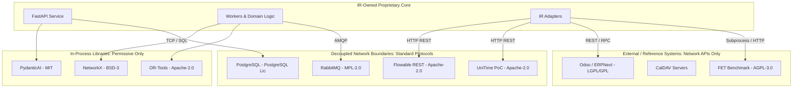

# Open-Source Licensing, Distribution and Compliance Register

---

## 1. Purpose and Boundary

This document establishes the formal **Technical Open-Source Software (OSS) Compliance and Distribution Register** for the **IR Infotech E-7 Operations Engine**.

### 1.1 Technical Governance vs. Legal Advice
* **Disclaimer**: This document represents a **technical licensing and architectural isolation screen** based on the findings in the authoritative *Open-Source Research Report*. **It does NOT constitute formal legal advice.**
* **Mandatory Legal Review**: Final commercial packaging, software distribution, customer contract terms, and whitelabeling decisions requiring statutory legal interpretation must be reviewed and approved by authorized IR Infotech legal counsel.

### 1.2 Multi-Dimensional Usage Boundaries
Open-source compliance obligations do not apply uniformly. Obligations depend strictly on the **technical integration modality**:
1. **Library Import (In-Process)**: Statically or dynamically linked into Python/Node runtimes.
2. **Decoupled Service Boundary**: Deployed as an independent container communicating across standard network protocols (HTTP REST / AMQP).
3. **Frontend Bundle**: Compiled into JavaScript/CSS bundles distributed to client web browsers.
4. **Source Code Modification**: Modifying upstream source code vs. running upstream unmodified binary/container distributions.
5. **Direct Source Copying**: Copying lines, functions, or templates directly into proprietary files.
6. **External Reference / SaaS**: Interfacing with customer-hosted or third-party external platforms.
7. **Model Weights & Code**: Distinguishing open-weights neural network parameters from executable Python inference code.
8. **Benchmark / Research Only**: Software executed in isolated test harnesses solely to establish performance baselines.

---

## 2. Component Classification Model

To prevent license contamination and premature tool adoption, every third-party component evaluated for E-7 is assigned an explicit architectural classification:

| Classification | Direct Dependency? | Deployed Service? | Source Copied into Core? | Production Runtime? | Benchmark / Test Only? | External Integration Target? |
| :--- | :---: | :---: | :---: | :---: | :---: | :---: |
| **`PRIMARY` / `ADOPT`** | **Yes** (in designated phase) | **Yes** (if service) | **Prohibited** (Import only) | **Yes** | No | Optional |
| **`PRIMARY POC`** | **No** (during Phase 0) | **Yes** (in Phase 5) | **Strictly Prohibited** | **Conditional on PoC** | Yes | Optional |
| **`CONDITIONAL`** | **Blocked** (Needs ADR) | **Blocked** (Needs ADR) | **Strictly Prohibited** | **Blocked** | Optional | Optional |
| **`BENCHMARK / FALLBACK`**| **Strictly Prohibited** | **Isolated Wrapper Only** | **Strictly Prohibited** | **Prohibited** | **Yes** | No |
| **`REFERENCE / ADAPTER`** | **No** (Adapter only) | **External System** | **Strictly Prohibited** | **As External Host** | Optional | **Yes** |
| **`MODEL / WEIGHTS`** | **Via Provider Abstraction** | **Self-Hosted Container** | **Strictly Prohibited** | **Conditional on Eval**| Yes | Optional |
| **`REJECTED FOUNDATION`** | **Strictly Prohibited** | **Strictly Prohibited** | **Strictly Prohibited** | **Strictly Prohibited** | No | Optional (Customer ERP) |

### Non-Negotiable Classification Rules
* **`PRIMARY` / `ADOPT` does NOT mean unrestricted copying**: Permissive libraries must be consumed as versioned package dependencies, never pasted directly into proprietary repositories.
* **`REFERENCE` does NOT mean runtime dependency**: Reference architectures (e.g., OpenProject, Plane) are study subjects; their code must never be imported or bundled.
* **`CONDITIONAL` does NOT mean installed**: Gated technologies (Temporal, LangGraph, Valkey, Timefold, Kafka) must remain absent from dependencies until an accepted ADR justifies them.
* **`BENCHMARK` does NOT mean production**: Tools like FET are restricted to isolated evaluation benchmarks.
* **`REJECTED` means excluded from E-7 core**: Rejected systems (Camunda 8, n8n) must never become foundation runtimes.

---

## 3. Complete Open-Source Compliance Register

The following register audits all 30 evaluated third-party projects across the mandatory compliance and operational dimensions:

| Project | E-7 Classification | E-7 Role | License / Family | Source Repository / Official URL | Usage Mode | May Be Direct Runtime Dep? | May Be Deployed as Separate Service? | May Source Be Copied into Core? | Redistribution / Attribution Concern | Special Condition | License / Compliance Risk (Authoritative Source) | Operational / Adoption Concern | Legal Review Required? | Phase First Considered | ADR Ref | Technical Compliance Notes |
| :--- | :--- | :--- | :--- | :--- | :--- | :---: | :---: | :---: | :--- | :--- | :--- | :--- | :---: | :---: | :---: | :--- |
| **FastAPI** | PRIMARY / ADOPT | Core API framework & OpenAPI transport | Verify from official LICENSE before adoption | `https://github.com/fastapi/fastapi` | Python Library | **Yes** | Yes (in `api`) | **Prohibited** (Import) | Pending official license verification | Standard Python web framework | **Not classified by current source set** | Core canonical API transport; low operational complexity | Standard Review | Phase 1 | ADR-000 | Architectural selection confirmed in report Section 11; exact license not stated in report. |
| **PydanticAI** | PRIMARY / ADOPT | Task Intelligence orchestration for MVP | MIT | `https://github.com/pydantic/pydantic-ai` | Python Library | **Yes** (Phase 2) | Yes (in worker) | **Prohibited** (Import) | Retain MIT copyright notice | Model provider must remain pluggable | **LOW** | Initial Task Intelligence planner; provider flexibility; validation-driven repair | No | Phase 2 | ADR-002 | Verified MIT from official upstream LICENSE. Provenance in `third_party/licenses/LICENSE.pydanticai.txt`. |
| **OpenAI Python SDK** | PRIMARY / ADOPT | OpenAI-compatible HTTP transport client | Apache-2.0 | `https://github.com/openai/openai-python` | Python Library | **Yes** (Phase 2) | No | **Prohibited** (Import) | Retain Apache-2.0 license & NOTICE file | Consumed by PydanticAI OpenAIProvider; neutral gateway transport | **LOW** | Underlying HTTP/streaming client for OpenAI-compatible providers | No | Phase 2 | ADR-002 | Verified Apache-2.0 from official upstream LICENSE. Provenance in `third_party/licenses/LICENSE.openai.txt`. |
| **NetworkX** | PRIMARY / ADOPT | Dependency DAG cycle detection & sorting | BSD-3-Clause | `https://github.com/networkx/networkx` | Python Library | **Yes** (Phase 2) | No | **Prohibited** (Import) | Retain 3-clause BSD notice & disclaimer | IR owns business CPM/slack math | **LOW** | In-process graph algorithms; low operational complexity | No | Phase 2 | ADR-000 | Explicitly documented as BSD-3-Clause and Low risk in report Section 9 matrix. |
| **Flowable Engine** | PRIMARY / ADOPT | Primary BPMN 2.0 & DMN 1.3 workflow runtime | Apache-2.0 | `https://github.com/flowable/flowable-engine` | Service Container | **No** (REST Client) | **Yes** (`flowable-rest`) | **Strictly Prohibited** | Include Apache-2.0 license & NOTICE file | Must reside behind IR workflow adapter | **LOW** | Java service sidecar; REST/AMQP decoupling; strong fit for embedded commercial use | Standard Review | Phase 3 | ADR-001 | Explicitly documented as Apache-2.0 and Low risk. Pinned image `flowable/flowable-rest:7.0.0`. Provenance in `third_party/licenses/LICENSE.flowable.txt`. |
| **bpmn-js** | PRIMARY / ADOPT | Visual BPMN 2.0 diagram canvas modeler | bpmn.io License | `https://github.com/bpmn-io/bpmn-js` | Frontend NPM Bundle | **Yes** (in UI) | No (Browser) | **Strictly Prohibited** | **Mandatory visible `bpmn.io` logo watermark** | Must NOT hide, crop, or obscure watermark | **MEDIUM** | Canvas embedding in authoring UI; requires visual regression check | **Yes** | Phase 3 | ADR-009 | Part of bpmn.io toolkits family documented as Medium risk. Provenance in `third_party/licenses/LICENSE.bpmnjs.txt`. |
| **dmn-js** | PRIMARY / ADOPT | Visual DMN 1.3 decision table editor | bpmn.io License | `https://github.com/bpmn-io/dmn-js` | Frontend NPM Bundle | **Yes** (in UI) | No (Browser) | **Strictly Prohibited** | **Mandatory visible `bpmn.io` logo watermark** | Must NOT hide, crop, or obscure watermark | **MEDIUM** | Decision table authoring canvas; requires visual regression check | **Yes** | Phase 3 | ADR-009 | Part of bpmn.io toolkits family documented as Medium risk. Provenance in `third_party/licenses/LICENSE.dmnjs.txt`. |
| **form-js** | PRIMARY / ADOPT | Visual form schema builder & renderer | bpmn.io License | `https://github.com/bpmn-io/form-js` | Frontend NPM Bundle | **Yes** (in UI) | No (Browser) | **Strictly Prohibited** | Retain bpmn.io attribution notices | Embedded form renderer for human tasks | **MEDIUM** | Human task form rendering; frontend bundle integration | **Yes** | Phase 3 | ADR-009 | Treated under bpmn.io toolkits family. Provenance in `third_party/licenses/LICENSE.formjs.txt`. |
| **lucide-react** | PRIMARY / ADOPT | Clean UI icons for Operations UI | ISC | `https://github.com/lucide-icons/lucide` | Frontend NPM Bundle | **Yes** (in UI) | No (Browser) | **Strictly Prohibited** | Retain ISC copyright notice | Modern UI icon components | **LOW** | Direct frontend dependency; standard permissive ISC license | No | Phase 3 | ADR-009 | Verified ISC from upstream repo. Provenance in `third_party/licenses/LICENSE.lucide-react.txt`. |
| **Google OR-Tools** | PRIMARY / ADOPT | Primary general constraint solver (CP-SAT) | Apache-2.0 | `https://github.com/google/or-tools` | Python Library | **Yes** (Phase 4) | Yes (in worker) | **Strictly Prohibited** | Retain Apache-2.0 notices | Primary general solver, not exclusive | **LOW** | In-worker solver execution; hard/soft constraint formulation | No | Phase 4 | ADR-003 | Explicitly documented as Apache-2.0 and Low risk in report Section 9 matrix. Provenance in `third_party/licenses/LICENSE.ortools.txt`. |
| **UniTime** | PRIMARY POC / REFERENCE ADAPTER | Specialized academic timetabling PoC & reference adapter | Apache-2.0 | `https://github.com/UniTime/unitime` | Service Container / Subprocess | **No** (Adapter only) | **Yes** (PoC / Reference only) | **Strictly Prohibited** | Retain Apache-2.0 notice | Phase-5 comparative benchmark & reference adapter; OR-Tools native chosen for production | **LOW** | Java runtime & service footprint; dual-solver maintenance overhead | Yes (Notices verified) | Phase 5 | ADR-003, ADR-010 | Verified Apache-2.0 from official upstream LICENSE (v4.9.152, CPSolver 1.4.94). Provenance in `third_party/licenses/LICENSE.unitime.txt`. |
| **PostgreSQL** | PRIMARY / ADOPT | Single canonical transactional system of record | PostgreSQL License | `https://github.com/postgres/postgres` | Service Container | **No** (DB Driver) | **Yes** (`postgres:16`) | **Strictly Prohibited** | Retain copyright notice in binary distribution | Canonical persistence for all domain data & outbox | **LOW** | Primary database operations, migrations, connection pool | No | Phase 1 | ADR-006 | Explicitly documented as PostgreSQL License and Low risk in report Section 9 matrix. |
| **RabbitMQ** | PRIMARY / ADOPT | Initial message broker & task queues | MPL-2.0 | `https://github.com/rabbitmq/rabbitmq-server` | Service Container | **No** (AMQP Client) | **Yes** (`rabbitmq:3`) | **Strictly Prohibited** | File-level copyleft; keep MPL notice | Operated as unmodified service container behind AMQP | **LOW/MEDIUM** | Broker operations, queue clustering, consumer dead-lettering | Standard Review | Phase 1 | ADR-005 | Explicitly documented as MPL-2.0 and Low/Medium risk in report Section 9 matrix. |
| **OpenTelemetry Python API / SDK** | PRIMARY / ADOPT | Core telemetry API & SDK in-process runtime | Apache-2.0 | `https://github.com/open-telemetry/opentelemetry-python` | Python Library | **Yes** (Phase 1 / Task 1K) | No | **Prohibited** (Import) | Retain Apache-2.0 license & NOTICE file | Programmatic initialization only; no CLI magic | **LOW** | Telemetry overhead, buffer memory, export timeout | No | Phase 1 | ADR-000 | Verified Apache-2.0 from official upstream LICENSE in Task 1K.1. Provenance in `third_party/licenses/LICENSE.opentelemetry.txt`. |
| **OpenTelemetry Python Contrib Instrumentation** | PRIMARY / ADOPT | FastAPI & SQLAlchemy instrumentation | Apache-2.0 | `https://github.com/open-telemetry/opentelemetry-python-contrib` | Python Library | **Yes** (Phase 1 / Task 1K) | No | **Prohibited** (Import) | Retain Apache-2.0 license & NOTICE file | Programmatic lifecycle hook; DB instrumentation deferred pending privacy validation | **LOW** | Span overhead; query privacy boundary | No | Phase 1 | ADR-000 | Verified Apache-2.0 from official upstream LICENSE in Task 1K.1. Provenance in `third_party/licenses/LICENSE.opentelemetry.txt`. |
| **OpenTelemetry OTLP HTTP Exporter** | PRIMARY / ADOPT | HTTP/protobuf telemetry export to Collector | Apache-2.0 | `https://github.com/open-telemetry/opentelemetry-python` | Python Library | **Yes** (Phase 1 / Task 1K) | No | **Prohibited** (Import) | Retain Apache-2.0 license & NOTICE file | OTLP/HTTP protobuf export; non-blocking retry/drop on collector outage | **LOW** | Network exporter socket handling, buffer saturation | No | Phase 1 | ADR-000 | Verified Apache-2.0 from official upstream LICENSE in Task 1K.1. Provenance in `third_party/licenses/LICENSE.opentelemetry.txt`. |
| **OpenTelemetry Collector / Collector Contrib** | PRIMARY / ADOPT | Telemetry aggregation & Prometheus metric exporter | Apache-2.0 | `https://github.com/open-telemetry/opentelemetry-collector-contrib` | Service Container | **No** | **Yes** (`observability` profile) | **Strictly Prohibited** | Include Apache-2.0 license & NOTICE file | Deployed as standalone container; receives OTLP/HTTP, exposes Prometheus metrics | **LOW** | Collector routing, container memory limits | Standard Review | Phase 1 | ADR-000 | Verified Apache-2.0 from official upstream LICENSE in Task 1K.1. Standalone container boundary. |
| **Prometheus** | PRIMARY / ADOPT | Metrics collection & time-series storage | Apache-2.0 | `https://github.com/prometheus/prometheus` | Service Container | **No** | **Yes** (`observability` profile) | **Strictly Prohibited** | Include Apache-2.0 license & NOTICE file | Scrapes Collector metrics endpoint (:8889); no Grafana in Phase 1 | **LOW** | Time-series storage retention, volume management | Standard Review | Phase 1 | ADR-000 | Verified Apache-2.0 from official upstream LICENSE in Task 1K.1. Provenance in `third_party/licenses/LICENSE.prometheus.txt`. |
| **Grafana** | PRIMARY / ADOPT | Operational dashboard & telemetry visualization | Verify from official LICENSE before adoption | `https://github.com/grafana/grafana` | Standalone App | **Strictly Prohibited** | **Yes** (External App) | **Strictly Prohibited** | Pending official license verification | Strictly unmodified external standalone service | **Not classified by current source set** | Dashboard configuration, external port exposure, auth integration | **Yes** | Phase 7 | ADR-000 | Architectural selection confirmed in report Section 11; exact license not stated in report. |
| **Temporal** | CONDITIONAL | Durable code-first background workflows | MIT | `https://github.com/temporalio/temporal` | Service + SDK | **Blocked** (Needs ADR) | **Blocked** (Needs ADR) | **Strictly Prohibited** | Retain MIT copyright notice | Gated; not part of initial MVP | **LOW** | Adds temporal server cluster and history service operational overhead | No | Phase 10 | ADR-001 | Explicitly documented as MIT and Low risk in report Section 9 matrix. |
| **LangGraph** | CONDITIONAL | Persistent multi-agent planning graphs | MIT | `https://github.com/langchain-ai/langgraph` | Python Library | **Blocked** (Needs ADR) | No | **Strictly Prohibited** | Distinguish open-source core from SaaS | Gated; PydanticAI used for MVP | **LOW** | Multi-agent graph state persistence and checkpointing overhead | No | Phase 10 | ADR-002 | Explicitly documented as MIT and Low risk in report Section 9 matrix. |
| **Timefold Community** | CONDITIONAL | Advanced Java/Kotlin employee rostering | Apache-2.0 (Community) | `https://github.com/TimefoldAI/timefold-solver` | Java Service | **Blocked** (Needs ADR) | **Blocked** (Needs ADR) | **Strictly Prohibited** | Community is Apache-2.0; Enterprise separate | Gated; OR-Tools is primary | **LOW** | Cross-runtime Java integration complexity; enterprise vs community tier split | **Yes** (Tier split) | Phase 10 | ADR-003 | Explicitly documented as Apache-2.0 and Low risk in report Section 9 matrix. |
| **Valkey** | CONDITIONAL | In-memory distributed caching & locking | BSD-3-Clause | `https://github.com/valkey-io/valkey` | Service Container | **Blocked** (Needs ADR) | **Blocked** (Needs ADR) | **Strictly Prohibited** | Retain BSD-3-Clause notice | Gated; PostgreSQL advisory locks first | **LOW** | Additional cache/coordination infrastructure component | No | Phase 10 | ADR-007 | Explicitly documented as BSD-3-Clause and Low risk in report Section 9 matrix. |
| **Apache Kafka** | CONDITIONAL | High-throughput distributed event streaming | Apache-2.0 | `https://github.com/apache/kafka` | Service Cluster | **Blocked** (Needs ADR) | **Blocked** (Needs ADR) | **Strictly Prohibited** | Retain Apache-2.0 notice | Gated; RabbitMQ is initial broker | **Not classified in Section 9 matrix (Source Section 5 notes Apache-2.0)** | High operational complexity, partition management, retention, and cluster overhead | No | Phase 10 | ADR-005 | Conditional event-streaming alternative; Section 5 notes Apache-2.0. |
| **Operaton** | CONDITIONAL | Fallback BPMN 2.0 workflow runtime | Apache-2.0 | `https://github.com/operaton/operaton` | Service Container | **Blocked** (Fallback) | **Blocked** (Fallback) | **Strictly Prohibited** | Retain Apache-2.0 notice | Contingency fallback if Flowable blocked | **Not classified in Section 9 matrix (Source Section 4.5 notes Apache-2.0)** | Community fork of Camunda 7; secondary workflow engine candidate | Standard Review | Fallback | ADR-001 | Contingency alternative; Section 4.5 notes Apache-2.0. |
| **FET** | BENCHMARK / FALLBACK| Educational timetabling benchmark reference | AGPL-3.0 | `https://lalescu.ro/liviu/fet/download.html` | CLI / Container | **Strictly Prohibited** | **Isolated Wrapper Only (Conditional)** | **Strictly Prohibited** | AGPL-3.0 network copyleft | Legal gate check required before run; not run when legal gate unapproved | **HIGH if embedded/distributed** | AGPL-3.0 legal review not approved for Phase-5 execution; skipped without embedding | **MANDATORY** | Phase 5 | ADR-003, ADR-010 | Legal gate status: FET_BENCHMARK_STATUS = NOT_RUN_LEGAL_GATE_NOT_APPROVED. Excluded from production images and dependencies. |
| **OpenProject** | REFERENCE / ADAPTER | Reference for WBS data models & hierarchies | GPL-3.0 | `https://github.com/opf/openproject` | External App | **Strictly Prohibited** | External System | **Strictly Prohibited** | GPL-3.0 copyleft | Clean-room implementation only | **MEDIUM** | External REST API integration; conceptual reference only | No (Study only) | Phase 0 | ADR-000 | Explicitly documented as GPL-3.0 and Medium risk in report Section 9 matrix. |
| **LibrePlan** | REFERENCE / ADAPTER | Reference for project resource allocation | AGPL-3.0 | `https://github.com/LibrePlan/libreplan` | External App | **Strictly Prohibited** | External System | **Strictly Prohibited** | AGPL-3.0 copyleft | Clean-room study only | **HIGH if embedded/modified** | Prefer study/reference unless legal strategy supports AGPL | **MANDATORY** | Phase 0 | ADR-000 | Explicitly documented as AGPL-3.0 and High risk if embedded/modified in report Section 9 matrix. |
| **Plane** | REFERENCE / ADAPTER | UI/UX reference for modern task boards | AGPL-3.0 | `https://github.com/makeplane/plane` | External App | **Strictly Prohibited** | External System | **Strictly Prohibited** | AGPL-3.0 copyleft | Clean-room frontend implementation | **HIGH if embedded/modified** | Reference/integration rather than core; clean-room UI only | No (Clean-room) | Phase 0 | ADR-000 | Explicitly documented as AGPL-3.0 and High risk if embedded/modified in report Section 9 matrix. |
| **Odoo Community** | REFERENCE / ADAPTER | External ERP integration adapter target | LGPL-3+ / mixed modules | `https://github.com/odoo/odoo` | External System | **Strictly Prohibited** | External System | **Strictly Prohibited** | Inspect licensing of each module used | Network REST/JSON-RPC boundary only | **MEDIUM** | Module-specific mixed licensing requires per-module inspection | **Yes** | Phase 7 | ADR-000 | Explicitly documented as LGPL-3+ / mixed modules and Medium risk in report Section 9 matrix. |
| **ERPNext** | REFERENCE / ADAPTER | External open-source ERP integration target | GPL-3.0 | `https://github.com/frappe/erpnext` | External System | **Strictly Prohibited** | External System | **Strictly Prohibited** | GPL-3.0 copyleft | Clean REST API consumer boundary | **MEDIUM** | External ERP integration target; network API boundary | No (API only) | Phase 7 | ADR-000 | Explicitly documented as GPL-3.0 and Medium risk in report Section 9 matrix. |
| **Sarvam-105B** | MODEL / WEIGHTS | Candidate open-weights planning model | Apache-2.0 model repository | `https://huggingface.co/sarvamai/sarvam-105b` | Model Weights | **Via Provider Abstraction** | Yes (vLLM container) | **Strictly Prohibited** | Distinguish weights from hosted API terms | Benchmark first; provider remains pluggable | **LOW** (License Risk) | **HIGH infra** (Deployment footprint must be benchmarked; high GPU memory and compute requirements) | **Yes** | Phase 2 | ADR-008 | Explicitly documented as Apache-2.0 model repository and Low license / High infra in report Section 9 matrix. |
| **Camunda 8** | REJECTED FOUNDATION | Workflow runtime (Evaluated & Rejected) | Camunda License / mixed | `https://github.com/camunda/camunda` | REJECTED | **Strictly Prohibited** | **Strictly Prohibited** | **Strictly Prohibited** | Camunda License / mixed | Rejected as E-7 foundation | **HIGH (Rejected Foundation)** | Technologically capable, but key core components under Camunda License rather than uniformly permissive OSS; creates avoidable production licensing dependency; rejected as foundation | N/A | Phase 0 | ADR-001 | Explicitly documented as Camunda License / mixed and High risk (Rejected) in report Section 9 matrix and Section 6. |
| **n8n** | REJECTED FOUNDATION | Automation engine (Evaluated & Rejected) | Sustainable Use + Enterprise | `https://github.com/n8n-io/n8n` | REJECTED | **Strictly Prohibited** | **Strictly Prohibited** | **Strictly Prohibited** | Sustainable Use + Enterprise | Rejected as E-7 foundation | **HIGH (Rejected Foundation)** | Source-available under Sustainable Use License; commercial-use restrictions; poor fit as embedded commercial E-7 product; rejected as foundation | N/A | Phase 0 | ADR-000 | Explicitly documented as Sustainable Use + Enterprise and High risk (Rejected) in report Section 9 matrix and Section 6. |

---

## 4. Required Known License Mappings

The technical licensing screen codified in the *Open-Source Research Report* establishes the following baseline facts:

* **Flowable Engine**: Licensed under **Apache-2.0**. Screened as **Low** technical licensing risk. Strong fit for embedded commercial use. Suitable for primary workflow execution behind an adapter.
* **Google OR-Tools**: Licensed under **Apache-2.0**. Screened as **Low** risk. Permissive general solver.
* **UniTime**: Core code is **Apache-2.0**. Screened as **Low** risk; permissive. Third-party notice inspection required to verify all bundled Java libraries before production adoption.
* **PydanticAI**: Licensed under **MIT**. Screened as **Low** risk; permissive. Retain MIT copyright notice.
* **NetworkX**: Licensed under **BSD-3-Clause**. Screened as **Low** risk; permissive. Retain 3-clause BSD notice and disclaimer.
* **Temporal**: Licensed under **MIT**. Screened as **Low** risk; permissive, but gated as conditional to avoid unnecessary operational overhead.
* **Timefold Community**: Core solver is **Apache-2.0**. Screened as **Low** risk; community edition is permissive; enterprise edition features are separate.
* **LangGraph**: Core library is **MIT**. Screened as **Low** risk; open-source framework; commercial LangSmith cloud telemetry services are separate.
* **bpmn.io toolkits (bpmn-js, dmn-js, form-js)**: Licensed under the **bpmn.io toolkit license**. Screened as **Medium** risk. Permissive-style, but watermark source must remain and **watermark must stay visible**. Hiding, cropping, or removing it violates license terms.
* **RabbitMQ**: Licensed under **MPL-2.0**. Screened as **Low/Medium** risk. File-level copyleft applies if modifying broker source files. Operating unmodified official containers behind network sockets presents low technical risk.
* **PostgreSQL**: Licensed under the **PostgreSQL License** (permissive BSD/MIT-style). Screened as **Low** risk.
* **Valkey**: Licensed under **BSD-3-Clause**. Screened as **Low** risk; permissive; optional/conditional.
* **OpenProject**: Licensed under **GPL-3.0**. Screened as **Medium** risk. Good external integration/reference; avoid copying code into proprietary core.
* **ERPNext**: Licensed under **GPL-3.0**. Screened as **Medium** risk. Treat as external system/integration target across REST boundaries.
* **Odoo Community**: Core and modules governed by **LGPL-3+ / mixed modules**. Screened as **Medium** risk. Technical compliance requires checking the license of each module used.
* **LibrePlan**: Licensed under **AGPL-3.0**. Screened as **High if embedded/modified**. Prefer study/reference unless legal strategy explicitly supports AGPL.
* **Plane**: Licensed under **AGPL-3.0**. Screened as **High if embedded/modified**. Reference/integration rather than core. Clean-room implementation required.
* **FET**: Licensed under **AGPL-3.0**. Screened as **High if embedded/distributed**. Benchmark and fallback only. Use service boundary/benchmark; mandatory legal review before any embedding or distribution.
* **Sarvam-105B**: The model repository on Hugging Face declares **Apache-2.0 model repository**. Screened as **Low license / High infra**. License friendly; deployment footprint must be benchmarked. Model weights licensing must be distinguished from hosted API terms of service.
* **Camunda 8 core**: Governed by the **Camunda License / mixed**. Screened as **High** risk. Technologically capable, but key core components are under the Camunda License rather than uniformly permissive OSS. This creates an avoidable production licensing dependency for IR's open-source-first engine strategy; rejected as foundation.
* **OpenTelemetry Python API/SDK, Contrib Instrumentation, OTLP Exporter, and Collector**: Licensed under **Apache-2.0**. Screened as **Low** risk; permissive open-source telemetry foundation. Officially verified in Task 1K.1 from upstream repositories (`open-telemetry/opentelemetry-python`, `open-telemetry/opentelemetry-python-contrib`, `open-telemetry/opentelemetry-collector-contrib`). Provenance recorded in `third_party/licenses/LICENSE.opentelemetry.txt`.
* **Prometheus**: Licensed under **Apache-2.0**. Screened as **Low** risk; operates as separate service container (`prom/prometheus`) scraping Collector metrics endpoint. Officially verified in Task 1K.1 from upstream repository (`prometheus/prometheus`). Provenance recorded in `third_party/licenses/LICENSE.prometheus.txt`. Strictly no Grafana adoption in Phase 1.
* **Remaining Source Gaps (FastAPI, Pydantic, Grafana)**: Architectural roles are confirmed by Section 11 of the research report, but exact software licenses were not established in the research report. They are marked **"Verify from official LICENSE before adoption"** and **"Not classified by current source set"** pending official verification. (OpenTelemetry and Prometheus resolved in Task 1K.1).

---

## 5. Code-Copying Policy & Clean-Room Standard

### 5.1 Strict Anti-Contamination Mandate
IR-owned proprietary and core E-7 code must **NEVER** directly copy, adapt, or incorporate source code, templates, or shaders from:
* **AGPL-3.0** projects (FET, LibrePlan, Plane).
* **GPL-3.0** projects (OpenProject, ERPNext).
* **Source-Available / Non-Commercial** repositories (Camunda 8, n8n).
* Any third-party repository whose licensing terms are unverified.

### 5.2 Permitted Clean-Room Reference Behaviors
Developers and AI agents are permitted to:
* Study public documentation, architecture patterns, and domain concepts.
* Inspect public API payloads and webhook event structures for integration compatibility.
* Analyze standard database entity relationships conceptually (e.g., how OpenProject structures work packages).
* Implement clean-room Python and TypeScript models from first principles according to the E-7 specification.
* Connect to third-party tools exclusively across documented network APIs (HTTP, REST, JSON-RPC, CalDAV).

---

## 6. Service Boundary vs. Library Boundary



### 6.1 Technical Isolation vs. Legal Exemption
* **Technical Fact**: Operating third-party software as a decoupled container communicating via HTTP REST, SQL, or AMQP creates a technical isolation boundary that prevents static/dynamic linking at the compiler/interpreter level.
* **Governance Rule**: Decoupling via a service boundary does **NOT** automatically grant a legal exemption from copyleft obligations (particularly AGPL network-use provisions). It is an architectural defense-in-depth measure that must be paired with clean-room coding and legal review.

---

## 7. Notice and Attribution Strategy

To ensure compliance upon distribution or commercial deployment, the repository build system will enforce a formal attribution structure:

```
operations-engine/
├── LICENSES.md                  # High-level governance pointer & manifest
└── third_party/
    ├── NOTICE.md                # Consolidated attribution notices for all locked deps
    └── licenses/                # Raw license text files for third-party packages
        ├── LICENSE.fastapi.txt
        ├── LICENSE.pydantic.txt
        ├── LICENSE.flowable.txt
        ├── LICENSE.ortools.txt
        └── LICENSE.bpmn-js.txt
```

### Build & Release Manifest Requirements
Before any release candidate is published, the build pipeline must record:
1. Exact package name and locked semantic version.
2. SPDX license identifier.
3. Upstream source code repository URL.
4. Exact copyright notice text extracted from the upstream package.
5. Confirmation of unmodified binary/wheel consumption.
6. Transitive license manifest generated via automated software composition analysis (SCA).

The current `LICENSES.md` file remains a lightweight governance pointer until dependencies are formally adopted and locked phase-by-phase.

---

## 8. Frontend License Controls (bpmn.io Ecosystem)

Embedded authoring toolkits (`bpmn-js`, `dmn-js`, `form-js`) require strict frontend governance:

1. **Mandatory Watermark Preservation**: The `bpmn.io` logo watermark in the bottom-right corner of the modeler canvas must remain visible, unobstructed, and un-cropped.
2. **Prohibited Actions**:
   * Hiding the logo via CSS (`display: none;`, `visibility: hidden;`, `opacity: 0;`).
   * Positioning UI overlays, toolbars, or modal dialogs directly on top of the logo.
   * Cropping out the watermark via canvas viewBox clipping or negative margins.
   * Modifying `bpmn-js` source code or webpack/vite bundles to strip the logo SVG.
   * Any branding or white-labeling change affecting license requirements requires explicit review.
3. **Automated Acceptance Check**: Frontend end-to-end visual regression tests (`tests/e2e/ui/test_bpmn_canvas.py`) must assert that the canvas element contains the visible `.bjs-powered-by` link and SVG.
   * **Mandatory Acceptance Check Criterion**: *"Workflow authoring UI visibly complies with bpmn.io licensing conditions."*

---

## 9. Model Licensing & Hosted Endpoint Controls

Neural network weights and generative AI models follow distinct legal terms from traditional software libraries:

### 9.1 Model Governance Inventory Attributes
Every model evaluated or integrated for Task Intelligence must record:
* **Model Name & Version**: (e.g., `Sarvam-105B`, revision hash).
* **Weights License**: (e.g., Apache-2.0 model repository on Hugging Face).
* **Inference Code License**: (e.g., custom modeling code vs. standard Hugging Face Transformers).
* **Deployment Mode**: Self-hosted container (vLLM) vs. third-party hosted API.
* **Hosted API Terms**: Commercial use rights, data logging, training retention, SLA guarantees.
* **Acceptable Use Policy (AUP)**: Prohibited domains or safety restrictions.
* **Evaluation Status**: Benchmark candidate vs. production-approved route.

### 9.2 Current Status
* **Sarvam-105B**: Candidate for Phase-2 benchmarking. Model repository declares Apache-2.0. Production adoption depends on Phase-2 quality and inference cost evaluation. License risk is **Low**, while infrastructure risk is **High**. No assumption is made that hosted API terms equal model repository license.
* **No Hardcoded Providers**: No cloud API provider (OpenAI, Anthropic, Gemini, DeepSeek, Qwen) is recorded as a permanent production dependency. The actual runtime provider must remain configurable behind the provider abstraction.

---

## 10. Transitive Dependency Governance

A top-level permissive library can introduce non-permissive or copyleft transitive dependencies. 

### Future CI/CD Pipeline Gates (Phase 1 & Phase 8)
1. **Lockfile Enforcement**: All direct and transitive Python (`poetry.lock` / `requirements.txt`) and Node (`package-lock.json`) dependencies must be pinned to exact hashes.
2. **Software Bill of Materials (SBOM)**: Automatically generated in CycloneDX or SPDX format during build.
3. **Automated License Scanner**: CI builds must fail if a newly introduced transitive package carries an unapproved license (GPL, AGPL, SSPL, or Unknown).
4. **License Whitelist**: `MIT`, `Apache-2.0`, `BSD-2-Clause`, `BSD-3-Clause`, `PostgreSQL`, `ISC`, `Python-2.0`.

---

## 11. Technical Risk Tiers & Authoritative License-Risk Matrix

The technical licensing risk classifications codified in Section 9 of the authoritative *Open-Source Research Report* are preserved verbatim. Operational complexity is maintained strictly as a separate dimension:

| Authoritative Licensing Risk Tier | Definition | Assigned Technologies (Source Matrix Section 9) | Technical Mitigation / Licensing Policy |
| :--- | :--- | :--- | :--- |
| **`LOW`** | Permissive open-source software with minimal attribution obligations. | Flowable (Apache-2.0), Google OR-Tools (Apache-2.0), UniTime (Apache-2.0), PydanticAI (MIT), NetworkX (BSD-3-Clause), Temporal (MIT), Timefold Community (Apache-2.0), LangGraph (MIT), PostgreSQL (PostgreSQL License), Valkey (BSD-3-Clause), Sarvam-105B (Apache-2.0 model repo — license dimension), OpenTelemetry Python API/SDK/Contrib/Collector (Apache-2.0 — verified Task 1K.1), Prometheus (Apache-2.0 — verified Task 1K.1). | Standard attribution notices; import as versioned package dependencies; operate unmodified official containers. |
| **`LOW/MEDIUM`** | Permissive or weak copyleft software with file-level copyleft provisions. | RabbitMQ (MPL-2.0). | Run RabbitMQ as unmodified service container behind network socket; keep MPL notice if broker source files modified. |
| **`MEDIUM`** | Permissive toolkits with special attribution conditions, or external copyleft integrations. | bpmn.io toolkits (bpmn-js, dmn-js, form-js), OpenProject (GPL-3.0), ERPNext (GPL-3.0), Odoo Community (LGPL-3+ / mixed modules). | Preserve visible bpmn.io watermarks; enforce strict network API boundary for ERPs; verify each Odoo module license. |
| **`HIGH`** | Strong copyleft (AGPL-3.0) or source-available software with commercial restrictions. | LibrePlan (AGPL-3.0 — High if embedded/modified), Plane (AGPL-3.0 — High if embedded/modified), FET (AGPL-3.0 — High if embedded/distributed), Camunda 8 core (Camunda License / mixed — Rejected foundation), n8n (Sustainable Use + Enterprise — Rejected foundation). | Strictly clean-room for Plane/LibrePlan; FET restricted to benchmark wrapper; mandatory legal review before distribution. Camunda 8 and n8n rejected as E-7 foundation. |
| **`Not classified by current source set`** | Architectural selection source-supported, but exact license not established by research report. | FastAPI, Pydantic, Grafana. | Verification from official repository `LICENSE` file required before adoption. (OpenTelemetry and Prometheus verified in Task 1K.1). |

### Operational / Adoption Considerations (Maintained Separately from Licensing Risk)
* **Apache Kafka**: High cluster, partition management, retention, and ZooKeeper/KRaft operational complexity.
* **Timefold Community**: Cross-runtime Java integration complexity and enterprise vs. community tier split.
* **Sarvam-105B**: High infrastructure footprint (high GPU VRAM and compute requirements).
* **Temporal**: Operational overhead of running dedicated temporal server clusters and persistence stores.

---

## 12. Component Approval & Gating Matrix

| Component | Current State | May Install Now? | Required Phase / Gate | Required Review Before Production | Evidence Required for Production Approval |
| :--- | :--- | :---: | :---: | :--- | :--- |
| **Flowable** | Accepted architecture | Do not install during Phase 0 | Phase 3 | License notice + integration validation | License notice file + REST adapter contract verification |
| **OR-Tools** | Accepted architecture | Do not install during Phase 0 | Phase 4 | locked dependency + license record | Locked dependency + hard-constraint benchmark test suite |
| **PydanticAI** | Accepted architecture | Do not install during Phase 0 | Phase 2 | benchmark + license record | Model benchmark report + schema validation accuracy >= 95% |
| **UniTime** | Accepted Reference Adapter | PoC completed; reference adapter | Phase 5 | PoC evidence + notices + operational decision | Completed Phase-5 PoC (ADR-010). Evaluated against OR-Tools; retained as reference adapter. |
| **FET** | Benchmark only (unapproved) | Not run (Legal gate not approved) | Phase 5 benchmark | legal/license review before any embedding/distribution | FET_BENCHMARK_STATUS = NOT_RUN_LEGAL_GATE_NOT_APPROVED. Excluded from runtime & containers. |
| **bpmn-js / dmn-js** | Accepted architecture | Do not install during Phase 0 | Phase 3 | Branding / License review | Automated visual regression test verifying visible canvas watermark |
| **Temporal** | Conditional | No | Future ADR Gate | Technical Architecture Review | Proof of Flowable service task limitations under real workflows |
| **LangGraph** | Conditional | No | Future ADR Gate | Technical Architecture Review | Proof of single-agent planning failure for multi-tier goals |
| **Valkey** | Conditional | No | Future ADR Gate | Technical Architecture Review | Benchmark proving PostgreSQL connection/lock contention under load |
| **Timefold** | Conditional | No | Future ADR Gate | Technical Architecture Review | Proof of OR-Tools constraint modeling limitations on rostering datasets |
| **Kafka** | Conditional | No | Future ADR Gate | Platform Governance Review | Formal enterprise platform streaming mandate |

---

## 13. Current Repository Dependency Audit Cross-Reference

Cross-referencing [`docs/PHASE_0A_SCAFFOLD_AUDIT.md`](file:///F:/operations-engine/docs/PHASE_0A_SCAFFOLD_AUDIT.md):

* **Premature Packages in `pyproject.toml`**:
  * `pydantic-ai>=0.0.1` (Phase 2)
  * `networkx>=3.3` (Phase 2)
  * `ortools>=9.10.0` (Phase 4)
  * `deepeval>=1.0.0` (Phase 2 eval)
  * `locust>=2.31.0` (Phase 5 load testing)
* **Compliance Classification**: *present in pre-existing scaffold; sequencing remediation scheduled for Phase 1 bootstrap cleanup*.
* **Policy Reminder**: Do NOT modify `pyproject.toml` during Task 0D.1. The presence of these package names in the pre-existing `pyproject.toml` file does **NOT** constitute final approved version locking, production authorization, or distribution sign-off.

---

## 14. Rejected Foundation Register

The following technologies were evaluated in the authoritative research and formally rejected as foundations for E-7:

| Rejected Project | Evaluation Role | License Type | Reason for Rejection | Conditions for Reconsideration | Current Status |
| :--- | :--- | :--- | :--- | :--- | :---: |
| **Camunda 8** | Workflow Execution Core | Camunda License / mixed | Camunda 8 is technologically capable, but key core components are under the Camunda License rather than uniformly permissive OSS. This creates an avoidable production licensing dependency for IR's open-source-first engine strategy. | Upstream relicensing to a uniformly permissive OSI-approved license (Apache-2.0 / MIT), or an enterprise client providing a self-funded commercial license. | **REJECTED FOUNDATION** |
| **n8n** | Visual Automation Engine | Sustainable Use + Enterprise | n8n is source-available under the Sustainable Use License, which restricts use to internal business/non-commercial scenarios unless licensed. It is excellent automation software but a poor foundation for an embedded commercial E-7 product. | Upstream relicensing to an OSI-approved license, or strictly internal non-commercial tooling usage. | **REJECTED FOUNDATION** |

*(Note: This rejection applies to using these tools as the internal foundation of E-7. Connecting to external customer-owned Camunda 8 or n8n instances via API adapters remains permissible if requested).*

---

## 15. Release Compliance Checklist

This is future release governance only. Before any commercial/pilot distribution confirm:

* [ ] exact dependency versions locked
* [ ] SBOM generated
* [ ] approved-license scan passed
* [ ] unknown licenses resolved
* [ ] required license texts included
* [ ] required notices included
* [ ] bpmn.io attribution/watermark verified
* [ ] AGPL/GPL usage reviewed
* [ ] model license/hosted terms recorded
* [ ] modified third-party code identified
* [ ] frontend bundled dependencies reviewed
* [ ] container image dependencies reviewed
* [ ] third-party service images reviewed
* [ ] reference-product source not copied into IR core
* [ ] rejected-foundation packages absent
* [ ] conditional technologies have accepted ADR if present
* [ ] legal/authorized review completed where required

---

## 16. Technical Licensing Status Summary

### List A: Approved Architectural Components (Technically Screened as Low License Risk Under Current Research)
* **Flowable Engine** (Apache-2.0)
* **Google OR-Tools** (Apache-2.0)
* **UniTime** (Apache-2.0)
* **PydanticAI** (MIT)
* **NetworkX** (BSD-3-Clause)
* **PostgreSQL** (PostgreSQL License)
* **Temporal** (MIT — Conditional)
* **Timefold Community** (Apache-2.0 — Conditional)
* **LangGraph** (MIT — Conditional)
* **Valkey** (BSD-3-Clause — Conditional)
* **Sarvam-105B** (Apache-2.0 model repo — License dimension)
* **OpenTelemetry** (Apache-2.0 — verified Task 1K.1; Python API/SDK, Contrib, OTLP Exporter, Collector)
* **Prometheus** (Apache-2.0 — verified Task 1K.1; server container)

### List B: Components Requiring Special Handling / Review / Unclassified Source Gaps
* **bpmn-js / dmn-js / form-js** (bpmn.io License): Medium risk; requires preserving mandatory visible watermark/attribution on canvas; do not hide, crop, or obscure.
* **RabbitMQ** (MPL-2.0): Low/Medium risk; requires running as unmodified decoupled service container; file-level copyleft applies if broker code is modified.
* **UniTime** (Apache-2.0): Low risk; requires inspecting bundled third-party libraries before production adoption; Phase 5 PoC only.
* **OpenProject** (GPL-3.0) & **ERPNext** (GPL-3.0): Medium risk; reference and external integration only; clean REST boundary; do not copy code into proprietary core.
* **Odoo Community** (LGPL-3+ / Mixed): Medium risk; requires verifying licensing of individual modules integrated via adapter.
* **LibrePlan** (AGPL-3.0) & **Plane** (AGPL-3.0): High risk if embedded/modified; clean-room study only; no code copying permitted.
* **FET 7.10.5** (AGPL-3.0): High risk if embedded/distributed; benchmark/fallback only; any embedding, packaging, or distribution requires mandatory legal review.
* **Sarvam-105B**: High infrastructure footprint; requires distinguishing model weights license from hosted API service terms; benchmark candidate only.
* **Temporal / LangGraph / Timefold / Valkey / Kafka / Operaton**: Conditional technologies; blocked from installation until accepted ADR gate.
* **Remaining Source Gaps Requiring License Verification (FastAPI, Pydantic, Grafana)**: Architectural roles source-supported; exact license not established in research report; must verify from official LICENSE before adoption. (OpenTelemetry and Prometheus verified in Task 1K.1).

### List C: Formally Rejected Foundation Components
* **Camunda 8** (Camunda License / mixed): High risk in source matrix; formally rejected as E-7 foundation due to core components under Camunda License creating an avoidable production licensing dependency.
* **n8n** (Sustainable Use + Enterprise): High risk in source matrix; source-available under Sustainable Use License with commercial-use restrictions; poor fit as embedded E-7 product; rejected as foundation.

---

## 17. Source Gaps Requiring Official License Verification at Adoption Time

The authoritative *Open-Source Research Report* identifies the architectural roles for the following components in Section 11, but does not explicitly provide their exact software license or license-risk classification. Per source-fidelity governance, their licenses must NOT be filled from general knowledge and must be verified directly from official repository sources prior to adoption:

| Project | Architectural Role | Current Source Support | Missing Fact in Report | Verification Gate | Phase Before Adoption | Status / Resolution |
| :--- | :--- | :--- | :--- | :--- | :--- | :--- |
| **FastAPI** | Core API framework & OpenAPI transport | Report Section 11: recommended API/orchestration stack | Exact software license & license risk | Inspect official repo `LICENSE` file; record in `third_party/licenses/` | Phase 1 Bootstrap | Unresolved Source Gap |
| **Pydantic** | Core data validation & settings management | Report Section 11: recommended API/orchestration stack | Exact software license & license risk (distinct from PydanticAI) | Inspect official repo `LICENSE` file; record in `third_party/licenses/` | Phase 1 Bootstrap | Unresolved Source Gap |
| **OpenTelemetry** | Distributed tracing and telemetry standard | Report Section 11: recommended observability stack | Exact software license & license risk | Inspect official SDK and collector `LICENSE` files | Phase 1 (Task 1K) | **VERIFIED Apache-2.0** (Task 1K.1; see `third_party/licenses/LICENSE.opentelemetry.txt`) |
| **Prometheus** | Metrics collection & time-series storage | Report Section 11: recommended observability stack | Exact software license & license risk | Inspect official repo `LICENSE` file before container deployment | Phase 1 (Task 1K) | **VERIFIED Apache-2.0** (Task 1K.1; see `third_party/licenses/LICENSE.prometheus.txt`) |
| **Grafana** | Operational dashboard & telemetry visualization | Report Section 11: recommended observability stack | Exact software license & license risk | Inspect official distribution `LICENSE` file before deploying dashboard service | Phase 7 | Deferred to Phase 7 |

*Governance Rule: Do NOT fill these gaps during Phase 0. They are verified from official repositories at the actual adoption phase (as completed for OpenTelemetry and Prometheus in Task 1K.1) or through an explicitly authorized external-research update.*
