# IR Infotech E-7 Operations Engine — Chat History & State Retention Log

**Repository**: [`f:/operations-engine`](file:///f:/operations-engine)  
**Last Updated**: September 25, 2026 (22:12 local time)  
**Active Phase**: **Phase 1 — Foundation (Persistence & Core Infrastructure)**  
**Governance Status**: 🟢 **PASS** (Clean-Room Compliant, 153/153 Tests Passing, Zero Lint Errors, Zero Mypy Errors)  
**Last Completed Task**: **Task 1D — PostgreSQL / SQLAlchemy 2.0 Async / Alembic Persistence Foundation**  
**Immediate In-Queue Task**: **Task 1E — Unit of Work, Repository & Transaction Boundaries Foundation** (Unstarted)

---

## 1. Executive Summary & Purpose

This document serves as the permanent, authoritative on-disk record of all conversational sessions, task executions, architectural governance decisions, and milestone deliverables across the development lifecycle of the **IR Infotech E-7 Operations Engine**.

Whenever a new assistant conversation or development session begins, this document guarantees zero loss of historical context, governance invariants, or project momentum.

---

## 2. Chronological Conversation Lineage

The project context spans six recorded development sessions in the Antigravity IDE:

```mermaid
timeline
    title IR Infotech E-7 Operations Engine Development Timeline
    section Session 1 (Sept 16, 2026)
      Task 0A / 0A.1 : Source of Truth & Scaffold Audit
      Task 0B : Requirements Traceability Matrix (25 FRs)
      Task 0C : Architecture Decision Records (ADR 000-009)
      Task 0D / 0D.1 : OSS Compliance Register & Licenses
      Task 0E : Canonical Domain Ownership & Boundaries
      Task 0F.1 / 0F.1A / 0F.2A : Reference Scenarios & Resource Catalog
    section Session 2 (Sept 16, 2026)
      Task 0F.1B : Schedule State INFEASIBLE Lifecycle Correction
      Task 0F.2B - 0F.2F : Complete Benchmark Test Fixture Families
      Task 0C.1 : Solver Governance Guardrail Correction
      Task 0F.2G : Cross-Fixture Manifest & Audit Report
    section Session 3 (Sept 24-25, 2026)
      Task 0G.1 - 0G.2B : MySQL Schema Inventory & Task Intelligence Mapping
      Task 0G.3 - 0G.3B : AI Context Access Policy & Security Perimeter
      Task 0G.4 - 0G.5A : MySQL ERP Adapter & Context Builder Contracts
      Task 0G.6A - 0G.6B.2 : External Integrations & E-8 Contract Mock
      Task 0G.6C - 0G.7 : Provider Decisions & Integration Verification Audit
      Task 0H.1 - 0H.2 : SLO, Retention & First-Tenant Scale Baseline
    section Session 4 (Sept 25, 2026)
      Task 0I : Phase-0 Final Governance Exit-Gate Sign-off
      Task 1A / 1A.1 : Packaging, Python >=3.11, Tooling & CI Baseline
      Task 1B : Config, Structured Logging, Correlation & Health Endpoints
      Task 1C.1 : AuthenticatedPrincipal, TenantContext & RBAC Models
      Task 1C.2 / 1C.2A : Google OIDC Verification & JWKS Hardening
      Task 1C.3 / 1C.3A : Service API Key Verifier & Timing Attack Hardening
    section Session 5 (Sept 25, 2026)
      Audit Check : Cross-directory confusion isolated & halted with zero repo changes
    section Session 6 (Sept 25, 2026 - Current)
      Task 1D Execution : PostgreSQL / SQLAlchemy 2.0 Async / Alembic Persistence Foundation
      Codebase Audit : Verified 153/153 Tests Passing, Zero Ruff/Mypy Issues (68 source files)
      Progress Retention : Synchronized On-Disk State Logs & Aligned for Task 1E
```

---

## 3. Detailed Session-by-Session Task Breakdown

### Session 1: Foundation, Governance & Traceability
* **Session ID**: `20db34af-7c67-4828-a47c-f302a8aa43b7`
* **Date**: September 16, 2026
* **Key Deliverables**:
  1. **Task 0A & 0A.1 — Bootstrap & Read-Only Scaffold Audit**:
     - Established source-of-truth document precedence in [`docs/SOURCE_OF_TRUTH.md`](file:///f:/operations-engine/docs/SOURCE_OF_TRUTH.md) referencing authoritative PDFs in [`docs/source-of-truth/`](file:///f:/operations-engine/docs/source-of-truth/).
     - Generated [`docs/PHASE_0A_SCAFFOLD_AUDIT.md`](file:///f:/operations-engine/docs/PHASE_0A_SCAFFOLD_AUDIT.md).
  2. **Task 0B — Requirements Traceability Matrix (RTM)**:
     - Authored [`docs/REQUIREMENTS_TRACEABILITY_MATRIX.md`](file:///f:/operations-engine/docs/REQUIREMENTS_TRACEABILITY_MATRIX.md) covering all 25 functional requirements, 10 ADRs, constraints, and source documents.
  3. **Task 0C — Architecture Decision Records (ADRs)**:
     - Authored [`docs/adr/README.md`](file:///f:/operations-engine/docs/adr/README.md) and [`ADR-000`](file:///f:/operations-engine/docs/adr/ADR-000-source-of-truth-and-reconciliation.md) through [`ADR-009`](file:///f:/operations-engine/docs/adr/ADR-009-workflow-authoring-toolkit.md) freezing runtime technology decisions.
  4. **Task 0D & 0D.1 — Open-Source Compliance Register**:
     - Authored [`docs/OPEN_SOURCE_COMPLIANCE_REGISTER.md`](file:///f:/operations-engine/docs/OPEN_SOURCE_COMPLIANCE_REGISTER.md) and [`LICENSES.md`](file:///f:/operations-engine/LICENSES.md) evaluating dual-licensing, copyleft boundaries, and commercial safety.
  5. **Task 0E — Canonical Domain Ownership & Service Boundaries**:
     - Authored [`docs/data-model/CANONICAL_OWNERSHIP_AND_SERVICE_BOUNDARIES.md`](file:///f:/operations-engine/docs/data-model/CANONICAL_OWNERSHIP_AND_SERVICE_BOUNDARIES.md) defining transactional bounds and aggregate boundaries.
  6. **Task 0F.1, 0F.1A & 0F.2A — Reference Scenarios & Synthetic Catalog**:
     - Created [`docs/poc/REFERENCE_USE_CASES.md`](file:///f:/operations-engine/docs/poc/REFERENCE_USE_CASES.md) and synthetic resources in [`tests/fixtures/resources/RS-SYNTH-001.json`](file:///f:/operations-engine/tests/fixtures/resources/RS-SYNTH-001.json).

---

### Session 2: Fixture Families & Guardrail Corrections
* **Session ID**: `cff3d398-43a5-4bcc-b99f-b11218ddcb7b`
* **Date**: September 16, 2026
* **Key Deliverables**:
  1. **Task 0F.1B — Schedule State Lifecycle Correction**:
     - Fixed schedule terminal status to require canonical `INFEASIBLE` state instead of generic failure.
  2. **Tasks 0F.2B through 0F.2F — Benchmark Fixture Suites**:
     - Maintenance Scheduling: `SC-MAINT-FEASIBLE-001.json`, `SC-MAINT-INFEASIBLE-001.json`, `SC-MAINT-REPAIR-001.json`.
     - Exam Scheduling: `SC-EXAM-FEASIBLE-001.json`, `SC-EXAM-INFEASIBLE-001.json`, `SC-EXAM-REPAIR-001.json`.
     - Workflows: `WF-EXAM-HAPPY-001.json`, `WF-EXAM-REJECT-001.json`, `WF-EXAM-SLA-001.json`.
     - AI Gold Sets: `TI-GOLD-001.json` through `TI-GOLD-005.json`.
     - Integration Contracts: `INT-CALENDAR-001.json`, `INT-CALENDAR-DUP-001.json`, `INT-NOTIFY-001.json`.
  3. **Task 0C.1 & Guardrails**:
     - Updated [`docs/IMPLEMENTATION_GUARDRAILS.md`](file:///f:/operations-engine/docs/IMPLEMENTATION_GUARDRAILS.md) to explicitly forbid hardcoded magic constants, cross-service DB calls, and authoritative LLM state mutation.
  4. **Task 0F.2G — Cross-Fixture Audit & Manifest**:
     - Created [`tests/fixtures/MANIFEST.json`](file:///f:/operations-engine/tests/fixtures/MANIFEST.json) and [`tests/fixtures/README.md`](file:///f:/operations-engine/tests/fixtures/README.md) cataloging 18 verified JSON fixtures.

---

### Session 3: Integrations, ERP Adapters, Security Policies & Baselines
* **Session ID**: `8b753d32-5422-4930-afdc-71d686eba412`
* **Date**: September 24–25, 2026 (26 completed turns)
* **Key Deliverables**:
  1. **Task 0G.1 & 0G.1A — MySQL Schema Inventory**:
     - Authored [`docs/integrations/MYSQL_SCHEMA_INVENTORY.md`](file:///f:/operations-engine/docs/integrations/MYSQL_SCHEMA_INVENTORY.md) and [`.json`](file:///f:/operations-engine/docs/integrations/MYSQL_SCHEMA_INVENTORY.json). Strictly cataloged tables without overclaiming resource authority.
  2. **Task 0G.2, 0G.2A & 0G.2B — Task Intelligence MySQL Data Mapping**:
     - Authored [`docs/integrations/MYSQL_TASK_INTELLIGENCE_DATA_MAPPING.md`](file:///f:/operations-engine/docs/integrations/MYSQL_TASK_INTELLIGENCE_DATA_MAPPING.md) and [`.json`](file:///f:/operations-engine/docs/integrations/MYSQL_TASK_INTELLIGENCE_DATA_MAPPING.json). Separated computation authority from persistence authority.
  3. **Task 0G.3, 0G.3A & 0G.3B — AI Context Access Security Policy**:
     - Authored [`docs/integrations/AI_CONTEXT_ACCESS_POLICY.md`](file:///f:/operations-engine/docs/integrations/AI_CONTEXT_ACCESS_POLICY.md) and [`.json`](file:///f:/operations-engine/docs/integrations/AI_CONTEXT_ACCESS_POLICY.json). Purged invented policy constants; corrected staff capability/eligibility semantics.
  4. **Task 0G.4 & 0G.4A — MySQL ERP Adapter Contract**:
     - Authored [`docs/integrations/MYSQL_ERP_ADAPTER_CONTRACT.md`](file:///f:/operations-engine/docs/integrations/MYSQL_ERP_ADAPTER_CONTRACT.md) and [`.json`](file:///f:/operations-engine/docs/integrations/MYSQL_ERP_ADAPTER_CONTRACT.json) establishing implementation-neutral boundary contracts.
  5. **Task 0G.5 & 0G.5A — Context Builder Contract**:
     - Authored [`docs/integrations/CONTEXT_BUILDER_CONTRACT.md`](file:///f:/operations-engine/docs/integrations/CONTEXT_BUILDER_CONTRACT.md) and [`.json`](file:///f:/operations-engine/docs/integrations/CONTEXT_BUILDER_CONTRACT.json) specifying prompt injection defenses and RBAC data filtering.
  6. **Task 0G.6A, 0G.6A.1 & 0G.6A.2 — External Integration Inventory**:
     - Authored [`docs/integrations/EXTERNAL_INTEGRATION_INVENTORY.md`](file:///f:/operations-engine/docs/integrations/EXTERNAL_INTEGRATION_INVENTORY.md) and [`.json`](file:///f:/operations-engine/docs/integrations/EXTERNAL_INTEGRATION_INVENTORY.json). Removed unsupported canonical event-name claims.
  7. **Task 0G.6B, 0G.6B.1 & 0G.6B.2 — E-8 Notification / Engagement Contract**:
     - Authored [`docs/integrations/E8_NOTIFICATION_ENGAGEMENT_CONTRACT.md`](file:///f:/operations-engine/docs/integrations/E8_NOTIFICATION_ENGAGEMENT_CONTRACT.md), [`.json`](file:///f:/operations-engine/docs/integrations/E8_NOTIFICATION_ENGAGEMENT_CONTRACT.json), and [`E8_NOTIFICATION_ENGAGEMENT_MOCK.json`](file:///f:/operations-engine/docs/integrations/E8_NOTIFICATION_ENGAGEMENT_MOCK.json).
  8. **Task 0G.6C & 0G.6C.1 — Phase-0 External Provider Decision Packet**:
     - Authored [`docs/integrations/PHASE_0_EXTERNAL_PROVIDER_DECISIONS.md`](file:///f:/operations-engine/docs/integrations/PHASE_0_EXTERNAL_PROVIDER_DECISIONS.md) and [`.json`](file:///f:/operations-engine/docs/integrations/PHASE_0_EXTERNAL_PROVIDER_DECISIONS.json).
  9. **Task 0G.7 — Integration Verification & Exit-Gap Audit**:
     - Authored [`docs/integrations/PHASE_0_INTEGRATION_VERIFICATION.md`](file:///f:/operations-engine/docs/integrations/PHASE_0_INTEGRATION_VERIFICATION.md) and [`.json`](file:///f:/operations-engine/docs/integrations/PHASE_0_INTEGRATION_VERIFICATION.json).
  10. **Task 0H.1, 0H.1A & 0H.1B — SLO, Retention & Scale Evidence Audit**:
      - Authored [`docs/phase-0/SLO_RETENTION_SCALE_EVIDENCE_AUDIT.md`](file:///f:/operations-engine/docs/phase-0/SLO_RETENTION_SCALE_EVIDENCE_AUDIT.md) and [`.json`](file:///f:/operations-engine/docs/phase-0/SLO_RETENTION_SCALE_EVIDENCE_AUDIT.json).
  11. **Task 0H.2 — Candidate SLO, Retention & First-Tenant Scale Baseline**:
      - Authored [`docs/phase-0/CANDIDATE_SLO_RETENTION_SCALE_BASELINE.md`](file:///f:/operations-engine/docs/phase-0/CANDIDATE_SLO_RETENTION_SCALE_BASELINE.md) and [`.json`](file:///f:/operations-engine/docs/phase-0/CANDIDATE_SLO_RETENTION_SCALE_BASELINE.json).

---

### Session 4: Phase-0 Exit Gate & Initial Phase-1 Foundation Implementations
* **Session ID**: `9deefd27-5052-4e11-b42d-f2101ac21320`
* **Date**: September 25, 2026 (09:58 – 21:45 local time, 24+ turns)
* **Key Deliverables**:
  1. **Task 0I — Phase-0 Governance Sign-off & Gate Approval**:
     - Authored [`docs/phase-0/PHASE_0_FINAL_GOVERNANCE_AUDIT.md`](file:///f:/operations-engine/docs/phase-0/PHASE_0_FINAL_GOVERNANCE_AUDIT.md) and [`.json`](file:///f:/operations-engine/docs/phase-0/PHASE_0_FINAL_GOVERNANCE_AUDIT.json).
     - Authored [`docs/phase-0/PHASE_0_EXIT_BACKLOG.md`](file:///f:/operations-engine/docs/phase-0/PHASE_0_EXIT_BACKLOG.md) and [`.json`](file:///f:/operations-engine/docs/phase-0/PHASE_0_EXIT_BACKLOG.json).
     - Verified all 13 Phase-0 deliverables (`P0-D01` to `P0-D13`) were satisfied. Formally unlocked Phase 1.
  2. **Task 1A & 1A.1 — Packaging, Toolchain & CI Baseline**:
     - Standardized `pyproject.toml` on Python `>=3.11`, setuptools package discovery, ruff, mypy, pytest.
     - Created GitHub Actions CI workflow in [`.github/workflows/ci.yml`](file:///f:/operations-engine/.github/workflows/ci.yml).
     - Authored [`docs/phase-1/PHASE_1_FOUNDATION_BASELINE.md`](file:///f:/operations-engine/docs/phase-1/PHASE_1_FOUNDATION_BASELINE.md).
     - Created initial `app/main.py`, `app/api/v1/router.py`, and `app/api/v1/schemas.py`.
  3. **Task 1B — Configuration, Structured Logging, Correlation & Health Endpoints**:
     - Built [`app/core/config.py`](file:///f:/operations-engine/app/core/config.py) using `pydantic-settings` with `E7_` environment prefix.
     - Built [`app/core/logging.py`](file:///f:/operations-engine/app/core/logging.py) combining `structlog` and stdlib logging with automated sensitive data redaction.
     - Built [`app/core/correlation.py`](file:///f:/operations-engine/app/core/correlation.py) and [`app/core/middleware.py`](file:///f:/operations-engine/app/core/middleware.py) providing leak-free `contextvars` request correlation tracking (`X-Correlation-ID`) and monotonic duration tracking.
     - Decoupled process liveness (`/api/v1/health`) and traffic readiness (`/api/v1/ready`).
     - Authored [`docs/phase-1/PHASE_1_CONFIG_LOGGING_HEALTH.md`](file:///f:/operations-engine/docs/phase-1/PHASE_1_CONFIG_LOGGING_HEALTH.md).
  4. **Task 1C.1 — AuthenticatedPrincipal, TenantContext & RBAC Models**:
     - Implemented [`app/core/auth/models.py`](file:///f:/operations-engine/app/core/auth/models.py) establishing provider-neutral `AuthenticatedPrincipal`, `TenantContext`, `Role`, and `Permission`.
     - Implemented [`app/core/auth/context.py`](file:///f:/operations-engine/app/core/auth/context.py) maintaining request-scoped principal isolation via `ContextVar`.
     - Implemented [`app/core/auth/rbac.py`](file:///f:/operations-engine/app/core/auth/rbac.py) providing reusable `require_roles` and `require_permissions` dependencies with deterministic 401 vs. 403 semantics.
     - Implemented [`app/core/auth/resolvers.py`](file:///f:/operations-engine/app/core/auth/resolvers.py) declaring abstract identity mapping protocols.
     - Authored [`docs/phase-1/PHASE_1_AUTH_PRINCIPAL_RBAC_CONTRACTS.md`](file:///f:/operations-engine/docs/phase-1/PHASE_1_AUTH_PRINCIPAL_RBAC_CONTRACTS.md).
  5. **Task 1C.2 & 1C.2A — Google OIDC Cryptographic Verification & Hardening**:
     - Built [`app/core/auth/google_oidc.py`](file:///f:/operations-engine/app/core/auth/google_oidc.py) executing local RSA (`RS256`) cryptographic signature verification, dynamic discovery, monotonic JWKS caching, and claim validation.
     - Pinned discovery to `accounts.google.com`, enforced SSRF origin protection, clock skew tolerance, disabled HTTP redirects, and verified zero network calls on import.
     - Verified clean boundary stopping at `VerifiedOidcIdentity` without premature tenant derivation or principal creation.
     - Authored [`docs/phase-1/PHASE_1_GOOGLE_OIDC_VERIFICATION.md`](file:///f:/operations-engine/docs/phase-1/PHASE_1_GOOGLE_OIDC_VERIFICATION.md).
  6. **Task 1C.3 & 1C.3A — Service API-Key Verification & Verification-Path Hardening**:
     - Built [`app/core/auth/service_api_key.py`](file:///f:/operations-engine/app/core/auth/service_api_key.py) establishing machine-to-machine key verification (`e7sk_<credential_id>.<secret>`).
     - Enforced unpadded base64url secrets with minimum 43 characters (256-bit entropy capacity) and constant-time HMAC digest verification.
     - Implemented dummy constant-time digest computation on unknown credentials to eliminate timing side-channel leakage.
     - Unified verification error paths to prevent revealing credential state to callers possessing invalid secrets.
     - Authored [`docs/phase-1/PHASE_1_SERVICE_API_KEY_VERIFICATION.md`](file:///f:/operations-engine/docs/phase-1/PHASE_1_SERVICE_API_KEY_VERIFICATION.md).

---

### Session 5: Cross-Directory Confusion & Immediate Halting
* **Session ID**: `b2e600d3-9b46-4c21-a4c0-cc6c7124a59d`
* **Date**: September 25, 2026 (21:48 local time)
* **Summary**:
  - User requested state retention and progress update.
  - Assistant erroneously inspected adjacent workspace `F:\HiScholar-CV-Implementation` before being terminated after 2 turns. Zero changes made to `F:\operations-engine`.

---

### Session 6: Task 1D Execution & Complete Persistence Baseline (Current Session)
* **Session ID**: `e6c9b62d-c78a-4c38-8627-0bffce3b5269`
* **Date**: September 25, 2026 (21:48 – 22:12 local time)
* **Actions Completed**:
  1. **Task 1D — PostgreSQL / SQLAlchemy 2.0 Async / Alembic Persistence Foundation**:
     - Activated runtime dependencies: `sqlalchemy[asyncio]>=2.0.0`, `asyncpg>=0.29.0`, `alembic>=1.13.0` in [`pyproject.toml`](file:///f:/operations-engine/pyproject.toml).
     - Extended [`app/core/config.py`](file:///f:/operations-engine/app/core/config.py) with technical PostgreSQL configuration (`database_url`, `database_pool_size`, `database_max_overflow`, `database_pool_timeout_seconds`, `database_pool_recycle_seconds`, `database_connect_timeout_seconds`, `database_echo`) with secret safety (`SecretStr`) and bounds validation.
     - Created [`app/db/base.py`](file:///f:/operations-engine/app/db/base.py) with `Base = DeclarativeBase` and deterministic PostgreSQL naming convention (`ix`, `uq`, `ck`, `fk`, `pk`). Zero business tables registered.
     - Created [`app/db/engine.py`](file:///f:/operations-engine/app/db/engine.py) with `create_database_engine`, `DatabaseManager`, scheme validation (rejecting sqlite, mysql, mariadb, sync postgresql), connect timeout propagation to asyncpg, and awaitable pool disposal.
     - Created [`app/db/session.py`](file:///f:/operations-engine/app/db/session.py) with `create_session_factory` and `get_db_session` async generator guaranteeing session closure without auto-commit.
     - Created [`app/db/health.py`](file:///f:/operations-engine/app/db/health.py) with `check_database_ready` executing bounded `SELECT 1` probe with non-leaking error handling.
     - Configured Alembic in [`alembic.ini`](file:///f:/operations-engine/alembic.ini), [`app/db/migrations/env.py`](file:///f:/operations-engine/app/db/migrations/env.py), [`app/db/migrations/script.py.mako`](file:///f:/operations-engine/app/db/migrations/script.py.mako), and created empty initial baseline migration [`app/db/migrations/versions/0001_phase_1_persistence_baseline.py`](file:///f:/operations-engine/app/db/migrations/versions/0001_phase_1_persistence_baseline.py) with zero table mutations.
     - Authored comprehensive test suites: [`tests/unit/test_database.py`](file:///f:/operations-engine/tests/unit/test_database.py) (21 tests) and [`tests/unit/test_alembic.py`](file:///f:/operations-engine/tests/unit/test_alembic.py) (7 tests).
     - Authored [`docs/phase-1/PHASE_1_DATABASE_FOUNDATION.md`](file:///f:/operations-engine/docs/phase-1/PHASE_1_DATABASE_FOUNDATION.md) and updated [`docs/phase-1/PHASE_1_FOUNDATION_BASELINE.md`](file:///f:/operations-engine/docs/phase-1/PHASE_1_FOUNDATION_BASELINE.md).
  2. **Codebase Quality & Governance Audit**:
     - Validated test suite: **153 / 153 unit tests passing** via `python -m pytest -v`.
     - Validated linting: `python -m ruff check .` passed with zero errors.
     - Validated static types: `python -m mypy app` passed with zero errors across all 68 source files.
     - Bytecode compilation: `python -m compileall app` passed cleanly.
     - Updated on-disk chat history and progress documentation ([`docs/PROJECT_CHAT_HISTORY_AND_STATE_RETENTION.md`](file:///f:/operations-engine/docs/PROJECT_CHAT_HISTORY_AND_STATE_RETENTION.md) and [`CHAT_HISTORY.md`](file:///f:/operations-engine/CHAT_HISTORY.md)).
  3. **Immediate Next Task**:
     - **Task 1E — Unit of Work, Repository & Transaction Boundaries Foundation** (Unstarted).

---

## 4. Current Repository State & Phase Metrics

| Metric / Dimension | Current Value / Status | Description |
| :--- | :--- | :--- |
| **Active Project Phase** | **Phase 1 — Foundation** | Runtime scaffolding, security contracts, configuration, persistence |
| **Phase 0 Status** | 🟢 **100% COMPLETE & APPROVED** | Formally signed off via [`PHASE_0_FINAL_GOVERNANCE_AUDIT.md`](file:///f:/operations-engine/docs/phase-0/PHASE_0_FINAL_GOVERNANCE_AUDIT.md) |
| **Requirements Traceability** | **25 / 25 Functional Requirements** | 100% mapped across TI, WF, SC, and INT families in RTM |
| **Architecture Decision Records** | **10 / 10 ADRs Frozen** | [`ADR-000`](file:///f:/operations-engine/docs/adr/ADR-000-source-of-truth-and-reconciliation.md) through [`ADR-009`](file:///f:/operations-engine/docs/adr/ADR-009-workflow-authoring-toolkit.md) |
| **Unit Test Suite** | **153 passed, 0 failed, 0 errors** | Execution time: ~6.4s across 10 test suites (`test_smoke`, `test_health`, `test_config`, `test_logging`, `test_correlation`, `test_auth`, `test_google_oidc`, `test_service_api_key`, `test_database`, `test_alembic`) |
| **Static Type Checking** | **Success (0 errors)** | `mypy app` verified clean across 68 source files |
| **Code Style & Linting** | **All checks passed** | `ruff check .` clean |
| **Integration Contracts** | **8 Contract Pairs Verified** | MySQL ERP, Context Builder, External Providers, E-8 Mock |
| **Test Fixtures Cataloged** | **18 JSON Fixtures** | Cataloged and validated in [`tests/fixtures/MANIFEST.json`](file:///f:/operations-engine/tests/fixtures/MANIFEST.json) |
| **Last Completed Task** | **Task 1D** | PostgreSQL / SQLAlchemy 2.0 Async / Alembic Persistence Foundation |
| **In-Queue Task** | **Task 1E** | Unit of Work, Repository & Transaction Boundaries Foundation |

---

## 5. Architectural Guardrails Enforced

1. **Strict No-Hardcoding**: No API keys, URLs, credentials, or magic values embedded in code.
2. **PostgreSQL Single Source of Record**: All authoritative operational state must commit transactionally to PostgreSQL with outbox events.
3. **Non-Authoritative AI Reasoning**: Generative AI (LLMs) is strictly confined to non-authoritative planning, drafting, and text decomposition. Never authoritative for state transitions, approvals, SLA clocks, or solver schedules.
4. **Deterministic Constraint-Based Scheduling**: Solvers (OR-Tools CP-SAT, UniTime) execute deterministic mathematical optimization.
5. **Adapter Boundary Isolation**: Flowable, UniTime, MySQL ERP, and E-8 notification layers reside strictly behind IR-owned adapters with zero vendor types leaking into domain contracts.
6. **Decoupled Identity vs. Authorization**: Authentication token verifiers (Google OIDC, Service API Key) stop at cryptographically validated identities (`VerifiedOidcIdentity`, `VerifiedServiceCredentialIdentity`). They never manufacture tenant assignments, roles, or internal principals directly.
7. **Infrastructure-Only Persistence Baseline**: Persistence foundation provides AsyncEngine, sessionmaker, and DeclarativeBase without registering premature domain models or repositories.
