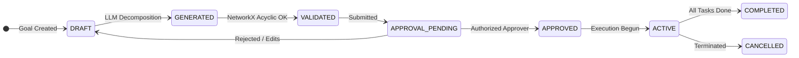

# Requirements Traceability Matrix (RTM)

---

## 1. Document Purpose

This document establishes the **authoritative, bidirectional Requirements Traceability Matrix (RTM)** for the **IR Infotech E-7 Operations Engine**.

### Why This Traceability Matrix Exists
1. **Implementation Governance**: It serves as an immutable contract binding all future development, pull requests, automated tests, and phase transitions to the approved specifications.
2. **Preventing Scope Drift & Omission**: Every functional requirement defined in the authoritative source documents must be traceable from domain ownership down to code components, database entities, APIs, domain events, tests, and acceptance criteria.
3. **Preserving Source Authority**: This document does **not** redefine or weaken requirements. The source documents under [`docs/source-of-truth/`](file:///F:/operations-engine/docs/source-of-truth/) remain the sole authoritative functional and architectural truth.
4. **Living Traceability**: As implementation progresses across phases, this matrix must be updated to track exact code modules and test locations.

### Authoritative Functional Requirement Count
* **Task Intelligence (TI)**: 9 requirements (`FR-TI-01` through `FR-TI-09`)
* **Workflow Engine (WF)**: 7 requirements (`FR-WF-01` through `FR-WF-07`)
* **Scheduling Engine (SC)**: 6 requirements (`FR-SC-01` through `FR-SC-06`)
* **Integrations (INT)**: 3 requirements (`FR-INT-01` through `FR-INT-03`)
* **Total Authoritative Functional Requirements**: **Exactly 25**

---

## 2. Implementation Component Vocabulary

The following canonical service and component vocabulary is derived strictly from the *Complete Implementation Plan* (Section 5.1 & Section 17) and *Complete Specification*:

| Canonical Component | Runtime / Stack | Architectural Role & Responsibility |
| :--- | :--- | :--- |
| **`api-service`** | FastAPI / Python | Inbound REST transport, OpenAPI schemas, authentication perimeter, tenant context resolution, request correlation IDs, idempotency validation, and route dispatching. |
| **`plan-service`** | Python Core Domain | Domain logic for goals, plans, work breakdown structures, milestones, task progress, priority assignment, and approval state machines. |
| **`task-intelligence-worker`** | Python / PydanticAI | Asynchronous worker executing LLM-based goal decomposition, prompt construction, structured `PlanSchema` generation, and non-authoritative repair loops. |
| **`dependency-service`** | Python / NetworkX | Deterministic graph analysis: DAG validation, cycle detection, topological sorting, Critical Path Method (CPM), and slack computation. |
| **`workflow-adapter`** | Python Domain Adapter | IR-owned abstraction layer interfacing the Flowable REST runtime. Encapsulates process deployment, task lifecycle, approvals, and SLA tracking. |
| **`Flowable runtime`** | Java Spring Boot / Docker | External open-source workflow execution engine (BPMN 2.0, DMN 1.3, human tasks, persistent timers, and state durability). |
| **`scheduling-worker`** | Python / Google OR-Tools | Asynchronous worker formulating constraint programming models (CP-SAT), executing solvers, extracting conflict sets, and computing disruption repair. |
| **`unitime-adapter`** | Python Domain Adapter | Specialized PoC adapter interfacing the UniTime REST API for academic course and exam timetabling benchmarks. |
| **`resource-service`** | Python Core Domain | Canonical registry of resources (people, rooms, equipment), skills, working hours, and capacity availability. |
| **`calendar-adapter`** | Python Adapter | Bidirectional synchronization between internal schedule assignments and external iCalendar / CalDAV endpoints. |
| **`event-gateway`** | Python / RabbitMQ | Transactional outbox relay, event schema serialization (CloudEvents), routing key distribution, and deduplicating inbox consumer. |
| **`audit-service`** | Python Core Domain | Immutable, append-only operational audit logging for all human approvals, state transitions, rule evaluations, and schedule publications. |
| **`analytics-api`** | Python Domain API | Operational KPIs, blocker durations, throughput, SLA breach statistics, and telemetry aggregation. |
| **`operations-ui`** | Next.js / React | Web frontends for Universal and Embedded modes, incorporating `bpmn-js`, `dmn-js`, and `form-js` visual modelers. |

---

## 3. Canonical Entity Vocabulary

The canonical domain data model is defined in the *Complete Specification* (Section 14). No third-party foreign identifiers or redundant entities may be introduced:

| Canonical Domain Entity | Core Attributes & Foreign Keys | System Role & Semantics |
| :--- | :--- | :--- |
| **`tenants`** | `id, name, slug, status, created_at, settings` | Multi-tenant root partition key. Enforced on every table. |
| **`users`** | `id, tenant_id, email, name, role, is_active` | Authenticated principals, approvers, and operators. |
| **`goals`** | `id, tenant_id, user_id, title, description, raw_prompt, deadline, constraints, status` | Ingested operational goal/request. |
| **`plans`** | `id, tenant_id, goal_id, version, title, status, critical_path_duration, approved_by, approved_at` | Structured, versioned Work Breakdown Structure. |
| **`tasks`** | `id, tenant_id, plan_id, parent_id, wbs_code, title, description, role, est_duration, act_duration, confidence, status, priority, progress` | Individual work package item in a plan. |
| **`task_dependencies`** | `id, tenant_id, predecessor_id, successor_id, dependency_type, lag_duration` | Directed graph edge between two tasks. |
| **`milestones`** | `id, tenant_id, plan_id, title, target_date, status, health` | Checkpoint grouping tasks toward an operational milestone. |
| **`task_risks`** | `id, tenant_id, task_id, risk_type, severity, description, mitigation, is_active` | Blocker, capacity shortfall, or critical-path delay alert. |
| **`workflow_definitions`** | `id, tenant_id, key, name, version, bpmn_xml, dmn_xml, status, deployed_at` | Versioned process template definition. |
| **`workflow_instances`** | `id, tenant_id, definition_id, plan_id, status, external_instance_id, start_time, end_time` | Active or completed execution instance of a workflow. |
| **`workflow_tasks`** | `id, tenant_id, instance_id, task_name, assignee_id, candidate_group, due_at, status, action_taken` | Human task requiring action or approval. |
| **`sla_policies`** | `id, tenant_id, name, target_duration, warning_threshold, calendar_id, escalation_rules` | Service level agreement definition and threshold rules. |
| **`resources`** | `id, tenant_id, name, type, capacity, skills, cost_per_hour, external_id, source_system` | Physical or human resource available for work/scheduling. |
| **`resource_availability`** | `id, tenant_id, resource_id, start_time, end_time, status, reason` | Working hours, booked blocks, or unavailability intervals. |
| **`schedule_jobs`** | `id, tenant_id, profile_id, status, solve_duration, objective_score, solver_metadata` | Optimization execution run and solver telemetry. |
| **`schedule_assignments`** | `id, tenant_id, job_id, task_id, resource_id, start_time, end_time, is_locked` | Assigned time slot and resource for a task. |
| **`constraints`** | `id, tenant_id, job_id, constraint_type, is_hard, weight, entity_refs, parameters` | Hard or soft constraint configured for a schedule job. |
| **`calendar_links`** | `id, tenant_id, assignment_id, provider, external_event_id, etag, last_synced_at` | Mapping internal assignments to external calendar events. |
| **`domain_events`** | `id, tenant_id, event_type, aggregate_type, aggregate_id, payload, correlation_id, created_at, published_at` | Outbox table storing versioned domain events. |
| **`audit_events`** | `id, tenant_id, entity_type, entity_id, action, actor_id, changes, metadata, timestamp` | Append-only tamper-evident audit history record. |

---

## 4. Functional Requirements Matrix (25 Requirements)

```
========================================================================================================================
TASK INTELLIGENCE ENGINE (FR-TI-01 to FR-TI-09)
========================================================================================================================
```

### FR-TI-01: Goal Intake
* **Domain**: Task Intelligence
* **Capability**: Goal Intake
* **Authoritative Requirement**: *Accept natural language and structured goals with objective, scope, deadline, constraints, resources and context.*
* **Primary Domain Owner**: `plan-service`
* **Supporting Component(s)**: `api-service`, `resource-service`, `operations-ui`
* **Canonical Entity / Entities**: `goals`, `tenants`, `users`
* **API / Interface**: `POST /api/v1/goals`
* **Domain Event(s)**: `goal.created`
* **OSS Component / Library**: FastAPI, Pydantic
* **Implementation Phase**: Phase 2 (First Implementation), Phase 6 (Vertical Slice), Phase 8 (Hardening)
* **Unit Test Evidence**: `tests/unit/task_intelligence/test_goal_intake.py` (Pydantic schema validation, mandatory objective/context fields).
* **Integration Test Evidence**: `tests/integration/test_goals_api.py` (Persistence to PostgreSQL `goals` table, tenant isolation, outbox write).
* **Contract / E2E Test Evidence**: `tests/contract/test_goals_contract.py` (REST contract validation, user context extraction).
* **Acceptance Evidence**: Valid structured and natural language goals are accepted and persisted with full tenant and user context.
* **Dependencies / Prerequisites**: Phase 1 platform foundation, tenant resolution middleware, database migrations.
* **Notes / Source References**: Complete Specification Section 9; Implementation Plan Section 7.1.

---

### FR-TI-02: WBS Generation
* **Domain**: Task Intelligence
* **Capability**: WBS Generation
* **Authoritative Requirement**: *Generate hierarchical work packages with IDs, descriptions, owners/roles, estimates, acceptance criteria and parent-child links.*
* **Primary Domain Owner**: `task-intelligence-worker`
* **Supporting Component(s)**: `plan-service`, `api-service`, `operations-ui`
* **Canonical Entity / Entities**: `plans`, `tasks`
* **API / Interface**: `POST /api/v1/goals/{id}/generate-plan`
* **Domain Event(s)**: `plan.generated`
* **OSS Component / Library**: PydanticAI (Configurable model provider: Sarvam-105B / open-weights benchmark / OpenAI fallback)
* **Implementation Phase**: Phase 2 (First Implementation), Phase 6 (Vertical Slice), Phase 8 (Hardening)
* **Unit Test Evidence**: `tests/unit/task_intelligence/test_wbs_schema.py` (`PlanSchema` hierarchy validation, WBS code formatting `1.1.2`, child-parent reference checks).
* **Integration Test Evidence**: `tests/integration/test_plan_generation.py` (Worker queue consumption, structured LLM prompt invocation, draft plan persistence).
* **Contract / E2E Test Evidence**: `tests/ai_eval/test_decomposition_quality.py` (DeepEval structural accuracy, schema conformance across 50 benchmark goals).
* **Acceptance Evidence**: Work items generated from goal conform to `PlanSchema` and persist only after successful schema validation.
* **Dependencies / Prerequisites**: FR-TI-01, PydanticAI worker runtime, RabbitMQ task queue.
* **Notes / Source References**: Complete Specification Section 9; Implementation Plan Section 7.2. LLM suggestions are strictly non-authoritative.

---

### FR-TI-03: Dependency Mapping
* **Domain**: Task Intelligence
* **Capability**: Dependency Mapping
* **Authoritative Requirement**: *Propose predecessor/successor relationships and validate acyclic dependency graphs.*
* **Primary Domain Owner**: `dependency-service`
* **Supporting Component(s)**: `task-intelligence-worker`, `plan-service`
* **Canonical Entity / Entities**: `task_dependencies`, `tasks`, `plans`
* **API / Interface**: `POST /api/v1/plans/{id}/validate`, `GET /api/v1/plans/{id}/critical-path`
* **Domain Event(s)**: None directly (validates plan prior to approval)
* **OSS Component / Library**: NetworkX + IR CPM Logic
* **Implementation Phase**: Phase 2 (First Implementation), Phase 6 (Vertical Slice), Phase 8 (Hardening)
* **Unit Test Evidence**: `tests/unit/task_intelligence/test_dependency_graph.py` (Cycle detection via NetworkX `simple_cycles`, topological sort, CPM forward/backward pass, float calculation).
* **Integration Test Evidence**: `tests/integration/test_plan_validation.py` (Plan validation endpoint blocks activation on cycle, persists valid dependency edges).
* **Contract / E2E Test Evidence**: `tests/contract/test_graph_api.py` (Intentional cycle injection test returns `422 Unprocessable Entity` with exact cycle path nodes).
* **Acceptance Evidence**: No activated plan contains dependency cycles; dependency relationships and critical path are visualizable.
* **Dependencies / Prerequisites**: FR-TI-02, NetworkX library.
* **Notes / Source References**: Complete Specification Section 9; Implementation Plan Section 7.3.

---

### FR-TI-04: Effort Estimation
* **Domain**: Task Intelligence
* **Capability**: Effort Estimation
* **Authoritative Requirement**: *Estimate duration/effort with confidence and basis; allow manual override and historical recalibration.*
* **Primary Domain Owner**: `plan-service`
* **Supporting Component(s)**: `task-intelligence-worker`, `analytics-api`
* **Canonical Entity / Entities**: `tasks`, `plans`
* **API / Interface**: `PATCH /api/v1/tasks/{id}`, `POST /api/v1/goals/{id}/generate-plan`
* **Domain Event(s)**: None directly
* **OSS Component / Library**: Rule-based heuristics / historical medians (Phase 2); XGBoost / LightGBM conditional for Phase 10
* **Implementation Phase**: Phase 2 (First Implementation), Phase 6 (Vertical Slice), Phase 8 (Hardening)
* **Unit Test Evidence**: `tests/unit/task_intelligence/test_estimation.py` (Bounds checks on confidence score [0.0, 1.0], positive duration requirement, basis string formatting).
* **Integration Test Evidence**: `tests/integration/test_task_patch.py` (Manual patch overrides estimate; preserves historical original estimate and recalibration basis).
* **Contract / E2E Test Evidence**: `tests/e2e/test_plan_editing.py` (User overrides task duration; CPM recalculates dependent task schedules).
* **Acceptance Evidence**: Every generated task contains duration, confidence score, and basis; manual overrides are recorded in audit history.
* **Dependencies / Prerequisites**: FR-TI-02.
* **Notes / Source References**: Complete Specification Section 9; Implementation Plan Section 7.4.

---

### FR-TI-05: Priority Assignment
* **Domain**: Task Intelligence
* **Capability**: Priority Assignment
* **Authoritative Requirement**: *Assign/recommend priority using urgency, impact, dependency criticality and policy rules.*
* **Primary Domain Owner**: `plan-service`
* **Supporting Component(s)**: `dependency-service`, `task-intelligence-worker`
* **Canonical Entity / Entities**: `tasks`, `plans`
* **API / Interface**: Internal Interface: `PriorityEngine.calculate_priority(task, graph_metrics)`
* **Domain Event(s)**: None directly
* **OSS Component / Library**: NetworkX (Graph centrality metrics) + IR Priority Policy Rules
* **Implementation Phase**: Phase 2 (First Implementation), Phase 6 (Vertical Slice), Phase 8 (Hardening)
* **Unit Test Evidence**: `tests/unit/task_intelligence/test_priority.py` (Critical-path tasks receive elevated priority; policy rules map urgency/impact matrix to enum).
* **Integration Test Evidence**: `tests/integration/test_priority_rules.py` (Plan generation populates priority enum matching domain policy).
* **Contract / E2E Test Evidence**: `tests/e2e/test_wbs_sorting.py` (Tasks listed in UI sort by computed priority and slack).
* **Acceptance Evidence**: Tasks on critical path and high-impact dependencies receive elevated priority recommendations.
* **Dependencies / Prerequisites**: FR-TI-02, FR-TI-03.
* **Notes / Source References**: Complete Specification Section 9; Implementation Plan Section 7.3.

---

### FR-TI-06: Milestones
* **Domain**: Task Intelligence
* **Capability**: Milestones
* **Authoritative Requirement**: *Create milestone groups and planned dates; track milestone health.*
* **Primary Domain Owner**: `plan-service`
* **Supporting Component(s)**: `dependency-service`, `operations-ui`
* **Canonical Entity / Entities**: `milestones`, `tasks`, `plans`
* **API / Interface**: `POST /api/v1/plans/{id}/milestones`, `GET /api/v1/plans/{id}/milestones`
* **Domain Event(s)**: None directly
* **OSS Component / Library**: NetworkX, SQLAlchemy
* **Implementation Phase**: Phase 2 (First Implementation), Phase 6 (Vertical Slice), Phase 8 (Hardening)
* **Unit Test Evidence**: `tests/unit/task_intelligence/test_milestones.py` (Milestone target date derivation from task latest finish; health calculation rules).
* **Integration Test Evidence**: `tests/integration/test_milestone_api.py` (Milestone CRUD operations and progress roll-up from member tasks).
* **Contract / E2E Test Evidence**: `tests/e2e/test_milestone_tracking.py` (Delaying member task updates milestone health from ON_TRACK to AT_RISK).
* **Acceptance Evidence**: Milestones accurately group work packages, show planned dates, and roll up health indicators without manual recomputation.
* **Dependencies / Prerequisites**: FR-TI-02, FR-TI-03.
* **Notes / Source References**: Complete Specification Section 9; Implementation Plan Section 7.1.

---

### FR-TI-07: Risk & Blocker Detection
* **Domain**: Task Intelligence
* **Capability**: Risk & Blocker Detection
* **Authoritative Requirement**: *Detect overdue dependencies, capacity shortages, repeated rework, critical-path slippage and declared blockers.*
* **Primary Domain Owner**: `plan-service`
* **Supporting Component(s)**: `dependency-service`, `resource-service`, `analytics-api`
* **Canonical Entity / Entities**: `task_risks`, `tasks`, `task_dependencies`
* **API / Interface**: `GET /api/v1/plans/{id}/risks`, `POST /api/v1/tasks/{id}/blocker`
* **Domain Event(s)**: `task.blocked`
* **OSS Component / Library**: NetworkX + IR Risk Monitor Engine
* **Implementation Phase**: Phase 2 (Basic), Phase 6 (Integrated), Phase 7 (Real-time Operations)
* **Unit Test Evidence**: `tests/unit/task_intelligence/test_risk_monitor.py` (Blocker propagation down dependency chain; critical-path slippage detection).
* **Integration Test Evidence**: `tests/integration/test_blocker_api.py` (Declaring blocker sets task status to BLOCKED, records risk entity, emits `task.blocked`).
* **Contract / E2E Test Evidence**: `tests/e2e/test_risk_alerting.py` (Simulated delay triggers risk alert in plan health dashboard).
* **Acceptance Evidence**: Known regression scenarios trigger configured risk/blocker signals and emit `task.blocked`.
* **Dependencies / Prerequisites**: FR-TI-03, FR-TI-08.
* **Notes / Source References**: Complete Specification Section 9; Implementation Plan Section 7.5.

---

### FR-TI-08: Progress Tracking
* **Domain**: Task Intelligence
* **Capability**: Progress Tracking
* **Authoritative Requirement**: *Track task status, percentage, actual effort, completion evidence and variance to plan.*
* **Primary Domain Owner**: `plan-service`
* **Supporting Component(s)**: `operations-ui`, `audit-service`
* **Canonical Entity / Entities**: `tasks`, `plans`, `audit_events`
* **API / Interface**: `PATCH /api/v1/tasks/{id}`
* **Domain Event(s)**: `task.completed`
* **OSS Component / Library**: SQLAlchemy, FastAPI
* **Implementation Phase**: Phase 2 (First Implementation), Phase 6 (Vertical Slice), Phase 8 (Hardening)
* **Unit Test Evidence**: `tests/unit/task_intelligence/test_task_lifecycle.py` (State transitions: TODO -> IN_PROGRESS -> COMPLETED; effort variance formula).
* **Integration Test Evidence**: `tests/integration/test_task_progress.py` (Patching task progress recalculates parent work package percentage and plan variance).
* **Contract / E2E Test Evidence**: `tests/e2e/test_progress_flow.py` (Marking task complete emits `task.completed` and unlocks dependent successor tasks).
* **Acceptance Evidence**: Task updates reflect in project and milestone health without manual recomputation.
* **Dependencies / Prerequisites**: FR-TI-02.
* **Notes / Source References**: Complete Specification Section 9; Implementation Plan Section 7.1.

---

### FR-TI-09: Task Recommendations
* **Domain**: Task Intelligence
* **Capability**: Task Recommendations
* **Authoritative Requirement**: *Recommend next best tasks, re-prioritization or mitigation with explanation and confidence.*
* **Primary Domain Owner**: `task-intelligence-worker`
* **Supporting Component(s)**: `plan-service`, `dependency-service`
* **Canonical Entity / Entities**: `plans`, `tasks`, `task_risks`
* **API / Interface**: `GET /api/v1/plans/{id}/recommendations`
* **Domain Event(s)**: None directly
* **OSS Component / Library**: PydanticAI / Rule-based Recommender
* **Implementation Phase**: Phase 2 (First Implementation), Phase 6 (Vertical Slice), Phase 8 (Hardening)
* **Unit Test Evidence**: `tests/unit/task_intelligence/test_recommendations.py` (Ready-task filtering: predecessors complete, unblocked; ranking by slack and priority).
* **Integration Test Evidence**: `tests/integration/test_recommendation_api.py` (Endpoint returns ranked task list with explanations and confidence scores).
* **Contract / E2E Test Evidence**: `tests/ai_eval/test_recommendation_eval.py` (Evaluates clarity and relevance of recommendation explanations).
* **Acceptance Evidence**: At least one ranked feasible recommendation with actionable explanation and confidence score is returned.
* **Dependencies / Prerequisites**: FR-TI-03, FR-TI-07, FR-TI-08.
* **Notes / Source References**: Complete Specification Section 9; Implementation Plan Section 7.2. Recommendations are non-authoritative.

---

```
========================================================================================================================
WORKFLOW ENGINE (FR-WF-01 to FR-WF-07)
========================================================================================================================
```

### FR-WF-01: Workflow Models
* **Domain**: Workflow Engine
* **Capability**: Workflow Models
* **Authoritative Requirement**: *Create/version BPMN-style workflow definitions with human, service, timer, gateway and event steps.*
* **Primary Domain Owner**: `workflow-adapter`
* **Supporting Component(s)**: `Flowable runtime`, `api-service`, `operations-ui`
* **Canonical Entity / Entities**: `workflow_definitions`
* **API / Interface**: `POST /api/v1/workflow-definitions`, `POST /api/v1/workflow-definitions/{id}/deploy`
* **Domain Event(s)**: None directly (internal audit event emitted)
* **OSS Component / Library**: Flowable Engine (REST API), bpmn-js, form-js
* **Implementation Phase**: Phase 3 (Workflow MVP - COMPLETE / FROZEN)
* **Unit Test Evidence**: `tests/unit/workflow/test_bpmn_validation.py`, `tests/unit/workflow/test_workflow_service.py`, `ui/operations-ui/src/components/BpmnDesigner.test.tsx` (Validates BPMN 2.0 structure, rejects arbitrary script tags/expressions, registers definitions, preserves visible bpmn.io watermark).
* **Integration Test Evidence**: `tests/integration/workflow/test_flowable_live.py` (Deploys BPMN XML to Flowable REST, verifies deployment result and definition key).
* **Contract / E2E Test Evidence**: `ui/operations-ui/src/components/BpmnDesigner.test.tsx` (Validates designer load/save/deploy cycle).
* **Acceptance Evidence**: BPMN definitions containing user tasks, service tasks, timers, and gateways parse, validate, and deploy cleanly to Flowable.
* **Dependencies / Prerequisites**: Phase 1 foundation, Flowable REST container.
* **Status**: **VERIFIED / FROZEN**
* **Notes / Source References**: Complete Specification Section 9; Implementation Plan Section 8.1. Mandatory `bpmn.io` visible watermark preserved.

---

### FR-WF-02: Approvals
* **Domain**: Workflow Engine
* **Capability**: Approvals
* **Authoritative Requirement**: *Support single, sequential, parallel, quorum and role-based approvals.*
* **Primary Domain Owner**: `workflow-adapter`
* **Supporting Component(s)**: `Flowable runtime`, `api-service`, `operations-ui`
* **Canonical Entity / Entities**: `workflow_instances`, `workflow_task_mappings`
* **API / Interface**: `POST /api/v1/workflow/tasks/{id}/actions/{action}`, `POST /api/v1/workflow/instances`
* **Domain Event(s)**: `workflow.task.created`, `plan.approved`
* **OSS Component / Library**: Flowable Engine (Multi-instance user tasks, candidate groups)
* **Implementation Phase**: Phase 3 (Workflow MVP - COMPLETE / FROZEN)
* **Unit Test Evidence**: `tests/unit/workflow/test_approval_compiler.py`, `tests/unit/workflow/test_delegation_policy.py`, `tests/unit/workflow/test_workflow_authorization.py` (Quorum N-of-M compilation, parallel-all-of fork/join, candidate role pools, pre-engine tenant and actor authorization).
* **Integration Test Evidence**: `tests/integration/workflow/test_flowable_live.py` (Sequential, parallel all-of, and quorum multi-instance live test suites).
* **Contract / E2E Test Evidence**: `ui/operations-ui/src/components/TaskInbox.test.tsx` (Human task action and approval completion).
* **Acceptance Evidence**: Configured approval chains execute correctly across single, sequential, parallel, and quorum paths with fail-closed authorization.
* **Dependencies / Prerequisites**: FR-WF-01, Flowable adapter.
* **Status**: **VERIFIED / FROZEN**
* **Notes / Source References**: Complete Specification Section 9; Implementation Plan Section 8.2. LLM output never performs authoritative approvals.

---

### FR-WF-03: Business Rules
* **Domain**: Workflow Engine
* **Capability**: Business Rules
* **Authoritative Requirement**: *Evaluate deterministic conditions against typed process data; rule outcomes must be auditable.*
* **Primary Domain Owner**: `workflow-adapter`
* **Supporting Component(s)**: `Flowable runtime`, `audit-service`
* **Canonical Entity / Entities**: `workflow_definitions`, `workflow_artifacts`, `audit_events`
* **API / Interface**: `FlowableAdapter.execute_decision`, `WorkflowService.execute_decision`
* **Domain Event(s)**: None directly (audited via `workflow.dmn.executed`)
* **OSS Component / Library**: Flowable DMN, dmn-js
* **Implementation Phase**: Phase 3 (Workflow MVP - COMPLETE / FROZEN)
* **Unit Test Evidence**: `tests/unit/workflow/test_dmn_runtime.py`, `tests/unit/workflow/test_form_validation.py`, `ui/operations-ui/src/components/DmnEditor.test.tsx` (DMN 1.3 XML validation, XXE prevention, hit policies, typed variable validation, derived variable allowlists).
* **Integration Test Evidence**: `tests/integration/workflow/test_flowable_live.py` (Flowable DMN decision deployment and deterministic rule evaluation).
* **Contract / E2E Test Evidence**: `tests/unit/workflow/test_dmn_runtime.py` (Determinism test: repeated runs with same inputs and version produce identical outcomes).
* **Acceptance Evidence**: Given identical typed inputs and rule version, deterministic rules return identical outcomes; all decisions are auditable.
* **Dependencies / Prerequisites**: FR-WF-01, Flowable DMN engine.
* **Status**: **VERIFIED / FROZEN**
* **Notes / Source References**: Complete Specification Section 9; Implementation Plan Section 8.3. Flowable DMN selected first; Drools deferred.

---

### FR-WF-04: SLA Tracking
* **Domain**: Workflow Engine
* **Capability**: SLA Tracking
* **Authoritative Requirement**: *Track due-at times by state/task, pause/resume rules, business calendars and breach thresholds.*
* **Primary Domain Owner**: `workflow-adapter`
* **Supporting Component(s)**: `Flowable runtime`, `calendar-adapter`
* **Canonical Entity / Entities**: `sla_policies`, `workflow_task_mappings`, `workflow_instances`
* **API / Interface**: `SlaService.attach_sla`, `SlaService.pause_sla`, `SlaService.resume_sla`, `SlaService.evaluate_active_slas`
* **Domain Event(s)**: `workflow.sla.warning`
* **OSS Component / Library**: Flowable boundary timer events / Python business-calendar engine
* **Implementation Phase**: Phase 3 (Workflow MVP - COMPLETE / FROZEN)
* **Unit Test Evidence**: `tests/unit/workflow/test_sla_engine.py`, `tests/unit/workflow/test_business_calendar.py` (Timezone-aware deadline calculation, pause/resume deadline shifts, warning and breach threshold evaluation).
* **Integration Test Evidence**: `tests/integration/workflow/test_flowable_live.py` (Flowable timer jobs list and timer trigger verification).
* **Contract / E2E Test Evidence**: `tests/unit/workflow/test_sla_engine.py` (Clock advance triggers warning and breach according to policy).
* **Acceptance Evidence**: Warning and breach events fire at configured business-clock thresholds; pause/resume freezes and shifts deadlines deterministically.
* **Dependencies / Prerequisites**: FR-WF-01, business calendar service.
* **Status**: **VERIFIED / FROZEN**
* **Notes / Source References**: Complete Specification Section 9; Implementation Plan Section 8.4. SLA state is deterministic; non-LLM.

---

### FR-WF-05: Escalation
* **Domain**: Workflow Engine
* **Capability**: Escalation
* **Authoritative Requirement**: *Create reminder, reassignment, manager escalation or service action when SLA thresholds are crossed.*
* **Primary Domain Owner**: `workflow-adapter`
* **Supporting Component(s)**: `event-gateway`, `Flowable runtime`
* **Canonical Entity / Entities**: `workflow_task_mappings`, `sla_policies`, `audit_events`
* **API / Interface**: `SlaService.evaluate_active_slas`
* **Domain Event(s)**: Emits `workflow.sla.warning`
* **OSS Component / Library**: Flowable Engine (Escalation boundary events), RabbitMQ
* **Implementation Phase**: Phase 3 (Workflow MVP - COMPLETE / FROZEN)
* **Unit Test Evidence**: `tests/unit/workflow/test_sla_engine.py` (Escalation action execution: reminder emission, task reassignment, service actions, audit recording).
* **Integration Test Evidence**: `tests/integration/workflow/test_flowable_live.py` (Live Flowable SLA warning and breach escalation triggers).
* **Contract / E2E Test Evidence**: `tests/unit/workflow/test_sla_engine.py` (Outbox emission of `workflow.sla.warning` and audit logging of `workflow.sla.breached`).
* **Acceptance Evidence**: Configured escalation actions execute upon breach, creating reminders, reassignments, or automated system actions.
* **Dependencies / Prerequisites**: FR-WF-04, FR-INT-01.
* **Status**: **VERIFIED / FROZEN**
* **Notes / Source References**: Complete Specification Section 9; Implementation Plan Section 8.4.

---

### FR-WF-06: Durable Execution
* **Domain**: Workflow Engine
* **Capability**: Durable Execution
* **Authoritative Requirement**: *Resume long-running processes after worker restarts without duplicate side effects.*
* **Primary Domain Owner**: `workflow-adapter`
* **Supporting Component(s)**: `Flowable runtime`, `api-service`
* **Canonical Entity / Entities**: `workflow_instances`, `workflow_task_mappings`
* **API / Interface**: `POST /api/v1/workflow/instances`, idempotency callback handlers
* **Domain Event(s)**: None directly
* **OSS Component / Library**: Flowable Engine (PostgreSQL-backed job executor and transaction management)
* **Implementation Phase**: Phase 3 (Workflow MVP - COMPLETE / FROZEN)
* **Unit Test Evidence**: `tests/unit/workflow/test_workflow_idempotency.py`, `tests/unit/workflow/test_workflow_service.py` (Idempotency key enforcement on task actions, callback deduplication, safe replay).
* **Integration Test Evidence**: `tests/integration/workflow/test_flowable_live.py` (Flowable container restart durability test; pending timers survive restart).
* **Contract / E2E Test Evidence**: `tests/unit/workflow/test_workflow_idempotency.py` (Replayed duplicate actions produce identical results without duplicate engine invocations).
* **Acceptance Evidence**: Workflow and job state survives service restart without duplicate committed side effects.
* **Dependencies / Prerequisites**: FR-WF-01, PostgreSQL ACID persistence.
* **Status**: **VERIFIED / FROZEN**
* **Notes / Source References**: Complete Specification Section 9; Implementation Plan Section 8.5. Temporal is conditional; Flowable provides core durability.

---

### FR-WF-07: Operational Audit
* **Domain**: Workflow Engine
* **Capability**: Operational Audit
* **Authoritative Requirement**: *Record every transition, actor, timestamp, input, rule outcome, external call and retry.*
* **Primary Domain Owner**: `audit-service`
* **Supporting Component(s)**: `workflow-adapter`, `Flowable runtime`, `api-service`
* **Canonical Entity / Entities**: `audit_events`, `workflow_instances`, `workflow_task_mappings`
* **API / Interface**: `GET /api/v1/audit`
* **Domain Event(s)**: Appended on all state transitions
* **OSS Component / Library**: PostgreSQL (Append-only `audit_events` table), SQLAlchemy
* **Implementation Phase**: Phase 1 (Foundation Schema), Phase 3 (Workflow Integration - COMPLETE / FROZEN)
* **Unit Test Evidence**: `tests/unit/audit/test_audit_logger.py`, `tests/unit/workflow/test_workflow_service.py`, `tests/unit/workflow/test_dmn_runtime.py` (Audit schema validation, actor extraction, DMN execution audit, SLA audit, immutability check).
* **Integration Test Evidence**: `tests/integration/workflow/test_flowable_live.py` (Workflow task claim, approval, and rule execution create immutable audit rows with correlation IDs).
* **Contract / E2E Test Evidence**: `tests/contract/test_audit_api.py` (`GET /api/v1/audit` returns chronological event trail filtered by tenant and entity).
* **Acceptance Evidence**: Every state transition, human decision, and external side effect has actor, timestamp, input, and correlation metadata.
* **Dependencies / Prerequisites**: Phase 1 audit schema, authentication context.
* **Status**: **VERIFIED / FROZEN**
* **Notes / Source References**: Complete Specification Section 9; Implementation Plan Section 8.6. Append-only enforcement at application and DB level.

---

```
========================================================================================================================
SCHEDULING ENGINE (FR-SC-01 to FR-SC-06)
========================================================================================================================
```

### FR-SC-01: Constraint Model
* **Domain**: Scheduling Engine
* **Capability**: Constraint Model
* **Authoritative Requirement**: *Represent hard and soft constraints for: time, rooms, people, capacity, equipment, policies. Hard constraints mandatory; soft constraints weighted/profile driven.*
* **Primary Domain Owner**: `scheduling-worker`
* **Supporting Component(s)**: `resource-service`, `api-service`
* **Canonical Entity / Entities**: `constraint_definitions`, `schedule_jobs`, `resources`
* **API / Interface**: `POST /api/v1/schedule-jobs`
* **Domain Event(s)**: None directly
* **OSS Component / Library**: Google OR-Tools (CP-SAT Solver: `cp_model.CpModel()`)
* **Implementation Phase**: Phase 4 (Generic Scheduling MVP - Phase 4A)
* **Unit Test Evidence**: `tests/unit/scheduling/test_constraints.py`, `tests/unit/scheduling/test_hard_constraints_matrix.py` (Typed Pydantic discriminated union constraint models, positive/negative validation of NO_OVERLAP, CAPACITY, ELIGIBILITY, PRECEDENCE, TIME_WINDOW, MINIMUM_GAP, LOCK).
* **Integration Test Evidence**: `tests/integration/scheduling/test_migration_0011.py` (PostgreSQL `constraint_definitions` table with check constraints and unique tenant versioning).
* **Contract / E2E Test Evidence**: `tests/unit/scheduling/test_api_contracts.py` (Schema validation of job payload with diverse constraint sets).
* **Acceptance Evidence**: Both hard constraints (mandatory feasibility) and soft constraints (penalized objectives) correctly represented in solver model.
* **Dependencies / Prerequisites**: Phase 1 foundation, resource registry.
* **Status**: **VERIFIED / FROZEN**
* **Notes / Source References**: Complete Specification Section 9; Implementation Plan Section 9.1. OR-Tools objects remain isolated behind adapter.

---

### FR-SC-02: Schedule Generation
* **Domain**: Scheduling Engine
* **Capability**: Schedule Generation
* **Authoritative Requirement**: *Produce: feasible candidate schedule OR explicit unsatisfied/infeasible constraints. Candidate is REVIEW by default. Publication is separate.*
* **Primary Domain Owner**: `scheduling-worker`
* **Supporting Component(s)**: `api-service`, `resource-service`
* **Canonical Entity / Entities**: `schedule_jobs`, `schedule_assignments`, `schedules`
* **API / Interface**: `POST /api/v1/schedule-jobs`, `GET /api/v1/schedule-jobs/{id}`
* **Domain Event(s)**: `schedule.generated` (enqueued when feasible candidate schedule reaches REVIEW)
* **OSS Component / Library**: Google OR-Tools (CP-SAT `CpSolver`)
* **Implementation Phase**: Phase 4 (Phase 4A & Phase 4B Complete)
* **Unit Test Evidence**: `tests/unit/scheduling/test_cpsat_solver.py`, `tests/unit/scheduling/test_phase_0_fixtures.py` (Solver execution, status mapping `OPTIMAL/FEASIBLE/INFEASIBLE`, assignment variable extraction, zero hard violations).
* **Integration Test Evidence**: `tests/integration/scheduling/test_live_worker.py` (Asynchronous solver execution, candidate assignment persistence, live PostgreSQL claim and solve).
* **Contract / E2E Test Evidence**: `tests/unit/scheduling/test_phase_0_fixtures.py` (Benchmark test suite: SC-MAINT-FEASIBLE-001 solves with zero hard-constraint violations).
* **Acceptance Evidence**: Feasible benchmark datasets produce zero hard-constraint conflicts; infeasible datasets return explicit status and conflict sets. Candidate created only on feasible solve. Candidate begins in REVIEW status; publication is a separate authorized step.
* **Dependencies / Prerequisites**: FR-SC-01, OR-Tools runtime.
* **Status**: **VERIFIED / FROZEN**
* **Notes / Source References**: Complete Specification Section 9; Implementation Plan Section 9.2. Strictly deterministic constraint programming; never LLM. Candidate reaches REVIEW; publish is separate authorized action.

---

### FR-SC-03: Optimization
* **Domain**: Scheduling Engine
* **Capability**: Optimization
* **Authoritative Requirement**: *Optimize weighted objectives such as: preference satisfaction, gaps, fairness, utilization, movement/conflict objectives as source-supported while preserving hard constraints. Persist solver/profile/version/settings/seed/score evidence.*
* **Primary Domain Owner**: `scheduling-worker`
* **Supporting Component(s)**: `solver_profiles`
* **Canonical Entity / Entities**: `schedule_jobs`, `solver_profiles`, `schedules`
* **API / Interface**: `POST /api/v1/schedule-jobs`
* **Domain Event(s)**: None directly
* **OSS Component / Library**: Google OR-Tools CP-SAT (`model.Minimize(sum(penalties))`)
* **Implementation Phase**: Phase 4 (Phase 4A & Phase 4B Complete)
* **Unit Test Evidence**: `tests/unit/scheduling/test_cpsat_solver.py`, `tests/unit/scheduling/test_profiles.py` (Modular soft objectives: preference penalties, movement penalties, distinct score components persistence).
* **Integration Test Evidence**: `tests/integration/scheduling/test_live_worker.py` (Persisting separate score components in PostgreSQL `schedules.score_components`).
* **Contract / E2E Test Evidence**: `tests/unit/scheduling/test_cpsat_solver.py` (Preference weight tuning changes assignment selections deterministically).
* **Acceptance Evidence**: Soft constraint penalties systematically minimized according to configured objective profile weights. Full solver metadata and profile version persisted.
* **Dependencies / Prerequisites**: FR-SC-01, FR-SC-02.
* **Status**: **VERIFIED / FROZEN**
* **Notes / Source References**: Complete Specification Section 9; Implementation Plan Section 9.2. Objective weights configured via `solver_profiles`.

---

### FR-SC-04: Incremental Rescheduling
* **Domain**: Scheduling Engine
* **Capability**: Incremental Rescheduling
* **Authoritative Requirement**: *Recompute affected assignments after: absence, resource unavailability, outage/disruption while minimizing changes to locked/published work.*
* **Primary Domain Owner**: `scheduling-worker`
* **Supporting Component(s)**: `resource-service`, `event-gateway`
* **Canonical Entity / Entities**: `schedule_assignments`, `schedule_jobs`, `schedules`
* **API / Interface**: `POST /api/v1/schedules/{id}/repair`
* **Domain Event(s)**: `schedule.changed`, consumes `resource.unavailable`
* **OSS Component / Library**: Google OR-Tools CP-SAT (Deterministic RepairScopeBuilder, hard locks on unaffected assignments, linear movement penalties on disrupted work)
* **Implementation Phase**: Phase 4B (Incremental Rescheduling & Repair Complete)
* **Unit Test Evidence**: `tests/unit/scheduling/test_repair_scope_builder.py` (Deterministic direct and transitive disruption scoping), `tests/unit/scheduling/test_canonical_repair_fixtures.py` (SC-MAINT-REPAIR-001, SC-EXAM-REPAIR-001, and infeasible conflicting hard-lock detection), `tests/unit/scheduling/test_stress_benchmark.py` (Synthetic engineering stress benchmark: 40 activities, 12 resources, 0 hard violations).
* **Integration Test Evidence**: `tests/integration/scheduling/test_live_phase4b_publish_repair.py` (`test_live_repair_and_superseding_publish`, `test_live_resource_unavailable_event_handler` inbox deduplication).
* **Contract / E2E Test Evidence**: `tests/unit/scheduling/test_api_contracts.py` (`POST /api/v1/schedules/{id}/repair` contract validation and tenant isolation).
* **Acceptance Evidence**: Disrupted schedules repaired by recomputing affected assignments while freezing unaffected assignments with hard locks and minimizing movement via objective penalties. Baseline remains untouched at PUBLISHED until new candidate is authorized.
* **Dependencies / Prerequisites**: FR-SC-02, FR-SC-05.
* **Status**: **VERIFIED / FROZEN**
* **Notes / Source References**: Complete Specification Section 9; Implementation Plan Section 9.3. Repair produces new candidate in REVIEW with supersedes_id referencing published baseline.

---

### FR-SC-05: Calendar Sync
* **Domain**: Scheduling Engine
* **Capability**: Calendar Sync
* **Authoritative Requirement**: *Import/export calendar-compatible schedule events and retain internal / external mappings.*
* **Primary Domain Owner**: `calendar-adapter`
* **Supporting Component(s)**: `scheduling-worker`, `api-service`
* **Canonical Entity / Entities**: `calendar_links`, `schedule_assignments`
* **API / Interface**: `POST /api/v1/schedule-jobs/{id}/publish`, `GET /api/v1/resources/availability`
* **Domain Event(s)**: `schedule.published`, `schedule.changed`
* **OSS Component / Library**: RFC 5545 canonical serializer/parser, provider-neutral `CalendarAdapter` Protocol
* **Implementation Phase**: Phase 4B (Publish & Calendar Boundary Complete)
* **Unit Test Evidence**: `tests/unit/integrations/test_calendar.py` (Strict RFC 5545 serializer/parser roundtrip, FakeCalendarAdapter lifecycle, simulated outage degraded behavior), `tests/unit/scheduling/test_publish_policy_and_transitions.py` (Provider-neutral fail-closed publish authorization and precondition validation).
* **Integration Test Evidence**: `tests/integration/scheduling/test_live_phase4b_publish_repair.py` (`test_live_publish_and_idempotency`, `test_live_calendar_outbound_sync_and_degraded_outage`), `tests/integration/scheduling/test_migration_0012.py` (`calendar_links` table lifecycle).
* **Contract / E2E Test Evidence**: `tests/unit/scheduling/test_api_contracts.py` (`POST /api/v1/schedule-jobs/{id}/publish` contract validation and Phase-1 idempotency key).
* **Acceptance Evidence**: Published schedule changes synchronize idempotently and preserve external calendar mappings in `calendar_links`. Outages report degraded `sync_status = "FAILED"` with zero false successes.
* **Dependencies / Prerequisites**: FR-SC-02, calendar link repository.
* **Status**: **VERIFIED / FROZEN**
* **Notes / Source References**: Complete Specification Section 9; Implementation Plan Section 9.4. Calendar synchronization is secondary; external failures do not roll back authorized PostgreSQL schedule publication.

---

### FR-SC-06: Conflict Explanation
* **Domain**: Scheduling Engine
* **Capability**: Conflict Explanation
* **Authoritative Requirement**: *Explain: why an assignment conflicts or: why no feasible schedule exists by mapping solver/model conflicts to canonical: constraint IDs, resources, activities, time windows, and suggesting human-review relaxations.*
* **Primary Domain Owner**: `scheduling-worker`
* **Supporting Component(s)**: `api-service`, `operations-ui`
* **Canonical Entity / Entities**: `schedule_jobs`, `constraint_definitions`
* **API / Interface**: `GET /api/v1/schedule-jobs/{id}` (Diagnostics payload)
* **Domain Event(s)**: None directly
* **OSS Component / Library**: Google OR-Tools CP-SAT (Boolean assumption tracking and SufficientAssumptionsForInfeasibility)
* **Implementation Phase**: Phase 4 (Generic Scheduling MVP - Phase 4A & Phase 4B Complete)
* **Unit Test Evidence**: `tests/unit/scheduling/test_cpsat_solver.py`, `tests/unit/scheduling/test_phase_0_fixtures.py` (Extraction of conflicting constraint IDs, human-readable conflict formatting, relaxation suggestions).
* **Integration Test Evidence**: `tests/integration/scheduling/test_live_worker.py` (Infeasible job persisted with detailed diagnostics in PostgreSQL `schedule_jobs.diagnostics`).
* **Contract / E2E Test Evidence**: `tests/unit/scheduling/test_api_contracts.py` (Verifies diagnostic JSON schema: violated constraint list, involved resources, explanation text).
* **Acceptance Evidence**: Infeasible datasets return explicit violated/conflicting constraints rather than failing silently or returning partial schedules.
* **Dependencies / Prerequisites**: FR-SC-01, FR-SC-02.
* **Status**: **VERIFIED / FROZEN**
* **Notes / Source References**: Complete Specification Section 9; Implementation Plan Section 9.5. Practical sufficient conflict sets extracted from solver assumptions.

---

```
========================================================================================================================
INTEGRATIONS (FR-INT-01 to FR-INT-03)
========================================================================================================================
```

### FR-INT-01: Notifications
* **Domain**: Integrations
* **Capability**: Notifications
* **Authoritative Requirement**: *Emit notification commands/events for E-8 or external messaging adapters.*
* **Primary Domain Owner**: `event-gateway`
* **Supporting Component(s)**: `workflow-adapter`, `scheduling-worker`
* **Canonical Entity / Entities**: `domain_events`
* **API / Interface**: Internal Interface: `NotificationDispatcher.emit_command(command)`
* **Domain Event(s)**: `workflow.task.created`, `workflow.sla.warning`, `schedule.published`, `schedule.changed`
* **OSS Component / Library**: RabbitMQ, Pydantic (CloudEvents format)
* **Implementation Phase**: Phase 1 (Outbox Infrastructure), Phase 3 (Workflow Notifications), Phase 7 (E-8 Engagement Integration)
* **Unit Test Evidence**: `tests/unit/integrations/test_notification_dispatcher.py` (Command payload formatting, template key assignment, recipient list resolution).
* **Integration Test Evidence**: `tests/integration/test_notification_outbox.py` (Workflow task creation dispatches notification message to RabbitMQ exchange).
* **Contract / E2E Test Evidence**: `tests/contract/test_e8_notification_contract.py` (Schema conformance test matching E-8 Engagement Engine contract).
* **Acceptance Evidence**: Notification commands are reliably emitted with recipient, channel, template, and payload data.
* **Dependencies / Prerequisites**: Phase 1 outbox pattern, RabbitMQ broker.
* **Notes / Source References**: Complete Specification Section 9; Implementation Plan Section 10.1. E-7 emits notification commands; E-8 delivers them.

---

### FR-INT-02: ERP Adapters
* **Domain**: Integrations
* **Capability**: ERP Adapters
* **Authoritative Requirement**: *Support configurable mapping between E-7 canonical entities and external ERP IDs.*
* **Primary Domain Owner**: `resource-service` (and ERP adapter module)
* **Supporting Component(s)**: `api-service`, `db`
* **Canonical Entity / Entities**: `resources`, `tenants`, `tasks`
* **API / Interface**: Internal Adapter Interface: `ERPAdapter.sync_resources(tenant_id)`
* **Domain Event(s)**: Consumes inbound webhook events
* **OSS Component / Library**: `httpx` (Asynchronous HTTP client), SQLAlchemy
* **Implementation Phase**: Phase 1 (Database `external_id` mapping schema), Phase 7 (Full ERP Adapter Implementation)
* **Unit Test Evidence**: `tests/unit/integrations/test_erp_mapper.py` (Entity transformation: mapping Odoo/ERPNext employee/room JSON to canonical `Resource` schema).
* **Integration Test Evidence**: `tests/integration/test_erp_sync.py` (Syncing mock ERP records populates canonical tables and stores immutable `external_id`).
* **Contract / E2E Test Evidence**: `tests/contract/test_erp_adapter_contract.py` (Adapter contract test against mock ERP REST endpoints).
* **Acceptance Evidence**: Canonical entities maintain bidirectional external system mapping without leaking foreign ERP schemas into domain models.
* **Dependencies / Prerequisites**: Phase 1 database schema with `external_id` and `source_system` columns.
* **Notes / Source References**: Complete Specification Section 9; Implementation Plan Section 10.2. Strict clean-room boundary; no copyleft code.

---

### FR-INT-03: Event Publishing
* **Domain**: Integrations
* **Capability**: Event Publishing
* **Authoritative Requirement**: *Publish versioned domain events for tasks, workflows, SLAs, schedules, resources and audits.*
* **Primary Domain Owner**: `event-gateway`
* **Supporting Component(s)**: `api-service`, `plan-service`, `workflow-adapter`, `scheduling-worker`
* **Canonical Entity / Entities**: `domain_events`, `outbox`
* **API / Interface**: Transactional Outbox Pattern & Background Publisher Relay
* **Domain Event(s)**: All 12 core domain events (`goal.created`, `plan.generated`, `plan.approved`, `task.blocked`, `task.completed`, `workflow.task.created`, `workflow.sla.warning`, `workflow.sla.breached`, `resource.unavailable`, `schedule.generated`, `schedule.published`, `schedule.changed`)
* **OSS Component / Library**: RabbitMQ, `aio-pika`, PostgreSQL (`domain_events` outbox table)
* **Implementation Phase**: Phase 1 (Event Outbox Foundation), Phase 6 (All Domain Publishers Active), Phase 8 (Hardening)
* **Unit Test Evidence**: `tests/unit/events/test_event_schemas.py` (CloudEvents 1.0 schema compliance, semantic versioning, correlation ID validation).
* **Integration Test Evidence**: `tests/integration/test_outbox_publisher.py` (Atomic write of state change + outbox row in single DB transaction; relay worker publishes to RabbitMQ).
* **Contract / E2E Test Evidence**: `tests/contract/test_event_contracts.py` (Event consumer deduplication test: duplicate event delivery by ID is safely ignored).
* **Acceptance Evidence**: All documented state changes emit versioned domain events via transactional outbox; consumers deduplicate by event ID.
* **Dependencies / Prerequisites**: Phase 1 PostgreSQL outbox table and RabbitMQ broker.
* **Notes / Source References**: Complete Specification Section 9; Implementation Plan Section 10.3.

---

## 5. API Traceability

The following table maps the authoritative API endpoints defined in the *Complete Specification* (Section 19) to their functional requirements, owners, and transactional behaviors:

| Endpoint | Method | Purpose | Requirement IDs | Owning Component | State-Changing? | Requires Idempotency? | Primary Canonical Entities | Authorization & Tenant Concern | Target Phase |
| :--- | :---: | :--- | :--- | :--- | :---: | :---: | :--- | :--- | :---: |
| `/api/v1/goals` | `POST` | Create an operational goal or unstructured planning request. | `FR-TI-01` | `api-service` / `plan-service` | **Yes** | **Yes** | `goals`, `tenants` | Planner / Admin role; tenant isolated. | Phase 2 |
| `/api/v1/goals/{id}/generate-plan` | `POST` | Trigger asynchronous LLM goal decomposition into draft WBS. | `FR-TI-02`, `FR-TI-04`, `FR-TI-05` | `task-intelligence-worker` | **Yes** | **Yes** | `plans`, `tasks` | Planner / Admin role; tenant isolated. | Phase 2 |
| `/api/v1/plans/{id}/validate` | `POST` | Execute DAG cycle check and topological sorting on plan. | `FR-TI-03` | `dependency-service` | **No** | **No** | `plans`, `task_dependencies` | Planner / Operator role. | Phase 2 |
| `/api/v1/plans/{id}/approve` | `POST` | Authoritative approval transitioning plan from DRAFT to APPROVED. | `FR-WF-02`, `FR-TI-02` | `plan-service` | **Yes** | **Yes** | `plans`, `audit_events` | Authorized Approver only; audit logged. | Phase 2 |
| `/api/v1/plans/{id}/critical-path` | `GET` | Retrieve critical path nodes, float, and CPM metrics. | `FR-TI-03`, `FR-TI-05` | `dependency-service` | **No** | **No** | `plans`, `tasks` | Read permission. | Phase 2 |
| `/api/v1/tasks/{id}` | `PATCH` | Update task status, progress percentage, or manual estimate override. | `FR-TI-04`, `FR-TI-08` | `plan-service` | **Yes** | **Yes** | `tasks`, `audit_events` | Task Assignee or Admin; tenant isolated. | Phase 2 |
| `/api/v1/workflow-definitions` | `POST` | Upload and validate new BPMN / DMN process definition. | `FR-WF-01`, `FR-WF-03` | `workflow-adapter` | **Yes** | **Yes** | `workflow_definitions` | Process Author / Admin. | Phase 3 |
| `/api/v1/workflow-definitions/{id}/deploy` | `POST` | Deploy validated definition to Flowable runtime engine. | `FR-WF-01` | `workflow-adapter` | **Yes** | **Yes** | `workflow_definitions` | Process Admin; immutable version lock. | Phase 3 |
| `/api/v1/workflow-instances` | `POST` | Start execution instance of a deployed workflow. | `FR-WF-01`, `FR-WF-06` | `workflow-adapter` | **Yes** | **Yes** | `workflow_instances` | Process Trigger / System Actor. | Phase 3 |
| `/api/v1/workflow-tasks/{id}/actions/{action}` | `POST` | Perform human task approval, rejection, or delegation. | `FR-WF-02`, `FR-WF-07` | `workflow-adapter` | **Yes** | **Yes** | `workflow_tasks`, `audit_events` | Task Assignee / Candidate Group member. | Phase 3 |
| `/api/v1/schedule-jobs` | `POST` | Submit constraint scheduling optimization job. | `FR-SC-01`, `FR-SC-02`, `FR-SC-03` | `scheduling-worker` | **Yes** | **Yes** | `schedule_jobs`, `constraints` | Scheduler Admin; quota enforced. | Phase 4 |
| `/api/v1/schedule-jobs/{id}` | `GET` | Get solver job status, assignments, scores, or conflict diagnostics. | `FR-SC-02`, `FR-SC-06` | `scheduling-worker` | **No** | **No** | `schedule_jobs`, `schedule_assignments` | Read permission; tenant isolated. | Phase 4 |
| `/api/v1/schedule-jobs/{id}/publish` | `POST` | Lock and publish schedule; trigger calendar synchronization. | `FR-SC-05`, `FR-INT-03` | `scheduling-worker` / `calendar-adapter` | **Yes** | **Yes** | `schedule_assignments`, `calendar_links` | Scheduler Admin only; publishes events. | Phase 4 |
| `/api/v1/schedules/{id}/repair` | `POST` | Trigger minimal-churn rescheduling following operational disruption. | `FR-SC-04` | `scheduling-worker` | **Yes** | **Yes** | `schedule_assignments`, `schedule_jobs` | Scheduler Admin / System Disruption Actor. | Phase 4 |
| `/api/v1/resources/availability` | `GET` | Query available time slots and capacity for resources. | `FR-SC-01`, `FR-SC-05` | `resource-service` | **No** | **No** | `resources`, `resource_availability` | Read permission. | Phase 4 |
| `/api/v1/analytics/operations` | `GET` | Query operational KPIs (turnaround, blockers, SLA health, utilization). | `FR-TI-07`, `FR-WF-04` | `analytics-api` | **No** | **No** | `tasks`, `workflow_tasks`, `milestones` | Operations Manager / Executive. | Phase 7 |
| `/api/v1/audit` | `GET` | Query append-only audit trail filtered by tenant, entity, and actor. | `FR-WF-07` | `audit-service` | **No** | **No** | `audit_events` | Compliance Auditor / Tenant Admin. | Phase 1 |

---

## 6. Event Traceability

The E-7 architecture is strictly event-driven. All state mutations write an atomic event to the PostgreSQL outbox table before publication to RabbitMQ. Consumers deduplicate by event ID:

| Event Name | Producer Component | Consumer(s) | Requirement IDs | Aggregate Type | Delivery Guarantee | Idempotency Key Requirement | Target Phase |
| :--- | :--- | :--- | :--- | :--- | :--- | :--- | :---: |
| **`goal.created`** | `plan-service` | `task-intelligence-worker` | `FR-TI-01` | `Goal` | At-Least-Once (Outbox) | Deduplicate on `event_id` | Phase 2 |
| **`plan.generated`** | `task-intelligence-worker` | `plan-service`, `operations-ui` | `FR-TI-02` | `Plan` | At-Least-Once (Outbox) | Deduplicate on `event_id` | Phase 2 |
| **`plan.approved`** | `plan-service` | `workflow-adapter`, `scheduling-worker` | `FR-WF-02`, `FR-TI-02` | `Plan` | At-Least-Once (Outbox) | Deduplicate on `event_id` | Phase 2 |
| **`task.blocked`** | `plan-service` | `analytics-api`, `event-gateway` (E-8) | `FR-TI-07` | `Task` | At-Least-Once (Outbox) | Deduplicate on `event_id` | Phase 2 |
| **`task.completed`** | `plan-service` | `dependency-service`, `workflow-adapter` | `FR-TI-08` | `Task` | At-Least-Once (Outbox) | Deduplicate on `event_id` | Phase 2 |
| **`workflow.task.created`** | `workflow-adapter` | `event-gateway` (E-8 Notifications) | `FR-WF-02`, `FR-INT-01` | `WorkflowTask` | At-Least-Once (Outbox) | Deduplicate on `event_id` | Phase 3 |
| **`workflow.sla.warning`** | `workflow-adapter` | `event-gateway` (E-8 Notifications) | `FR-WF-04`, `FR-INT-01` | `WorkflowTask` | At-Least-Once (Outbox) | Deduplicate on `task_id + warning_level` | Phase 3 |
| **`workflow.sla.breached`** | `workflow-adapter` | `workflow-adapter` (Escalation), `audit-service` | `FR-WF-04`, `FR-WF-05` | `WorkflowTask` | At-Least-Once (Outbox) | Deduplicate on `task_id + breach` | Phase 3 |
| **`resource.unavailable`** | `resource-service` | `scheduling-worker` (Repair Queue) | `FR-SC-04` | `Resource` | At-Least-Once (Outbox) | Deduplicate on `resource_id + interval` | Phase 4 |
| **`schedule.generated`** | `scheduling-worker` | `operations-ui`, `calendar-adapter` | `FR-SC-02`, `FR-SC-03` | `ScheduleJob` | At-Least-Once (Outbox) | Deduplicate on `job_id` | Phase 4 |
| **`schedule.published`** | `scheduling-worker` | `calendar-adapter`, `event-gateway` (E-8) | `FR-SC-05`, `FR-INT-03` | `ScheduleAssignment` | At-Least-Once (Outbox) | Deduplicate on `assignment_id + version` | Phase 4 |
| **`schedule.changed`** | `scheduling-worker` | `calendar-adapter`, `analytics-api` | `FR-SC-04`, `FR-INT-03` | `ScheduleAssignment` | At-Least-Once (Outbox) | Deduplicate on `assignment_id + version` | Phase 4 |

---

## 7. State Model Traceability

Authoritative lifecycle states defined in the *Complete Specification* (Sections 16.1 to 16.3):



### 7.1 Plan Lifecycle
* **Valid States**: `DRAFT`, `GENERATED`, `VALIDATED`, `APPROVAL_PENDING`, `APPROVED`, `ACTIVE`, `COMPLETED`, `CANCELLED`
* **Relevant Requirements**: `FR-TI-01`, `FR-TI-02`, `FR-TI-03`, `FR-TI-08`, `FR-WF-02`
* **Authoritative Component**: `plan-service`
* **Valid Transition Responsibility**:
  - `DRAFT -> GENERATED`: `task-intelligence-worker` (emits draft WBS).
  - `GENERATED -> VALIDATED`: `dependency-service` (verifies zero cycles).
  - `VALIDATED -> APPROVAL_PENDING`: User submission.
  - `APPROVAL_PENDING -> APPROVED`: Authorized human approver via `plan-service`.
  - `APPROVED -> ACTIVE`: Start of execution.
  - `ACTIVE -> COMPLETED`: All constituent tasks verified complete.
* **Prohibited Actors**: **LLM outputs must NEVER directly transition a plan to `APPROVED` or `ACTIVE`.**

### 7.2 Workflow Definition Lifecycle
* **Valid States**: `DRAFT`, `VALIDATED`, `DEPLOYED`, `RETIRED`
* **Relevant Requirements**: `FR-WF-01`, `FR-WF-03`
* **Authoritative Component**: `workflow-adapter`
* **Valid Transition Responsibility**:
  - `DRAFT -> VALIDATED`: BPMN XML schema parser.
  - `VALIDATED -> DEPLOYED`: `workflow-adapter` deploying to Flowable runtime.
  - `DEPLOYED -> RETIRED`: Process admin deprecation.
* **Prohibited Actors**: Unvalidated BPMN XML may never transition to `DEPLOYED`.

### 7.3 Workflow Instance Lifecycle
* **Valid States**: `RUNNING`, `SUSPENDED`, `COMPLETED`, `TERMINATED`, `FAILED`
* **Relevant Requirements**: `FR-WF-01`, `FR-WF-02`, `FR-WF-06`
* **Authoritative Component**: `Flowable runtime` (mirrored in `workflow_instances`)
* **Valid Transition Responsibility**:
  - `RUNNING -> SUSPENDED`: Administrator intervention or timer pause.
  - `RUNNING -> COMPLETED`: Natural end-event execution in BPMN.
  - `RUNNING -> TERMINATED`: Cancelled by authorized workflow supervisor.
  - `RUNNING -> FAILED`: Uncaught service task exception or worker failure.
* **Prohibited Actors**: External callers cannot force status without Flowable engine consensus.

### 7.4 Schedule Lifecycle
* **Valid States**: `REQUESTED`, `SOLVING`, `FEASIBLE`, `INFEASIBLE`, `REVIEW`, `PUBLISHED`, `SUPERSEDED`
* **Relevant Requirements**: `FR-SC-01`, `FR-SC-02`, `FR-SC-03`, `FR-SC-04`, `FR-SC-06`
* **Authoritative Component**: `scheduling-worker`
* **Valid Transition Responsibility**:
  - `REQUESTED -> SOLVING`: Asynchronous solver queue pickup.
  - `SOLVING -> FEASIBLE / INFEASIBLE`: Google OR-Tools solver outcome.
  - `FEASIBLE -> REVIEW`: Generated candidate assignments ready for review.
  - `REVIEW -> PUBLISHED`: Authorized scheduler admin publication.
  - `PUBLISHED -> SUPERSEDED`: New published schedule generated by disruption repair.
* **Prohibited Actors**: **LLMs must NEVER act as the scheduling authority or publish a schedule.**

---

## 8. Acceptance Criteria Traceability

Mapped directly to the 14 consolidated acceptance benchmark areas from the *Complete Specification* (Section 31 & 35):

| Acceptance Area | Related FR IDs | Required Acceptance Evidence | Future Test Category | Implementation Phase | Pass Condition Faithful to Specification |
| :--- | :--- | :--- | :--- | :---: | :--- |
| **1. Task Generation** | `FR-TI-01`, `FR-TI-02` | Valid work items generated from goal and persisted only after schema validation. | `ai_eval` / `contract` | Phase 2 | 100% of persisted tasks strictly conform to `PlanSchema`; zero malformed plans persisted. |
| **2. Dependencies** | `FR-TI-03` | No activated plan contains dependency cycles; dependencies visualizable. | `unit` / `contract` | Phase 2 | NetworkX cycle detection rejects 100% of cyclic inputs with exact node cycle path. |
| **3. Resource Recommendation** | `FR-TI-02`, `FR-TI-09` | At least one ranked feasible recommendation returned when eligible resources exist. | `unit` / `integration` | Phase 2 | Candidate resources filtered by skill and capacity; clear explanation and confidence score returned. |
| **4. Progress** | `FR-TI-08` | Task updates reflect in project/milestone health without manual recomputation. | `integration` / `e2e` | Phase 2 | Marking task complete automatically updates parent WBS %, milestone date, and plan variance. |
| **5. Risks / Blockers** | `FR-TI-07` | Known regression scenarios trigger the configured risk/blocker signal. | `integration` / `e2e` | Phase 2 / 7 | Critical-path slip or declared blocker emits `task.blocked` and flags risk in operational API. |
| **6. Workflow** | `FR-WF-01`, `FR-WF-02` | Configured approval chains execute correctly across sequential and parallel paths. | `integration` / `e2e` | Phase 3 | Multi-stage approval processes complete strictly according to defined sequential/parallel quorum rules. |
| **7. Rules** | `FR-WF-03` | Deterministic rules return identical outcomes given identical typed inputs. | `unit` / `contract` | Phase 3 | Flowable DMN evaluation produces identical outputs across 100 consecutive runs on same inputs. |
| **8. SLA** | `FR-WF-04`, `FR-WF-05` | Warning and breach events fire at configured business-clock thresholds. | `integration` / `e2e` | Phase 3 | Advancing business calendar clock triggers `workflow.sla.warning` and `workflow.sla.breached` at exact boundaries. |
| **9. Audit** | `FR-WF-07` | Every state transition and external side effect has actor/time/correlation metadata. | `integration` / `security` | Phase 1 / 3 | 100% of state-changing operations create append-only audit entries containing tenant, actor, and trace ID. |
| **10. Scheduling** | `FR-SC-01`, `FR-SC-02`, `FR-SC-03` | Feasible benchmark datasets produce zero hard-constraint conflicts. | `integration` / `performance` | Phase 4 | OR-Tools CP-SAT generates schedule with 0 hard conflicts on standard benchmark datasets. |
| **11. Infeasibility** | `FR-SC-06` | Infeasible datasets return explicit violated constraints rather than failing silently. | `unit` / `integration` | Phase 4 | Solver returns status `INFEASIBLE` with exact list of conflicting constraint IDs; zero partial schedules. |
| **12. Calendar** | `FR-SC-05` | Published schedule changes synchronize idempotently and preserve external mappings. | `integration` / `contract` | Phase 4 / 5 | iCalendar feed accurately reflects assignments; re-sync produces zero duplicate VEVENT records. |
| **13. APIs** | All FRs | All documented happy-path and error contract tests pass. | `contract` / `e2e` | Phase 1 – 8 | 100% OpenAPI contract tests pass; all error responses adhere to standard error schema. |
| **14. Recovery** | `FR-WF-06` | Workflow and job state survives service restart without duplicate committed side effects. | `integration` / `e2e` | Phase 3 / 8 | Simulated container crash during active job recovers cleanly from PostgreSQL snapshot on restart. |

---

## 9. Cross-Cutting Requirements

Non-functional invariants and architectural controls governing all functional domains:

| Cross-Cutting Concern | Source Requirement Reference | Affected Components | Implementation Phase | Test / Evidence Required | Architectural Notes |
| :--- | :--- | :--- | :---: | :--- | :--- |
| **Multi-Tenancy** | Spec Sec. 23; Plan Sec. 5.1 | All components, all tables | Phase 1 | `tests/security/test_tenancy.py`: Cross-tenant query injection returns empty/403. | `tenant_id` resolved exclusively from verified JWT; never trusted from payload. |
| **RBAC / ABAC** | Spec Sec. 23; Plan Sec. 6 | `api-service`, `workflow-adapter` | Phase 1 | `tests/security/test_rbac.py`: Unauthorized role access returns `403 Forbidden`. | Role check on route; object-level permission verified on domain entities. |
| **Idempotency** | Spec Sec. 19; Plan Sec. 5.1 | `api-service`, `event-gateway` | Phase 1 | `tests/integration/test_idempotency.py`: Replaying request with same `Idempotency-Key` returns cached result without re-executing. | Enforced on all state-changing endpoints via Redis/DB cache. |
| **Auditability** | Spec Sec. 23; Plan Sec. 16 | `audit-service`, all services | Phase 1 / 3 | `tests/security/test_audit_immutability.py`: Application-level `UPDATE`/`DELETE` on audit table fails. | Append-only audit trail capturing actor, timestamp, correlation ID, before/after diff. |
| **Correlation IDs** | Plan Sec. 17; Spec Sec. 24 | All components & events | Phase 1 | `tests/integration/test_tracing.py`: `X-Correlation-ID` header propagates across API, broker, and logs. | OpenTelemetry trace propagation across all boundaries. |
| **Transactional Consistency** | Plan Sec. 5.2; Spec Sec. 21 | `db`, `event-gateway` | Phase 1 | `tests/integration/test_outbox_atomicity.py`: Rolled back business transaction writes zero outbox events. | Transactional outbox pattern: domain write + outbox write in single ACID commit. |
| **Outbox / Inbox Reliability** | Plan Sec. 5.2; Spec Sec. 21 | `event-gateway`, consumers | Phase 1 | `tests/integration/test_inbox_dedupe.py`: Consumer processes event once even if delivered 5 times. | Deduplication by `event_id` in consumer inbox. |
| **API Versioning** | Spec Sec. 19; Plan Sec. 5.1 | `api-service` | Phase 1 | `tests/contract/test_api_versioning.py`: Route prefix `/api/v1` enforced. | Public API routes explicitly versioned; breaking changes require `/api/v2`. |
| **Configuration Management** | Implementation Guardrails | `core/config` | Phase 1 | `tests/unit/core/test_settings.py`: All settings validated via Pydantic Settings. | Zero hardcoding; environment variables override defaults. |
| **No Hardcoding** | Implementation Guardrails | Entire codebase | Phase 0 – 8 | Static analysis scan: zero credentials, URLs, or policy magic numbers in code. | Strictly enforced via CI lint rules. |
| **LLM Output Validation** | Spec Sec. 32; Plan Sec. 7.2 | `task-intelligence-worker` | Phase 2 | `tests/unit/task_intelligence/test_validator.py`: Malformed JSON or hallucinatory IDs rejected. | Pydantic schema validation + canonical entity resolution before persistence. |
| **Secret Handling** | Implementation Guardrails | Infrastructure & config | Phase 1 | Automated secret scan (GitGuardian / Ruff / Trufflehog) in CI pipeline. | Zero secrets committed; injected via container environment secrets. |
| **Signed Callbacks** | Spec Sec. 23; Plan Sec. 10.2 | `integrations/webhooks` | Phase 7 | `tests/security/test_webhook_signatures.py`: Invalid HMAC signature or expired timestamp rejected. | HMAC-SHA256 signature verification + replay window checks. |
| **Observability** | Spec Sec. 24; Plan Sec. 17 | All components | Phase 1 | `tests/integration/test_telemetry.py`: Metrics emitted to Prometheus; spans exported via OTLP. | OpenTelemetry metrics and distributed tracing across all runtimes. |
| **Recoverability** | Spec Sec. 32; Plan Sec. 30 | `db`, `workflow-adapter` | Phase 8 | `tests/performance/test_pitr_recovery.py`: Database recovery to point-in-time restores state. | Automated backup validation and crash-recovery integration tests. |
| **Portability** | Plan Sec. 17.1; Spec Sec. 25 | Container stack | Phase 1 | Docker Compose boots cleanly on Linux and Windows container hosts. | Standard multi-platform Docker containerization. |
| **Backward-Compatible Migrations**| Implementation Guardrails | `db/migrations` | Phase 1 – 8 | `tests/integration/test_migrations.py`: Alembic upgrades and downgrades execute cleanly. | Dual-phase schema evolution (expand before contract). |
| **Tenant-Aware Retention** | Spec Sec. 23; Plan Sec. 16 | `audit-service`, `db` | Phase 8 | `tests/unit/audit/test_retention.py`: Audit records older than tenant policy purged safely. | Configurable per-tenant retention window (`AUDIT_RETENTION_DAYS`). |
| **Explainability** | Spec Sec. 9; Plan Sec. 9.5 | `task_intelligence`, `scheduling` | Phase 2 / 4 | `tests/unit/scheduling/test_explainer.py`: Decisions return explicit human-readable reasons. | LLM recommendations and solver conflicts must return rationale. |
| **Model/Solver Version Recording**| Plan Sec. 17; Spec Sec. 24 | `plans`, `schedule_jobs` | Phase 2 / 4 | `tests/integration/test_metadata_logging.py`: Generated plan and schedule store exact model/solver version. | Allows correlating regressions with upstream provider changes. |

---

## 10. Open-Source Requirement Mapping

Mapping authoritative functional domains to reconciled open-source runtimes and reference tools:

| Functional Area | Selected OSS Project | Project Role | Authority Boundary | Target Phase | Fallback / Conditional Option |
| :--- | :--- | :--- | :--- | :---: | :--- |
| **API & Core** | **FastAPI + Pydantic** | Primary Web Framework | IR-owned core orchestration and transport. | Phase 1 | None (Core technology). |
| **Task Planning** | **PydanticAI** | Primary Planning Framework | Non-authoritative structured prompt execution and repair. | Phase 2 | `LangGraph` (Conditional for multi-agent graph in Phase 10). |
| **Graph & CPM** | **NetworkX** | Primary Graph Library | Cycle detection, topological sort; IR owns business CPM/slack logic. | Phase 2 | Custom Python graph traversal algorithms. |
| **Workflow Engine** | **Flowable Engine** | Primary Workflow Runtime | BPMN 2.0 / DMN 1.3 execution behind IR domain adapter. | Phase 3 | `Operaton` (Conditional fallback); `Temporal` (Conditional for code workflows). |
| **Visual Modeler** | **bpmn-js / dmn-js / form-js**| Primary Visual Authoring | Browser canvas modeler; must retain visible `bpmn.io` logo. | Phase 3 | Form-based tabular workflow builder. |
| **Business Rules** | **Flowable DMN** | Primary Rule Engine | Deterministic decision tables accessed via Flowable adapter. | Phase 3 | `Drools` / `Easy Rules` (Conditional if complex rule chaining needed). |
| **Generic Solver** | **Google OR-Tools** | Primary Constraint Solver | Mathematical constraint optimization (CP-SAT) behind solver adapter. | Phase 4 | `Timefold Solver` (Conditional Java solver if domain complexity requires). |
| **Academic Timetable** | **UniTime** | Primary PoC Timetabler | Specialized institutional course/exam timetabling adapter. | Phase 5 | Native OR-Tools academic model; `FET 7.10.5` (Benchmark/fallback only). |
| **Persistence** | **PostgreSQL 16** | System of Record | Canonical ACID relational store, outbox, and audit trail. | Phase 1 | None (Core canonical store). |
| **Message Broker** | **RabbitMQ** | Primary Event Broker | AMQP asynchronous task queues and domain event exchange. | Phase 1 | `Apache Kafka` (Conditional for high-volume enterprise streaming). |
| **Observability** | **OpenTelemetry** | Telemetry Standard | Vendor-neutral distributed tracing, metrics, and log context. | Phase 1 | Standard logging and Prometheus exporter. |

### Reference Systems (Clean-Room Study Only — Zero Code Contamination)
* **OpenProject (GPL-3.0)**: Reference for WBS data models and work package hierarchies.
* **Plane (AGPL-3.0)**: Reference for modern task board UX and issue filtering.
* **LibrePlan (AGPL-3.0)**: Reference for resource allocation and Gantt charting.
* **Odoo / ERPNext (LGPL / GPL)**: Reference for external ERP data mapping and API contracts.

---

## 11. Phase Coverage Summary

The master delivery sequence spans 10 structured phases:

| Phase | Phase Name & Focus | Functional Requirements Introduced | Validation & Verification Focus | Production Hardening Scope |
| :---: | :--- | :--- | :--- | :--- |
| **Phase 1** | Platform Foundation & Core | Cross-cutting, `FR-WF-07` (Audit Schema), `FR-INT-03` (Outbox) | Core API, Auth, Tenancy, DB migrations, RabbitMQ outbox. | Base Docker, security scan, telemetry bootstrap. |
| **Phase 2** | Task Intelligence MVP | `FR-TI-01` through `FR-TI-09` | Goal intake, PydanticAI WBS, NetworkX DAG, CPM, estimates. | DeepEval benchmark, prompt injection guardrails. |
| **Phase 3** | Workflow MVP | `FR-WF-01` through `FR-WF-07` | Flowable REST adapter, BPMN/DMN deploy, approvals, SLA timers. | Worker crash durability, audit trail verification. |
| **Phase 4** | Generic Scheduling MVP | `FR-SC-01`, `FR-SC-02`, `FR-SC-03`, `FR-SC-04`, `FR-SC-05`, `FR-SC-06` | OR-Tools CP-SAT model, constraints, conflict explanation, iCal. | Solver benchmark datasets, solve timeout safety. |
| **Phase 5** | Education Scheduling PoC | `FR-SC-01` – `FR-SC-06` (Academic slice) | UniTime adapter PoC vs native OR-Tools academic model. | Comparative benchmark ADR, licensing verification. |
| **Phase 6** | Unified Vertical Slice | All 25 FRs (End-to-end integration) | Semester exam scenario: Goal → WBS → Approval → Schedule → Disruption. | Cross-engine correlation ID tracing, unified dashboard. |
| **Phase 7** | Real-Time Operations & Integrations | `FR-INT-01`, `FR-INT-02`, `FR-SC-04` | Event consumers, real-time risk monitor, ERP sync, CalDAV sync. | External webhook replay protection, network resilience. |
| **Phase 8** | Hardening & Production Readiness | All 25 FRs (System-wide readiness) | Full authorization matrix, load testing, HA recovery, UAT scripts. | Penetration testing, PITR recovery, release candidate freeze. |
| **Phase 9** | Pilot & Production Rollout | All 25 FRs (Operational deployment) | Canary rollout, read-only sync, KPI verification against manual base. | Production runbooks, tenant onboarding, monitoring. |
| **Phase 10** | Evidence-Based Enhancements | Post-production optimizations | ML effort estimation (XGBoost), conditional LangGraph / Temporal. | Only adopted if explicit gap and accepted ADR. |

---

## 12. Coverage Validation & Verification

### Automated Metric Validation
* **Task Intelligence Requirements**: Exactly 9 (`FR-TI-01`, `FR-TI-02`, `FR-TI-03`, `FR-TI-04`, `FR-TI-05`, `FR-TI-06`, `FR-TI-07`, `FR-TI-08`, `FR-TI-09`).
* **Workflow Requirements**: Exactly 7 (`FR-WF-01`, `FR-WF-02`, `FR-WF-03`, `FR-WF-04`, `FR-WF-05`, `FR-WF-06`, `FR-WF-07`).
* **Scheduling Requirements**: Exactly 6 (`FR-SC-01`, `FR-SC-02`, `FR-SC-03`, `FR-SC-04`, `FR-SC-05`, `FR-SC-06`).
* **Integration Requirements**: Exactly 3 (`FR-INT-01`, `FR-INT-02`, `FR-INT-03`).
* **Total Requirements Count**: **25 / 25 Verified**.
* **Zero Disappeared Requirements**: Every ID from Section 9 of the *Complete Specification* exists in Section 4.
* **Component Ownership**: 100% of requirements mapped to a primary canonical domain owner.
* **Phase Alignment**: 100% of requirements mapped to an explicit target phase.
* **Test & Acceptance Evidence**: 100% of requirements contain unit, integration, and contract/E2E test evidence.
* **Non-Authoritative AI Compliance**: Zero functional requirements map an LLM as an authoritative workflow or scheduling executor.
* **Conditional Gating**: All conditional technologies (Temporal, LangGraph, Timefold, Valkey, Kafka) remain strictly gated by ADR.

---

## 13. Phase 8 Production Hardening & Canonical Documentation Traceability

Phase 8 establishes end-to-end production readiness, security boundaries, failure resilience, capacity tuning, and canonical operational runbooks:

| Phase 8 Subphase | Focus / Deliverable | Canonical Production Document | Automated Test / Evidence Reference | Operational Status |
|---|---|---|---|---|
| **Phase 8A** | Security & Tenant Isolation | [`docs/production/ERD.md`](file:///f:/operations-engine/docs/production/ERD.md) | `tests/security/test_cross_tenant_bola.py`, `test_separation_of_duties.py`, `test_auth_boundary.py` | `PASS` |
| **Phase 8B** | AI Prompt & Data Security | [`docs/production/MODEL_EVALUATION_GUIDE.md`](file:///f:/operations-engine/docs/production/MODEL_EVALUATION_GUIDE.md) | `tests/security/ai/test_prompt_injection.py`, `test_indirect_injection.py`, `test_canary_leakage.py` | `PASS` |
| **Phase 8C** | Performance Load Testing | [`docs/phase-8/performance/BENCHMARK_SUMMARY.md`](file:///f:/operations-engine/docs/phase-8/performance/BENCHMARK_SUMMARY.md) | `tests/performance/run_all_benchmarks.py`, `test_http_crud_load.py`, `test_scheduler_solver_load.py` | `PASS` |
| **Phase 8D** | Disaster Recovery & DR Drills | [`docs/production/DEPLOYMENT_RUNBOOK.md`](file:///f:/operations-engine/docs/production/DEPLOYMENT_RUNBOOK.md), [`docs/phase-8/recovery/`](file:///f:/operations-engine/docs/phase-8/recovery/) | `tests/recovery/test_disaster_recovery_scenarios.py`, `RECOVERY_DRILL_REPORT.md` | `PASS` |
| **Phase 8E** | Capacity Tuning & Quotas | [`docs/production/CONSTRAINT_CATALOG.md`](file:///f:/operations-engine/docs/production/CONSTRAINT_CATALOG.md), [`docs/phase-8/capacity/`](file:///f:/operations-engine/docs/phase-8/capacity/) | `tests/unit/capacity/test_tenant_quotas.py`, `CAPACITY_TUNING_REPORT.md`, `RATE_LIMITING_AND_QUOTAS.md` | `PASS` |
| **Phase 8F** | API Contracts & OpenAPI Spec | [`docs/production/API_REFERENCE.md`](file:///f:/operations-engine/docs/production/API_REFERENCE.md), [`docs/production/openapi.json`](file:///f:/operations-engine/docs/production/openapi.json) | `tests/unit/test_openapi_drift.py` (Zero schema drift gate) | `PASS` |
| **Phase 8F** | Database ERD & Models | [`docs/production/ERD.md`](file:///f:/operations-engine/docs/production/ERD.md), [`docs/production/erd.mmd`](file:///f:/operations-engine/docs/production/erd.mmd) | Introspected from SQLAlchemy `Base.metadata` (26 application tables + `alembic_version`) | `PASS` |
| **Phase 8F** | Workflow Authoring Guide | [`docs/production/WORKFLOW_AUTHORING_GUIDE.md`](file:///f:/operations-engine/docs/production/WORKFLOW_AUTHORING_GUIDE.md) | `tests/contract/test_workflow_contracts.py`, `tests/unit/workflow/test_bpmn_validator.py` | `PASS` |
| **Phase 8F** | Scheduler Constraint Catalog | [`docs/production/CONSTRAINT_CATALOG.md`](file:///f:/operations-engine/docs/production/CONSTRAINT_CATALOG.md) | `tests/unit/scheduling/education/test_education_scheduler.py`, `tests/unit/scheduling/test_phase_4a_baseline.py` | `PASS` |
| **Phase 8F** | Model Evaluation Guide | [`docs/production/MODEL_EVALUATION_GUIDE.md`](file:///f:/operations-engine/docs/production/MODEL_EVALUATION_GUIDE.md) | `tests/security/ai/test_prompt_injection.py`, `tests/unit/task_intelligence/test_plan_validator.py` | `PASS` |
| **Phase 8F** | Deployment Runbook | [`docs/production/DEPLOYMENT_RUNBOOK.md`](file:///f:/operations-engine/docs/production/DEPLOYMENT_RUNBOOK.md) | Pre-flight verification scripts, Alembic 0014 head verification | `PASS` |
| **Phase 8F** | Incident Response Guide | [`docs/production/INCIDENT_RESPONSE_GUIDE.md`](file:///f:/operations-engine/docs/production/INCIDENT_RESPONSE_GUIDE.md) | Triage matrix covering 20 failure modes, security incident procedures, low-cardinality observability | `PASS` |
| **Phase 8F** | Master Documentation Index | [`docs/production/DOCUMENTATION_INDEX.md`](file:///f:/operations-engine/docs/production/DOCUMENTATION_INDEX.md) | `tests/unit/test_docs_links.py` (Internal offline link verification) | `PASS` |
| **Phase 8G** | User Acceptance Testing & Role-Based Operational Validation | [`docs/phase-8/uat/UAT_PLAN.md`](file:///f:/operations-engine/docs/phase-8/uat/UAT_PLAN.md), [`docs/phase-8/uat/UAT_RESULTS.md`](file:///f:/operations-engine/docs/phase-8/uat/UAT_RESULTS.md), [`docs/phase-8/uat/ROLE_ACCEPTANCE_MATRIX.md`](file:///f:/operations-engine/docs/phase-8/uat/ROLE_ACCEPTANCE_MATRIX.md), [`docs/phase-8/uat/UAT_SIGNOFF.md`](file:///f:/operations-engine/docs/phase-8/uat/UAT_SIGNOFF.md) | `tests/uat/test_role_based_uat.py` (49 acceptance scenarios, 100% pass) | `PASS` |


