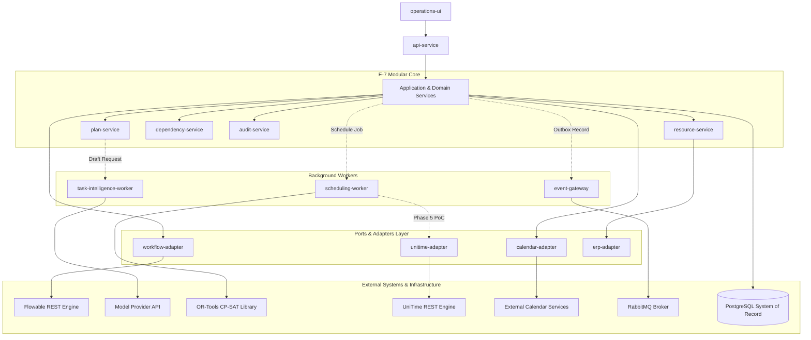

# Canonical Domain Ownership and Service Boundary Freeze

---

## 1. Purpose and Architectural Scope

This document formally establishes and freezes the **Canonical Domain Ownership, State Authority, and Service Boundaries** for the **IR Infotech E-7 Operations Engine**.

### 1.1 Architectural Purpose
The objective of this specification is to prevent architectural drift, accidental data model duplication, boundary bypasses, and unauthorized cross-subsystem coupling during implementation. It explicitly codifies:
* Which E-7 subsystem owns each canonical domain concept.
* Which system of record is authoritative for each state category.
* Which components hold read and write permissions for each domain entity.
* The isolation boundaries governing third-party execution engines (Flowable, OR-Tools, UniTime).
* Rules for handling external provider identifiers versus internal canonical identifiers.
* Permitted and strictly forbidden inter-component call paths.

### 1.2 Non-Scope & Governance Boundaries
* **Not Physical Deployment Topology**: Component names define **logical responsibility boundaries** within an initial Python modular monorepo. They do NOT mandate independent microservices, separate databases, or container-per-module overhead.
* **Not a Replacement for RTM**: This document operationalizes the requirements traced in [`docs/REQUIREMENTS_TRACEABILITY_MATRIX.md`](file:///F:/operations-engine/docs/REQUIREMENTS_TRACEABILITY_MATRIX.md); it does not alter or renumber functional requirements.
* **Not a Database Schema Implementation**: This document freezes semantic entity ownership and authority rules. It intentionally does NOT define SQL DDL, column data types, foreign key cascade policies, indexes, JSONB structures, or SQLAlchemy ORM code (which belong to the Phase 1 schema implementation).

### 1.3 Core Invariant: Logical Boundary != Deployment Unit
The E-7 architecture adheres to a clean modular architecture:
1. **Single Modular Monorepo**: All IR-owned Python application logic resides in `app/` organized by cohesive package boundaries.
2. **Dedicated Runtimes Only Where Justified**:
   * **Flowable Engine**: Deployed as a dedicated Java container (`flowable-rest`) because it is a separate Java/BPMN runtime.
   * **PostgreSQL & RabbitMQ**: Deployed as dedicated infrastructure containers.
   * **Task Intelligence & Scheduling Workers**: Implemented as background worker processes to isolate compute-intensive LLM network calls and constraint-solving jobs from synchronous HTTP API latency.
   * **Domain Services** (`plan-service`, `resource-service`, `dependency-service`, `audit-service`, `event-gateway`, `analytics-api`): Initialized as modular Python domain services within the E-7 codebase, communicating via internal Python interfaces, not distributed RPC or microservices.

---

## 2. Canonical Component Vocabulary

The system architecture defines exactly **14 canonical components**:

1. **`api-service`**: Synchronous REST/OpenAPI ingress, JWT authentication verification, tenant context resolution, correlation ID assignment, request validation, and HTTP response serialization.
2. **`plan-service`**: Canonical domain owner for Goals, Plans, Tasks, Milestones, Task Dependencies, and Plan Baselines in PostgreSQL.
3. **`task-intelligence-worker`**: Asynchronous worker executing prompt construction, LLM inference via PydanticAI provider abstraction, structured JSON extraction, and bounded schema repair.
4. **`dependency-service`**: Pure deterministic graph computation library/service utilizing NetworkX for cycle detection, topological sorting, slack analysis, and Critical Path Method (CPM) math.
5. **`workflow-adapter`**: Anti-corruption layer translating canonical E-7 workflow concepts to Flowable REST API calls, mapping process definitions, instances, and human tasks.
6. **`Flowable runtime`**: Authoritative external Java/BPMN 2.0 and DMN 1.3 execution runtime managing active process state tokens, execution trees, persisted timers, and user tasks.
7. **`scheduling-worker`**: Asynchronous worker executing constraint mathematical modeling, Google OR-Tools CP-SAT solving, objective optimization, and infeasibility diagnostics.
8. **`unitime-adapter`**: Specialized adapter translating canonical academic course/room scheduling datasets to/from UniTime during Phase 5 evaluation benchmarks.
9. **`resource-service`**: Canonical registry for people, rooms, and equipment, tracking capacity, skills, availability windows, and external synchronization freshness.
10. **`calendar-adapter`**: Anti-corruption layer translating scheduled assignments to external iCal/CalDAV/Google/Microsoft calendar events with timezone normalization and sync tokens.
11. **`event-gateway`**: Asynchronous messaging gateway implementing the Transactional Outbox publisher and consumer inbox deduplication over RabbitMQ.
12. **`audit-service`**: Append-only compliance ledger recording immutable actor, source, correlation ID, and state transition histories.
13. **`analytics-api`**: Read-only query service aggregating operational KPIs, planning velocity, workflow bottlenecks, and resource utilization metrics.
14. **`operations-ui`**: Frontend browser application providing workflow modeling (bpmn-js), decision modeling (dmn-js), plan review, schedule inspection, and task inbox interfaces.

### Logical Workflow Submodules
The following capabilities are modular domain components within `app/workflow/`, not separate microservices:
* **DMN / Rule Handling**: Business rule evaluation and decision table execution logic.
* **SLA Policy Handling**: SLA calculation, warning threshold triggers, and escalation policies.
* **Workflow Artifact Management**: Versioned storage, validation, and hash tracking of BPMN/DMN XML assets.

---

## 3. Component Responsibility Matrix

| Component | Primary Responsibility | Owns Canonical State? | May Mutate Canonical State? | External Runtime Dependency | Allowed Inputs | Allowed Outputs | Must NOT Do | Initial Deployment Form | First Phase |
| :--- | :--- | :---: | :---: | :--- | :--- | :--- | :--- | :--- | :---: |
| **`api-service`** | REST ingress, auth, tenant resolution, idempotency, input validation | No | No (Delegates to Services) | None | HTTP requests, Bearer tokens, headers | HTTP responses, OpenAPI specs, Problem Details JSON | Contain business logic; query DB directly for business mutations; trust client-provided tenant_id; call model/solver APIs directly | Synchronous Web Process (Uvicorn) | Phase 1 |
| **`plan-service`** | Goal, plan, task, milestone, and baseline lifecycle management | **Yes** | **Yes** | None | Plan commands, task updates, verified proposals | Canonical plan records, domain events, validation errors | Execute solver algorithms; call LLM providers; bypass authorization policies | Python Application Module (`app/domain/`) | Phase 1 |
| **`task-intelligence-worker`** | Structured plan generation, prompt orchestration, schema repair | No | No (Proposals Only) | LLM Provider API / vLLM | Asynchronous goal context, generation requests | Validated `PlanSchema` proposals, token/cost telemetry | Directly activate plans; mutate canonical tasks; publish schedules; bypass Pydantic validation | Asynchronous Background Worker | Phase 2 |
| **`dependency-service`** | Graph cycle detection, topological sorting, CPM slack math | No | No (Pure Compute) | NetworkX (In-process) | Task & dependency graph adjacency lists | Topological ordering, critical paths, cycle diagnostics | Own persistent entities; store graph data independently; mutate task records | Python In-Process Library (`app/task_intelligence/graph/`) | Phase 2 |
| **`workflow-adapter`** | Flowable REST translation, process deployment, task action mapping | **Yes** (Mappings) | **Yes** (Workflow State) | Flowable Engine REST API | Workflow commands, task completion requests | Mapped workflow state, human task lists, errors | Expose Flowable native IDs publicly; query Flowable DB directly; bypass E-7 auth | Python Application Module (`app/workflow/adapters/`) | Phase 3 |
| **`Flowable runtime`** | BPMN token execution, state persistence, timer jobs, DMN execution | **Yes** (Native Runtime) | **Yes** (Engine State) | Flowable PostgreSQL Schema | Flowable REST JSON payloads | Flowable process/task state, DMN evaluation results | Store E-7 business entities; manage tenancy isolation; bypass adapter layer | Standalone Java Container (`flowable-rest`) | Phase 3 |
| **`scheduling-worker`** | Hard/soft constraint modeling, CP-SAT solve, repair, diagnostics | No | No (Candidates Only) | Google OR-Tools (CP-SAT) | Canonical scheduling job snapshots, constraint parameters | Candidate schedule solutions, infeasibility diagnoses | Directly publish schedules; mutate ERP master records; invent unverified resources | Asynchronous Background Worker | Phase 4 |
| **`unitime-adapter`** | Academic course/room timetabling translation for Phase 5 PoC | **Yes** (Mappings) | **Yes** (Candidate Mapping) | UniTime REST API | Canonical academic scheduling inputs | Mapped candidate timetables, conflict reports | Act as canonical store; expose UniTime native IDs; replace OR-Tools without ADR | Python Application Module (`app/integrations/unitime/`) | Phase 5 |
| **`resource-service`** | People/room/equipment registry, skills, capacity, availability intervals | **Yes** | **Yes** | ERP / SIS Adapter (Embedded Mode) | Resource commands, availability updates, sync feeds | Canonical resource profiles, availability masks | Silently overwrite ERP master data; merge identity with availability | Python Application Module (`app/resources/`) | Phase 1 |
| **`calendar-adapter`** | Calendar event mapping, timezone normalization, sync tokens | **Yes** (Mappings) | **Yes** (Sync State) | CalDAV / Google / MS Graph | Published schedule assignments, sync triggers | Calendar event mappings, synchronization statuses | Treat failed external sync as success; mutate unpublished schedules | Python Application Module (`app/integrations/calendar/`) | Phase 6 |
| **`event-gateway`** | Transactional outbox polling, event publishing, consumer deduplication | **Yes** (Outbox/Inbox) | **Yes** (Outbox/Inbox) | RabbitMQ (AMQP) | Internal domain events, inbound AMQP messages | Outbox dispatches, routed consumer invocations | Decide domain state transitions; bypass DB outbox transaction; lose message deduplication | Python Background Publisher / Consumer | Phase 1 |
| **`audit-service`** | Immutable append-only audit event logging and correlation tracking | **Yes** (Audit Log) | **Yes** (Append-Only) | PostgreSQL Audit Storage | State transition records, actor context, diff payloads | Immutable audit log streams, query results | Allow updates or deletes of audit records; skip tenant isolation | Python Application Module (`app/audit/`) | Phase 1 |
| **`analytics-api`** | Read-optimized aggregation of planning, workflow, and solver KPIs | No | No (Read-Only) | None | Analytics query parameters, filter criteria | Aggregated metrics, KPI summaries, SLA trends | Act as write path into domain state; run unindexed full-table scans | Python Application Module (`app/analytics/`) | Phase 7 |
| **`operations-ui`** | Visual plan editing, workflow designer, schedule inspection, inbox | No | No (Client-Side) | Browser Environment | User interactions, form inputs, designer gestures | API HTTP requests with JWT & correlation headers | Connect directly to DB/Flowable/Solvers; strip bpmn.io watermarks | Static Web App (Vite/React Bundle) | Phase 3 |

---

## 4. Canonical Entity Ownership Matrix

PostgreSQL is the single authoritative transactional system of record for all E-7 canonical entities. Third-party engine IDs are strictly secondary mapping attributes.

| Entity | Canonical Owner | Authoritative Storage | Primary Writer | Allowed Secondary Writers | Primary Readers | External Authoritative Source | External ID Mapping Required? | Tenant-Scoped? | Lifecycle Owner | Notes |
| :--- | :--- | :--- | :--- | :--- | :--- | :--- | :---: | :---: | :--- | :--- |
| **`tenants`** | `api-service` / Core | PostgreSQL (`tenants`) | Platform Admin API | None | All E-7 Components | None (IR Sovereign) | No | Sovereign Root | Platform Admin | Root isolation boundary. |
| **`users`** | `api-service` / Auth | PostgreSQL (`users`) | Auth Sync / Admin API | None | All E-7 Components | Corporate IdP / SSO | Yes (`idp_sub`) | Yes (`tenant_id`) | Tenant Admin | Maps external IdP identity. |
| **`goals`** | `plan-service` | PostgreSQL (`goals`) | `plan-service` | None | `plan-service`, `task-intelligence-worker`, UI | None | Optional (ERP Project ID) | Yes (`tenant_id`) | Goal Owner | High-level business objective. |
| **`plans`** | `plan-service` | PostgreSQL (`plans`) | `plan-service` | None | `plan-service`, `scheduling-worker`, UI | None | Optional (External Project) | Yes (`tenant_id`) | Plan Owner | Approved versioned baseline. |
| **`tasks`** | `plan-service` | PostgreSQL (`tasks`) | `plan-service` | `workflow-adapter` (status sync) | All Subsystems | None | Optional (Issue Tracker ID) | Yes (`tenant_id`) | Plan Service | Canonical work breakdown item. |
| **`task_dependencies`** | `plan-service` | PostgreSQL (`task_dependencies`) | `plan-service` | None | `dependency-service`, `plan-service` | None | No | Yes (via Task) | Plan Service | Directed acyclic graph edges. |
| **`milestones`** | `plan-service` | PostgreSQL (`milestones`) | `plan-service` | None | `plan-service`, UI | None | No | Yes (`tenant_id`) | Plan Service | Major plan delivery dates. |
| **`task_risks`** | `plan-service` | PostgreSQL (`task_risks`) | `plan-service` | `task-intelligence-worker` | `plan-service`, UI | None | No | Yes (via Task) | Plan Service | Execution risk flags. |
| **`workflow_definitions`** | `workflow-adapter` | PostgreSQL (`workflow_definitions`) | `workflow-adapter` | None | `workflow-adapter`, UI | Flowable Engine (Deployment) | Yes (`flowable_deployment_id`) | Yes (`tenant_id`) | Process Owner | Versioned BPMN/DMN package. |
| **`workflow_instances`** | `workflow-adapter` | PostgreSQL (`workflow_instances`) | `workflow-adapter` | None | `workflow-adapter`, UI | Flowable Runtime (Instance) | Yes (`flowable_process_instance_id`) | Yes (`tenant_id`) | Workflow Adapter | Active workflow execution tracker. |
| **`workflow_tasks`** | `workflow-adapter` | PostgreSQL (`workflow_tasks`) | `workflow-adapter` | None | `workflow-adapter`, UI | Flowable Runtime (Task) | Yes (`flowable_task_id`) | Yes (`tenant_id`) | Workflow Adapter | Human task inbox items. |
| **`sla_policies`** | `workflow-adapter` | PostgreSQL (`sla_policies`) | `workflow-adapter` | None | `workflow-adapter`, `audit-service` | None | No | Yes (`tenant_id`) | Process Owner | Timers and escalation rules. |
| **`resources`** | `resource-service` | PostgreSQL (`resources`) | `resource-service` | None | `scheduling-worker`, UI | ERP / SIS / HRMS (Embedded) | Yes (`external_id`, `provider`) | Yes (`tenant_id`) | Resource Admin | People, rooms, and equipment. |
| **`resource_availability`**| `resource-service` | PostgreSQL (`resource_availability`)| `resource-service` | None | `scheduling-worker` | External Calendars / HRMS | Yes (`calendar_event_id`) | Yes (via Resource)| Resource Admin | Time interval availability. |
| **`constraints`** | `scheduling-worker`| PostgreSQL (`constraints`) | `scheduling-worker`| None | `scheduling-worker` | None | No | Yes (`tenant_id`) | Scheduling Admin | Hard/soft mathematical rules. |
| **`schedule_jobs`** | `scheduling-worker`| PostgreSQL (`schedule_jobs`) | `scheduling-worker`| None | `scheduling-worker`, UI | None | No | Yes (`tenant_id`) | Scheduler | Solver run execution tracker. |
| **`schedule_assignments`** | `scheduling-worker`| PostgreSQL (`schedule_assignments`)| `scheduling-worker`| `calendar-adapter` (sync status) | All Subsystems | None | No | Yes (via Job) | Scheduler | Time-slot & resource bindings. |
| **`calendar_links`** | `calendar-adapter` | PostgreSQL (`calendar_links`) | `calendar-adapter` | None | `calendar-adapter` | External Calendar Service | Yes (`external_event_id`) | Yes (`tenant_id`) | Calendar Adapter | Outward calendar event mappings. |
| **`domain_events`** | `event-gateway` | PostgreSQL (`domain_events` outbox)| Domain Services | `event-gateway` (mark dispatched) | `event-gateway` | None | No | Yes (`tenant_id`) | Event Gateway | Transactional Outbox log. |
| **`event_inbox`** | `event-gateway` | PostgreSQL (`event_inbox`) | `event-gateway` | None | Internal Consumers | RabbitMQ Delivery Tag | Yes (`message_id`) | Yes (`tenant_id`) | Event Gateway | Idempotent consumer ledger. |
| **`audit_events`** | `audit-service` | PostgreSQL (`audit_events`) | `audit-service` | None (All write via audit API)| Compliance / Auditing | None | No | Yes (`tenant_id`) | Audit Service | Immutable compliance ledger. |

---

## 5. Authoritative State Matrix

State authority is partitioned strictly across specialized engines. External runtimes hold transient or native execution state, but E-7 in PostgreSQL is the sole arbiter of canonical truth:

| State Category | Authoritative Owner | Canonical Persisted Representation | Native External / Runtime Representation | Who May Transition It? | Who May NOT Transition It? | Reconciliation Behavior |
| :--- | :--- | :--- | :--- | :--- | :--- | :--- |
| **Goal / Plan Baseline** | `plan-service` | PostgreSQL `plans` table (`status=APPROVED`, `baseline_hash`) | None | Authorized Human / Tenant Approval Policy | `task-intelligence-worker`, LLM Provider, `api-service` routes directly | LLM proposes; approved canonical record is authoritative. Unapproved LLM proposals remain transient until explicit approval. |
| **AI Planner Output** | Non-Authoritative | Ephemeral Pydantic Schema / Staging Plan | LLM Token Stream / JSON Response | `task-intelligence-worker` validator | `plan-service` without validation; UI without human review | Discarded or repaired if schema validation fails; never directly activated. |
| **Dependency Graph State** | `dependency-service` | PostgreSQL `task_dependencies` table | NetworkX DiGraph (In-Memory) | `plan-service` via DAG validation | `scheduling-worker`, `workflow-adapter`, raw SQL routes | Graph recomputed on every task dependency update; cycles rejected. |
| **Workflow Execution State**| Flowable Runtime | PostgreSQL `workflow_instances` mapping | Flowable DB `ACT_RU_EXECUTION`, `ACT_RU_TASK` | Flowable Process Engine via `workflow-adapter` | `api-service`, direct DB update, UI | Flowable event webhook/poll reconciles canonical instance status. |
| **DMN Decision Result** | Flowable DMN | PostgreSQL `audit_events` / task payload | Flowable DMN Rule Engine execution table | Flowable DMN Service via versioned key | Client UI, LLM provider, direct user edit | Re-evaluated with identical inputs yields deterministic immutable output. |
| **SLA / Timer Runtime** | Flowable Runtime | PostgreSQL `workflow_tasks` (`due_at`, `sla_status`) | Flowable Job Executor `ACT_RU_JOB` | Flowable Async Job Executor | In-memory FastAPI timers, client browser | Flowable timer fire triggers webhook/message updating E-7 task SLA. |
| **Schedule Job State** | `scheduling-worker`| PostgreSQL `schedule_jobs` (`status=RUNNING,COMPLETED`) | Solver thread process memory | `scheduling-worker` job manager | UI, `api-service` route handlers, RabbitMQ consumers | Stalled jobs timed out by worker supervisor; status set to `FAILED`. |
| **Candidate Schedule** | `scheduling-worker`| PostgreSQL `schedule_assignments` (`status=CANDIDATE`) | OR-Tools CP-SAT solution vectors | `scheduling-worker` upon solver completion | Human planner, `calendar-adapter`, `workflow-adapter` | Solver proposals remain un-synchronized to calendars until approved. |
| **Published Schedule** | `scheduling-worker` / Policy | PostgreSQL `schedule_assignments` (`status=PUBLISHED`) | None | Authorized Planner / Tenant Auto-Publish Policy | OR-Tools CP-SAT solver, LLM provider, `calendar-adapter` | Published assignments trigger `SchedulePublishedEvent` to calendar adapter. |
| **Solver Internal State** | OR-Tools CP-SAT | Ephemeral Worker Memory | C++ CP-SAT solver model & variable state | `scheduling-worker` solver thread | Any external service or database writer | Discarded immediately after solution extraction; never persisted. |
| **Resource Master Record** | ERP / SIS / HRMS | PostgreSQL `resources` cache (`external_id`, `provider`) | ERP Database / SIS API | External Master System (in Embedded Mode) | E-7 internal CRUD (when Embedded Mode active) | Scheduled batch or webhook synchronization updates E-7 resource cache. |
| **E-7 Resource Registry** | `resource-service` | PostgreSQL `resources` table | None | `resource-service` Admin API (Universal Mode) | External systems (in Universal Mode) | E-7 is sovereign; direct CRUD enabled for tenant administrators. |
| **External Calendar Record**| External Calendar Provider | None | Google Calendar / CalDAV / Exchange Event | External Calendar Service | E-7 directly without calendar-adapter mapping | External provider owns event; E-7 tracks sync token and external ID. |
| **Calendar Sync State** | `calendar-adapter` | PostgreSQL `calendar_links` (`sync_status`, `sync_token`) | None | `calendar-adapter` worker | External provider, UI, `scheduling-worker` | Synchronization retries with exponential backoff on provider failure. |
| **Domain Event Transport** | RabbitMQ Transport | RabbitMQ Broker Queue | AMQP Message Frame / Delivery Tag | RabbitMQ Erlang Broker | Domain services, PostgreSQL outbox poller | Transport is transient; surviving broker restart via persistent delivery. |
| **Canonical Event Outbox** | `event-gateway` | PostgreSQL `domain_events` table | None | Domain Service (Atomic Write) | RabbitMQ, external API clients | Poller reads un-dispatched rows; commits dispatched flag after ACK. |
| **Audit History** | `audit-service` | PostgreSQL `audit_events` table | None | `audit-service` via internal audit port | Any user or administrator (Strictly Immutable) | Append-only; zero updates or deletions permitted under any role. |

---

## 6. Identifier Policy

To prevent vendor lock-in and security leakage, E-7 establishes three strictly demarcated identifier tiers:

### 6.1 Canonical E-7 ID (Canonical Identifier)
* **Format**: Standard UUIDv4 (represented as lowercase hyphenated strings in public APIs and binary UUIDs in database storage).
* **Scope**: Globally unique across tenants and environments.
* **Usage**: Primary keys in canonical PostgreSQL tables, entity references in public REST APIs, aggregate identifiers in domain events, and correlation handles in UI navigation routes.
* **Ownership**: Exclusively generated and minted by E-7 core services.

### 6.2 External Provider ID (External Identifier)
* **Examples**: `flowable_process_instance_id`, `flowable_task_id`, `unitime_course_offering_id`, `odoo_hr_employee_id`, `google_calendar_event_id`.
* **Scope**: Sovereign to the respective third-party engine or external system.
* **Usage**: Stored **strictly as secondary mapping attributes** within mapping tables (e.g., `calendar_links`, `workflow_instances`, `resources`).
* **Governance Rule**: **Never exposed as public canonical IDs.** Public API clients never interact with raw Flowable task IDs or Google event IDs.

### 6.3 Correlation / Idempotency ID
* **Correlation ID (`X-Correlation-ID`)**: Passed across HTTP headers, worker jobs, Flowable business keys, and RabbitMQ message metadata to trace end-to-end execution across boundaries.
* **Idempotency Key (`Idempotency-Key`)**: Client-generated token stored in `idempotency_keys` table to guarantee exactly-once semantic processing of state-changing HTTP requests.
* **Governance Rule**: Never overloaded or substituted for canonical entity IDs.

---

## 7. External Mapping Rules

All external integrations must decouple third-party identifiers from canonical identity using an explicit mapping specification:

```
+-------------------------------------------------------------------------------+
|                             Canonical Entity                                  |
|  (e.g., canonical_task_id: "e7-task-9021", tenant_id: "tenant-acme")         |
+---------------------------------------+---------------------------------------+
                                        |
                                        v
+-------------------------------------------------------------------------------+
|                       External Entity Mapping Record                          |
|  - tenant_id:               "tenant-acme"                                     |
|  - provider:                "FLOWABLE_REST"                                   |
|  - entity_type:             "WORKFLOW_TASK"                                   |
|  - canonical_id:            "e7-task-9021"                                    |
|  - external_id:             "act-task-54891"                                  |
|  - external_version / etag: "v3"                                              |
|  - sync_status:             "SYNCHRONIZED"                                    |
|  - last_synchronized_at:    2026-09-16T03:00:00Z                              |
|  - metadata_json:           {"flowable_execution_id": "exec-102"}             |
+-------------------------------------------------------------------------------+
```

### Mapping Governance Rules
1. **Dynamic Provider Registration**: Provider names (`FLOWABLE_REST`, `UNITIME_POC`, `CALDAV_WORKER`, `ODOO_ERP`) are registered via configuration; provider names must never be hardcoded into core domain logic.
2. **Atomic Mapping Updates**: When an external adapter receives a response from an upstream system, updating the local mapping and writing the audit record must occur within a unified transactional boundary.
3. **Outage Resilience**: If an external provider is unreachable, the mapping status must reflect `SYNC_FAILED` or `PENDING_RETRY`; it must **never** report false synchronization.

---

## 8. Allowed Dependency Directions

The architecture enforces a strict layered dependency structure following Clean Architecture principles:



### Explicit Subsystem Call Paths
1. **Task Intelligence**:
   * `api-service` $
ightarrow$ `plan-service` $
ightarrow$ (enqueues job) $
ightarrow$ `task-intelligence-worker` $
ightarrow$ Provider Abstraction $
ightarrow$ LLM.
   * `task-intelligence-worker` $
ightarrow$ `dependency-service` (validates generated DAG).
   * Validated proposal $
ightarrow$ `plan-service` (stores draft for human review).
2. **Workflow**:
   * `api-service` $
ightarrow$ `workflow-adapter` $
ightarrow$ Flowable REST API.
   * Flowable Webhook $
ightarrow$ `workflow-adapter` $
ightarrow$ updates canonical `workflow_instances` mapping & logs audit event.
3. **Scheduling**:
   * `api-service` $
ightarrow$ `plan-service` $
ightarrow$ triggers job $
ightarrow$ `scheduling-worker`.
   * `scheduling-worker` reads snapshot from PostgreSQL $
ightarrow$ models in OR-Tools $
ightarrow$ writes candidate solution to PostgreSQL.
   * Human / Policy Approval $
ightarrow$ transitions candidate to `PUBLISHED` $
ightarrow$ triggers `calendar-adapter`.
4. **Calendar Integration**:
   * Published schedule event $
ightarrow$ `calendar-adapter` $
ightarrow$ CalDAV/Google API.
5. **Transactional Events**:
   * Domain command $
ightarrow$ PostgreSQL atomic transaction (`domain_state` + `domain_events` outbox).
   * `event-gateway` background poller $
ightarrow$ reads outbox $
ightarrow$ publishes to RabbitMQ exchange.
6. **Audit**:
   * Any state mutation $
ightarrow$ synchronous write to `audit_events` table within domain transaction.

---

## 9. Forbidden Dependencies

To prevent coupling and architectural erosion, the following cross-subsystem dependencies are **strictly forbidden**:

| Calling Component | Prohibited Target | Violation Type | Architectural Hazard / Rationale |
| :--- | :--- | :--- | :--- |
| **`operations-ui`** | PostgreSQL Database | Direct DB Access | Bypasses authentication, authorization, tenancy, and audit logging. |
| **`operations-ui`** | Flowable REST API | Boundary Bypass | Leaks internal workflow engine implementation and native IDs to frontend. |
| **`operations-ui`** | Google OR-Tools Library | Layer Violation | Solver requires worker environment and snapshot validation. |
| **`operations-ui`** | UniTime Server | Boundary Bypass | Academic solver PoC must remain behind canonical scheduling facade. |
| **`operations-ui`** | LLM Provider API | Security Leak | Exposes provider credentials and circumvents prompt guardrails. |
| **Route Handler (`app/api/`)** | Raw External Third-Party APIs | Layer Violation | Routes must delegate to domain services; zero direct network egress. |
| **Route Handler (`app/api/`)** | OR-Tools CP-SAT Solver | CPU Saturation | Heavy constraint computation will freeze the async HTTP event loop. |
| **Route Handler (`app/api/`)** | Flowable PostgreSQL Schema | Data Layer Bypass | Direct schema tampering corrupts Flowable execution state tables. |
| **`task-intelligence-worker`** | Authoritative Workflow Transition | Authority Breach | AI outputs are proposals; only humans or approved policies execute workflows. |
| **`task-intelligence-worker`** | Schedule Publication | Authority Breach | AI cannot publish schedules without constraint solver validation and review. |
| **LLM Provider API** | PostgreSQL Database | Direct DB Access | Third-party AI models never hold direct SQL connectivity or storage rights. |
| **LLM Output Payload** | Direct Domain Activation | Authority Breach | Unvalidated JSON must never be directly saved to active canonical tables. |
| **`dependency-service`** | Workflow Authorization Override | Authority Breach | Dependency service is a pure math library; cannot approve workflow steps. |
| **`scheduling-worker`** | ERP Master Data Mutation | Authority Breach | Solver cannot alter master employee, course, or room records in external ERP. |
| **`scheduling-worker`** | Direct Calendar Mutation | Timing Violation | Calendars must only synchronize after schedule has been explicitly published. |
| **OR-Tools Library** | PostgreSQL Direct Connection | Layer Violation | Solver receives memory structs; never connects to SQL as a persistence engine. |
| **UniTime Database** | Public E-7 API Identity | Vendor Leakage | UniTime native primary keys must never be exposed as canonical E-7 IDs. |
| **Flowable Database** | Canonical E-7 API Identity | Vendor Leakage | Flowable process IDs must never be exposed as canonical E-7 IDs. |
| **RabbitMQ Message** | Trusted State Change | Unvalidated Ingress | Inbound messages must undergo tenant validation and deduplication. |
| **`analytics-api`** | Canonical State Mutation | Read/Write Inversion | Analytics is strictly read-only; zero write permissions on domain tables. |
| **External Webhook Callback** | Immediate State Mutation | Security Breach | Callbacks must undergo signature verification, tenant validation, and dedupe. |
| **Cross-Tenant Query** | Any Domain Mutation | Tenancy Breach | Any operation referencing another tenant's foreign key must be blocked. |

---

## 10. Transaction Boundaries & Consistency

E-7 enforces rigorous transaction isolation using standard transactional outbox patterns while rejecting distributed transactions:

### 10.1 Single-Database ACID Boundary
All state mutations within E-7 occur within local PostgreSQL transactions. An atomic transaction must simultaneously commit:
1. The canonical entity state mutation (e.g., Task status updated to `COMPLETED`).
2. The audit log record in `audit_events` capturing actor, action, and diff.
3. The outbound domain event in `domain_events` (Transactional Outbox).

```
BEGIN TRANSACTION;
  UPDATE tasks SET status = 'COMPLETED', updated_at = NOW() WHERE id = 'task-101';
  INSERT INTO audit_events (tenant_id, actor, action, entity_id, ...) VALUES (...);
  INSERT INTO domain_events (tenant_id, aggregate_id, event_type, payload, ...) VALUES (...);
COMMIT;
```

### 10.2 Separate Consistency Domains (No 2PC)
* **No Distributed Two-Phase Commit**: E-7 and Flowable (or external ERPs) do **NOT** share a distributed XA transaction. Flowable operates in its own database transaction.
* **Eventual Consistency via Outbox**: State synchronization between E-7 and external engines relies on:
  * Transactional Outbox pattern for guaranteed message emission.
  * Consumer Inbox pattern with `message_id` deduplication.
  * Exponential backoff retry policies for transient network failures.
  * Compensating transactions when an upstream call fails permanently.
* **No Exactly-Once Delivery Claims**: Transport over RabbitMQ guarantees **at-least-once delivery**. Processing exactly-once semantics is enforced at the application layer via idempotent consumer deduplication.

---

## 11. Workflow Consistency Boundary

Flowable is the authoritative engine for BPMN execution tokens, while E-7 is authoritative for business permissions and canonical domain mappings.

```
[Client UI] 
     | 1. Submit Action (Task ID: e7-task-1)
     v
[api-service] 
     | 2. Verify JWT & Tenant Auth
     v
[workflow-adapter] 
     | 3. Resolve Mapping (e7-task-1 -> flowable-task-99)
     | 4. Invoke Flowable REST API (POST /runtime/tasks/99)
     v
[Flowable Engine] 
     | 5. Advance BPMN Execution Token
     v
[workflow-adapter] 
     | 6. Update Canonical Mapping & Commit Outbox Event
     v
[PostgreSQL] (Atomic state + audit + outbox)
```

### Non-Negotiable Workflow Rules
1. **Never Fake Success**: If Flowable returns an HTTP error or rejects a transition, the E-7 workflow adapter must raise a domain error; it must **never** fabricate a successful local state transition.
2. **Never Direct-Update Flowable Tables**: E-7 services never connect to Flowable's internal tables (`ACT_*`). All interactions occur strictly via Flowable's authenticated REST endpoints.
3. **E-7 Authorization Gate**: Flowable does not know E-7 tenant roles. E-7 must fully authorize every action before forwarding it to Flowable.

---

## 12. Scheduling Consistency Boundary

Constraint solving follows a strict pipeline distinguishing computational candidates from authoritative published schedules:

```
[Canonical State Snapshot] (Tasks, Resources, Constraints, Unavailability)
             |
             v
     [scheduling-worker]
             | (Build CP-SAT Model)
             v
   [Google OR-Tools Solver]
             |
             +---> [INFEASIBLE] ---> Generate Conflict Diagnostics & Repair Advice
             |
             +---> [FEASIBLE / OPTIMAL]
                         |
                         v
           [Candidate Schedule Created] (Stored in PostgreSQL as CANDIDATE)
                         |
                         v
               [Human / Policy Review]
                         |
                         +---> [REJECTED] ---> Modify Constraints & Re-solve
                         |
                         +---> [APPROVED / PUBLISHED]
                                     |
                                     v
                       [Published Schedule Active]
                                     |
                                     v
                          [Calendar Synchronization]
```

### Non-Negotiable Scheduling Rules
1. **Solver Output is Non-Authoritative**: An optimal solution from OR-Tools is merely a candidate proposal. It does not become an active operational schedule until accepted by a human manager or explicit tenant auto-publish policy.
2. **Explicit Infeasibility**: If a constraint model cannot be solved, the engine must return an explicit `INFEASIBLE` diagnostic payload pinpointing conflicting constraints; it must **never** return an empty or truncated schedule as "success".
3. **Calendar Isolation**: Un-published candidate schedules must never be pushed to external employee calendars.

---

## 13. Task Intelligence Consistency Boundary

The Task Intelligence subsystem utilizes generative AI strictly for proposal drafting, never for direct state activation:

```
[User Objective / Goal]
          |
          v
[api-service] (Verify Auth & Tenant)
          |
          v
[plan-service] (Construct Authorized Context Snapshot)
          |
          v
[task-intelligence-worker]
          |
          v
[PydanticAI / Model Provider] (Generate Structured Draft)
          |
          v
[Pydantic Schema Validation] (Enforce strict types, ranges, enums)
          |
          v
[Domain Policy Validation] (Check tenant boundaries & capability rules)
          |
          v
[dependency-service] (Assert DAG: Cycle detection & topological sort)
          |
          +---> [VALIDATION FAILURE] ---> Bounded Repair Loop (Max 2 Attempts)
          |
          +---> [VALIDATION SUCCESS]
                      |
                      v
          [Staged Draft Plan Created] (Status: PROPOSED / DRAFT)
                      |
                      v
             [Human Review / Approval]
                      |
                      v
         [Canonical Approved Baseline] (Status: APPROVED, Baseline Hash Minted)
```

### Non-Negotiable AI Rules
1. **No Direct State Mutation**: AI agents and LLM API calls are strictly forbidden from writing directly to active canonical tables (`tasks`, `plans`, `milestones`).
2. **Temporary Reference IDs**: Any IDs generated by the LLM (e.g., `temp-task-1`) are treated as transient validation tokens. Real canonical UUIDs are minted exclusively by `plan-service` during draft staging.
3. **Bounded Repair**: Automated repair of ill-formed LLM responses is capped at 2 iterations. If the schema remains invalid, the operation fails explicitly with diagnostic context.

---

## 14. Resource Ownership Modes

E-7 supports two operational resource management modes:

### 14.1 Universal Mode (Standalone)
* **Authority**: E-7 is the sovereign master of all resource definitions.
* **Management**: People, equipment, and room resources are created, updated, and deactivated directly via E-7 `resource-service` APIs.
* **Storage**: Primary resource attributes, skills, and capacities are stored authoritatively in PostgreSQL `resources`.

### 14.2 Embedded Mode (Integrated Enterprise)
* **Authority**: An external client system (e.g., Odoo ERP, ERPNext, SIS, Workday) is the authoritative master for personnel, payroll, and facility records.
* **E-7 Role**: E-7 maintains a **canonical operational replica and mapping cache**.
* **Governance Invariant**:
  * E-7 **never** silently overwrites external master data.
  * E-7 tracks `provider`, `external_id`, and `last_synchronized_at` metadata for every resource.
  * Operational scheduling attributes (e.g., temporary skill tags, task assignment readiness) are managed by E-7 without corrupting the upstream ERP record.

---

## 15. Read/Write Authority Matrix

The following compact matrix codifies read and write permissions across all canonical data domains:

| Subsystem / Component | Plan Data | Workflow Mappings | Flowable Runtime | Resource Data | Schedule Data | Calendar Mappings | Events / Outbox | Audit Log |
| :--- | :---: | :---: | :---: | :---: | :---: | :---: | :---: | :---: |
| **`plan-service`** | **OWNER** | READ | NONE | READ | READ | NONE | **OWNER** | APPEND ONLY |
| **`task-intelligence-worker`**| WRITE VIA OWNER | NONE | NONE | READ | NONE | NONE | NONE | APPEND ONLY |
| **`dependency-service`** | READ | NONE | NONE | NONE | NONE | NONE | NONE | NONE |
| **`workflow-adapter`** | WRITE VIA OWNER | **OWNER** | **ADAPTER** | READ | NONE | NONE | **OWNER** | APPEND ONLY |
| **`Flowable runtime`** | NONE | NONE | **OWNER** | NONE | NONE | NONE | NONE | NONE |
| **`scheduling-worker`** | READ | NONE | NONE | READ | **OWNER** | NONE | **OWNER** | APPEND ONLY |
| **`unitime-adapter`** | NONE | NONE | NONE | READ | WRITE VIA OWNER | NONE | NONE | APPEND ONLY |
| **`resource-service`** | READ | NONE | NONE | **OWNER** | READ | NONE | **OWNER** | APPEND ONLY |
| **`calendar-adapter`** | NONE | NONE | NONE | READ | READ | **OWNER** | **OWNER** | APPEND ONLY |
| **`event-gateway`** | NONE | NONE | NONE | NONE | NONE | NONE | **OWNER** | NONE |
| **`audit-service`** | READ | READ | NONE | READ | READ | READ | NONE | **OWNER** |
| **`analytics-api`** | READ | READ | NONE | READ | READ | READ | NONE | NONE |
| **`operations-ui`** | READ | READ | NONE | READ | READ | READ | NONE | NONE |

*Values:*
* **`OWNER`**: Component holds primary write authority and manages the canonical lifecycle.
* **`READ`**: Component has authorized query access.
* **`WRITE VIA OWNER`**: Component may submit validated proposals or transition requests to the owner.
* **`ADAPTER`**: Component communicates across an anti-corruption interface to external runtimes.
* **`APPEND ONLY`**: Component writes immutable append-only event logs.
* **`NONE`**: Access is strictly forbidden.

---

## 16. Public Contract Boundary

Public interfaces (REST APIs, Webhooks, Domain Event payloads) must maintain strict abstraction hygiene:

### 16.1 Required Canonical Elements
* Canonical E-7 UUIDs for all entity references.
* Strongly-typed canonical enums (e.g., `TaskStatus.IN_PROGRESS`, `Priority.CRITICAL`).
* Clean, versioned Data Transfer Objects (DTOs) with field-level validation schemas.
* Standardized RFC 7807 Problem Details error responses.

### 16.2 Banned Implementation Leaks
The following third-party engine artifacts are **strictly banned** from public API contracts and domain events:
* Flowable Java class names, package references, or internal exception stack traces.
* Flowable database table structures or execution IDs.
* Google OR-Tools internal objects, solver status enum codes, or CP-SAT mathematical variable strings.
* UniTime Java class models or internal academic database keys.
* Client ERP database table names or raw SQL primary keys.
* RabbitMQ delivery tags, exchange names, or broker channel IDs.
* PydanticAI internal runner objects or raw LLM provider response JSON dumps.

---

## 17. Directory-to-Boundary Mapping

The frozen logical boundaries map directly onto the repository structure:

| Repository Directory | Assigned Component / Boundary | Permitted Dependencies | Forbidden Dependencies |
| :--- | :--- | :--- | :--- |
| **`app/api/`** | `api-service` | `app/core/`, `app/domain/`, Pydantic Schemas | Raw database SQL, third-party provider SDKs, OR-Tools, Flowable REST |
| **`app/core/`** | Config, Auth, Tenancy, Logging | Standard Python libraries, Pydantic Settings | `app/domain/`, `app/workflow/`, `app/scheduling/` |
| **`app/domain/`** | Canonical Domain Entities & Services | `app/core/`, `app/db/repositories/` | `app/api/`, Flowable SDK, OR-Tools, external cloud provider SDKs |
| **`app/task_intelligence/`** | `task-intelligence-worker`, Planner | `app/core/`, `app/domain/`, PydanticAI | Direct database write models, Flowable REST, OR-Tools |
| **`app/workflow/`** | `workflow-adapter`, DMN, SLA | `app/core/`, `app/domain/`, HTTP Client | Direct Flowable DB connections, OR-Tools, UI components |
| **`app/scheduling/`** | `scheduling-worker`, Solvers | `app/core/`, `app/domain/`, OR-Tools CP-SAT | Direct Flowable REST, LLM Provider APIs, external CalDAV |
| **`app/resources/`** | `resource-service` | `app/core/`, `app/domain/` | Scheduling solver internals, Flowable REST |
| **`app/integrations/`** | Adapters (Calendar, ERP, UniTime) | `app/core/`, `app/domain/`, External HTTP | Direct database write bypass, `app/api/` |
| **`app/events/`** | `event-gateway`, Outbox, Inbox | `app/core/`, `app/domain/`, RabbitMQ AMQP | Business domain mutation logic, route handlers |
| **`app/audit/`** | `audit-service` | `app/core/`, `app/domain/` | Write routes for audit modification (strictly append-only) |
| **`app/analytics/`** | `analytics-api` | `app/core/`, `app/domain/` | Domain entity write operations (strictly read-only) |
| **`app/db/`** | PostgreSQL Schema, Migrations, Repos | `app/core/`, SQLAlchemy | Domain business logic, third-party engine SDKs |

---

## 18. Implementation Rules for Future Gemini Prompts

All future development sessions and automated code generators must adhere to the following mandatory engineering rules:

1. **Check Canonical Ownership First**: Before adding any database model or table, verify its canonical owner in Section 4. Never create a table in an un-owned namespace.
2. **Zero Duplicate Entities**: Never create secondary or shadow entities (e.g., do not create a `FlowableTask` entity in `app/workflow/` when `Task` already exists in `app/domain/`).
3. **Always Use Adapter Ports**: Never call an external third-party API or engine directly from domain logic. Always route through a dedicated adapter interface.
4. **No Third-Party SDKs in Core Domain**: Never import `flowable`, `ortools`, `pydantic_ai`, or `boto3` inside `app/domain/entities/` or `app/domain/services/`.
5. **No Business Logic in Route Handlers**: Route functions in `app/api/` must strictly validate input, invoke a domain service, and return a response.
6. **Never Trust Payload `tenant_id`**: Always extract `tenant_id` from the verified JWT security context; never accept it from raw request JSON bodies.
7. **Strict LLM Output Validation**: Never allow LLM outputs to enter canonical storage without Pydantic schema validation, domain policy checks, and DAG cycle validation.
8. **Never Expose Third-Party IDs**: Always return canonical E-7 UUIDs in public APIs. External IDs belong in internal adapter mapping metadata only.
9. **No Direct Cross-Subsystem Table Mutations**: A component must never execute direct SQL updates against tables owned by another subsystem. Use domain service methods.
10. **Atomic Audit & Outbox Logging**: Every state-changing domain mutation must commit an audit record and an outbox event within the same PostgreSQL transaction.
11. **ADR Required for New Service Boundaries**: Never introduce a new background worker, daemon, or microservice without an approved Architecture Decision Record.
12. **ADR Required for New Databases**: PostgreSQL is the single system of record. Never introduce a secondary database (Redis, MongoDB, Qdrant) without an approved ADR.
13. **ADR Required for Gated Technologies**: Gated technologies (Temporal, LangGraph, Timefold, Valkey, Kafka, Operaton) remain blocked until their respective ADR gates are formally unlocked.
14. **Preserve the Monorepo**: Do not split E-7 into distributed microservice repositories. Maintain clean Python package separation within the single modular monorepo.

---

## 19. Boundary Validation Checklist

Before accepting any code implementation or schema migration, verify:

* [ ] PostgreSQL 16 remains the single canonical system of record for all E-7 domain state.
* [ ] `plan-service` is the sole lifecycle owner of approved Goal, Plan, and Task baselines.
* [ ] AI outputs are treated as non-authoritative proposals requiring human or policy approval.
* [ ] `dependency-service` executes deterministically with zero persistent database state.
* [ ] Flowable Engine runtime is authoritative for active BPMN execution tokens and timers.
* [ ] E-7 maintains canonical workflow instance mappings and does not expose native Flowable IDs.
* [ ] DMN decision tables execute deterministically against versioned rule definitions.
* [ ] Persisted SLA timers are managed by Flowable job executor, not ephemeral FastAPI in-memory timers.
* [ ] Google OR-Tools is the primary general constraint solver.
* [ ] Constraint solver outputs remain candidate proposals until explicitly published.
* [ ] UniTime integration remains an isolated adapter boundary for Phase 5 academic evaluation.
* [ ] Client ERP systems can remain resource masters in Embedded Mode without being overwritten.
* [ ] E-7 tracks external resource identifiers and synchronization freshness timestamps.
* [ ] Calendar event IDs remain isolated mapping metadata within `calendar_links`.
* [ ] RabbitMQ is transport, NOT system of record; PostgreSQL outbox is the event system of record.
* [ ] Audit event logging is strictly append-only with zero update or deletion capabilities.
* [ ] `analytics-api` is read-oriented and contains zero write paths into canonical domain tables.
* [ ] `operations-ui` communicates exclusively via authenticated E-7 REST APIs.
* [ ] No vendor-native IDs or implementation classes leak into public contracts.
* [ ] No unnecessary distributed microservices were introduced.
