# Operations Engine — Live Demo Runbook

**Audience**: Executive leadership, Technical Evaluators, Operations Leads
**Duration**: 5–10 minutes
**Format**: Presentation & Operational Flow Walkthrough
**Repository**: `F:\operations-engine`
**Security Classification**: Zero Credentials / Environment-Driven

---

## 1. Prerequisites & Environment

Ensure Docker daemon is active and the pre-built demo containers are available.

### Verified Architecture & URLs

| Component | Target URL | Expected Status |
|:---|:---|:---|
| **API Gateway (Nginx)** | `http://127.0.0.1:8088` | HTTP 200 via `/api/v1/health` |
| **API Gateway Readiness** | `http://127.0.0.1:8088/api/v1/ready` | HTTP 200 via `/api/v1/ready` |
| **OpenAPI Specification** | `http://127.0.0.1:8088/openapi.json` | JSON Schema Specification |
| **Operations UI (Frontend)** | `http://127.0.0.1:5173` | Canonical Operator Interface |

---

## 2. Service Startup & Verification

### Step 2.1 — Start Backend Services

```powershell
docker compose -f docker-compose.yml -f docker-compose.pilot.yml up -d
```

Verify container readiness:

```powershell
docker compose -f docker-compose.yml -f docker-compose.pilot.yml ps
```

Expected output:
- `e7-api`: Up (healthy)
- `e7-pilot-gateway`: Up (healthy) on `127.0.0.1:8088->80/tcp`
- `e7-postgres`: Up (healthy) on port 5432
- `e7-rabbitmq`: Up (healthy) on port 5672/15672
- `e7-scheduler-worker`: Up
- `e7-worker`: Up

### Step 2.2 — Health & Readiness Probe (Hard Timeouts)

```powershell
curl.exe --connect-timeout 3 --max-time 5 -sS -i http://127.0.0.1:8088/api/v1/health
curl.exe --connect-timeout 3 --max-time 5 -sS -i http://127.0.0.1:8088/api/v1/ready
```

Expected: `{"status":"ok",...}` and `{"status":"ready",...}` with HTTP 200.

### Step 2.3 — Launch Canonical Frontend

```powershell
cd ui/operations-ui
npm run dev
```

The frontend server starts on `http://127.0.0.1:5173`.

---

## 3. Authentication & Browser Demo Truthfulness

### Institutional Sign-in Status

```text
HUMAN_BROWSER_AUTH = BLOCKED_ON_COMPANY_OIDC_CLIENT_CONFIGURATION
INTERACTIVE_AUTHENTICATED_BROWSER_DEMO = BLOCKED_EXTERNAL
CORE_ENGINEERING_DEMO_FLOW = PASS
```

- When visiting `http://127.0.0.1:5173/login`, the interface truthfully presents:
  **"Authentication Configuration Required"** with status **OIDC Pending**.
- **Security Invariant**: Machine-to-machine service tokens (`e7sk_...`) are strictly prohibited from browser input fields. No fake login personas, mock bypasses, or hard-coded secrets are permitted.
- **Presenter Talking Point**:
  > *"The Operations Engine enforces strict institutional Google Workspace OIDC authentication. Until company IT registers the OAuth 2.0 Web Client for our local origin, the browser login screen transparently discloses configuration requirements rather than allowing mock authentication bypasses. Meanwhile, our automated and non-browser operator rehearsal demonstrates 100% of the core lifecycle."*

---

## 4. 5–10 Minute Demo Script & Sequence

```mermaid
graph LR
    Dashboard[1. Dashboard] --> Goals[2. Goals]
    Goals --> Plan[3. Plan & WBS]
    Plan --> Validate[4. Validate]
    Validate --> Submit[5. Submit for Approval]
    Submit --> Approve[6. Approve & Baseline]
    Approve --> Resources[7. Resources]
    Resources --> Solver[8. Dispatch Solver]
    Solver --> Timetable[9. Timetable]
    Timetable --> Publish[10. Publish Baseline]
    Publish --> Repair[11. Repair Schedule]
```



### Step 1: Executive Dashboard & Operational Telemetry
- **Presenter**: *"We start at the unified Executive Dashboard. Notice live telemetry across Plan Progress, Schedule Feasibility, SLA State, and Repair Stability without mock data."*
- **Visible Details**: 5 metric cards, active blockers table, immutable audit event stream.

### Step 2: Operational Goal Specification
- **Presenter**: *"We define a concrete institutional goal with defined boundaries, target completion windows, and resource constraints."*
- **Action**: In Goals, click **"Define Operational Goal"**, submit objective (e.g., `Conduct Semester 1 Final Examination`).
- **Visible Result**: Goal card created, direct navigation to Goal Detail.

### Step 3: Automated Plan Synthesis (WBS Generation)
- **Presenter**: *"Next, the system synthesizes a Work Breakdown Structure (WBS) directly from the goal."*
- **Action**: Click **"Generate Plan"**.
- **Visible Result**: Immediate transition to Plan Detail (`/plans/{id}`) showing task breakdown, estimated durations, and role assignments.

### Step 4: Plan Structure & Cycle Validation
- **Presenter**: *"Before any approval, the operator validates task dependency graphs against cycles and scheduling feasibility."*
- **Action**: Click **"Validate Plan"**.
- **Visible Result**: Toast: *Plan Validation Passed*. State moves to `VALIDATED`. Primary CTA switches to *Submit for Approval*.

### Step 5: Submission for Operational Approval
- **Presenter**: *"With validation confirmed, the planner submits the plan into the formal approval queue."*
- **Action**: Click **"Submit for Approval"**.
- **Visible Result**: State advances to `APPROVAL_PENDING`. Action CTA updates to *Approve Plan*.

### Step 6: Approval & Baseline Freezing
- **Presenter**: *"The authorized approver reviews and approves the plan, establishing an approved baseline with SHA-256 integrity hash (`is_baseline=True`)."*
- **Action**: Click **"Approve Plan"**, confirm dialog.
- **Visible Result**: Status displays **Approved Baseline** with badge. Primary CTA advances to **Proceed to Scheduling**.

### Step 7: Resource Inventory & Availability Windows
- **Presenter**: *"Before running the mathematical solver, we inspect physical examination halls, invigilation staff, and availability windows."*
- **Action**: Review Resource Catalog (`/resources`) and Availability Windows (`/resources/availability`).
- **Visible Result**: Differentiated resource categories (`PERSON`, `ROOM`, `EQUIPMENT`) and operating hours.

### Step 8: CP-SAT Constraint Satisfaction Solver
- **Presenter**: *"We now dispatch the Google OR-Tools CP-SAT constraint satisfaction engine to solve the combinatorial scheduling problem."*
- **Action**: In Scheduling Jobs (`/scheduling/jobs`), click **"Dispatch Solver Job"**.
- **Visible Result**: Job queued, solver polling transitions to `FEASIBLE` in < 2 seconds with zero constraint violations. Primary CTA button updates to **Open Timetable**.

### Step 9: Authoritative Timetable Inspection
- **Presenter**: *"The solver produces a conflict-free timetable matrix grouped by rooms and staff lanes."*
- **Action**: Click **"Open Timetable"** (or navigate to `/schedules/{id}`). Switch between Grid and Table views.
- **Visible Result**: Color-coded resource lanes, non-overlapping exam sessions, start/end windows. Status: `REVIEW`. Primary CTA: **Publish Timetable**.

### Step 10: Baseline Publication
- **Presenter**: *"Publishing formalizes the schedule for operational broadcast and student portals."*
- **Action**: Click **"Publish Timetable"**, confirm publication.
- **Visible Result**: Status badge changes to **Published** (v1). Publication timestamp and author recorded. Primary CTA transforms to **Repair Schedule**.

### Step 11: Real-Time Operational Schedule Repair
- **Presenter**: *"In real operations, disruptions occur—e.g., an invigilator illness or room maintenance conflict. We invoke CP-SAT minimal-movement repair."*
- **Action**: Click **"Repair Schedule"**, enter reason (e.g., `Invigilator illness disruption`), submit.
- **Visible Result**: Candidate schedule v2 created with successor relationship linking back to baseline v1. Original baseline remains published and auditable.

---

## 5. Contingency Plans

| Scenario | Contingency Action |
|:---|:---|
| **Solver Run Takes > 15s** | Default profile solve timeout is capped at 10 seconds. If hardware causes slower solving, point out real-time worker logs via `docker logs --tail 20 e7-scheduler-worker`. |
| **OIDC Institutional Sign-In Unavailable** | Open the login page to showcase truthful enterprise disclosure of pending configuration, then execute the live non-browser rehearsal script (`scratch/test_live_full_flow.py`) to demonstrate the live HTTP API lifecycle through Gateway port 8088. |
| **Downstream E8 / ERP Sync Inquiries** | Truthfully explain external blockers: Pilot mode utilizes self-contained operational databases while company ERP access and E8 endpoint integrations await enterprise network provisioning. |

---

## 6. External Dependency Disclosures

1. **HUMAN_BROWSER_AUTH**:
   - Status: `BLOCKED_ON_COMPANY_OIDC_CLIENT_CONFIGURATION`
   - Impact: Full browser-based operator session requires company Google Workspace OAuth Client ID registration.
2. **MYSQL_LIVE_READ_VERIFICATION**:
   - Status: `BLOCKED_ON_COMPANY_READ_ONLY_ACCESS`
   - Impact: Downstream ERP read validation blocked awaiting company read-only credentials.
3. **E8_NOTIFICATION_INTEGRATION**:
   - Status: `BLOCKED_ON_COMPANY_E8_ENDPOINT`
   - Impact: Downstream webhook notification verification blocked awaiting company E8 endpoint delivery URL.

---

## 7. Shutdown Procedure

To cleanly stop the demonstration environment:

```powershell
# Stop frontend dev server
Ctrl+C (in terminal running npm run dev)

# Stop docker containers
docker compose -f docker-compose.yml -f docker-compose.pilot.yml down
```
