# Operations Engine — Live Demo Runbook (Local OIDC with Keycloak)

**Audience**: Executive leadership, Technical Evaluators, Operations Leads<br/>
**Duration**: 5–10 minutes<br/>
**Format**: Interactive Browser Single Sign-On & Real Operational Lifecycle<br/>
**Repository**: `F:\operations-engine`<br/>
**Security Classification**: Zero Credentials / Environment-Driven

---

## 1. Prerequisites & Environment

Ensure Docker daemon is active and the pre-built demo containers are available.

### Verified Architecture & URLs

| Component | Target URL | Expected Status |
| :--- | :--- | :--- |
| **Local OIDC Provider (Keycloak)** | `http://127.0.0.1:8180` | HTTP 200 via discovery endpoint |
| **API Gateway (Nginx)** | `http://127.0.0.1:8088` | HTTP 200 via `/api/v1/health` |
| **API Gateway Readiness** | `http://127.0.0.1:8088/api/v1/ready` | HTTP 200 via `/api/v1/ready` |
| **OpenAPI Specification** | `http://127.0.0.1:8088/openapi.json` | JSON Schema Specification |
| **Operations UI (Frontend)** | `http://127.0.0.1:5173` | Canonical Operator Interface |

---

## 2. Service Startup & Verification

### Step 2.1 — Build Clean Image & Start Services

Build the canonical demo API image directly from repository source:

```powershell
docker build -t e7-operations-engine:demo-oidc-validation .
```

Launch the core application services and the self-hosted Keycloak demo identity provider:

```powershell
docker compose -f docker-compose.yml -f docker-compose.pilot.yml -f docker-compose.demo.yml up -d
```

Verify container readiness:

```powershell
docker compose -f docker-compose.yml -f docker-compose.pilot.yml -f docker-compose.demo.yml ps
```

Expected healthy services:
- `e7-keycloak`: Up (healthy) on `127.0.0.1:8180->8080/tcp`
- `e7-api`: Up (healthy)
- `e7-pilot-gateway`: Up (healthy) on `127.0.0.1:8088->80/tcp`
- `e7-postgres`: Up (healthy) on port 5432
- `e7-rabbitmq`: Up (healthy) on port 5672/15672
- `e7-flowable`: Up on port 8080 (internal)
- `e7-scheduler-worker`: Up
- `e7-worker`: Up

### Step 2.2 — Bootstrap Local Demo Credentials

Run the reproducible bootstrap script to set active credentials for the four canonical demo personas (`planner`, `approver`, `scheduler`, `admin`) via the admin REST API:

```powershell
python scripts/bootstrap_keycloak.py
```

> **Security Note**: Password values are read from `KEYCLOAK_DEMO_PASSWORD` in your local uncommitted `.env` file. Plaintext passwords must never be committed to git.

### Step 2.3 — Health & Readiness Probe (Hard Timeouts)

```powershell
curl.exe --connect-timeout 3 --max-time 5 -sS -i http://127.0.0.1:8088/api/v1/health
curl.exe --connect-timeout 3 --max-time 5 -sS -i http://127.0.0.1:8088/api/v1/ready
curl.exe --connect-timeout 3 --max-time 5 -sS -i http://127.0.0.1:8180/realms/operations-engine-demo/.well-known/openid-configuration
```

Expected: All three endpoints return HTTP 200 OK.

### Step 2.4 — Launch Canonical Frontend

```powershell
cd ui/operations-ui
npm run dev
```

The frontend server starts on `http://127.0.0.1:5173`.

---

## 3. Authentication & Separation of Duties Architecture

The local demonstration uses actual standards-compliant OpenID Connect:
- **Authorization Flow**: Authorization Code Flow with PKCE (`S256` code challenge).
- **Client Configuration**: Public browser client `operations-ui` with zero embedded client secrets.
- **Backend Validation**: Asymmetric RSA `RS256` signature validation using Keycloak's dynamic JWKS endpoint.
- **Identity Resolution**: Verified JWT identities map deterministically into internal `AuthenticatedPrincipal` objects with canonical roles and permissions on `tenant-demo-real-001`.
- **Security Invariant**: Browser service API key input (`e7sk_...`) and fake-login bypasses are strictly prohibited.

### Canonical Demo Personas

| Username | Role | Primary Permissions | Separation of Duties Invariant |
| :--- | :--- | :--- | :--- |
| `planner` | `planner` | `plan:create`, `plan:read`, `plan:validate`, `plan:submit`, `plan:edit` | **Cannot approve plans** (`plan:approve` denied) |
| `approver` | `approver` | `plan:approve`, `schedule:publish`, `workflow:approve` | **Cannot author plans** (`plan:create` denied) |
| `scheduler` | `scheduler` | `schedule:solve`, `schedule:publish`, `schedule:repair`, `task:execute` | **Cannot approve plans** (`plan:approve` denied) |
| `admin` | `tenant_admin` | `admin:tenant`, `*` | Full tenant administrative oversight |

---

## 4. 5–10 Minute Interactive Demo Script & Sequence

```mermaid
graph LR
    Login[1. OIDC PKCE Login: planner] --> Goals[2. Create Goal]
    Goals --> Plan[3. Generate Plan]
    Plan --> Validate[4. Validate Graph]
    Validate --> Submit[5. Submit for Approval]
    Submit --> SwitchUser[6. Logout & Login: approver]
    SwitchUser --> Approve[7. Approve Baseline Plan]
    Approve --> SwitchScheduler[8. Logout & Login: scheduler]
    SwitchScheduler --> Resources[9. Add Resource & Window]
    Resources --> Solver[10. CP-SAT Solver: FEASIBLE]
    Solver --> Timetable[11. Review Timetable]
    Timetable --> Publish[12. Publish Timetable]
    Publish --> Repair[13. Real-Time Repair]
```



### Step 1: Human Browser OIDC Login (Planner Persona)
- **Presenter**: *"We open the application at `http://127.0.0.1:5173/login`. Notice the Local Single Sign-On (Keycloak) card. Clicking 'Sign in with Keycloak' initiates standard RFC 7636 Authorization Code Flow with PKCE."*
- **Action**: Click **"Sign in with Keycloak (Demo SSO)"**. The browser redirects to Keycloak's institutional login screen (`http://127.0.0.1:8180`).
- **Input**: Enter username `planner` and the demo password. Click **Sign In**.
- **Visible Result**: Keycloak validates credentials, redirects to the callback with an authorization code. The frontend exchanges the code and PKCE verifier for tokens, and calls `/api/v1/auth/me`. The app navigates to `/dashboard`.
- **Verified State**: User identity displays `planner@operations.local` with role `planner` on clean demo tenant `tenant-demo-real-001`.

### Step 2: Operational Goal Specification
- **Presenter**: *"We define a concrete institutional goal with defined boundaries, target completion windows, and resource constraints."*
- **Action**: In Goals (`/goals`), click **"Define Operational Goal"**, enter objective: `Conduct Fall 2026 Institutional Examinations`. Submit.
- **Visible Result**: Goal created with real PostgreSQL persistence. Click through to Goal Detail.

### Step 3: Automated Plan Synthesis (WBS Generation)
- **Presenter**: *"Next, the system synthesizes a Work Breakdown Structure (WBS) directly from the goal."*
- **Action**: Click **"Generate Plan"**.
- **Visible Result**: Immediate transition to Plan Detail (`/plans/{id}`) showing task breakdown, estimated durations, and role assignments.

### Step 4: Plan Structure & Cycle Validation
- **Presenter**: *"Before submission, the planner validates task dependency graphs against cycles and scheduling feasibility."*
- **Action**: Click **"Validate Plan"**.
- **Visible Result**: Toast: *Plan Validation Passed*. State moves to `VALIDATED`. Primary CTA updates to *Submit for Approval*.

### Step 5: Submission for Operational Approval
- **Presenter**: *"With validation confirmed, the planner submits the plan into the formal approval queue."*
- **Action**: Click **"Submit for Approval"**.
- **Visible Result**: State advances to `APPROVAL_PENDING`. Notice that because the user is logged in as `planner`, they **cannot** approve their own plan (separation of duties).

### Step 6: Separation of Duties — Logout & Login as Approver
- **Presenter**: *"To enforce compliance and audit integrity, only an authorized Approver can approve the plan. We perform real OIDC logout and authenticate as the approver."*
- **Action**: Click **Sign Out** in the user menu. Session is cleared in-memory, and the browser returns to `/login`. Click **Sign in with Keycloak**, log in as `approver`.
- **Visible Result**: Active user is now `approver@operations.local` with role `approver`.

### Step 7: Plan Approval & Baseline Freezing
- **Presenter**: *"The approver reviews the pending plan and formally approves it, establishing an immutable approved baseline with a SHA-256 integrity hash."*
- **Action**: Navigate to `/plans/{id}`, click **"Approve Plan"**, confirm dialog.
- **Visible Result**: Status displays **Approved Baseline** (`is_baseline=True`).

### Step 8: Switch to Scheduler Persona
- **Presenter**: *"Now we transition to the Constraint Scheduler to execute the combinatorial optimization and timetable publishing."*
- **Action**: Sign out, sign in with Keycloak as `scheduler`.
- **Visible Result**: Active identity displays `scheduler@operations.local` with role `scheduler`.

### Step 9: Register Operational Room & Availability Windows
- **Presenter**: *"Source ERP systems track faculty and courses, but physical exam facilities are managed locally by facility operators. We create an operational room and define its availability window via canonical product APIs."*
- **Action**: In Resource Catalog (`/resources`), click **"Add Resource"**, enter `room-hall-a`, Label: `Examination Hall A`, Type: `ROOM`, Capacity: `80`, Skills: `cctv_monitored, projector`. Submit. Then in Availability Windows (`/resources/availability`), click **"Add Window"**, select `Examination Hall A`, interval: `2026-10-21 08:00 to 18:00`, type: `AVAILABLE`. Submit.
- **Visible Result**: Resource persisted with `provenance: USER_CREATED`, `source: LOCAL`. Table displays real operational room and active shift. No synthetic fixtures.

### Step 10: CP-SAT Constraint Satisfaction Solver
- **Presenter**: *"We now dispatch the Google OR-Tools CP-SAT constraint satisfaction engine to solve the combinatorial scheduling problem."*
- **Action**: In Scheduling Jobs (`/scheduling/jobs`), click **"Run Scheduler"**.
- **Visible Result**: Job queued, solver polling transitions to `FEASIBLE` in < 2 seconds with zero constraint violations. Primary CTA button updates to **Open Timetable**.

### Step 11: Authoritative Timetable Inspection
- **Presenter**: *"The solver produces a conflict-free timetable matrix grouped by rooms and staff lanes."*
- **Action**: Click **"Open Timetable"** (or navigate to `/schedules/{id}`). Switch between Grid and Table views.
- **Visible Result**: Color-coded resource lanes, non-overlapping exam sessions, start/end windows. Status: `REVIEW`. Primary CTA: **Publish Timetable**.

### Step 12: Baseline Publication
- **Presenter**: *"Publishing formalizes the schedule for operational broadcast and student portals."*
- **Action**: Click **"Publish Timetable"**, confirm publication.
- **Visible Result**: Status badge changes to **Published** (v1). Publication timestamp and author recorded. Primary CTA transforms to **Repair Schedule**.

### Step 13: Real-Time Operational Schedule Repair
- **Presenter**: *"In real operations, disruptions occur—e.g., an invigilator illness or room maintenance conflict. We invoke CP-SAT minimal-movement repair."*
- **Action**: Click **"Repair Schedule"**, enter reason (e.g., `Invigilator illness disruption`), submit.
- **Visible Result**: Candidate schedule v2 created with successor relationship linking back to baseline v1. Original baseline remains published and auditable.

---

## 5. External Dependency Disclosures (Production vs. Demo)

| Domain | Demo Status | Production Blocker Status | Production Prerequisite |
| :--- | :--- | :--- | :--- |
| **Institutional SSO** | `DEMO_LOCAL_OIDC = PASS` | `PRODUCTION_COMPANY_OIDC = BLOCKED_EXTERNAL` | Awaiting IT OAuth Client ID registration |
| **Institutional DB** | Native PostgreSQL | `MYSQL_LIVE_READ_VERIFICATION = BLOCKED_ON_COMPANY_READ_ONLY_ACCESS` | Awaiting dedicated SELECT-only credentials |
| **Notification API** | Native Outbox + RabbitMQ | `E8_NOTIFICATION_INTEGRATION = BLOCKED_ON_COMPANY_E8_ENDPOINT` | Awaiting external webhook endpoint & contract |
| **Production Gate** | Local Ingress (:8088) | `PHASE_8_PRODUCTION_READINESS = NOT_READY` | Gated on all 3 external items above |

---

## 6. Shutdown Procedure

To cleanly stop the demonstration environment:

```powershell
# Stop frontend dev server
Ctrl+C (in terminal running npm run dev)

# Stop docker containers
docker compose -f docker-compose.yml -f docker-compose.pilot.yml -f docker-compose.demo.yml down
```
