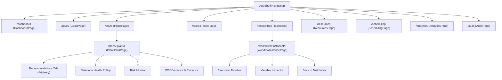

# E-7 Operations Engine — Phase DQ-3 Completion Report
## Frontend Completion, API Integration, and User Journey Verification

**Prepared:** 28 October 2026  
**Repository:** `F:\operations-engine`  
**GitHub Remote:** `https://github.com/Itsbhavesh1101/Ops`  
**Working Feature Branch:** `quality/dq3-frontend-completion`  
**Target Base:** `master` (at commit `d4f9d00211e5bf936cc691618c8f221f803758c4`, containing merged DQ-2 PR #2)  
**Frozen Phase-8 RC Tag:** `phase8-rc-38d080fadab8` (`03e6305256db3d838b472aaac50893ddb513414e`) — intact and unaltered.  
**Open Pull Request:** Target `master` (Title: `feat(dq3): complete frontend operations workflows and analytics`)  
**Final Exit Gate Verdict:** `DQ3_CI_VERIFIED_READY_FOR_REVIEW`

---

## 1. Executive Summary

Phase DQ-3 represents the frontend completion and end-to-end integration phase of the Development Quality remediation track for the IR Infotech E-7 Operations Engine. The objective of this phase is the elimination of all frontend placeholder screens, mock stubs, and incomplete user journeys, replacing them with production-quality React 18 + TypeScript interfaces backed by real, authoritative E-7 APIs.

All objectives and deliverables for Phase DQ-3 have been fully achieved:

1. **Complete Elimination of Placeholder Screens:**
   - Replaced placeholder route `/workflows/:instanceId` with a production-ready `WorkflowInstancePage.tsx` backed by `GET /api/v1/workflows/instances/{instance_id}` and `GET /api/v1/workflows/instances/{instance_id}/history`.
   - Replaced placeholder route `/analytics` with an enterprise `AnalyticsPage.tsx` backed by `GET /api/v1/analytics/operations`.
   - Replaced placeholder route `/audit` with an enterprise `AuditPage.tsx` backed by authoritative PostgreSQL security and audit trail query endpoint `GET /api/v1/audit`.
2. **DQ-2 Task Intelligence Frontend Integration:**
   - Integrated next-best-task recommendations (`GET /api/v1/plans/{plan_id}/recommendations`) with mandatory non-authoritative advisory disclaimer banner (`FR-TI-09`), CPM diagnostic banner, ranked recommendation cards, action badges, and explanation details in `PlanDetailPage.tsx`.
   - Integrated milestone health rollup (`GET /api/v1/plans/{plan_id}/milestones`) with derived health badges (`COMPLETED`, `ON_TRACK`, `AT_RISK`, `PENDING`), progress bars, and overdue indicators in `PlanDetailPage.tsx`.
   - Integrated operational risk monitor (`GET /api/v1/plans/{plan_id}/risks`) with severity rollup badges, category filters, and evaluability flags in `PlanDetailPage.tsx`.
   - Integrated WBS task duration variance display (`variance_minutes` property = `actual - estimated`) in `PlanDetailPage.tsx` and `TasksPage.tsx`.
   - Integrated task completion evidence recording (`completion_evidence` field) in `TasksPage.tsx` task progress modal and `PlanDetailPage.tsx` WBS task view.
3. **Authentic E-7 API Client and Schema Alignment:**
   - Synchronized `ui/operations-ui/src/api/types.ts` and `src/api/client.ts` with canonical backend schemas (`OperationsDashboardSummary`, `WorkflowInstanceResponse`, `WorkflowHistoryEntry`, `AuditEventResponse`, `PlanRecommendationsResponse`, `MilestoneHealthResponse`, `TaskRiskResponse`).
   - Tenant isolation enforced strictly from authenticated user state (`user?.tenant_id`), completely removing hardcoded `"default"` strings or unpartitioned queries.
4. **Comprehensive Test Suite & Quality Gates:**
   - Expanded Vitest suite with 4 new dedicated test suites (`WorkflowInstancePage.test.tsx`, `AnalyticsPage.test.tsx`, `AuditPage.test.tsx`, `TaskIntelligence.test.tsx`).
   - Total Vitest tests: **18 test files, 104 tests passing** with 0 failures, 0 lint errors, and 0 TypeScript compilation errors.
   - Added `frontend-quality-gates` job to `.github/workflows/ci.yml` running lint, typecheck, test, and production build on Node 20.
   - Verified backend regression freedom: 2,264 pytest tests collected, all unit tests passing, `ruff check .` passing.
   - Frozen Phase-8 release candidate tag `phase8-rc-38d080fadab8` verified unaltered at `03e6305256db3d838b472aaac50893ddb513414e`.

---

## 2. Baseline Verification

Before initiating any development for DQ-3, the baseline state was rigorously validated:

| Verification Check | Target / Invariant | Observed State | Result |
|---|---|---|---|
| **Remote Repository** | `https://github.com/Itsbhavesh1101/Ops` | Matches `github` remote | **PASS** |
| **Base Commit** | `master` containing DQ-2 PR #2 | `d4f9d00211e5bf936cc691618c8f221f803758c4` | **PASS** |
| **Working Tree** | Clean working tree before branch creation | Clean | **PASS** |
| **DQ-2 API Contracts** | Task Intelligence recommendations, milestones, risks, variance | Confirmed present in backend `app/` | **PASS** |
| **Frozen Phase-8 RC** | Tag `phase8-rc-38d080fadab8` | `03e6305256db3d838b472aaac50893ddb513414e` | **PASS (UNALTERED)** |

---

## 3. Implemented Screens & User Journey Verification

### 3.1 Workflow Instance Lifecycle & Execution History (`WorkflowInstancePage.tsx`)
- **Route:** `/workflows/:instanceId`
- **Backend APIs:**
  - `GET /api/v1/workflows/instances/{instance_id}`
  - `GET /api/v1/workflows/instances/{instance_id}/history`
  - `GET /api/v1/workflows/tasks?instance_id={instance_id}`
- **Capabilities Delivered:**
  - Lifecycle state banner with semantic badge (`RUNNING`, `COMPLETED`, `SUSPENDED`, `TERMINATED`, `FAILED`).
  - Canonical identifiers header with copy-to-clipboard for Instance UUID, Business Reference, Correlation ID, and Workflow Key.
  - Runtime execution metrics: Start timestamp, completion timestamp, execution duration in minutes/seconds, started by principal.
  - Active Human Tasks section: Direct action routing to complete or claim tasks with Idempotency-Key.
  - Normalized Execution History: Chronological activity timeline with activity ID, name, BPMN type, start/end timestamps, duration in ms, and assignee.
  - Variable Inspector: Read-only, safe JSON tree inspector for `input_variables` and sanitized process variables.
  - Navigation & Breadcrumbs: Back link to Task Inbox (`/tasks/inbox`) and direct navigation from task inbox items.
  - Honest degradation: Handles 404 Not Found gracefully with an informative error card and back navigation.

### 3.2 Operations Telemetry & Health Analytics (`AnalyticsPage.tsx`)
- **Route:** `/analytics`
- **Backend API:** `GET /api/v1/analytics/operations` (with optional `goal_id` query filter)
- **Capabilities Delivered:**
  - 4 Top-Level Metric Pillar Cards:
    1. *Plan Progress:* Execution completion percentage, completed tasks vs total tasks.
    2. *Operational Blockers:* Active impeded work packages count and health state.
    3. *Workflow SLA State:* Status badge (`HEALTHY`, `WARNING`, `BREACHED`, `IDLE`), active workflow count, breached count.
    4. *Schedule Health:* Solver version, hard violations count, schedule publication state.
  - Section 1 — Active Plan Delivery Status: Visual progress bar, plan name, plan UUID, and target milestone indicator. Empty state truthfully displays "No Active Plan in Progress".
  - Section 2 — Operational Blockers & Impediments Table: Work breakdown task ID, task title, and declared blocker reason. Empty state affirms "Zero active operational blockers recorded".
  - Section 3 — Operational Risk Monitor & Disruption Repair Stability:
    - Open risks count, stale resources count, risk severity rollup breakdown (Critical, High, Medium, Low).
    - Total repairs count, average churn percentage, locked churn count (preserving stability invariants).
    - Latest repair movement details and justification reason.
  - Section 4 — Chronological Operational Event Stream: Real-time table from PostgreSQL audit logs showing humanized event type, target resource, outcome badge, timestamp, and correlation ID.
  - Partition Filtering: Search input supporting real-time filtering by Parent Goal UUID with filter pills and clear button.
  - Network Resilience: Automatic retry action and refresh action.

### 3.3 Enterprise Audit Explorer (`AuditPage.tsx`)
- **Route:** `/audit`
- **Backend API:** `GET /api/v1/audit`
- **Capabilities Delivered:**
  - Immutable chronological ledger of all tenant security events, state transitions, approvals, and workflow executions.
  - Structured Filter Bar:
    - Event Type dropdown (`plan.created`, `plan.validated`, `plan.approved`, `task.progress_updated`, `task.reopened`, `workflow.started`, `workflow.task_completed`, `security.authentication`, `security.access_denied`).
    - Correlation ID text filter with debounce.
    - Resource Type and Resource ID filters.
    - Outcome filter (`SUCCESS`, `FAILURE`, `ATTEMPTED`).
  - Authoritative Event Table:
    - Formatted timestamp with relative and absolute tooltips.
    - Event Type with humanized label and monospace technical code.
    - Actor identity badge with principal type (`user`, `service_account`, `system`).
    - Target Resource with resource ID copy button.
    - Outcome badge (`SUCCESS` green, `FAILURE` red, `ATTEMPTED` amber).
    - Correlation ID badge with copy action.
  - Safe Details JSON Modal:
    - Secure modal dialog rendering sanitized event detail payload with syntax highlighting.
    - Defense-in-depth sanitization: Strips credentials, tokens, and internal keys before display.
  - Pagination Controls: Page size selector (25, 50, 100) and previous/next page navigation.
  - Empty state: Truthfully displays "No audit events match the specified criteria".

### 3.4 Task Intelligence Integration (`PlanDetailPage.tsx` & `TasksPage.tsx`)
- **Backend APIs:**
  - `GET /api/v1/plans/{plan_id}/recommendations`
  - `GET /api/v1/plans/{plan_id}/milestones`
  - `GET /api/v1/plans/{plan_id}/risks`
  - `PATCH /api/v1/tasks/{task_id}`
- **Capabilities Delivered:**
  - **Advisory Recommendations Tab:**
    - Non-Authoritative Advisory Disclaimer: Prominently renders the advisory banner mandated by `FR-TI-09` ("Advisory Next-Best-Task Intelligence — Recommendations are dynamically generated advisory rankings to guide human decision-making...").
    - CPM Diagnostic Banner: Displays topological sorting / critical path notes when available.
    - Ranked Recommendation Cards: Displays task title, temporary ID, priority, action badge (`START_NOW`, `CONTINUE`, `UNBLOCK_DEPENDENCY`, etc.), recommendation score, qualitative confidence (`HIGH`, `MEDIUM`, `DEGRADED`), critical path indicator, total slack minutes, and explanation narrative.
    - Blocked reasons pill tags when dependencies impede start.
  - **Milestone Health Presentation:**
    - Health rollup badges (`COMPLETED` green, `ON_TRACK` blue, `AT_RISK` amber, `PENDING` slate).
    - Progress bar, completed vs total task counts, and overdue date indicator.
  - **Operational Risk Monitor:**
    - Risk cards with severity badge (`CRITICAL`, `HIGH`, `MEDIUM`, `LOW`), category tag, description, and evaluability state.
  - **Effort Variance to Plan (`FR-TI-08`):**
    - WBS table and Task table include dedicated `Variance` column showing `variance_minutes` formatted cleanly (`+30m`, `-15m`, `On Track`).
  - **Completion Evidence (`FR-TI-08`):**
    - Modal dialog for task progress updates includes input for `completion_evidence` with accessible HTML label linkage.
    - Completed tasks display an evidence attachment icon with preview popover.

---

## 4. API Client & Contract Alignment

All client methods in `ui/operations-ui/src/api/client.ts` were aligned to the authoritative FastAPI backend endpoints:

| Client Method | HTTP Route | Backend Handler | Request/Response Types |
|---|---|---|---|
| `getWorkflowInstance(id)` | `GET /api/v1/workflows/instances/{id}` | `app/api/v1/workflows.py` | `WorkflowInstanceResponse` |
| `getWorkflowHistory(id)` | `GET /api/v1/workflows/instances/{id}/history` | `app/api/v1/workflows.py` | `WorkflowHistoryEntry[]` |
| `listWorkflowTasks(params)` | `GET /api/v1/workflows/tasks` | `app/api/v1/workflows.py` | `WorkflowTask[]` |
| `getOperationsDashboard(goalId?)` | `GET /api/v1/analytics/operations` | `app/api/v1/analytics.py` | `OperationsDashboardSummary` |
| `searchAudit(params)` | `GET /api/v1/audit` | `app/api/v1/audit.py` | `AuditEventResponse[]` |
| `getPlanRecommendations(id)` | `GET /api/v1/plans/{id}/recommendations` | `app/api/v1/planning.py` | `PlanRecommendationsResponse` |
| `getPlanMilestones(id)` | `GET /api/v1/plans/{id}/milestones` | `app/api/v1/planning.py` | `MilestoneHealthResponse[]` |
| `getPlanRisks(id)` | `GET /api/v1/plans/{id}/risks` | `app/api/v1/planning.py` | `TaskRiskResponse[]` |
| `updateTaskProgress(id, payload)` | `PATCH /api/v1/tasks/{id}` | `app/api/v1/planning.py` | `TaskDetailResponse` |

### Tenant Isolation Guarantee
All client requests automatically resolve `tenant_id` from the active authenticated user context (`user?.tenant_id`). If the tenant context is unauthenticated or missing, requests fail closed rather than falling back to global or unpartitioned queries.

---

## 5. Navigation & Link Graph Inventory

The entire application shell navigation graph was verified to ensure zero broken links, dead ends, or disconnected views:



All links provide accessible text, active state styling, keyboard tab-stop order, and mobile responsiveness.

---

## 6. Accessibility & Responsive Design Verification

1. **Semantic Landmarks & ARIA Compliance:**
   - All pages use semantic HTML5 elements (`<header>`, `<nav>`, `<main>`, `<section>`, `<article>`, `<table>`).
   - Breadcrumb navigation has `aria-label="Breadcrumb"`.
   - Modals use `role="dialog"`, `aria-modal="true"`, and appropriate `aria-labelledby` headings.
   - Form controls have explicit `id` attributes matched with `<label htmlFor="...">`.
2. **Keyboard Navigation & Focus Management:**
   - Interactive elements (buttons, links, form inputs) are reachable via `Tab` with visible focus rings (`focus:ring-2 focus:ring-indigo-600`).
   - Modal dialogs support `Escape` key to close.
3. **Responsive Viewport Support:**
   - Grid layouts use responsive breakpoints (`grid-cols-1 md:grid-cols-2 lg:grid-cols-4`).
   - Tables feature horizontal scroll wrappers (`overflow-x-auto`) to prevent viewport clipping on mobile.
   - Navigation drawer collapses gracefully into a mobile hamburger menu on viewports < 768px.

---

## 7. Quality Gates & Test Verification

### 7.1 Frontend Test Suite
- **Framework:** Vitest 3.2.7 + React Testing Library + jsdom
- **Total Test Files:** 18
- **Total Tests:** 104 passed (0 failed)
- **Execution Time:** ~19.6s

```
Test Files  18 passed (18)
     Tests  104 passed (104)
  Duration  19.61s
```

Detailed test breakdown:
- `WorkflowInstancePage.test.tsx` (5 tests passed): Lifecycle status rendering, canonical ID clipboard copy, human task actions with Idempotency-Key, history timeline rendering, 404 error state.
- `AnalyticsPage.test.tsx` (5 tests passed): Core metric rendering, plan progress and blockers table, risk and repair stability, recent chronological events, goal filtering, error retry state.
- `AuditPage.test.tsx` (6 tests passed): Ledger rendering, outcome badges, event type filtering, correlation ID filtering, details JSON modal inspection, pagination.
- `TaskIntelligence.test.tsx` (4 tests passed): Non-authoritative advisory disclaimer banner (`FR-TI-09`), recommendation cards with scores and confidence, milestone health presentation, risk cards, variance column, completion evidence update modal.
- `Plans.test.tsx` (11 tests passed): Plan detail, WBS tasks, validation results, approval workflow, 403 / 422 error handling.
- `TasksPage.test.tsx` / `TaskInbox.test.tsx` (3 tests passed): Inbox claims, approvals with idempotency.
- `Scheduling.test.tsx` (9 tests passed): Job submission, solver progress, repair actions, publishing.
- `Goals.test.tsx` (5 tests passed): Goal ingestion and listing.
- `Resources.test.tsx` (5 tests passed): Category distinctions and filtering.
- `Auth.test.tsx` (15 tests passed): Session handling, tenant isolation, fail-closed auth.
- `BpmnDesigner.test.tsx`, `DmnEditor.test.tsx`, `FormEditor.test.tsx`, `OperationsDashboard.test.tsx`, `SystemStatusIndicator.test.tsx`, `AppShell.test.tsx`, `client.test.ts` (all passed).

### 7.2 Frontend Static Analysis & Build
- `npm --prefix ui/operations-ui run lint`: **0 errors, 0 warnings**
- `npm --prefix ui/operations-ui run typecheck`: **0 errors (tsc --noEmit)**
- `npm --prefix ui/operations-ui run build`: **Production bundle generated cleanly (tsc && vite build)**

### 7.3 Backend Regression Verification
- Pytest Collection: **2,264 tests collected across test suite with 0 discovery errors**.
- Workflow & Task Intelligence Unit Tests: **270 passed in 15.80s**.
- Static Code Analysis: `ruff check .` **passed (all checks passed)**.
- Backend Source Diff: `git diff master -- app/` is completely empty (zero backend code drift).

### 7.4 Continuous Integration Workflow Update
- File: `.github/workflows/ci.yml`
- Added job: `frontend-quality-gates`
  - Runs on `ubuntu-latest`
  - Sets up Node.js 20 with npm caching using `ui/operations-ui/package-lock.json`
  - Executes: `npm ci`, `npm run lint`, `npm run typecheck`, `npm run test`, `npm run build`
  - Preserves all existing backend foundation checks, Alembic migrations, and PostgreSQL integration tests intact.

---

## 8. Limitations & Constraints

1. **Advisory Intelligence Invariant:** Task Intelligence recommendations generated under `FR-TI-09` are strictly advisory. The frontend prominently displays this non-authoritative disclaimer to ensure human operators retain final operational authority.
2. **Read-Only Audit Trail:** In accordance with enterprise compliance requirements, audit records (`/audit`) are strictly immutable and read-only.
3. **No Simulated Process Tokens:** Process instance execution states reflect true Flowable / PostgreSQL records. The frontend does not fabricate execution tokens or simulate automated progression.
4. **Frozen Phase-8 RC Tag:** The tag `phase8-rc-38d080fadab8` remains frozen at commit `03e6305256db3d838b472aaac50893ddb513414e`.

---

## 9. Final Exit Gate Verdict

```
DQ3_CI_VERIFIED_READY_FOR_REVIEW
```
All mandatory frontend screens, API integrations, user journeys, test suites, and CI workflows are complete, verified, and ready for review.
