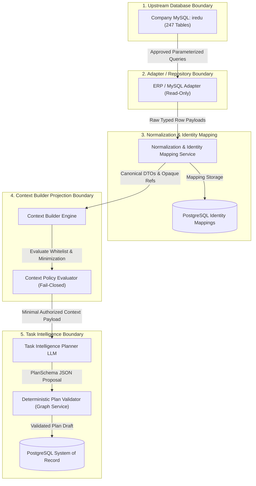

# E-7 Task Intelligence — AI Context Access Policy

**Document Identifier:** `E7-POL-INT-003`  
**Version:** `1.0.0` (Task 0G.3 Phase-0 Documentation Baseline)  
**Status:** COMPLETE / APPROVED BASELINE  
**Canonical References:** Task 0G.1 Schema Inventory (`MYSQL_SCHEMA_INVENTORY.md` / `.json`), Task 0G.1A Correction, Task 0G.2 / 0G.2A / 0G.2B Data Mapping (`MYSQL_TASK_INTELLIGENCE_DATA_MAPPING.md` / `.json`), ADR-000 through ADR-009, Implementation Guardrails (`docs/IMPLEMENTATION_GUARDRAILS.md`), Canonical Ownership & Boundaries (`docs/data-model/CANONICAL_OWNERSHIP_AND_SERVICE_BOUNDARIES.md`).  
**Upstream Database:** MySQL `iredu` (MySQL 8.0.35 InnoDB dump)  
**Downstream Persistence:** E-7 PostgreSQL (System of Record for E-7-owned operational state)  
**Target Consumer:** E-7 Task Intelligence Context Builder & Planner LLM Interface  

---

## 1. Purpose

This policy establishes the formal, binding data-minimization, privacy, field-exposure, and fail-closed security specification governing how company MySQL institutional data (`iredu`) may move from the upstream persistence layer through the approved adapter and Context Builder projection boundary into the Task Intelligence Planner LLM.

### 1.1 Scope & Governance Boundaries
- **Phase 0 Documentation & Contract Specification Only:** This document and its accompanying machine-readable specification (`AI_CONTEXT_ACCESS_POLICY.json`) define the security policy contract that future implementation MUST enforce. It does NOT implement runtime code, Pydantic models, SQL queries, or database connections.
- **Strict Zero-Code Boundary:** Zero runtime code, ORM models (SQLAlchemy), network connections, middleware, or dependency installations are introduced.
- **Phase 1 Maintained Unstarted:** Phase 1 (Core Scheduling Engine and Data Layer) remains strictly unstarted.
- **Frozen Baselines Preserved:** Task 0G.1 inventory files, Task 0G.2 mapping files, synthetic fixtures (`tests/fixtures/*`), and ADRs remain unchanged.

---

## 2. Security Boundary

The E-7 architecture requires strict physical and logical decoupling between upstream ERP persistence, internal normalization services, and probabilistic language model interfaces. Upstream MySQL MUST remain an external, read-only institutional data source where approved.

### 2.1 The 5-Stage Data Ingestion & Sanitization Pipeline



### 2.2 The 16 Architectural Security Invariants
Every runtime implementation across all phases must strictly enforce the following 16 architectural security invariants:
1. **Zero LLM Database Connection:** LLMs NEVER receive a database connection handle, pool, or socket.
2. **Zero SQL Execution by LLMs:** LLMs NEVER execute SQL queries, DDL, or DML under any circumstance.
3. **Zero Credentials in Prompts:** LLMs NEVER receive database credentials, DSNs, connection strings, API keys, certificates, or secrets.
4. **Zero Unrestricted Schema Exposure:** LLMs NEVER receive unrestricted database schemas, DDL scripts, or bulk `SELECT *` style table dumps.
5. **Strict Whitelist Admittance:** Only explicitly approved, normalized, and goal-relevant fields may enter model context.
6. **Default Deny Posture:** All context access is deny-by-default (`DEFAULT = DENY`).
7. **Fail-Closed on Unknowns:** Unknown, unclassified, or newly discovered fields are NOT model-visible and fail closed.
8. **Decoupled Canonical Identity:** External MySQL auto-increment IDs are never presented to the LLM as canonical E-7 IDs.
9. **Mandatory Opaque References:** External entities must be represented by normalized, opaque reference tokens (`StaffRef_<id>`, `ClassSecRef_<id>`) when identity is needed.
10. **Zero Passive PII Ingress:** Sensitive source fields must not enter AI prompts merely because they exist in an upstream table.
11. **Absolute Student Row Prohibition:** Individual student rows and minors' PII remain strictly forbidden from planner context.
12. **Controlled Aggregates Only:** Aggregate cohort information may be exposed only as an adapter-derived mathematical summary approved by the mapping.
13. **Untrusted Model Output:** Model output is untrusted until deterministic validation (PlanSchema, DAG acyclicity, CPM) completes.
14. **Non-Authoritative AI Reasoning:** The model cannot approve a plan, activate tasks, publish schedules, advance SLA clocks, or bypass policy.
15. **Tenant Scoping Production Blocker:** Tenant/organization scoping is unresolved in MySQL `iredu`; live production context retrieval remains blocked until authoritative tenant/organization scoping is defined.
16. **Future Implementation Mandate:** Runtime enforcement does not yet exist; this policy defines the binding contract that future implementation MUST enforce.

---

## 3. Policy Principles

The policy is built upon seven foundational architectural principles:
1. **Default Posture = DENY (`DEFAULT = DENY`):** Context access is deny-by-default. Every single column must have an affirmative, auditable rationale to enter model context.
2. **Strict Whitelist Admittance:** Only the 28 columns explicitly designated as `PLANNER_CONTEXT_ALLOWED` in Task 0G.2 are eligible for model exposure.
3. **Two-Tier Minimization:** Whitelist admittance is a necessary condition, but NEVER a sufficient condition. Context Builder MUST project only the subset of whitelisted fields required for the active planning goal.
4. **Opaque References by Default:** Real personnel names are withheld unless an explicit authorized workflow genuinely requires recognizable identities. Descriptive attributes provide contextual suggestions only, and planner reasoning operates over opaque tokens.
5. **Absolute Prohibition of Minors' PII:** All 67 individual columns of student records remain strictly prohibited from model context under all circumstances.
6. **Untrusted Free Text:** All upstream free-text descriptions are treated strictly as untrusted data, structurally isolated from instructions, and sanitized per reviewed policy.
7. **Non-Authoritative Planning:** The LLM is an untrusted generative drafting engine. All outputs are strictly proposals subject to deterministic validation before persistence.

---

## 4. Source and Mapping Baseline

This policy directly binds to the frozen artifacts of Task 0G.1 and Task 0G.2:
- **Task 0G.1 Schema Inventory Baseline:** Grounded in [`MYSQL_SCHEMA_INVENTORY.md`](file:///F:/operations-engine/docs/integrations/MYSQL_SCHEMA_INVENTORY.md) and [`MYSQL_SCHEMA_INVENTORY.json`](file:///F:/operations-engine/docs/integrations/MYSQL_SCHEMA_INVENTORY.json) (247 tables, 2,637 columns, 307 foreign keys).
- **Task 0G.1A Correction Baseline:** Reaffirms that MySQL `iredu` contains no authoritative academic physical-resource model (no room capacity, room types, or equipment).
- **Task 0G.2 / 0G.2A / 0G.2B Mapping Baseline:** Grounded in [`MYSQL_TASK_INTELLIGENCE_DATA_MAPPING.md`](file:///F:/operations-engine/docs/integrations/MYSQL_TASK_INTELLIGENCE_DATA_MAPPING.md) and [`MYSQL_TASK_INTELLIGENCE_DATA_MAPPING.json`](file:///F:/operations-engine/docs/integrations/MYSQL_TASK_INTELLIGENCE_DATA_MAPPING.json) (70 tables evaluated, 14 initial sources, 13 optional later, 5 validation only, 2 aggregate only, 1 unresolved, 35 excluded).

---

## 5. Exposure Classes

Every column in the evaluated institutional schema is assigned to exactly one of **six exposure classes**:

| Exposure Class | Target Subsystem | Model Visibility | Definition & Operational Boundary |
| :--- | :--- | :---: | :--- |
| **`PLANNER_CONTEXT_ALLOWED`** | Context Builder / LLM | **YES** (Controlled) | Explicitly approved for inclusion in Task Intelligence planning prompts. Subject to goal-scoped minimization and tokenization. |
| **`DETERMINISTIC_VALIDATION_ONLY`** | Backend Services Only | **NO** | Consumed strictly by backend deterministic services (graph validation, identity mapping, active status checks). Never exposed to model. |
| **`AGGREGATE_ONLY`** | Context Builder / LLM | **YES** (Counts Only) | Table cannot be read row-by-row. Exposed strictly as adapter-derived mathematical aggregates (e.g. cohort headcount). |
| **`REQUIRES_BUSINESS_CONFIRMATION`** | Blocked / Quarantined | **NO** | Blocked until formal institutional business or architecture confirmation resolves pending semantic questions. |
| **`RESTRICTED_FORBIDDEN`** | Blocked / Quarantined | **NO** | Sensitive PII, authentication secrets, financial accounts, or payroll. FORBIDDEN_FROM_AI for the current TI scope and policy version. |
| **`EXCLUDED`** | Quarantined | **NO** | Irrelevant subsystems (LMS quizzes, vehicle GPS tracking, hostel beds). Completely excluded from context ingestion. |

---

## 6. Authoritative Planner-Context Whitelist

The following **28 columns** constitute the COMPLETE and EXHAUSTIVE whitelist of fields permitted to enter the Task Intelligence model context:

| Source Table | Column Name | Context Category | Model Exposure | Transformation / Projection Rule | Operational Purpose & Sensitivity |
| :--- | :--- | :--- | :---: | :--- | :--- |
| **`annual_calendar`** | **`from_date`** (`datetime`) | `calendar_context` | `ALLOWED` | ISO-8601 UTC timestamp formatting | Informational date context only; does not enforce automated operational blackout without E-7 policy. |
| **`annual_calendar`** | **`to_date`** (`datetime`) | `calendar_context` | `ALLOWED` | ISO-8601 UTC timestamp formatting | Informational date context only; does not enforce automated operational blackout without E-7 policy. |
| **`annual_calendar`** | **`description`** (`text`) | `calendar_context` | `ALLOWED` | Whitespace normalization and sanitization per reviewed policy; structural separation as untrusted data | Untrusted free text; MUST remain structurally separated from instructions. Suspicious instruction-like text treated as data and may be omitted/quarantined. |
| **`classes`** | **`class`** (`varchar(60)`) | `academic_context` | `ALLOWED` | Trim whitespace, string sanitization | Scoped to active academic session and goal target cohort only. |
| **`department`** | **`department_name`** (`varchar(200)`) | `organization_context` | `ALLOWED` | Trim whitespace, string sanitization | Scoped to active departments relevant to the active planning goal. Provides descriptive organizational context only; does NOT establish individual task eligibility or capability. |
| **`events`** | **`event_title`** (`varchar(200)`) | `calendar_context` | `ALLOWED` | Trim whitespace, string sanitization | Informational date context only; verified against active status and event_for scope. |
| **`events`** | **`event_description`** (`text`) | `calendar_context` | `ALLOWED` | Whitespace normalization and sanitization per reviewed policy; structural separation as untrusted data | Untrusted free text; MUST remain structurally separated from instructions. Suspicious instruction-like text treated as data and may be omitted/quarantined. |
| **`events`** | **`start_date`** (`datetime`) | `calendar_context` | `ALLOWED` | ISO-8601 UTC timestamp formatting | Filtered to events overlapping the active planning operational window. |
| **`events`** | **`end_date`** (`datetime`) | `calendar_context` | `ALLOWED` | ISO-8601 UTC timestamp formatting | Filtered to events overlapping the active planning operational window. |
| **`events`** | **`event_type`** (`varchar(100)`) | `calendar_context` | `ALLOWED` | Standardize enum string token | Filter by event_for to prevent leaking staff-only or private events to generalized planning. |
| **`sections`** | **`section`** (`varchar(60)`) | `academic_context` | `ALLOWED` | Trim whitespace, string sanitization | Scoped to active class-sections in goal scope. |
| **`sessions`** | **`session`** (`varchar(60)`) | `academic_context` | `ALLOWED` | Trim whitespace, string sanitization | Active institutional session only (is_active = 1 or explicit target session). |
| **`staff`** | **`qualification`** (`varchar(200)`) | `staff_resource_context` | `ALLOWED` | Trim whitespace, sanitize string | Descriptive context only; does NOT establish task eligibility or capability. Free-text qualification must not automatically map to capabilities without an explicit versioned business rule. |
| **`staff`** | **`work_exp`** (`varchar(200)`) | `staff_resource_context` | `ALLOWED` | Trim whitespace, sanitize string | Descriptive context only; does NOT establish task eligibility or capability. Free-text work experience must not automatically map to capabilities without an explicit versioned business rule. |
| **`staff`** | **`name`** (`varchar(200)`) | `staff_resource_context` | `CONDITIONAL` | Opaque reference token (StaffRef_<id>) by default; sanitized display label only for authorized use case requiring human-recognizable identity | MODEL_EXPOSURE_CONDITIONAL: Default projection MUST use an opaque staff reference (StaffRef_<id>) where identity is not needed. Human-readable name may be included only for an authorized use case where the user's workflow genuinely needs a recognizable person (e.g. an authorized human-facing review or assignment screen where a recognizable staff identity is genuinely required and the actor is permitted to see it). Name is display identity, not capability evidence, and must never influence eligibility or ranking merely because it identifies the person. Qualifications, work experience, department association, and designation may provide descriptive context, but must not be treated as authoritative evidence of task eligibility or capability unless a separately approved policy/mapping establishes that relationship. No name exposure can compensate for unresolved tenant/org authorization. |
| **`staff`** | **`surname`** (`varchar(200)`) | `staff_resource_context` | `CONDITIONAL` | Opaque reference token (StaffRef_<id>) by default; sanitized display label only for authorized use case requiring human-recognizable identity | MODEL_EXPOSURE_CONDITIONAL: Default projection MUST use an opaque staff reference (StaffRef_<id>) where identity is not needed. Human-readable name may be included only for an authorized use case where the user's workflow genuinely needs a recognizable person (e.g. an authorized human-facing review or assignment screen where a recognizable staff identity is genuinely required and the actor is permitted to see it). Name is display identity, not capability evidence, and must never influence eligibility or ranking merely because it identifies the person. Qualifications, work experience, department association, and designation may provide descriptive context, but must not be treated as authoritative evidence of task eligibility or capability unless a separately approved policy/mapping establishes that relationship. No name exposure can compensate for unresolved tenant/org authorization. |
| **`staff_designation`** | **`designation`** (`varchar(200)`) | `organization_context` | `ALLOWED` | Trim whitespace, sanitize string | Filter to active professional titles relevant to institutional work breakdown. Provides descriptive title context only; does NOT establish individual task eligibility or capability. |
| **`subject_group_class_sections`** | **`description`** (`text`) | `subject_context` | `ALLOWED` | Whitespace normalization and sanitization per reviewed policy; structural separation as untrusted data | Untrusted free text; MUST remain structurally separated from instructions. Suspicious instruction-like text treated as data and may be omitted/quarantined. |
| **`subject_groups`** | **`name`** (`varchar(250)`) | `subject_context` | `ALLOWED` | Trim whitespace, sanitize string | Scoped to target class curriculum. |
| **`subject_groups`** | **`description`** (`text`) | `subject_context` | `ALLOWED` | Whitespace normalization and sanitization per reviewed policy; structural separation as untrusted data | Untrusted free text; MUST remain structurally separated from instructions. Suspicious instruction-like text treated as data and may be omitted/quarantined. |
| **`subject_timetable`** | **`day`** (`varchar(20)`) | `commitment_context` | `ALLOWED` | Standardize day of week string token | Published timetable intervals define busy windows only. Free intervals != complete availability. |
| **`subject_timetable`** | **`time_from`** (`varchar(20)`) | `commitment_context` | `ALLOWED` | Standardize HH:MM string | Commitment window context; free slots != complete availability. |
| **`subject_timetable`** | **`time_to`** (`varchar(20)`) | `commitment_context` | `ALLOWED` | Standardize HH:MM string | Commitment window context; free slots != complete availability. |
| **`subject_timetable`** | **`start_time`** (`time`) | `commitment_context` | `ALLOWED` | ISO-8601 Time formatting (HH:MM:SS) | Commitment window context; free slots != complete availability. |
| **`subject_timetable`** | **`end_time`** (`time`) | `commitment_context` | `ALLOWED` | ISO-8601 Time formatting (HH:MM:SS) | Commitment window context; free slots != complete availability. |
| **`subjects`** | **`name`** (`varchar(100)`) | `subject_context` | `ALLOWED` | Trim whitespace, sanitize string | Scoped to subjects assigned to target cohorts. |
| **`subjects`** | **`code`** (`varchar(100)`) | `subject_context` | `ALLOWED` | Trim whitespace, uppercase string | Scoped to subjects assigned to target cohorts. |
| **`subjects`** | **`type`** (`varchar(100)`) | `subject_context` | `ALLOWED` | Standardize case token ('Theory' / 'Practical') | Contextual feature for effort estimation (FR-TI-04); values must be validated against allowed types. |

---

## 7. Conditional Personal Identity Exposure & Staff Semantics

In order to maximize personal privacy, reduce prompt bias, and maintain architectural integrity, the exposure and interpretation of human personnel attributes are governed by strict operational rules:

### 7.1 Default Policy: Opaque Reference Tokens
By default, the Context Builder MUST project staff resources using opaque reference tokens (`StaffRef_<id>`) and sanitized operational metadata, omitting real names entirely where identity is not needed:

```json
{
  "staff_ref": "StaffRef_12",
  "designation": "Senior Teacher",
  "department": "Science Department",
  "qualification": "M.Sc. Physics, B.Ed.",
  "work_exp": "10 Years",
  "known_commitments": [
    {"day": "Monday", "busy_window": "09:00 - 10:00", "reason": "Teaching Period"}
  ]
}
```

### 7.2 Conditional Name Exposure (`MODEL_EXPOSURE_CONDITIONAL`)
The columns `staff.name` and `staff.surname` remain classified as `PLANNER_CONTEXT_ALLOWED` to preserve the Task 0G.2 baseline, but are subject to binding operational constraints:
1. **Default Opaque Projection:** Default projection MUST use an opaque staff reference (`StaffRef_<id>`) where identity is not needed.
2. **Authorized Workflow Activation:** A human-readable name may be included only for an authorized use case where the user's workflow genuinely needs a recognizable person (e.g. an authorized human-facing review or assignment screen where a recognizable staff identity is genuinely required and the actor is permitted to see it). This does NOT imply that MySQL establishes assignment eligibility.
3. **Planner Reasoning Independent of Names:** Planner reasoning should not require names for eligibility or capability decisions. Name is display identity, not capability evidence, and must never influence eligibility or ranking merely because it identifies the person. Qualifications, work experience, department association, and designation may provide descriptive context, but must not be treated as authoritative evidence of task eligibility or capability unless a separately approved policy/mapping establishes that relationship.
4. **No Compensation for Scoping:** No name exposure can compensate for unresolved tenant/organization authorization.
5. **Strict Data Boundary:** Even when names are conditionally admitted, personal contact numbers, personal emails, residential addresses, dates of birth, banking data, compensation, national IDs, and family details remain **FORBIDDEN_FROM_AI for the current Task Intelligence scope and policy version** (with credentials and secrets categorically prohibited under all circumstances).
6. **Log Redaction:** Real personnel names must NEVER be emitted into application debug or trace logs; logs must use opaque tokens (`StaffRef_<id>`).

### 7.3 Descriptive Staff Context vs. Authoritative Operational Eligibility
The E-7 architecture explicitly distinguishes between **descriptive planning context** and **authoritative operational eligibility**:

1. **Descriptive Context Role:** The following fields may provide descriptive planning context where allowed:
   - `staff.qualification` (professional degrees/credentials)
   - `staff.work_exp` (reported work history)
   - `department.department_name` (organizational department)
   - `staff_designation.designation` (job title/designation)
   - `subject_timetable` (known published teaching commitments)

2. **Non-Eligibility Invariant:** NONE of these fields alone establishes that a staff member:
   - is eligible for a specific task,
   - holds a required certification,
   - has a required operational capability,
   - is authorized for a regulated responsibility,
   - is available for assignment,
   - can act as an invigilator,
   - can supervise a laboratory,
   - can approve a workflow, or
   - can perform any other domain-specific role,
   unless that conclusion is independently supported by an authoritative policy, capability source, approved mapping, or explicit business rule.

3. **Zero Invigilator or Role Inferences from MySQL:** Upstream MySQL `iredu` does not provide an authoritative invigilator eligibility, laboratory supervisor, or regulated role capability model. No invigilator eligibility or assignment suitability may be inferred from MySQL staff records.

4. **Contextual Suggestions vs. Permitted Assignment:** The Task Intelligence planner may use these descriptive fields to understand context or produce candidate suggestions. Deterministic validation and/or human review must determine whether a candidate assignment is actually permitted.

5. **Qualification & Work Experience Mapping Governance:**
   - `staff.qualification` and `staff.work_exp` inform contextual understanding only.
   - Free-text or categorical strings must NOT automatically map to capabilities.
   - Any mapping rule such as `"qualification X => eligible for task Y"` requires an explicit, versioned business rule / capability mapping approved by institutional authority.
   - In the absence of such an approved rule, the planner can only describe or suggest, never authorize.

6. **Auxiliary Structures Non-Authority:** Neither application RBAC roles (`roles`, `staff_roles`), class teacher assignments (`class_teacher`), nor timetable gaps establish general staff capability, operational eligibility, or complete availability.

---

## 8. Aggregate-Only Data Policy

The tables `students` and `student_session` contain records of minor students, comprising 69 individual columns of personal, demographic, guardian, and academic history.

### 8.1 Formal Prohibitions
The Context Builder MUST enforce an absolute ban on individual student data:
- Individual student rows MUST NEVER enter model context.
- Student first names, last names, and admission numbers MUST NEVER enter model context.
- Student personal contact numbers, emails, and parent/guardian phone numbers MUST NEVER enter model context.
- Student residential addresses, guardian addresses, and emergency contacts MUST NEVER enter model context.
- Demographic characteristics (religion, caste, blood group, medical history, physical measurements) MUST NEVER enter model context.
- Student identification documents and ID photos MUST NEVER enter model context.

### 8.2 Approved Headcount Aggregations
The LLM planner requires cohort population sizes solely for instructional scale, exam material volume, and staffing ratio estimation (FR-TI-04); individual staff invigilator eligibility is NOT inferred from MySQL. This need is met exclusively through adapter-derived count aggregations:
- The ERP adapter MUST execute parameterized aggregation queries (e.g. `COUNT(student_session.id) WHERE session_id = :sid AND class_id = :cid AND section_id = :secid`).
- The output is injected into `academic_context` as a scalar integer (`student_count: 38`).
- Individual primary keys (`student_id`, `student_session_id`) MUST be discarded immediately after calculation and MUST NOT be retained or exposed.
- **Cohort Aggregate Privacy & Re-Identification Rules:**
  - Individual student records remain strictly forbidden from planner context.
  - Only approved cohort aggregates may be exposed.
  - Aggregate disclosure must follow organization/privacy policy.
  - Minimum-group-size or suppression thresholds, if required, MUST be configurable and approved by the appropriate business/privacy authority; until such a threshold is approved, do not invent one.
  - If a cohort aggregate creates an obvious re-identification concern, policy requires `OMIT_AGGREGATE` or `REQUIRE_HUMAN_CLARIFICATION`.
  - No numeric cutoff is hardcoded or assumed in this policy.

---

## 9. Validation-Only Data Policy

A total of **74 columns** across the 14 initial tables and 5 validation-only tables are classified as `DETERMINISTIC_VALIDATION_ONLY`. These attributes provide technical plumbing, relational integrity, and constraint checking for backend services:

### 9.1 Allowed Consumers
Validation-only fields may be queried and processed strictly by:
- The ERP / MySQL Adapter (for joining tables and filtering soft-deleted rows).
- The Normalization and Identity Mapping service (for resolving entity relationships).
- The Context Policy Evaluator (for verifying tenant scoping and active status).
- The Deterministic Validators (for verifying relational links prior to plan activation).
- The Dependency Service (for constructing adjacency lists and DAG nodes).

### 9.2 Strict Model Invisibility
Validation-only fields MUST NEVER appear in LLM prompt text or context payloads:
- **Raw Primary Keys:** `annual_calendar.id`, `classes.id`, `department.id`, `events.id`, `sections.id`, `sessions.id`, `staff.id`, `subjects.id`, `subject_groups.id`, `subject_timetable.id`.
- **Relational Foreign Keys:** `class_sections.class_id`, `class_sections.section_id`, `subject_group_subjects.subject_group_id`, `subject_group_subjects.subject_id`, `subject_timetable.staff_id`.
- **Technical Flags & Timestamps:** `classes.is_active`, `sections.is_active`, `department.is_active`, `events.is_active`, `annual_calendar.is_active`, `staff.is_active`, `staff.disable_at`.
- **RBAC Application Roles:** Tables `roles` and `staff_roles` are internal software authorization permissions; they do NOT define operational task capabilities, task eligibility, or professional certifications, and are strictly hidden from LLMs.
- **Bell Schedules & Holiday Types:** Tables `class_section_times`, `holiday_type`, and `cbse_template_class_sections` are consumed deterministically by backend services and do not enter prompt text.

---

## 10. Restricted / Forbidden AI Data

Under the E-7 architecture, the following 13 data categories are **FORBIDDEN_FROM_AI for the current Task Intelligence scope and policy version** (with authentication credentials and secrets remaining categorically prohibited from model context under all circumstances):

Any future change to data exposure would require:
- an explicit new functional requirement,
- thorough privacy and security review,
- mapping revision,
- policy version change, and
- comprehensive tests and governance approval.

### CAT-FORBID-01: Authentication Credentials & Secrets
- **Policy Status:** `FORBIDDEN_FROM_AI for the current Task Intelligence scope and policy version (categorically prohibited under all circumstances)`
- **Description:** Passwords, password hashes, salt strings, auth tokens, session tokens, verification codes
- **Threat Rationale:** Total system compromise and unauthorized account takeover
- **Discovered Schema Columns:** `staff.password, staff.verification_code`

### CAT-FORBID-02: Financial & Personal Banking Identifiers
- **Policy Status:** `FORBIDDEN_FROM_AI for the current Task Intelligence scope and policy version`
- **Description:** Bank account numbers, account titles, bank names, branch IFSC codes, routing numbers
- **Threat Rationale:** Financial fraud, identity theft, financial privacy violation
- **Discovered Schema Columns:** `staff.bank_account_no, staff.bank_name, staff.ifsc_code, staff.account_title, staff.bank_branch`

### CAT-FORBID-03: Compensation & Payroll Data
- **Policy Status:** `FORBIDDEN_FROM_AI for the current Task Intelligence scope and policy version`
- **Description:** Basic salaries, payscales, allowances, provident fund (EPF) numbers, tax deductions
- **Threat Rationale:** Employee wage privacy breach, HR compensation policy leak
- **Discovered Schema Columns:** `staff.basic_salary, staff.payscale, staff.epf_no`

### CAT-FORBID-04: Government National Identifiers & Tax IDs
- **Policy Status:** `FORBIDDEN_FROM_AI for the current Task Intelligence scope and policy version`
- **Description:** National identity numbers, Aadhaar numbers, PAN numbers, passport numbers, driving licenses
- **Threat Rationale:** Regulatory statutory breach, severe identity theft risk
- **Discovered Schema Columns:** `students.adhar_no, students.samagra_id`

### CAT-FORBID-05: Biometric & Physical Measurement Records
- **Policy Status:** `FORBIDDEN_FROM_AI for the current Task Intelligence scope and policy version`
- **Description:** Height, weight, measurements, fingerprints, biometric punch logs
- **Threat Rationale:** Sensitive personal physical data violation
- **Discovered Schema Columns:** `students.height, students.weight`

### CAT-FORBID-06: Personal Telecommunications & Contact PII
- **Policy Status:** `FORBIDDEN_FROM_AI for the current Task Intelligence scope and policy version`
- **Description:** Personal phone numbers, emergency contact numbers, personal email addresses
- **Threat Rationale:** Employee and minor harassment, spam, privacy infringement
- **Discovered Schema Columns:** `staff.contact_no, staff.emergency_contact_no, staff.email, students.mobileno, students.guardian_phone`

### CAT-FORBID-07: Personal Residential & Physical Addresses
- **Policy Status:** `FORBIDDEN_FROM_AI for the current Task Intelligence scope and policy version`
- **Description:** Permanent home addresses, local temporary residential addresses, postal codes
- **Threat Rationale:** Personal safety risk, physical privacy breach
- **Discovered Schema Columns:** `staff.local_address, staff.permanent_address, students.current_address, students.permanent_address`

### CAT-FORBID-08: Personal Dates of Birth (DOB)
- **Policy Status:** `FORBIDDEN_FROM_AI for the current Task Intelligence scope and policy version`
- **Description:** Exact dates of birth of adult employees and minor students
- **Threat Rationale:** Identity spoofing, age discrimination, statutory privacy breach
- **Discovered Schema Columns:** `staff.dob, students.dob`

### CAT-FORBID-09: Demographic, Caste, Religious & Family Background
- **Policy Status:** `FORBIDDEN_FROM_AI for the current Task Intelligence scope and policy version`
- **Description:** Religion, caste, community category, marital status, father/mother names
- **Threat Rationale:** Unlawful demographic profiling, social discrimination, sensitive PII leak
- **Discovered Schema Columns:** `staff.marital_status, staff.father_name, staff.mother_name, students.religion, students.cast`

### CAT-FORBID-10: Personal Social Media Profiles & Handles
- **Policy Status:** `FORBIDDEN_FROM_AI for the current Task Intelligence scope and policy version`
- **Description:** Facebook, Twitter, LinkedIn, Instagram links, personal web pages
- **Threat Rationale:** Personal social scraping, profile doxxing
- **Discovered Schema Columns:** `staff.facebook, staff.twitter, staff.linkedin, staff.instagram`

### CAT-FORBID-11: Confidential HR & Employment Documents
- **Policy Status:** `FORBIDDEN_FROM_AI for the current Task Intelligence scope and policy version`
- **Description:** Resumes, appointment letters, resignation letters, internal HR notes, medical certificates
- **Threat Rationale:** Confidential personnel file exposure, internal legal document leak
- **Discovered Schema Columns:** `staff.resume, staff.joining_letter, staff.resignation_letter, staff.note, staff.other_document_file`

### CAT-FORBID-12: Subjective Employee Ratings & Disciplinary Notes
- **Policy Status:** `FORBIDDEN_FROM_AI for the current Task Intelligence scope and policy version`
- **Description:** Subjective supervisor feedback, performance ratings, chronological disciplinary journal entries
- **Threat Rationale:** Defamation, biased planning allocation, internal HR friction
- **Discovered Schema Columns:** `staff_rating.comment, staff_rating.rate, staff_timeline.title, staff_timeline.description`

### CAT-FORBID-13: Minors' Individual Academic, Attendance & Conduct Records
- **Policy Status:** `FORBIDDEN_FROM_AI for the current Task Intelligence scope and policy version`
- **Description:** Individual student test scores, homework submissions, evaluations, daily attendance punches
- **Threat Rationale:** Student privacy statutory violations (e.g. FERPA / Indian DPDP Act), minor profiling
- **Discovered Schema Columns:** `homework_evaluation, submit_assignment, student_attendance, students`

### 10.1 Mathematical Scope Summary
- **Scope 1 (`REQUIRED_FOR_INITIAL_TI`):** Exactly 31 columns in `staff` are restricted and forbidden from AI context.
- **Scope 2 (70 Evaluated Tables):** Exactly 74 columns are restricted across the evaluated candidate tables (including `students`, `staff_rating`, `staff_timeline`, `staff_leave_request`).
- **Scope 3 (Global MySQL Dump):** Exactly 286 sensitive columns discovered across the entire 247-table database.

---

## 11. Requires-Business-Confirmation Policy

In accordance with fail-closed security, any column or table classified as `REQUIRES_BUSINESS_CONFIRMATION` is blocked from model context until formal institutional sign-off:

### UBQ-TI-01: Tenant / Organization Scoping Blocker
- **Status:** `UNRESOLVED_PRODUCTION_BLOCKER`
- **Schema Evidence:** [SCHEMA FACT] Database dump iredu lacks tenant_id, school_id, or organization_id columns across all 247 tables.
- **Risk:** Without tenant scoping, multi-campus deployments risk catastrophic cross-tenant data leakage.
- **Fail-Closed Action:** `BLOCK_PLANNING`
- **Binding Governance Rule:** Live production context retrieval remains blocked until an authoritative organization/tenant partition rule is established. Audit evidence must store the resolved tenant/organization scope reference only when such scope has been authoritatively established. During synthetic/mock/documentation testing, synthetic/test scope identifiers only are used; do not invent a production tenant filter or identifier.

### UBQ-TI-02: Active and Soft-Delete Semantics
- **Status:** `UNRESOLVED_SEMANTIC_GATE`
- **Schema Evidence:** [SCHEMA FACT] Tables utilize heterogeneous active flags (int is_active, varchar(100) is_active, status varchar, disable_at).
- **Risk:** Naive queries may misinterpret string flags or include inactive/soft-deleted resources.
- **Fail-Closed Action:** `REQUIRE_HUMAN_CLARIFICATION`
- **Binding Governance Rule:** Allowed values ('0','1','yes','no','active') must be explicitly confirmed for each source table before production queries.

### UBQ-TI-03: Examination Subsystem Operational Authority
- **Status:** `UNRESOLVED_SEMANTIC_GATE`
- **Schema Evidence:** [SCHEMA FACT] Schema contains parallel examination subsystems: CBSE exam subsystem vs Legacy exam_groups subsystem.
- **Risk:** Targeting the incorrect exam subsystem will generate plans incompatible with school workflows.
- **Fail-Closed Action:** `REQUIRE_HUMAN_CLARIFICATION`
- **Binding Governance Rule:** Institutional stakeholders must designate which exam subsystem is authoritative for the curriculum.

### UBQ-TI-04: SCHEDULING / EXAM RESOURCE PRODUCTION GATE: Physical Academic Resource Source Authority
- **Status:** `SCHEDULING_RESOURCE_PRODUCTION_GATE`
- **Schema Evidence:** [SCHEMA FACT] MySQL iredu lacks room capacity, room equipment, room dimensions, or room type masters. Fields named room_no are unconstrained strings.
- **Risk:** Inferring room seating capacity or equipment from MySQL will produce invalid schedules.
- **Fail-Closed Action:** `REQUIRE_HUMAN_CLARIFICATION`
- **Binding Governance Rule:** The unresolved academic room/equipment authority blocks production capabilities that require authoritative physical-resource scheduling, such as exam-room assignment. It does NOT by itself block all Task Intelligence functions (such as goal intake, WBS generation, dependency planning, organization/subject context, or general planning using known supported data). Physical room/resource authority remains unresolved; no room capacity or equipment metadata may be invented.

### UBQ-TI-05: Future Staff Availability vs Historical Attendance Semantics
- **Status:** `UNRESOLVED_SEMANTIC_GATE`
- **Schema Evidence:** [SCHEMA FACT] Historical daily employee punch logs (staff_attendance) cannot be assumed to represent future operational availability. Timetable free slots != complete availability.
- **Risk:** Treating historical punch logs as forward availability creates severe resource scheduling risk.
- **Fail-Closed Action:** `OMIT_FIELD`
- **Binding Governance Rule:** Forward availability is governed exclusively by approved leave (staff_leave_request) and published timetables; historical attendance is excluded from planning.

---

## 12. Goal-Scoped Context Minimization

The Context Builder MUST operate under strict goal-scoped retrieval. Whitelist admittance is a necessary condition, but NEVER a sufficient condition for model exposure:

### 12.1 Minimization Rules by Goal Type
1. **Curricular & Syllabus Goals:** Adopts `academic_context` and `subject_context`; completely suppresses `commitment_context` and personnel records.
2. **Staff Meeting Scheduling Goals:** Adopts `organization_context`, `commitment_context`, and `calendar_context`; suppresses `subject_context` details and student aggregates.
3. **Exam Operation Goals (`E7-REF-EXAM-001`):** Adopts `academic_context`, `subject_context`, `calendar_context`, candidate staff descriptive qualifications, and cohort student headcounts.

---

## 13. Context Category Policies

The Context Builder organizes verified context into **7 supported categories**:

### 13.1 `organization_context`
- **Purpose:** Provide institutional structure, department hierarchies, and professional designations for task routing and role matching.
- **Allowed Source Tables:** `department, staff_designation`
- **Allowed Model-Visible Fields:** `department.department_name, staff_designation.designation`
- **Validation-Only Fields:** `department.id, department.is_active, staff_designation.id, staff_designation.is_active`
- **Aggregate-Only Fields:** `None`
- **Forbidden Fields:** `None`
- **Conditions for Inclusion:** Included when goal requires role-based work decomposition or inter-departmental task routing. Descriptive context only; does not establish individual task capability or eligibility.
- **Freshness Class:** `STATIC_OR_SLOW`
- **Source Attribution:** Attributed to institutional organization master in upstream ERP.
- **Staleness Behavior:** High caching tolerance (daily refresh acceptable); invalidate on explicit administrative organizational update.

### 13.2 `academic_context`
- **Purpose:** Provide academic session temporal bounds, target grade classes, sections, and cohort identifiers.
- **Allowed Source Tables:** `sessions, classes, sections, class_sections`
- **Allowed Model-Visible Fields:** `sessions.session, classes.class, sections.section`
- **Validation-Only Fields:** `sessions.id, sessions.is_active, classes.id, classes.is_active, sections.id, sections.is_active, class_sections.id, class_sections.class_id, class_sections.section_id, class_sections.is_active`
- **Aggregate-Only Fields:** `None`
- **Forbidden Fields:** `None`
- **Conditions for Inclusion:** Mandatory for academic operational goals; scoped strictly to target cohorts identified in goal input.
- **Freshness Class:** `STATIC_OR_SLOW`
- **Source Attribution:** Attributed to academic session and curriculum masters in upstream ERP.
- **Staleness Behavior:** Session rarely changes mid-term; high caching tolerance; invalidate on term rollover.

### 13.3 `subject_context`
- **Purpose:** Provide subject master details, codes, instructional types (Theory vs Practical), and curricular groupings.
- **Allowed Source Tables:** `subjects, subject_groups, subject_group_subjects, subject_group_class_sections`
- **Allowed Model-Visible Fields:** `subjects.name, subjects.code, subjects.type, subject_groups.name, subject_groups.description, subject_group_class_sections.description`
- **Validation-Only Fields:** `subjects.id, subject_groups.id, subject_groups.session_id, subject_group_subjects.id, subject_group_subjects.subject_group_id, subject_group_subjects.subject_id, subject_group_subjects.session_id, subject_group_class_sections.id, subject_group_class_sections.subject_group_id, subject_group_class_sections.class_section_id, subject_group_class_sections.session_id`
- **Aggregate-Only Fields:** `None`
- **Forbidden Fields:** `None`
- **Conditions for Inclusion:** Included when goal involves curriculum, examination, lesson planning, or subject-specific work orders.
- **Freshness Class:** `STATIC_OR_SLOW`
- **Source Attribution:** Attributed to institutional course catalogue and subject masters.
- **Staleness Behavior:** Curricular definitions are stable per term; cached across planning sessions; refreshed on syllabus change.

### 13.4 `staff_resource_context`
- **Purpose:** Provide sanitized candidate staff roster, descriptive qualifications, work experience, and opaque reference tokens for contextual planning suggestions. Descriptive staff attributes do NOT establish authoritative operational capability or task eligibility.
- **Allowed Source Tables:** `staff`
- **Allowed Model-Visible Fields:** `staff.qualification, staff.work_exp, staff.name, staff.surname`
- **Validation-Only Fields:** `staff.id, staff.employee_id, staff.department, staff.designation, staff.is_active, staff.disable_at`
- **Aggregate-Only Fields:** `None`
- **Forbidden Fields:** 31 sensitive columns (`password`, `bank_account_no`, `basic_salary`, `email`, `contact_no`, `permanent_address`, etc.).
- **Conditions for Inclusion:** Included when goal requires resource candidate matching; filtered to staff matching required designations or departments. Default projection uses opaque staff references (`StaffRef_<id>`); names are conditional on explicit workflow requirement. Descriptive attributes provide contextual suggestions only; deterministic validation and/or human review must determine whether a candidate assignment is actually permitted.
- **Freshness Class:** `STATIC_OR_SLOW`
- **Source Attribution:** Attributed to sanitized staff roster; opaque references mapped to canonical E-7 resource IDs.
- **Staleness Behavior:** Staff roster cached daily; active employment status verified prior to planning payload dispatch.

### 13.5 `commitment_context`
- **Purpose:** Provide known published teaching timetable periods defining busy intervals for candidate staff and classes.
- **Allowed Source Tables:** `subject_timetable`
- **Allowed Model-Visible Fields:** `subject_timetable.day, subject_timetable.time_from, subject_timetable.time_to, subject_timetable.start_time, subject_timetable.end_time`
- **Validation-Only Fields:** `subject_timetable.id, subject_timetable.subject_group_subject_id, subject_timetable.subject_group_class_sections_id, subject_timetable.staff_id, subject_timetable.session_id`
- **Aggregate-Only Fields:** `None`
- **Forbidden Fields:** `None`
- **Conditions for Inclusion:** Included when scheduling operational tasks or meetings to avoid timetable collisions. Known periods define busy windows; free slots != complete availability.
- **Freshness Class:** `DAILY_OR_PERIODIC`
- **Source Attribution:** Attributed to published institutional timetable schedule in upstream ERP.
- **Staleness Behavior:** Moderate tolerance for caching (session duration); refresh daily or on-demand prior to schedule run.

### 13.6 `calendar_context`
- **Purpose:** Provide informational institutional holiday dates and events for temporal planning awareness.
- **Allowed Source Tables:** `annual_calendar, events`
- **Allowed Model-Visible Fields:** `annual_calendar.from_date, annual_calendar.to_date, annual_calendar.description, events.event_title, events.event_description, events.start_date, events.end_date, events.event_type`
- **Validation-Only Fields:** `annual_calendar.id, annual_calendar.holiday_type_id, annual_calendar.is_active, events.id, events.event_for, events.is_active, events.status`
- **Aggregate-Only Fields:** `None`
- **Forbidden Fields:** `None`
- **Conditions for Inclusion:** Filtered to calendar dates and events overlapping the active planning operational window. Informational only; hard operational shutdown requires E-7 policy.
- **Freshness Class:** `DAILY_OR_PERIODIC`
- **Source Attribution:** Attributed to institutional academic calendar and public event logs.
- **Staleness Behavior:** Refreshed daily or on-demand before planning intake.

### 13.7 `aggregate_context`
- **Purpose:** Provide anonymized student cohort headcounts for operational scale, effort estimation, and staffing ratio planning (individual staff assignment eligibility is not inferred from MySQL).
- **Allowed Source Tables:** `students, student_session`
- **Allowed Model-Visible Fields:** `None (Aggregate counts only)`
- **Validation-Only Fields:** `students.id, students.is_active, student_session.id, student_session.session_id, student_session.class_id, student_session.section_id`
- **Aggregate-Only Fields:** `student_session.student_count (derived), student_session.cohort_headcount (derived)`
- **Forbidden Fields:** `All individual student row attributes, PII, contacts, addresses, medical, and guardian fields`
- **Conditions for Inclusion:** Included when task effort, seating, or material requirements scale with cohort population size. Aggregate disclosure must follow institutional privacy policy; minimum group size or suppression thresholds, if required, must be configurable and approved by business authority; no numeric cutoff is invented or assumed in this policy. If a cohort aggregate creates an obvious re-identification concern, policy requires OMIT_AGGREGATE or REQUIRE_HUMAN_CLARIFICATION.
- **Freshness Class:** `AGGREGATE_ON_DEMAND`
- **Source Attribution:** Derived dynamically by ERP adapter aggregation query without storing or exposing individual records.
- **Staleness Behavior:** Computed synchronously during goal intake or cached with short TTL.

### 13.8 Deferred Categories (`OPTIONAL_LATER`)
- **`availability_context`:** Future staff availability (`staff_leave_request`, `staff_attendence_schedules`) is deferred to Phase 2/4. Historical attendance (`staff_attendance`) is excluded.
- **`exam_context`:** Formal exam schedule entities (`cbse_exams`, `exam_groups`) are deferred pending resolution of subsystem authority (UBQ-TI-03).

---

## 14. Raw → Normalized → Model-Visible Data Boundary

Data moves through three distinct isolation boundaries with progressive sanitization:

```
+--------------------------------------------------------------------------------+
|  1. RAW UPSTREAM DATA (MySQL iredu)                                            |
|  - Raw relational rows, auto-increment integer PKs, sensitive columns.        |
|  - Confined strictly within the ERP / MySQL Adapter boundary.                  |
+---------------------------------------+----------------------------------------+
                                        | Parameterized Query Projection
                                        v
+--------------------------------------------------------------------------------+
|  2. NORMALIZED DTOs & IDENTITY MAPPING (E-7 Backend Services)                  |
|  - Typed Canonical DTOs, external IDs mapped to PostgreSQL identity tables.   |
|  - Deterministic validation executed; restricted fields stripped.              |
+---------------------------------------+----------------------------------------+
                                        | Goal Minimization & Opaque Tokenization
                                        v
+--------------------------------------------------------------------------------+
|  3. MODEL-VISIBLE CONTEXT (LLM Prompt Payload)                                 |
|  - Minimal JSON payload; opaque tokens (StaffRef_42). Real names conditional.  |
|  - Zero SQL, zero credentials, zero individual student records.                |
+--------------------------------------------------------------------------------+
```

---

## 15. External Identifier & Opaque Reference Policy

1. **Decoupled Identity:** External MySQL integer primary keys (e.g. `staff.id = 42`) MUST NEVER be exposed to the LLM as canonical E-7 identifiers.
2. **Opaque Planner References:** In LLM context payloads, external entities are projected as opaque references:
   - Staff Members: `StaffRef_42` (or synthetic hash).
   - Class-Sections: `ClassSecRef_101`.
   - Departments: `DeptRef_5`.
3. **Persistence Mapping Boundary:** When the E-7 Task Engine creates a plan or task referencing an external resource, the mapping from `StaffRef_42` to the canonical E-7 UUID is resolved in PostgreSQL via internal identity mapping tables.
4. **Authority Invariant:** Storing an external identity mapping row in PostgreSQL does **NOT** transfer domain authority over the external entity to PostgreSQL.

---

## 16. Provenance and Freshness Metadata

To ensure total auditability, every model-visible context payload carries internal provenance tracking:
- `source_system`: Fixed string `"mysql_iredu"`.
- `source_entity_type`: Table or domain entity name (e.g. `"staff"`, `"subjects"`).
- `opaque_source_ref`: Mapped opaque token (e.g. `"StaffRef_42"`).
- `retrieved_at`: UTC ISO-8601 timestamp of source database query.
- `freshness_class`: `STATIC_OR_SLOW`, `DAILY_OR_PERIODIC`, `NEAR_REAL_TIME`, or `AGGREGATE_ON_DEMAND`.
- `policy_decision`: Formal policy check outcome (`"ALLOWED"` or `"CONDITIONAL"`).
- `transformation_applied`: Description of redaction, truncation, or tokenization applied.

---

## 17. Untrusted Free Text & Prompt-Injection Boundary

Upstream database records contain free-text fields (such as `annual_calendar.description`, `events.event_description`, `subject_groups.description`, and `subject_group_class_sections.description`).

### 17.1 Policy Requirements
The following provider- and framework-neutral policy requirements govern all free-text ingestion:
1. **Untrusted Data Status:** Upstream free text is classified strictly as **UNTRUSTED DATA**.
2. **Structural Separation:** Free text must remain structurally separated from system and developer instructions (e.g. encapsulated within structured data objects). Free text MUST NEVER be concatenated directly into prompt instructions or gain instruction authority.
3. **Whitelisted Field Gate:** Only explicitly approved free-text fields (`annual_calendar.description`, `events.event_description`, `subject_groups.description`, `subject_group_class_sections.description`) may enter model context.
4. **Normalization & Sanitization Policy:** Unsafe, non-printable, or control characters must be normalized according to the future runtime implementation's reviewed sanitization policy.
5. **Instruction Neutralization & Quarantine:** Suspicious instruction-like source text (e.g. prompt injection attempts, role-override directives) must be treated as passive data, and SHOULD be omitted or quarantined from model context. Offending payloads MUST emit security audit evidence.
6. **Zero Instruction Authority:** Model instructions embedded inside ERP content must never gain instruction authority over the Planner LLM or E-7 execution workflows.
7. **Regression Testing Requirement:** Rigorous prompt-injection regression tests are required before any production deployment.

---

## 18. Model Output Trust Boundary

The Task Intelligence subsystem treats all model outputs as **UNTRUSTED PROPOSALS**:
1. **Schema Validation:** Model output must parse into strongly typed Pydantic models conforming to `PlanSchema` (ADR-003).
2. **Opaque Token Resolution:** Model outputs referencing resources or cohorts must use the exact opaque tokens provided in the context.
3. **Graph Integrity Verification:** All generated task dependencies must be validated by `dependency_service` using Kahn's algorithm (zero cycles).
4. **No Direct Execution:** Model output NEVER mutates active PostgreSQL tables, activates tasks, publishes schedules, or advances SLA clocks directly.

---

## 19. Logging and Observability

Future runtime implementations MUST adhere to strict zero-PII logging standards:
### 19.1 Mandatory Redactions in Logs
- Passwords, hashes, verification tokens, and API keys.
- Raw MySQL credentials, DSNs, and connection strings.
- Complete raw source rows from MySQL.
- Personal employee/student PII (real names, phone numbers, emails, addresses, salaries, bank accounts).
- Full raw LLM prompts containing sensitive context payloads.

### 19.2 Permitted Observability Metadata
- Correlation ID (`X-Correlation-ID`) and Goal Request UUID.
- Resolved tenant/organization scope reference (only when authoritatively established, or synthetic scope identifier in testing).
- Context policy decision (`ALLOWED`, `OMITTED`, `BLOCKED`).
- Projected field counts and redacted column counts.
- Source table identifiers and opaque entity tokens (`StaffRef_12`).
- Validation failures, repair iterations, and error classification codes.
- Inference latency, token consumption, and model provider telemetry.

---

## 20. External Model Provider Boundary

1. **Provider Neutrality:** The E-7 architecture is provider-agnostic. No specific external provider (OpenAI, Anthropic, Google) is hardcoded into the policy.
2. **Payload Minimization:** The external provider receives ONLY the sanitized, minimized planner-context payload.
3. **Zero Credential Egress:** Internal database credentials, DSNs, and PostgreSQL connection strings NEVER enter outbound model provider network payloads.
4. **Data Protection Review:** Prior to production deployment, institutional contracts with model providers must enforce Zero Data Retention (ZDR) and verify that client payloads are not used for model training.

---

## 21. Schema Drift

Upstream database changes cannot dynamically expand the AI exposure surface:
1. **Default Deny on New Columns:** If a new column is added to an upstream MySQL table, the Context Builder denies it by default.
2. **Drift Detection:** If an approved whitelisted column is renamed, dropped, or has its SQL datatype altered, Failure Mode `FM-03` is triggered, blocking context retrieval and requiring formal policy revision.
3. **Immutable Whitelist:** The whitelist can only be modified through a formal Task 0G governance cycle and ADR update.

---

## 22. Failure-Mode Matrix

The following matrix codifies the fail-closed behavior for all **14 identified failure modes**:

| Failure ID | Failure Mode | Technical Rationale | Default Action | Human Required? |
| :--- | :--- | :--- | :---: | :---: |
| **`FM-01`** | **`unknown_table`** | Access to unmapped, unvetted, or arbitrary tables is denied by default. | `BLOCK_PLANNING` | No |
| **`FM-02`** | **`unknown_column`** | Unknown columns fail closed and MUST be omitted before context normalization. | `OMIT_FIELD` | No |
| **`FM-03`** | **`changed_schema`** | Upstream schema mutation cannot automatically expand or modify the exposure surface. | `BLOCK_PLANNING` | **YES** |
| **`FM-04`** | **`missing_mapping`** | Unmapped entities cannot be safely represented in canonical or opaque context. | `BLOCK_PLANNING` | **YES** |
| **`FM-05`** | **`unresolved_tenant_scope`** | Database iredu lacks multi-tenant partitioning; live production context retrieval remains blocked until authoritative tenant/organization scoping is defined. | `BLOCK_PLANNING` | **YES** |
| **`FM-06`** | **`stale_critical_context`** | Stale context reduces planning fidelity; marked degraded and planning proceeds only with human override. | `MARK_CONTEXT_DEGRADED` | No |
| **`FM-07`** | **`missing_required_entity`** | Core planning context cannot be constructed without foundational entities. | `BLOCK_PLANNING` | **YES** |
| **`FM-08`** | **`restricted_field_requested`** | Restricted fields are FORBIDDEN_FROM_AI for the current Task Intelligence scope and policy version; MUST emit security audit evidence. | `OMIT_FIELD` | No |
| **`FM-09`** | **`business_confirmation_field_requested`** | Unconfirmed business fields fail closed and cannot enter model context. | `OMIT_FIELD` | **YES** |
| **`FM-10`** | **`aggregate_computation_unavailable`** | Missing cohort headcount degrades effort estimation accuracy; if aggregate presents re-identification risk, action is OMIT_FIELD or REQUIRE_HUMAN_CLARIFICATION without assuming numeric thresholds. | `MARK_CONTEXT_DEGRADED` | **YES** |
| **`FM-11`** | **`source_database_unavailable`** | Cannot assemble verified context; silent fallback or synthetic substitution is strictly prohibited. | `BLOCK_PLANNING` | No |
| **`FM-12`** | **`prompt_injection_like_upstream_text`** | Suspicious instruction-like text is treated as data, SHOULD be omitted or quarantined from the context payload, and MUST emit security audit evidence. | `OMIT_FIELD` | **YES** |
| **`FM-13`** | **`conflicting_source_records`** | Contradictory upstream data cannot be resolved algorithmically by the Context Builder. | `REQUIRE_HUMAN_CLARIFICATION` | **YES** |
| **`FM-14`** | **`unresolved_external_id_mapping`** | Missing identity mapping prevents linking generated tasks to institutional entities. | `REQUIRE_HUMAN_CLARIFICATION` | **YES** |

---

## 23. Tenant / Organization Production Blocker

### 23.1 The Production Blocker
> [!CAUTION]
> **FORMAL INTEGRATION BLOCKER:** The analyzed MySQL `iredu` database contains NO multi-tenant or organization partitioning columns (`tenant_id`, `school_id`, `campus_id`) across its 247 tables.
> 
> **LIVE PRODUCTION CONTEXT RETRIEVAL REMAINS BLOCKED** until an authoritative organization/tenant partitioning rule is formally defined and approved.

### 23.2 Permitted Non-Production Activities
This blocker applies strictly to live production database access. It does NOT block:
- Phase-0 governance, architecture, and specification tasks.
- Synthetic fixture execution (`tests/fixtures/ai_gold_set/*`, `tests/fixtures/resources/*`).
- Local mocked adapter integration testing using synthetic database records and synthetic test scope identifiers.
- Specification of JSON schemas and query contracts.

Do not invent a production tenant filter or identifier before authoritative tenant scoping is defined.

---

## 24. Audit Evidence Requirements

Future Context Builder implementation MUST produce auditable evidence for context assembly operations.

The audit evidence MAY include:
1. `context_request_id`: Globally unique UUIDv4 correlating the context build request.
2. `goal_id` / `plan_request_id`: Identifier of the active operational goal triggering context assembly.
3. `actor_identity`: Authenticated actor or background service identity requesting plan generation.
4. `resolved_tenant_scope`: Resolved tenant/organization scope reference ONLY when such scope has been authoritatively established (during synthetic/mock/documentation testing, synthetic/test scope identifiers only; no production tenant identifier is invented).
5. `policy_version`: Version of the AI Context Access Policy applied (`1.0.0`).
6. `mapping_version`: Version of the MySQL Task Intelligence mapping applied (`1.2.0`).
7. `categories_requested`, `categories_included`, and `categories_denied`: Context categories evaluated, admitted, and rejected.
8. `fields_projected_count`: Total integer count of whitelisted/projected fields admitted.
9. `fields_redacted_count`: Total integer count of restricted/forbidden fields intercepted and omitted.
10. `source_freshness_snapshots`: Map of source table names to their last retrieval timestamp or cache age.
11. `model_invocation_correlation_id`: Correlation token linking context payload to LLM telemetry.

*Audit evidence storage MUST NOT require raw sensitive payload persistence; forbidden raw PII must never be stored in audit records.*

---

## 25. Exam Reference Context Example (`E7-REF-EXAM-001`)

To validate the policy against real-world scenarios, we examine reference use case **`E7-REF-EXAM-001`** (*"Plan and conduct Grade 10 semester examinations"*):

### 25.1 Synthetic Model-Visible Context Payload

```json
{
  "goal_id": "TI-REF-EXAM-001",
  "objective": "Plan and conduct Grade 10 semester examinations",
  "target_window": {
    "start_at": "2026-11-09T08:00:00Z",
    "end_at": "2026-11-13T17:00:00Z"
  },
  "organization_context": {
    "departments": ["Examination Cell", "Science Department", "Mathematics Department"],
    "key_designations": ["Principal", "Senior Teacher", "Exam In-Charge"]
  },
  "academic_context": {
    "academic_session": "2026-2027",
    "target_cohorts": [
      {
        "cohort_ref": "ClassSecRef_101",
        "class": "Class 10",
        "section": "A",
        "cohort_label": "Class 10 - Section A",
        "student_count": 38
      },
      {
        "cohort_ref": "ClassSecRef_102",
        "class": "Class 10",
        "section": "B",
        "cohort_label": "Class 10 - Section B",
        "student_count": 40
      }
    ]
  },
  "subject_context": {
    "subjects": [
      {"code": "PHY-101", "name": "Physics", "type": "Theory"},
      {"code": "CHEM-101", "name": "Chemistry", "type": "Theory"},
      {"code": "MATH-101", "name": "Mathematics", "type": "Theory"}
    ],
    "subject_groups": [
      {"group_name": "Science Stream", "description": "Core Secondary Science and Mathematics"}
    ]
  },
  "staff_resource_context": {
    "candidate_staff": [
      {
        "staff_ref": "StaffRef_01",
        "designation": "Exam In-Charge",
        "department": "Examination Cell",
        "qualification": "M.Sc. Physics, B.Ed.",
        "work_exp": "14 Years",
        "display_name": "Staff Member 01 [Name Omitted by Policy]"
      },
      {
        "staff_ref": "StaffRef_12",
        "designation": "Senior Teacher",
        "department": "Science Department",
        "qualification": "M.Sc. Chemistry",
        "work_exp": "10 Years",
        "display_name": "Staff Member 12 [Name Omitted by Policy]"
      }
    ]
  },
  "commitment_context": {
    "known_commitments": [
      {"staff_ref": "StaffRef_01", "day": "Monday", "busy_window": "09:00 - 10:00", "reason": "Teaching Period"},
      {"staff_ref": "StaffRef_12", "day": "Wednesday", "busy_window": "11:00 - 12:00", "reason": "Teaching Period"}
    ]
  },
  "calendar_context": {
    "informational_dates": [
      {
        "title": "National Holiday",
        "type": "holiday_entry",
        "from": "2026-11-14T00:00:00Z",
        "to": "2026-11-14T23:59:59Z",
        "description": "Children's Day",
        "policy_notice": "Informational context only; operational blackout requires E-7 institutional policy."
      }
    ]
  },
  "aggregate_context": {
    "cohort_headcounts": [
      {"cohort_ref": "ClassSecRef_101", "headcount": 38, "derivation": "adapter_aggregated_count"},
      {"cohort_ref": "ClassSecRef_102", "headcount": 40, "derivation": "adapter_aggregated_count"}
    ]
  }
}
```

### 25.2 Deterministic Validation Inputs (Separated from Model Context)
The following attributes are queried by the adapter and processed strictly by deterministic validators; they are NEVER included in the prompt payload sent to the LLM:
- **Raw Primary Keys:** `classes.id = 10`, `sections.id = 1`, `staff.id = 1`, `sessions.id = 26`.
- **Relational FK Links:** `class_sections.class_id -> classes.id`, `subject_timetable.staff_id -> staff.id`.
- **Active Flags:** `classes.is_active = 1`, `sections.is_active = 1`, `sessions.is_active = 1`.
- **Bell Schedules:** `class_section_times` (period start and end boundaries).
- **Restricted Staff PII:** Passwords, salary, bank account details, and private contacts for Staff 01 and Staff 12 MUST be completely omitted.
- **Student Demographic Records:** Individual student rows for the 78 students across Section A and B MUST be strictly excluded.

---

## 26. Implementation Requirements for Phase 1/2

This policy establishes architectural specifications that future runtime implementation must satisfy:
1. **Pydantic Data Models (Phase 1):** Implement strict Pydantic schemas enforcing field-level validation, enum bounds, and optionality for every context category.
2. **Parameterized ERP Adapter (Phase 1):** Build read-only parameterized query interfaces for the ERP adapter with explicit column whitelisting (zero `SELECT *`).
3. **Security Interceptors (Phase 2):** Implement field-level masking, sanitization, and minimization interceptors in the Context Builder in accordance with reviewed security policy to prevent unauthorized PII leakage.
4. **Tenant Gateway Enforcement (Phase 1):** Integrate authoritative tenant context resolution before live production query dispatch once multi-tenant scoping is formally defined.
5. **No Code in Phase 0:** No implementation code, models, or database queries are constructed during Phase 0.

---

## 27. Acceptance Criteria

This specification satisfies all formal acceptance criteria established for Task 0G.3, Task 0G.3A, and Task 0G.3B:
1. `DEFAULT = DENY` is the mandatory policy decision posture.
2. Whitelist is derived strictly and programmatically from Task 0G.2.
3. Allowed field count equals exactly 28 columns.
4. No column outside `PLANNER_CONTEXT_ALLOWED` is permitted to the model.
5. Staff personal identity exposure is conditional (`MODEL_EXPOSURE_CONDITIONAL`) and minimized by default; name is display identity, not capability evidence.
6. Individual student records are completely forbidden.
7. Aggregate-only sources expose only adapter-derived mathematical headcounts; aggregate disclosure follows institutional privacy policy without assuming numeric thresholds.
8. Validation-only fields are completely hidden from model prompts.
9. Restricted and highly sensitive data is model-forbidden for the current scope and policy version.
10. Unknown and unclassified fields fail closed.
11. Business-confirmation fields fail closed.
12. Attendance is not forward availability.
13. Timetable free time is not complete availability.
14. Informational events are not automated hard constraints.
15. External IDs are not canonical model identifiers.
16. Raw MySQL rows are not model-visible.
17. Upstream free text is classified as untrusted data with provider-neutral sanitization policy requirements.
18. Model output remains strictly non-authoritative.
19. Unresolved tenant scoping is documented as an active production blocker for live database reads.
20. Physical-resource blocker scope is corrected to a scheduling/exam resource gate, preserving non-resource TI planning.
21. Audit evidence is defined as a future implementation requirement, not an existing runtime enforcement.
22. Schema drift cannot automatically expand model exposure.
23. Zero runtime code or SQL added.
24. Zero credentials or connection strings included.
25. Task 0G.1 and 0G.2 artifacts remain unchanged.
26. Phase 1 remains strictly unstarted.
27. Descriptive staff context (qualifications, work experience, department, designation) is explicitly separated from authoritative operational capability/eligibility, with no invigilator eligibility inferred from MySQL.

---

## 28. Unresolved Decisions

The following 5 integration questions remain unresolved and are tracked as formal architectural gates:
1. **UBQ-TI-01 (Tenant Scoping):** Resolution of multi-tenant partitioning strategy (Active Production Blocker for live database reads).
2. **UBQ-TI-02 (Active Semantics):** Allowed string values and soft-delete conventions across tables.
3. **UBQ-TI-03 (Exam Authority):** Formal designation of CBSE subsystem vs Legacy exam subsystem.
4. **UBQ-TI-04 (Physical Resource Authority — SCHEDULING / EXAM RESOURCE PRODUCTION GATE):** Unresolved room/equipment authority blocks production capabilities requiring authoritative physical-resource scheduling (such as exam-room assignment); does not block general TI planning. Authority mode (Universal Mode in PostgreSQL vs Embedded Mode via external facilities system) must be confirmed.
5. **UBQ-TI-05 (Availability Semantics):** Confirmation that forward availability relies strictly on leave requests and timetables.

---

## 29. Next Task Recommendation

### Task 0G.4 — MySQL / ERP Adapter Interface Contract Specification
Following approval of Task 0G.3, Task 0G.3A, and Task 0G.3B, the next recommended task in the Phase-0 integration track is **Task 0G.4**:
- **Objective:** Specify parameterized query interface signatures, DTO structures, and error-handling contracts for the ERP / MySQL Adapter.
- **Boundary:** Specification and data contract definition only; zero runtime code or database queries.
- **Strict Invariant:** **Task 0G.4 was NOT started during this task.**

