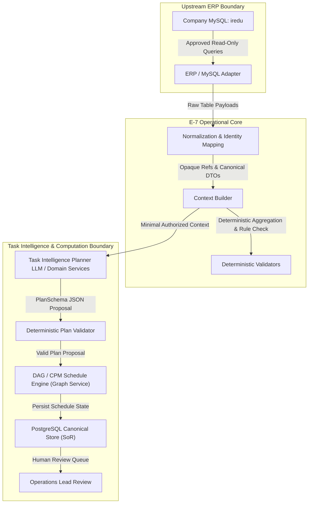

# MySQL → Task Intelligence Source Data Mapping

**Document Identifier:** `E7-DOC-INT-002`  
**Version:** `1.2.0` (Task 0G.2B Computation vs. Persistence Authority Correction)  
**Status:** COMPLETE (Task 0G.2B Approved Baseline)  
**Canonical Reference:** Task 0G.1 Inventory (`MYSQL_SCHEMA_INVENTORY.md` / `MYSQL_SCHEMA_INVENTORY.json`), Task 0G.1A Correction, ADR-001 through ADR-009, Requirements Traceability Matrix (`FR-TI-01` through `FR-TI-09`).  
**Upstream Source:** Company MySQL Database (`iredu`, MySQL 8.0.35 dump)  
**Canonical Downstream Persistence:** E-7 PostgreSQL (System-of-Record persistence layer for E-7-owned operational state; E-7 Task Intelligence and Domain Services own planning computation and orchestration)  

---

## 1. Purpose

This document establishes the Phase-0 source-grounded mapping contract, context projection rules, and exposure classifications between the company MySQL institutional database (`iredu`) and the E-7 Task Intelligence Engine.

### 1.1 Objectives
1. **Data Minimization & Safety:** Determine exactly which company MySQL tables and columns are relevant to the E-7 Task Intelligence Engine and define validated documentation boundaries designed to constrain unauthorized data exposure, PII leakage, or unvetted operational assumptions (to be strictly enforced by runtime implementation).
2. **Context Projection Rules:** Classify every evaluated column into strict exposure classes (`PLANNER_CONTEXT_ALLOWED`, `DETERMINISTIC_VALIDATION_ONLY`, `AGGREGATE_ONLY`, `RESTRICTED / FORBIDDEN_FROM_AI`, `NOT_REQUIRED_FOR_TASK_INTELLIGENCE`, `REQUIRES_BUSINESS_CONFIRMATION`).
3. **Requirement Traceability & Boundary Separation:** Review all 9 Task Intelligence functional requirements (`FR-TI-01` through `FR-TI-09`), explicitly distinguishing MySQL context contributions from E-7 engine responsibilities and external policy requirements.
4. **Reference Use Case Validation:** Define the minimal authorized context package required to execute `E7-REF-EXAM-001` ("Plan and conduct semester examinations") without fabricating unsupported schema capabilities.
5. **Integration Blockers & Governance:** Document all unresolved business and architectural questions (tenant scoping, active flag semantics, exam subsystem authority, and physical academic resource modeling) that constitute formal integration blockers prior to live database access.

### 1.2 Strict Governance Boundaries
- **Documentation & Data Contract Analysis Only:** This task produces specification artifacts only (`MYSQL_TASK_INTELLIGENCE_DATA_MAPPING.md` and `MYSQL_TASK_INTELLIGENCE_DATA_MAPPING.json`).
- **No Runtime Implementation:** Zero runtime code, ORM models (SQLAlchemy), MySQL client connections, network requests, or database credentials are created.
- **Phase 1 Boundary Maintained:** Phase 1 (Core Scheduling Engine) has NOT started.
- **No Fixture or Governance Mutation:** Existing synthetic fixtures (`tests/fixtures/ai_gold_set/*`, `tests/fixtures/resources/*`) and ADRs remain frozen.
- **Zero LLM Direct DB Exposure:** Upstream MySQL data never passes directly or unredacted to an LLM. All data flows through approved read-only queries, adapter normalization, and the Context Builder projection boundary.

---

## 2. Architectural Boundary & Authority Model

The E-7 architecture enforces strict decoupling between upstream ERP databases, domain computation services, and canonical persistence. Upstream MySQL is treated as an external, read-only institutional data source.

### 2.1 Computation vs. Persistence Authority Model

To eliminate any ambiguity between business computation, deterministic graph validation, and state persistence, operational authority is partitioned across three distinct architectural tiers:

1. **E-7 Task Intelligence / Domain Services:**
   - Own business computation, planning workflows, and orchestration.
   - Specific computational responsibilities include:
     - Goal normalization and decomposition
     - Structured plan generation and macro-WBS decomposition
     - Recommendation generation and next-action ranking
     - Effort estimation heuristics, risk scoring, and priority evaluation logic
   - Emits structured plan proposals conforming strictly to `PlanSchema`.

2. **E-7 Deterministic Validators / Graph Service:**
   - Own deterministic validation, integrity verification, and graph algorithms.
   - Specific computational responsibilities include:
     - Schema, entity, and institutional policy validation
     - Dependency reference validation and cycle detection
     - Directed Acyclic Graph (DAG) construction and topological ordering
     - Critical Path Method (CPM), total/free float analysis, slack calculation, and critical-path computation
   - Validates and schedules plan proposals prior to persistence or human review.

3. **E-7 PostgreSQL (Canonical Persistence / System of Record):**
   - Serves as the authoritative System-of-Record (SoR) and persistence layer for E-7-owned persisted operational state, evidence, and audit logs.
   - Persists E-7 entities, including:
     - Operational goals and approved/generated plan versions
     - Canonical tasks, task dependencies, milestones, and operational risks
     - Identity provider/source mapping rows linking canonical IDs to external source IDs
     - System events, transactional outbox/inbox records, and audit logs
     - Persisted computation results, schedule artifacts, and run metadata
   - **Non-Computational Boundary:** PostgreSQL does NOT perform plan generation, WBS creation, dependency generation, DAG validation, CPM computation, recommendation generation, or business risk/priority calculations. All intelligence and graph computation reside strictly in E-7 domain services and validators.

### 2.2 The Data Ingestion & Sanitization Pipeline



### 2.3 LLM Architectural Guardrails
The system architecture must enforce during implementation that the LLM:
1. Never connects directly to MySQL or executes SQL.
2. Never receives database credentials, connection strings, or DSNs.
3. Never receives unrestricted schema definitions, DDL scripts, or bulk wildcard table dumps (all `SELECT *` queries strictly prohibited).
4. Never receives restricted PII (passwords, salary, bank accounts, tax IDs, national IDs, personal phone/email, residential addresses, medical/guardian records).
5. Never dictates canonical database authority or invents business rules.
6. Never treats external MySQL auto-increment IDs as canonical E-7 operational IDs.

---

## 3. Source Evidence & Candidate Table Provenance

### 3.1 Inventory Baseline
This mapping is built upon the comprehensive schema audit performed in Task 0G.1 and corrected in Task 0G.1A:
- **Database:** `iredu` (MySQL 8.0.35 InnoDB engine).
- **Analyzed Source:** 247 table DDL files (`Dump20260924`).
- **Inventory Metrics:** 247 tables, 2,637 columns, 246 tables with PK, 1 without PK, 307 foreign-key constraints.
- **Task 0G.1 Artifacts:** `docs/integrations/MYSQL_SCHEMA_INVENTORY.md` and `docs/integrations/MYSQL_SCHEMA_INVENTORY.json`.

### 3.2 Candidate Table Provenance and Construction of Evaluated Set
To ensure complete reproducibility and eliminate double-counting, the construction of the evaluated tables set is documented below:

1. **Task 0G.1 Preliminary TI-Tagged Tables (61 Tables):**
   - In `MYSQL_SCHEMA_INVENTORY.json`, exactly **61 tables** carried the relevance tag `"Task Intelligence candidate (CANDIDATE ONLY — REQUIRES TASK 0G.2 MAPPING REVIEW)"`.
   - These 61 tables consisted of **37 core institutional/academic tables** and **24 auxiliary LMS & digital content tables** (`online_courses`, `contents`, `video_tutorial`, etc.).

2. **Focus Domain Dependency Tables Added (9 Tables):**
   - During Task 0G.2 analysis of the 10 Focus Domains and foreign-key relationships, exactly **9 additional tables** from other relevance categories in Task 0G.1 were evaluated:
     - Organization: `roles` (originally tagged `none / currently unknown`).
     - Leave / Availability: `staff_leave_request`, `staff_leave_details` (originally tagged `Workflow candidate, Resource candidate`).
     - Attendance: `staff_attendance` (originally tagged `Resource candidate, Reporting/analytics candidate`).
     - Shift Schedules: `staff_attendence_schedules` (originally tagged `Scheduling candidate, Resource candidate, Reporting/analytics candidate`).
     - Legacy Examination: `exam_groups`, `exam_schedules` (originally tagged `Scheduling candidate`).
     - Cohort Headcounts: `students`, `student_session` (originally tagged `none / currently unknown`).

3. **Total Evaluated Table Set (70 Tables):**
   - `61 (Task 0G.1 Tagged) + 9 (Focus Domain Dependencies) = 70 Unique Evaluated Tables`.
   - Zero double-counting exists. All 70 tables have distinct, verified provenance.

4. **Provenance of Prior '39 Primary Candidates' Phrasing:**
   - The prior Task 0G.2 prompt referenced '39 preliminary Task Intelligence candidate tables'. That number represented the **37 core non-LMS TI-tagged tables** plus **2 focus domain tables** (`roles`, `staff_leave_request`). In this revised document, all provenance is strictly grounded in the physical inventory facts.

### 3.3 Task 0G.1A Physical Resource Correction Baseline
Task 0G.1A corrected prior unsupported assumptions regarding academic room authority:
- **[SCHEMA FACT]:** The analyzed company MySQL schema lacks an authoritative academic physical-resource model. Specifically, it contains no tables for academic rooms, room seating capacity, room types, or physical equipment.
- **[SCHEMA FACT]:** Fields named `room_no` (e.g. in `subject_timetable` and `exam_schedules`) are unconstrained string labels (e.g. `varchar(20)`), lacking FK constraints, unique keys, or capacity associations.
- **[ENGINEERING MAPPING DECISION]:** Academic physical resource authority remains **UNRESOLVED**. Authority depends on deployment mode:
  - *Universal Mode:* Physical resource entities are owned natively by E-7 and persisted in E-7 PostgreSQL.
  - *Embedded Mode:* An external upstream facility master must provide room metadata.
- **[E-7 REQUIREMENT]:** `tests/fixtures/resources/RS-SYNTH-001.json` is synthetic test data only and is **NOT** a production source of authority.

### 3.4 Labeling Standard Applied Throughout
To establish a strictly source-grounded Phase-0 mapping contract and avoid unverified assumptions, every assertion in this document is explicitly labeled:
- `[SCHEMA FACT]`: Verified by physical DDL / column definitions in MySQL inventory.
- `[E-7 REQUIREMENT]`: Mandated by E-7 governance, traceability matrix (`FR-TI-01..09`), or ADRs.
- `[ENGINEERING MAPPING DECISION]`: Technical mapping rule established to bridge schema facts to requirements.
- `[REQUIRES BUSINESS CONFIRMATION]`: Ambiguity that must be formally clarified by institutional stakeholders before production deployment.

---

## 4. Task Intelligence Requirements: Context vs Engine Responsibilities

100% of functional requirements (`FR-TI-01` through `FR-TI-09`) were reviewed. Rather than claiming that MySQL schema sources satisfy these requirements, the architecture explicitly distinguishes **MySQL Context Contribution**, **E-7 Engine Responsibility**, and **Configuration / History / Policy Required**:

| Requirement | MySQL Context Contribution | E-7 Engine Responsibility | Configuration / History / Policy Required |
| :--- | :--- | :--- | :--- |
| **FR-TI-01<br>Goal Intake** | Provides upstream naming: active session (`sessions`), classes (`classes`), sections (`sections`), subjects (`subjects`), and departments (`department`). | Goal normalization and decomposition (E-7 Task Intelligence), input schema validation against PlanSchema (Deterministic Validators), and canonical goal persistence (E-7 PostgreSQL). | User input (objective, deadline, scope constraints, priority targets) and E-7 institutional profile configuration. |
| **FR-TI-02<br>WBS Generation** | Curricular hierarchy (`subject_groups`, `subject_group_subjects`, `classes`) and designations (`staff_designation`) provide naming context. | Algorithmic decomposition into hierarchical phases, work packages, tasks, descriptions, owner role matching, and acceptance criteria (E-7 Task Intelligence / Domain Services; generated/approved plan versions persisted in PostgreSQL). | WBS prompting strategies, standard operational templates, institutional SOPs, and human reviewer approval. |
| **FR-TI-03<br>Dependency Mapping** | **None directly.** Calendar dates (`annual_calendar`) provide temporal boundaries but do NOT define task dependency networks. | Constructing predecessor/successor links, strict DAG acyclicity validation, topological sorting, and CPM forward/backward passes (E-7 Deterministic Validators / Graph Service; dependency records persisted in PostgreSQL). | Operational workflow sequence rules. *(Note: MySQL contains NO task dependency or prerequisite tables; no curricular prerequisite relationship exists).* |
| **FR-TI-04<br>Effort Estimation** | `subjects.type` (Theory vs Practical) and adapter-derived aggregate cohort counts provide instructional scale context. | Algorithmic effort estimation, confidence scoring, estimation basis logging, and human override enforcement (E-7 Task Intelligence; estimates persisted in PostgreSQL). | Task estimation heuristics and historical operational duration actuals. *(Note: MySQL contains NO task-duration history or operational effort actuals).* |
| **FR-TI-05<br>Priority Intelligence** | Session deadlines (`sessions`) and informational calendar dates (`annual_calendar`) provide temporal milestone dates. | Multi-criteria priority scoring evaluating urgency (slack time), task impact, dependency criticality (path length in DAG), and resource bottlenecks (E-7 Task Intelligence and Graph Service; computed priorities persisted in PostgreSQL). | E-7 priority weighting rules and institutional urgency policies. *(MySQL fields do NOT constitute a complete priority model).* |
| **FR-TI-06<br>Milestones** | Academic session boundaries (`sessions`) and informational calendar dates (`annual_calendar`, `events`). | Milestone group generation, target date scheduling via CPM (Graph Service), milestone health tracking, and slippage detection (E-7 Domain Services; persisted in PostgreSQL). | Institutional milestone deadlines and examination term policies. |
| **FR-TI-07<br>Risk & Blocker Detection** | Known teaching periods (`subject_timetable`) and approved leave (`staff_leave_request`, when active) provide negative commitment windows. | Collision detection algorithms, resource overload detection, cycle detection, and risk scoring (E-7 Deterministic Validators / Graph Service and Task Intelligence; risk records persisted in PostgreSQL). | Calendar non-working day policy (which events/holidays enforce blackouts) and resource capacity thresholds. *(Free timetable slots != complete availability).* |
| **FR-TI-08<br>Progress Tracking** | **Optional domain evidence only.** Upstream lesson logs or exam schedules provide historical pedagogical records. | Canonical lifecycle state management (TODO, IN_PROGRESS, BLOCKED, COMPLETED), percentage completion, actual execution timestamps, and audit history (lifecycle logic owned by E-7 domain services; canonical state persisted in PostgreSQL). | Human task progress updates and E-7 state machine transitions. *(Canonical task progress is strictly E-7-owned; class_teacher is NOT progress evidence).* |
| **FR-TI-09<br>Recommendations** | Staff roster (`staff`), departments (`department`), designations (`staff_designation`), and teaching commitments (`subject_timetable`). | Generating next-action suggestions, candidate reassignment rankings, and schedule mitigation options (E-7 Task Intelligence). | Recommendation heuristic policies and human operational approval. *(Free timetable slots do NOT imply complete availability or skill suitability).* |

---

## 5. Candidate Table Decision Matrix (70 Tables Evaluated)

Based on strict source-fidelity and semantic analysis, the 70 evaluated tables are classified into 6 formal categories:
- **REQUIRED_FOR_INITIAL_TI (14 Tables):** Core academic and organizational spine, staff roster (strictly sanitized), known teaching commitments, and informational calendar entries.
- **OPTIONAL_LATER (13 Tables):** Fine-grained curricular detail, pedagogical coursework, legacy/CBSE exam entities, homeroom assignments, and leave requests.
- **VALIDATION_ONLY (5 Tables):** Application RBAC roles, bell schedules, assessment templates, and holiday categories used deterministically by backend services.
- **AGGREGATE_ONLY (2 Tables):** Student demographic and enrollment masters used strictly for adapter-derived cohort count queries.
- **UNRESOLVED (1 Table):** Historical daily attendance punch logs.
- **EXCLUDED (35 Tables):** Administrative, extracurricular, HR private journals, and auxiliary LMS/digital content tables.

### 5.1 Evaluated Tables Decision Matrix

| MySQL Table | Decision | TI Requirements | Context Purpose | Exposure Class | Confidence | Business Clarification Required |
| :--- | :--- | :--- | :--- | :--- | :--- | :--- |
| **`annual_calendar`** | **REQUIRED_FOR_INITIAL_TI** | FR-TI-01, FR-TI-06 | Official institutional holiday calendar for an academic session (INFORMATIONAL DATE CONTEXT; hard blackouts require E-7 policy) | `PLANNER_CONTEXT_ALLOWED / DETERMINISTIC` | HIGH | INFORMATIONAL DATE VS HARD BLACKOUT: Holiday entries provide informational calendar context. Whether a holiday enforces a total operational shutdown requires E-7 institutional policy confirmation.; ACTIVE SEMANTICS: Confirm is_active filtering rules for calendar dates |
| **`class_sections`** | **REQUIRED_FOR_INITIAL_TI** | FR-TI-01, FR-TI-02 | Operational cohort pairing of Class and Section (e.g., Class 10 - Section A) | `PLANNER_CONTEXT_ALLOWED / DETERMINISTIC` | HIGH | COHORT IDENTIFIER: Confirm whether composite string 'Class X - Section Y' is the standard display format; ACTIVE SEMANTICS: Confirm whether class_sections.is_active disables the entire cohort |
| **`classes`** | **REQUIRED_FOR_INITIAL_TI** | FR-TI-01, FR-TI-02 | Academic grade levels / classes (e.g., Class 10, Grade 12) | `PLANNER_CONTEXT_ALLOWED / DETERMINISTIC` | HIGH | TENANT/ORGANIZATION SCOPE: Campus-level grade structure confirmation; ACTIVE SEMANTICS: Confirm is_active filtering rules |
| **`department`** | **REQUIRED_FOR_INITIAL_TI** | FR-TI-01, FR-TI-02, FR-TI-09 | Staff departmental hierarchy (e.g., Mathematics, Science, Exam Cell, Operations) | `PLANNER_CONTEXT_ALLOWED / DETERMINISTIC` | HIGH | TENANT/ORGANIZATION SCOPE: Multi-school or branch partitioning unsupported in schema; ACTIVE SEMANTICS: Confirm whether is_active=0 represents soft-deletion or temporary deactivation |
| **`events`** | **REQUIRED_FOR_INITIAL_TI** | FR-TI-01, FR-TI-06 | Institutional events, meetings, and public calendar activities (INFORMATIONAL DATE CONTEXT; work-blocking requires E-7 policy) | `PLANNER_CONTEXT_ALLOWED / DETERMINISTIC` | HIGH | INFORMATIONAL DATE VS SCHEDULING CONFLICT: Events provide informational calendar context. They must NOT be treated as automated hard blackouts without E-7 policy confirmation.; ACTIVE SEMANTICS: is_active column is varchar(100) rather than integer flag; confirm allowed string values ('0', '1', 'yes', 'no'); EVENT SCOPE: Confirm event_for values ('all', 'role', 'class') to prevent leaking staff-only or private events to generalized planning |
| **`sections`** | **REQUIRED_FOR_INITIAL_TI** | FR-TI-01, FR-TI-02 | Section divisions within a class (e.g., A, B, C) | `PLANNER_CONTEXT_ALLOWED / DETERMINISTIC` | HIGH | TENANT/ORGANIZATION SCOPE: Section nomenclature rules across branches; ACTIVE SEMANTICS: Section activation flag rules |
| **`sessions`** | **REQUIRED_FOR_INITIAL_TI** | FR-TI-01, FR-TI-05, FR-TI-06 | Academic operational calendar sessions/years (e.g., 2026-2027) | `PLANNER_CONTEXT_ALLOWED / DETERMINISTIC` | HIGH | ACTIVE SESSION SEMANTICS: Confirm whether exactly one session has is_active=1 at any point in time; TENANT/ORGANIZATION SCOPE: Multi-branch academic session alignment |
| **`staff`** | **REQUIRED_FOR_INITIAL_TI** | FR-TI-01, FR-TI-02, FR-TI-07, FR-TI-09 | Institutional personnel master (teachers, administrators, support staff) — REQUIRES STRICTEST DATA MINIMIZATION | `PLANNER_CONTEXT_ALLOWED / DETERMINISTIC` | HIGH | STRICT PRIVACY ENFORCEMENT: Only name, surname, qualification, work_exp may enter planner context. All 31 sensitive/PII/payroll fields forbidden.; EXTERNAL ID OBFUSCATION: Raw staff IDs must be mapped to opaque references (e.g. StaffRef_42) before planner context intake; TENANT/ORGANIZATION SCOPE: Multi-school staff sharing or branch scoping rules; ACTIVE SEMANTICS: Confirm interplay between is_active=1 and disable_at date |
| **`staff_designation`** | **REQUIRED_FOR_INITIAL_TI** | FR-TI-01, FR-TI-02, FR-TI-09 | Institutional professional titles and designations (e.g., Principal, Senior Teacher, Lab In-Charge) | `PLANNER_CONTEXT_ALLOWED / DETERMINISTIC` | HIGH | TENANT/ORGANIZATION SCOPE: Designation hierarchy scope across campuses; ACTIVE SEMANTICS: Confirm whether is_active filters inactive titles |
| **`subject_group_class_sections`** | **REQUIRED_FOR_INITIAL_TI** | FR-TI-01, FR-TI-02 | Association assigning subject bundles to operational class-sections for a session | `PLANNER_CONTEXT_ALLOWED / DETERMINISTIC` | HIGH | ACTIVE SEMANTICS: Confirm is_active filtering for subject assignments |
| **`subject_group_subjects`** | **REQUIRED_FOR_INITIAL_TI** | FR-TI-01, FR-TI-02 | Associative mapping of subjects belonging to a subject group in a session | `PLANNER_CONTEXT_ALLOWED / DETERMINISTIC` | HIGH | SESSION REDUNDANCY: Confirm purpose of session_id both in subject_groups and subject_group_subjects |
| **`subject_groups`** | **REQUIRED_FOR_INITIAL_TI** | FR-TI-01, FR-TI-02 | Curricular subject streams / bundles for an academic session (e.g., Class 10 Science Stream) | `PLANNER_CONTEXT_ALLOWED / DETERMINISTIC` | HIGH | TENANT/ORGANIZATION SCOPE: Multi-branch curriculum bundling; SESSION BINDING: Confirm whether subject groups are strictly session-bound |
| **`subject_timetable`** | **REQUIRED_FOR_INITIAL_TI** | FR-TI-01, FR-TI-07, FR-TI-09 | Weekly recurring timetable periods / scheduled instructional commitments for teachers and classes (KNOWN COMMITMENTS ONLY; free slots != complete availability) | `PLANNER_CONTEXT_ALLOWED / DETERMINISTIC` | HIGH | ROOM_NO SEMANTICS (CRITICAL): room_no is an unconstrained string label only (e.g. '101', 'Lab'). SCHEMA FACT: Lacks room capacity, room type, or physical inventory. MUST NOT BE INTERPRETED BY PLANNER AS ROOM MASTER OR CAPACITY.; COMMITMENT VS AVAILABILITY: Free timetable slots do NOT imply complete staff availability; non-teaching administrative duties, preparation hours, and leave govern actual availability.; TIMETABLE VERSIONING: Confirm effective date ranges or term-based timetable versions; TIME COLUMNS: Confirm usage differences between varchar time_from/time_to and time start_time/end_time |
| **`subjects`** | **REQUIRED_FOR_INITIAL_TI** | FR-TI-01, FR-TI-02, FR-TI-04 | Master catalogue of academic courses and subjects (e.g., Mathematics, Physics, English) | `PLANNER_CONTEXT_ALLOWED / DETERMINISTIC` | HIGH | SUBJECT TYPE SEMANTICS: Confirm 'Theory' vs 'Practical' values and impact on effort estimation formulas; SUBJECT CODES: Confirm institutional uniqueness of code column |
| **`cbse_exams`** | OPTIONAL_LATER | FR-TI-01, FR-TI-06 | CBSE examination definitions and assessment cycles | `DETERMINISTIC / NOT_REQUIRED` | HIGH | EXAMINATION SUBSYSTEM AUTHORITY: Clarify whether cbse_exams or legacy exam_groups is the authoritative exam master |
| **`cbse_terms`** | OPTIONAL_LATER | FR-TI-01, FR-TI-06 | Formal CBSE academic term periods (e.g., Term 1, Term 2) | `DETERMINISTIC / NOT_REQUIRED` | HIGH | CURRICULUM SPECIFICITY: Clarify whether school operates under pure CBSE or dual/multiple examination boards |
| **`class_teacher`** | OPTIONAL_LATER | FR-TI-01, FR-TI-05 | Administrative homeroom teacher assignment to a class section (HOMEROOM RELATIONSHIP ONLY; does not prove skill, capacity, availability, or general task eligibility) | `DETERMINISTIC / NOT_REQUIRED` | HIGH | RELATIONSHIP VS ELIGIBILITY: Confirm whether class-teacher assignment has any mandatory operational role or if task suitability is governed by designations and subject specialties. |
| **`daily_assignment`** | OPTIONAL_LATER | FR-TI-04 | Classroom assignments published by teachers for student coursework | `DETERMINISTIC / NOT_REQUIRED` | HIGH | COURSEWORK VS OPERATIONS: Confirm operational engine distinction |
| **`exam_groups`** | OPTIONAL_LATER | FR-TI-01, FR-TI-06 | General / legacy examination grouping (e.g. Mid-term Exam, Final Exam) | `DETERMINISTIC / NOT_REQUIRED` | MEDIUM | EXAM AUTHORITY: Resolve dual exam subsystem coexistence |
| **`exam_schedules`** | OPTIONAL_LATER | FR-TI-01, FR-TI-07 | Scheduled date, time, and room allocations for legacy exam batches | `DETERMINISTIC / NOT_REQUIRED` | MEDIUM | PHYSICAL RESOURCE: room_no in exam_schedules is a string label only; lacks room capacity/equipment |
| **`homework`** | OPTIONAL_LATER | FR-TI-04, FR-TI-08 | Daily academic homework assigned to students | `DETERMINISTIC / NOT_REQUIRED` | HIGH | TASK CLASSIFICATION: Confirm pedagogical homework is outside operational WBS scope |
| **`lesson`** | OPTIONAL_LATER | FR-TI-02, FR-TI-04 | Specific curricular lesson units belonging to subject groups and class-sections | `DETERMINISTIC / NOT_REQUIRED` | HIGH | CURRICULAR GRANULARITY: Clarify whether operational tasks require lesson-level breakdown or macro-subject milestones |
| **`staff_attendence_schedules`** | OPTIONAL_LATER | FR-TI-01, FR-TI-07 | Contractual staff daily shift arrival and departure time boundaries | `DETERMINISTIC / NOT_REQUIRED` | MEDIUM | SHIFT ENFORCEMENT: Confirm whether staff attendance schedules strictly restrict task execution hours |
| **`staff_leave_details`** | OPTIONAL_LATER | FR-TI-07 | Annual quota allocations and entitlement balances per leave type | `DETERMINISTIC / NOT_REQUIRED` | MEDIUM | QUOTA RELEVANCE: Confirm whether remaining leave quota affects task suitability |
| **`staff_leave_request`** | OPTIONAL_LATER | FR-TI-01, FR-TI-07, FR-TI-09 | Applied and approved staff leave windows and absence records | `DETERMINISTIC / NOT_REQUIRED` | HIGH | LEAVE APPROVAL STATUS: Confirm status column values ('approved', 'pending', 'rejected') to avoid treating pending requests as definitive absences. No hardcoded status filter (e.g. approved=1) should be assumed without documented evidence.; REMARK/DOCUMENT PRIVACY: employee_remark, admin_remark, document_file contain sensitive medical/personal notes and MUST be forbidden from AI context |
| **`subject_syllabus`** | OPTIONAL_LATER | FR-TI-04, FR-TI-08 | Lesson pacing and syllabus completion status recorded by teachers | `DETERMINISTIC / NOT_REQUIRED` | MEDIUM | PROGRESS AUTHORITY: E-7 PostgreSQL is canonical for operational progress; subject_syllabus is read-only pedagogical evidence only |
| **`topic`** | OPTIONAL_LATER | FR-TI-02 | Sub-lesson curricular topics and conceptual units | `DETERMINISTIC / NOT_REQUIRED` | HIGH | PEDAGOGICAL GRANULARITY: Confirm exclusion from macro-operational engine |
| **`cbse_template_class_sections`** | VALIDATION_ONLY | FR-TI-01 | Associative binding between CBSE assessment templates and class sections | `DETERMINISTIC_VALIDATION_ONLY` | MEDIUM | TEMPLATE BINDING: Used only for validating curriculum applicability |
| **`class_section_times`** | VALIDATION_ONLY | FR-TI-01, FR-TI-07 | Daily class bell schedule / section timing boundaries | `DETERMINISTIC_VALIDATION_ONLY` | MEDIUM | BELL SCHEDULE: Confirm whether bell timings are operational task boundaries |
| **`holiday_type`** | VALIDATION_ONLY | FR-TI-01, FR-TI-03 | Lookup classification for calendar holidays (e.g. Gazetted, Regional, Institutional) | `DETERMINISTIC_VALIDATION_ONLY` | HIGH | HOLIDAY CATEGORIZATION: Confirm which holiday types enforce operational blackout |
| **`roles`** | VALIDATION_ONLY | FR-TI-01 | Institutional application RBAC roles (e.g. Admin, Teacher, Accountant) — VALIDATION ONLY; application authorization roles do not represent operational task-assignment capabilities or professional skills | `DETERMINISTIC_VALIDATION_ONLY` | HIGH | RBAC VS CAPABILITY: Confirm that system roles do not define operational task eligibility; professional capabilities reside in staff_designation and qualifications. |
| **`staff_roles`** | VALIDATION_ONLY | FR-TI-01 | Association mapping staff members to application RBAC roles — VALIDATION ONLY | `DETERMINISTIC_VALIDATION_ONLY` | HIGH | APPLICATION PERMISSION BOUNDARY: System role mappings are restricted to access control validation. |
| **`student_session`** | **AGGREGATION_ONLY** | FR-TI-01, FR-TI-04 | Enrollment association linking student to class-section for an academic session | `AGGREGATE_ONLY` | HIGH | ENROLLMENT STATUS: Confirm whether student_session rows include transferred/inactive students |
| **`students`** | **AGGREGATION_ONLY** | FR-TI-01, FR-TI-04 | Student demographic, enrollment, and personal master — STRICTLY AGGREGATE ONLY | `AGGREGATE_ONLY` | HIGH | STRICT PRIVACY POLICY: Zero student records may be selected or transmitted to LLM. Aggregation only at database adapter boundary.; ACTIVE STUDENT FILTER: Confirm is_active filtering for calculating active student headcounts |
| **`staff_attendance`** | UNRESOLVED | FR-TI-07, FR-TI-08 | Historical daily employee punch logs and clock-in/out attendance records | `REQUIRES_BUSINESS_CONFIRMATION` | LOW | FUTURE AVAILABILITY SEMANTICS: Confirm whether historical attendance has any valid predictive role in E-7 planning or if only forward leave requests (staff_leave_request) and timetables govern availability; DATA VOLUME: High-frequency operational punch data creates unnecessary integration overhead if misapplied to macro-planning |
| **`certificates`** | *EXCLUDED* | None | Document template generation: Template metadata for printing student/staff completion certificates. Not an operational planning input. | `FORBIDDEN_FROM_AI / NOT_REQUIRED` | HIGH | None (Excluded from scope) |
| **`content_for`** | *EXCLUDED* | None | Digital asset distribution: User distribution lists for content downloads. | `FORBIDDEN_FROM_AI / NOT_REQUIRED` | HIGH | None (Excluded from scope) |
| **`content_types`** | *EXCLUDED* | None | Digital asset classification: Content type metadata lookup. | `FORBIDDEN_FROM_AI / NOT_REQUIRED` | HIGH | None (Excluded from scope) |
| **`contents`** | *EXCLUDED* | None | Digital asset library: Uploaded educational files, assignments, and study materials. | `FORBIDDEN_FROM_AI / NOT_REQUIRED` | HIGH | None (Excluded from scope) |
| **`course_category`** | *EXCLUDED* | None | E-learning taxonomy: Online course subject categorization. | `FORBIDDEN_FROM_AI / NOT_REQUIRED` | HIGH | None (Excluded from scope) |
| **`course_lesson_quiz_order`** | *EXCLUDED* | None | E-learning navigation: Sequencing order for online lessons and quizzes. | `FORBIDDEN_FROM_AI / NOT_REQUIRED` | HIGH | None (Excluded from scope) |
| **`course_progress`** | *EXCLUDED* | None | E-learning analytics: Student video playback completion percentages. | `FORBIDDEN_FROM_AI / NOT_REQUIRED` | HIGH | None (Excluded from scope) |
| **`course_quiz_answer`** | *EXCLUDED* | None | E-learning quiz: Student submitted quiz responses and answers. | `FORBIDDEN_FROM_AI / NOT_REQUIRED` | HIGH | None (Excluded from scope) |
| **`course_quiz_question`** | *EXCLUDED* | None | E-learning quiz: Multiple choice quiz question definitions. | `FORBIDDEN_FROM_AI / NOT_REQUIRED` | HIGH | None (Excluded from scope) |
| **`course_rating`** | *EXCLUDED* | None | E-learning reviews: Public course star ratings and reviews. | `FORBIDDEN_FROM_AI / NOT_REQUIRED` | HIGH | None (Excluded from scope) |
| **`fee_session_groups`** | *EXCLUDED* | None | Financial domain: Fee structure grouping by session. Zero relevance to operational task breakdown, WBS, or scheduling. | `FORBIDDEN_FROM_AI / NOT_REQUIRED` | HIGH | None (Excluded from scope) |
| **`gmeet_sections`** | *EXCLUDED* | None | Teleconferencing integration: Join table linking class sections to Google Meet sessions. | `FORBIDDEN_FROM_AI / NOT_REQUIRED` | HIGH | None (Excluded from scope) |
| **`gmeet_staff`** | *EXCLUDED* | None | Teleconferencing integration: Join table linking staff to Google Meet virtual sessions. External teleconference URL management. | `FORBIDDEN_FROM_AI / NOT_REQUIRED` | HIGH | None (Excluded from scope) |
| **`homework_evaluation`** | *EXCLUDED* | None | Pedagogical assessment: Individual student homework evaluation and marks. Sensitive minor grading data. | `FORBIDDEN_FROM_AI / NOT_REQUIRED` | HIGH | None (Excluded from scope) |
| **`lesson_plan_forum`** | *EXCLUDED* | None | Discussion board: Unstructured forum commentary between teachers and students on lesson plans. Non-authoritative communication. | `FORBIDDEN_FROM_AI / NOT_REQUIRED` | HIGH | None (Excluded from scope) |
| **`online_course_class_sections`** | *EXCLUDED* | None | E-learning course mapping: Linking online courses to class sections. | `FORBIDDEN_FROM_AI / NOT_REQUIRED` | HIGH | None (Excluded from scope) |
| **`online_course_lesson`** | *EXCLUDED* | None | E-learning course unit: Video lesson metadata. | `FORBIDDEN_FROM_AI / NOT_REQUIRED` | HIGH | None (Excluded from scope) |
| **`online_course_payment`** | *EXCLUDED* | None | E-learning e-commerce: Online course payment transactions and gateway logs. | `FORBIDDEN_FROM_AI / NOT_REQUIRED` | HIGH | None (Excluded from scope) |
| **`online_course_processing_payment`** | *EXCLUDED* | None | E-learning e-commerce: In-flight payment gateway transactions. | `FORBIDDEN_FROM_AI / NOT_REQUIRED` | HIGH | None (Excluded from scope) |
| **`online_course_quiz`** | *EXCLUDED* | None | E-learning quiz: Online quiz master definitions. | `FORBIDDEN_FROM_AI / NOT_REQUIRED` | HIGH | None (Excluded from scope) |
| **`online_course_section`** | *EXCLUDED* | None | E-learning course module: Course module sections. | `FORBIDDEN_FROM_AI / NOT_REQUIRED` | HIGH | None (Excluded from scope) |
| **`online_course_settings`** | *EXCLUDED* | None | E-learning configuration: Payment gateway keys and course portal configuration. | `FORBIDDEN_FROM_AI / NOT_REQUIRED` | HIGH | None (Excluded from scope) |
| **`online_courses`** | *EXCLUDED* | None | E-learning course catalogue: Asynchronous online video course metadata. | `FORBIDDEN_FROM_AI / NOT_REQUIRED` | HIGH | None (Excluded from scope) |
| **`school_houses`** | *EXCLUDED* | None | Student grouping: Extracurricular student houses (e.g. Red House, Blue House). No operational workflow relevance. | `FORBIDDEN_FROM_AI / NOT_REQUIRED` | HIGH | None (Excluded from scope) |
| **`share_content_for`** | *EXCLUDED* | None | Content sharing: Distribution recipients for shared content. | `FORBIDDEN_FROM_AI / NOT_REQUIRED` | HIGH | None (Excluded from scope) |
| **`share_contents`** | *EXCLUDED* | None | Content sharing: Shared file bundles and download links. | `FORBIDDEN_FROM_AI / NOT_REQUIRED` | HIGH | None (Excluded from scope) |
| **`share_upload_contents`** | *EXCLUDED* | None | Content sharing: Mapping shared files to uploaded content. | `FORBIDDEN_FROM_AI / NOT_REQUIRED` | HIGH | None (Excluded from scope) |
| **`staff_id_card`** | *EXCLUDED* | None | Print layout template: Visual badge styling, background images, and header colors for ID printing. Zero operational relevance. | `FORBIDDEN_FROM_AI / NOT_REQUIRED` | HIGH | None (Excluded from scope) |
| **`staff_rating`** | *EXCLUDED* | None | Subjective feedback: Employee performance ratings and subjective student/peer comments. FORBIDDEN FROM AI PLANNING. | `FORBIDDEN_FROM_AI / NOT_REQUIRED` | HIGH | None (Excluded from scope) |
| **`staff_timeline`** | *EXCLUDED* | None | Personnel HR journal: Internal HR chronological notes, employee disciplinary logs, and personal documents. High privacy risk. | `FORBIDDEN_FROM_AI / NOT_REQUIRED` | HIGH | None (Excluded from scope) |
| **`student_quiz_status`** | *EXCLUDED* | None | E-learning quiz: Student quiz attempt status. | `FORBIDDEN_FROM_AI / NOT_REQUIRED` | HIGH | None (Excluded from scope) |
| **`submit_assignment`** | *EXCLUDED* | None | Student submission: Homework file uploads, messages, and student attachments. PII and media storage. | `FORBIDDEN_FROM_AI / NOT_REQUIRED` | HIGH | None (Excluded from scope) |
| **`upload_contents`** | *EXCLUDED* | None | File storage: Storage metadata for uploaded educational media. | `FORBIDDEN_FROM_AI / NOT_REQUIRED` | HIGH | None (Excluded from scope) |
| **`video_tutorial`** | *EXCLUDED* | None | Digital video library: Standalone video tutorial metadata. | `FORBIDDEN_FROM_AI / NOT_REQUIRED` | HIGH | None (Excluded from scope) |
| **`video_tutorial_class_sections`** | *EXCLUDED* | None | Digital video distribution: Linking video tutorials to class sections. | `FORBIDDEN_FROM_AI / NOT_REQUIRED` | HIGH | None (Excluded from scope) |

---

## 6. Initial Task Intelligence Source Set (`REQUIRED_FOR_INITIAL_TI`)

A source is classified as `REQUIRED_FOR_INITIAL_TI` if and only if it is judged necessary for the initial Task Intelligence integration AND is sufficiently understood to define a safe context contract. Exactly **14 tables** meet these criteria:

### `annual_calendar`

- **Business Meaning:** Official institutional holiday calendar for an academic session (INFORMATIONAL DATE CONTEXT; hard blackouts require E-7 policy)
- **Schema Evidence:** [SCHEMA FACT] Table has 12 columns in MySQL dump `iredu`. Primary Key: `['id']`. Outgoing Foreign Keys: 1.
- **TI Requirements:** [E-7 REQUIREMENT] Mapped to: FR-TI-01, FR-TI-06.
- **Read Policy:** [ENGINEERING MAPPING DECISION] Read-Only access via approved ERP adapter parameterized queries. No ad-hoc SQL or runtime direct table scans permitted.

#### Column Mapping Whitelist

| Column | Purpose | Exposure Class | Sensitive? | External-ID Behavior | Notes |
| :--- | :--- | :--- | :--- | :--- | :--- |
| **`id`** (`int`) | Primary key identifier | `DETERMINISTIC_VALIDATION_ONLY` | NO | `(mysql_iredu, annual_calendar, id)` | Mapped to external_id in (mysql_iredu, annual_calendar, id) |
| **`session_id`** (`int`) | FK to sessions.id | `DETERMINISTIC_VALIDATION_ONLY` | NO | None | Filter to current active session |
| **`holiday_type`** (`int`) | FK / lookup to holiday_type.id | `DETERMINISTIC_VALIDATION_ONLY` | NO | None | Resolved via join to holiday_type.type |
| **`from_date`** (`datetime`) | Holiday start datetime boundary | `PLANNER_CONTEXT_ALLOWED` | NO | None | Informational date context for calendar display |
| **`to_date`** (`datetime`) | Holiday end datetime boundary | `PLANNER_CONTEXT_ALLOWED` | NO | None | Informational date context for calendar display |
| **`description`** (`text`) | Holiday title / description | `PLANNER_CONTEXT_ALLOWED` | NO | None | Exposed in sanitized prompt |
| **`is_active`** (`int`) | Active holiday entry flag | `DETERMINISTIC_VALIDATION_ONLY` | NO | None | Deterministic query filter |
| **`holiday_color`** (`varchar(200)`) | UI display hex color code | `NOT_REQUIRED_FOR_TASK_INTELLIGENCE` | NO | None | Not required |
| **`front_site`** (`int`) | Public portal display flag | `NOT_REQUIRED_FOR_TASK_INTELLIGENCE` | NO | None | Not required |
| **`created_by`** (`int`) | User ID of creator | `NOT_REQUIRED_FOR_TASK_INTELLIGENCE` | NO | None | Not required |
| **`created_at`** (`timestamp`) | Audit timestamp | `NOT_REQUIRED_FOR_TASK_INTELLIGENCE` | NO | None | Not required |
| **`updated_at`** (`timestamp`) | Audit timestamp | `NOT_REQUIRED_FOR_TASK_INTELLIGENCE` | NO | None | Not required |

- **Required Joins:** [SCHEMA FACT] annual_calendar.session_id -> sessions.id; annual_calendar.holiday_type -> holiday_type.id.
- **Freshness Class:** [ENGINEERING MAPPING DECISION] `DAILY_OR_PERIODIC`.
- **Null Handling:** [SCHEMA FACT / ENGINEERING MAPPING DECISION] Primary keys and non-nullable descriptive columns must be validated non-null by the adapter; null foreign keys or inactive records are pruned by query filters.
- **Authority:** [ENGINEERING MAPPING DECISION] Upstream institutional ERP (`iredu`) remains authoritative for external master records. E-7 PostgreSQL is the canonical persistence/System-of-Record layer for E-7-owned operational state and entity mappings; E-7 domain services own planning computation.
- **Business Clarifications Required:**
  - [REQUIRES BUSINESS CONFIRMATION] INFORMATIONAL DATE VS HARD BLACKOUT: Holiday entries provide informational calendar context. Whether a holiday enforces a total operational shutdown requires E-7 institutional policy confirmation.
  - [REQUIRES BUSINESS CONFIRMATION] ACTIVE SEMANTICS: Confirm is_active filtering rules for calendar dates

### `class_sections`

- **Business Meaning:** Operational cohort pairing of Class and Section (e.g., Class 10 - Section A)
- **Schema Evidence:** [SCHEMA FACT] Table has 6 columns in MySQL dump `iredu`. Primary Key: `['id']`. Outgoing Foreign Keys: 2.
- **TI Requirements:** [E-7 REQUIREMENT] Mapped to: FR-TI-01, FR-TI-02.
- **Read Policy:** [ENGINEERING MAPPING DECISION] Read-Only access via approved ERP adapter parameterized queries. No ad-hoc SQL or runtime direct table scans permitted.

#### Column Mapping Whitelist

| Column | Purpose | Exposure Class | Sensitive? | External-ID Behavior | Notes |
| :--- | :--- | :--- | :--- | :--- | :--- |
| **`id`** (`int`) | Primary key identifier | `DETERMINISTIC_VALIDATION_ONLY` | NO | `(mysql_iredu, class_sections, id)` | Mapped to external_id in (mysql_iredu, class_sections, id) |
| **`class_id`** (`int`) | FK to classes.id | `DETERMINISTIC_VALIDATION_ONLY` | NO | None | Resolved via join to classes.class |
| **`section_id`** (`int`) | FK to sections.id | `DETERMINISTIC_VALIDATION_ONLY` | NO | None | Resolved via join to sections.section |
| **`is_active`** (`varchar(255)`) | Active status flag | `DETERMINISTIC_VALIDATION_ONLY` | NO | None | Deterministic filter |
| **`created_at`** (`timestamp`) | Audit timestamp | `NOT_REQUIRED_FOR_TASK_INTELLIGENCE` | NO | None | Not required |
| **`updated_at`** (`timestamp`) | Audit timestamp | `NOT_REQUIRED_FOR_TASK_INTELLIGENCE` | NO | None | Not required |

- **Required Joins:** [SCHEMA FACT] class_sections.class_id -> classes.id; class_sections.section_id -> sections.id; Referenced by subject_group_class_sections.class_section_id -> class_sections.id; Referenced by subject_timetable.class_section_id -> class_sections.id.
- **Freshness Class:** [ENGINEERING MAPPING DECISION] `STATIC_OR_SLOW`.
- **Null Handling:** [SCHEMA FACT / ENGINEERING MAPPING DECISION] Primary keys and non-nullable descriptive columns must be validated non-null by the adapter; null foreign keys or inactive records are pruned by query filters.
- **Authority:** [ENGINEERING MAPPING DECISION] Upstream institutional ERP (`iredu`) remains authoritative for external master records. E-7 PostgreSQL is the canonical persistence/System-of-Record layer for E-7-owned operational state and entity mappings; E-7 domain services own planning computation.
- **Business Clarifications Required:**
  - [REQUIRES BUSINESS CONFIRMATION] COHORT IDENTIFIER: Confirm whether composite string 'Class X - Section Y' is the standard display format
  - [REQUIRES BUSINESS CONFIRMATION] ACTIVE SEMANTICS: Confirm whether class_sections.is_active disables the entire cohort

### `classes`

- **Business Meaning:** Academic grade levels / classes (e.g., Class 10, Grade 12)
- **Schema Evidence:** [SCHEMA FACT] Table has 5 columns in MySQL dump `iredu`. Primary Key: `['id']`. Outgoing Foreign Keys: 0.
- **TI Requirements:** [E-7 REQUIREMENT] Mapped to: FR-TI-01, FR-TI-02.
- **Read Policy:** [ENGINEERING MAPPING DECISION] Read-Only access via approved ERP adapter parameterized queries. No ad-hoc SQL or runtime direct table scans permitted.

#### Column Mapping Whitelist

| Column | Purpose | Exposure Class | Sensitive? | External-ID Behavior | Notes |
| :--- | :--- | :--- | :--- | :--- | :--- |
| **`id`** (`int`) | Primary key identifier | `DETERMINISTIC_VALIDATION_ONLY` | NO | `(mysql_iredu, classes, id)` | Mapped to external_id in (mysql_iredu, classes, id) |
| **`class`** (`varchar(60)`) | Grade level name | `PLANNER_CONTEXT_ALLOWED` | NO | None | Exposed in sanitized prompt |
| **`is_active`** (`varchar(255)`) | Active status flag | `DETERMINISTIC_VALIDATION_ONLY` | NO | None | Deterministic query filter |
| **`created_at`** (`timestamp`) | Audit timestamp | `NOT_REQUIRED_FOR_TASK_INTELLIGENCE` | NO | None | Not required |
| **`updated_at`** (`timestamp`) | Audit timestamp | `NOT_REQUIRED_FOR_TASK_INTELLIGENCE` | NO | None | Not required |

- **Required Joins:** [SCHEMA FACT] Referenced by class_sections.class_id -> classes.id; Referenced by class_teacher.class_id -> classes.id.
- **Freshness Class:** [ENGINEERING MAPPING DECISION] `STATIC_OR_SLOW`.
- **Null Handling:** [SCHEMA FACT / ENGINEERING MAPPING DECISION] Primary keys and non-nullable descriptive columns must be validated non-null by the adapter; null foreign keys or inactive records are pruned by query filters.
- **Authority:** [ENGINEERING MAPPING DECISION] Upstream institutional ERP (`iredu`) remains authoritative for external master records. E-7 PostgreSQL is the canonical persistence/System-of-Record layer for E-7-owned operational state and entity mappings; E-7 domain services own planning computation.
- **Business Clarifications Required:**
  - [REQUIRES BUSINESS CONFIRMATION] TENANT/ORGANIZATION SCOPE: Campus-level grade structure confirmation
  - [REQUIRES BUSINESS CONFIRMATION] ACTIVE SEMANTICS: Confirm is_active filtering rules

### `department`

- **Business Meaning:** Staff departmental hierarchy (e.g., Mathematics, Science, Exam Cell, Operations)
- **Schema Evidence:** [SCHEMA FACT] Table has 5 columns in MySQL dump `iredu`. Primary Key: `['id']`. Outgoing Foreign Keys: 0.
- **TI Requirements:** [E-7 REQUIREMENT] Mapped to: FR-TI-01, FR-TI-02, FR-TI-09.
- **Read Policy:** [ENGINEERING MAPPING DECISION] Read-Only access via approved ERP adapter parameterized queries. No ad-hoc SQL or runtime direct table scans permitted.

#### Column Mapping Whitelist

| Column | Purpose | Exposure Class | Sensitive? | External-ID Behavior | Notes |
| :--- | :--- | :--- | :--- | :--- | :--- |
| **`id`** (`int`) | Primary key identifier | `DETERMINISTIC_VALIDATION_ONLY` | NO | `(mysql_iredu, department, id)` | Mapped to external_id in (mysql_iredu, department, id) |
| **`department_name`** (`varchar(200)`) | Department display label for task assignment and routing | `PLANNER_CONTEXT_ALLOWED` | NO | None | Sanitized string exposed to planner |
| **`is_active`** (`varchar(100)`) | Department active status flag | `DETERMINISTIC_VALIDATION_ONLY` | NO | None | Deterministic query filter; confirmation required on semantics |
| **`created_at`** (`timestamp`) | Audit timestamp | `NOT_REQUIRED_FOR_TASK_INTELLIGENCE` | NO | None | Not required for operational task planning |
| **`updated_at`** (`timestamp`) | Audit timestamp | `NOT_REQUIRED_FOR_TASK_INTELLIGENCE` | NO | None | Not required for operational task planning |

- **Required Joins:** [SCHEMA FACT] Referenced by staff.department -> department.id.
- **Freshness Class:** [ENGINEERING MAPPING DECISION] `STATIC_OR_SLOW`.
- **Null Handling:** [SCHEMA FACT / ENGINEERING MAPPING DECISION] Primary keys and non-nullable descriptive columns must be validated non-null by the adapter; null foreign keys or inactive records are pruned by query filters.
- **Authority:** [ENGINEERING MAPPING DECISION] Upstream institutional ERP (`iredu`) remains authoritative for external master records. E-7 PostgreSQL is the canonical persistence/System-of-Record layer for E-7-owned operational state and entity mappings; E-7 domain services own planning computation.
- **Business Clarifications Required:**
  - [REQUIRES BUSINESS CONFIRMATION] TENANT/ORGANIZATION SCOPE: Multi-school or branch partitioning unsupported in schema
  - [REQUIRES BUSINESS CONFIRMATION] ACTIVE SEMANTICS: Confirm whether is_active=0 represents soft-deletion or temporary deactivation

### `events`

- **Business Meaning:** Institutional events, meetings, and public calendar activities (INFORMATIONAL DATE CONTEXT; work-blocking requires E-7 policy)
- **Schema Evidence:** [SCHEMA FACT] Table has 12 columns in MySQL dump `iredu`. Primary Key: `['id']`. Outgoing Foreign Keys: 1.
- **TI Requirements:** [E-7 REQUIREMENT] Mapped to: FR-TI-01, FR-TI-06.
- **Read Policy:** [ENGINEERING MAPPING DECISION] Read-Only access via approved ERP adapter parameterized queries. No ad-hoc SQL or runtime direct table scans permitted.

#### Column Mapping Whitelist

| Column | Purpose | Exposure Class | Sensitive? | External-ID Behavior | Notes |
| :--- | :--- | :--- | :--- | :--- | :--- |
| **`id`** (`int`) | Primary key identifier | `DETERMINISTIC_VALIDATION_ONLY` | NO | `(mysql_iredu, events, id)` | Mapped to external_id in (mysql_iredu, events, id) |
| **`event_title`** (`varchar(200)`) | Event title summary | `PLANNER_CONTEXT_ALLOWED` | NO | None | Exposed in sanitized prompt |
| **`event_description`** (`text`) | Event detailed description | `PLANNER_CONTEXT_ALLOWED` | NO | None | Contextual description for informational awareness |
| **`start_date`** (`datetime`) | Event start datetime | `PLANNER_CONTEXT_ALLOWED` | NO | None | Informational event timing |
| **`end_date`** (`datetime`) | Event end datetime | `PLANNER_CONTEXT_ALLOWED` | NO | None | Informational event timing |
| **`event_type`** (`varchar(100)`) | Event classification (e.g. public, task, academic) | `PLANNER_CONTEXT_ALLOWED` | NO | None | Exposed in sanitized prompt |
| **`event_color`** (`varchar(200)`) | UI display hex color code | `NOT_REQUIRED_FOR_TASK_INTELLIGENCE` | NO | None | Not required |
| **`event_for`** (`varchar(100)`) | Audience filter code (e.g. all, staff, students) | `DETERMINISTIC_VALIDATION_ONLY` | NO | None | Deterministic query filter |
| **`role_id`** (`int`) | FK to roles.id for role-specific events | `DETERMINISTIC_VALIDATION_ONLY` | NO | None | Deterministic role filter |
| **`is_active`** (`varchar(100)`) | Active status flag (varchar) | `DETERMINISTIC_VALIDATION_ONLY` | NO | None | Confirmation required on string values |
| **`created_at`** (`timestamp`) | Audit timestamp | `NOT_REQUIRED_FOR_TASK_INTELLIGENCE` | NO | None | Not required |
| **`updated_at`** (`timestamp`) | Audit timestamp | `NOT_REQUIRED_FOR_TASK_INTELLIGENCE` | NO | None | Not required |

- **Required Joins:** [SCHEMA FACT] events.role_id -> roles.id.
- **Freshness Class:** [ENGINEERING MAPPING DECISION] `DAILY_OR_PERIODIC`.
- **Null Handling:** [SCHEMA FACT / ENGINEERING MAPPING DECISION] Primary keys and non-nullable descriptive columns must be validated non-null by the adapter; null foreign keys or inactive records are pruned by query filters.
- **Authority:** [ENGINEERING MAPPING DECISION] Upstream institutional ERP (`iredu`) remains authoritative for external master records. E-7 PostgreSQL is the canonical persistence/System-of-Record layer for E-7-owned operational state and entity mappings; E-7 domain services own planning computation.
- **Business Clarifications Required:**
  - [REQUIRES BUSINESS CONFIRMATION] INFORMATIONAL DATE VS SCHEDULING CONFLICT: Events provide informational calendar context. They must NOT be treated as automated hard blackouts without E-7 policy confirmation.
  - [REQUIRES BUSINESS CONFIRMATION] ACTIVE SEMANTICS: is_active column is varchar(100) rather than integer flag; confirm allowed string values ('0', '1', 'yes', 'no')
  - [REQUIRES BUSINESS CONFIRMATION] EVENT SCOPE: Confirm event_for values ('all', 'role', 'class') to prevent leaking staff-only or private events to generalized planning

### `sections`

- **Business Meaning:** Section divisions within a class (e.g., A, B, C)
- **Schema Evidence:** [SCHEMA FACT] Table has 5 columns in MySQL dump `iredu`. Primary Key: `['id']`. Outgoing Foreign Keys: 0.
- **TI Requirements:** [E-7 REQUIREMENT] Mapped to: FR-TI-01, FR-TI-02.
- **Read Policy:** [ENGINEERING MAPPING DECISION] Read-Only access via approved ERP adapter parameterized queries. No ad-hoc SQL or runtime direct table scans permitted.

#### Column Mapping Whitelist

| Column | Purpose | Exposure Class | Sensitive? | External-ID Behavior | Notes |
| :--- | :--- | :--- | :--- | :--- | :--- |
| **`id`** (`int`) | Primary key identifier | `DETERMINISTIC_VALIDATION_ONLY` | NO | `(mysql_iredu, sections, id)` | Mapped to external_id in (mysql_iredu, sections, id) |
| **`section`** (`varchar(60)`) | Section letter or name | `PLANNER_CONTEXT_ALLOWED` | NO | None | Exposed in sanitized prompt |
| **`is_active`** (`varchar(255)`) | Active status flag | `DETERMINISTIC_VALIDATION_ONLY` | NO | None | Deterministic filter |
| **`created_at`** (`timestamp`) | Audit timestamp | `NOT_REQUIRED_FOR_TASK_INTELLIGENCE` | NO | None | Not required |
| **`updated_at`** (`timestamp`) | Audit timestamp | `NOT_REQUIRED_FOR_TASK_INTELLIGENCE` | NO | None | Not required |

- **Required Joins:** [SCHEMA FACT] Referenced by class_sections.section_id -> sections.id; Referenced by class_teacher.section_id -> sections.id.
- **Freshness Class:** [ENGINEERING MAPPING DECISION] `STATIC_OR_SLOW`.
- **Null Handling:** [SCHEMA FACT / ENGINEERING MAPPING DECISION] Primary keys and non-nullable descriptive columns must be validated non-null by the adapter; null foreign keys or inactive records are pruned by query filters.
- **Authority:** [ENGINEERING MAPPING DECISION] Upstream institutional ERP (`iredu`) remains authoritative for external master records. E-7 PostgreSQL is the canonical persistence/System-of-Record layer for E-7-owned operational state and entity mappings; E-7 domain services own planning computation.
- **Business Clarifications Required:**
  - [REQUIRES BUSINESS CONFIRMATION] TENANT/ORGANIZATION SCOPE: Section nomenclature rules across branches
  - [REQUIRES BUSINESS CONFIRMATION] ACTIVE SEMANTICS: Section activation flag rules

### `sessions`

- **Business Meaning:** Academic operational calendar sessions/years (e.g., 2026-2027)
- **Schema Evidence:** [SCHEMA FACT] Table has 5 columns in MySQL dump `iredu`. Primary Key: `['id']`. Outgoing Foreign Keys: 0.
- **TI Requirements:** [E-7 REQUIREMENT] Mapped to: FR-TI-01, FR-TI-05, FR-TI-06.
- **Read Policy:** [ENGINEERING MAPPING DECISION] Read-Only access via approved ERP adapter parameterized queries. No ad-hoc SQL or runtime direct table scans permitted.

#### Column Mapping Whitelist

| Column | Purpose | Exposure Class | Sensitive? | External-ID Behavior | Notes |
| :--- | :--- | :--- | :--- | :--- | :--- |
| **`id`** (`int`) | Primary key identifier | `DETERMINISTIC_VALIDATION_ONLY` | NO | `(mysql_iredu, sessions, id)` | Mapped to external_id in (mysql_iredu, sessions, id) |
| **`session`** (`varchar(60)`) | Academic session name/code (e.g., 2026-2027) | `PLANNER_CONTEXT_ALLOWED` | NO | None | Primary temporal operational boundary for goals |
| **`is_active`** (`varchar(255)`) | Active academic session flag | `DETERMINISTIC_VALIDATION_ONLY` | NO | None | Used to select current operational academic year |
| **`created_at`** (`timestamp`) | Audit timestamp | `NOT_REQUIRED_FOR_TASK_INTELLIGENCE` | NO | None | Not required |
| **`updated_at`** (`timestamp`) | Audit timestamp | `NOT_REQUIRED_FOR_TASK_INTELLIGENCE` | NO | None | Not required |

- **Required Joins:** [SCHEMA FACT] Referenced by subject_groups, subject_timetable, annual_calendar, class_teacher, student_session.
- **Freshness Class:** [ENGINEERING MAPPING DECISION] `STATIC_OR_SLOW`.
- **Null Handling:** [SCHEMA FACT / ENGINEERING MAPPING DECISION] Primary keys and non-nullable descriptive columns must be validated non-null by the adapter; null foreign keys or inactive records are pruned by query filters.
- **Authority:** [ENGINEERING MAPPING DECISION] Upstream institutional ERP (`iredu`) remains authoritative for external master records. E-7 PostgreSQL is the canonical persistence/System-of-Record layer for E-7-owned operational state and entity mappings; E-7 domain services own planning computation.
- **Business Clarifications Required:**
  - [REQUIRES BUSINESS CONFIRMATION] ACTIVE SESSION SEMANTICS: Confirm whether exactly one session has is_active=1 at any point in time
  - [REQUIRES BUSINESS CONFIRMATION] TENANT/ORGANIZATION SCOPE: Multi-branch academic session alignment

### `staff`

- **Business Meaning:** Institutional personnel master (teachers, administrators, support staff) — REQUIRES STRICTEST DATA MINIMIZATION
- **Schema Evidence:** [SCHEMA FACT] Table has 51 columns in MySQL dump `iredu`. Primary Key: `['id']`. Outgoing Foreign Keys: 2.
- **TI Requirements:** [E-7 REQUIREMENT] Mapped to: FR-TI-01, FR-TI-02, FR-TI-07, FR-TI-09.
- **Read Policy:** [ENGINEERING MAPPING DECISION] Read-Only access via approved ERP adapter parameterized queries. No ad-hoc SQL or runtime direct table scans permitted.

#### Column Mapping Whitelist

| Column | Purpose | Exposure Class | Sensitive? | External-ID Behavior | Notes |
| :--- | :--- | :--- | :--- | :--- | :--- |
| **`id`** (`int`) | Primary key identifier | `DETERMINISTIC_VALIDATION_ONLY` | NO | `(mysql_iredu, staff, id)` | Mapped to external_id in (mysql_iredu, staff, id) |
| **`employee_id`** (`varchar(200)`) | Institutional staff code | `DETERMINISTIC_VALIDATION_ONLY` | NO | `(mysql_iredu, staff, employee_id)` | Mapped to external_id tuple |
| **`lang_id`** (`int`) | UI language preference | `NOT_REQUIRED_FOR_TASK_INTELLIGENCE` | NO | None | Not required |
| **`currency_id`** (`int`) | Currency preference | `NOT_REQUIRED_FOR_TASK_INTELLIGENCE` | NO | None | Not required |
| **`department`** (`int`) | FK to department.id | `DETERMINISTIC_VALIDATION_ONLY` | NO | None | Resolved via join to department.department_name |
| **`designation`** (`int`) | FK to staff_designation.id | `DETERMINISTIC_VALIDATION_ONLY` | NO | None | Resolved via join to staff_designation.designation |
| **`qualification`** (`varchar(200)`) | Professional qualification for role capability matching | `PLANNER_CONTEXT_ALLOWED` | NO | None | Exposed in sanitized prompt |
| **`work_exp`** (`varchar(200)`) | Work experience description for task suitability | `PLANNER_CONTEXT_ALLOWED` | NO | None | Exposed in sanitized prompt |
| **`name`** (`varchar(200)`) | Staff first name for display/identification | `PLANNER_CONTEXT_ALLOWED` | YES (RESTRICTED) | None | Exposed as sanitized label or opaque reference |
| **`surname`** (`varchar(200)`) | Staff last name for display/identification | `PLANNER_CONTEXT_ALLOWED` | YES (RESTRICTED) | None | Exposed as sanitized label or opaque reference |
| **`father_name`** (`varchar(200)`) | Guardian/parent PII | `RESTRICTED / FORBIDDEN_FROM_AI` | YES (RESTRICTED) | None | STRICTLY FORBIDDEN FROM AI CONTEXT |
| **`mother_name`** (`varchar(200)`) | Guardian/parent PII | `RESTRICTED / FORBIDDEN_FROM_AI` | YES (RESTRICTED) | None | STRICTLY FORBIDDEN FROM AI CONTEXT |
| **`contact_no`** (`varchar(200)`) | Personal phone number | `RESTRICTED / FORBIDDEN_FROM_AI` | YES (RESTRICTED) | None | STRICTLY FORBIDDEN FROM AI CONTEXT |
| **`emergency_contact_no`** (`varchar(200)`) | Emergency phone number | `RESTRICTED / FORBIDDEN_FROM_AI` | YES (RESTRICTED) | None | STRICTLY FORBIDDEN FROM AI CONTEXT |
| **`email`** (`varchar(200)`) | Personal/work email address | `RESTRICTED / FORBIDDEN_FROM_AI` | YES (RESTRICTED) | None | STRICTLY FORBIDDEN FROM AI CONTEXT |
| **`dob`** (`date`) | Date of birth | `RESTRICTED / FORBIDDEN_FROM_AI` | YES (RESTRICTED) | None | STRICTLY FORBIDDEN FROM AI CONTEXT |
| **`marital_status`** (`varchar(100)`) | Marital status personal PII | `RESTRICTED / FORBIDDEN_FROM_AI` | NO | None | STRICTLY FORBIDDEN FROM AI CONTEXT |
| **`date_of_joining`** (`date`) | Employment start date | `DETERMINISTIC_VALIDATION_ONLY` | NO | None | Used for deterministic tenure checks only |
| **`date_of_leaving`** (`date`) | Employment end date | `DETERMINISTIC_VALIDATION_ONLY` | NO | None | Used for deterministic tenure checks only |
| **`local_address`** (`varchar(300)`) | Residential address | `RESTRICTED / FORBIDDEN_FROM_AI` | YES (RESTRICTED) | None | STRICTLY FORBIDDEN FROM AI CONTEXT |
| **`permanent_address`** (`varchar(200)`) | Residential address | `RESTRICTED / FORBIDDEN_FROM_AI` | YES (RESTRICTED) | None | STRICTLY FORBIDDEN FROM AI CONTEXT |
| **`note`** (`varchar(200)`) | Unstructured HR notes | `RESTRICTED / FORBIDDEN_FROM_AI` | YES (RESTRICTED) | None | STRICTLY FORBIDDEN FROM AI CONTEXT |
| **`image`** (`varchar(200)`) | Profile photograph filename | `RESTRICTED / FORBIDDEN_FROM_AI` | YES (RESTRICTED) | None | STRICTLY FORBIDDEN FROM AI CONTEXT |
| **`password`** (`varchar(250)`) | Authentication password hash | `RESTRICTED / FORBIDDEN_FROM_AI` | YES (RESTRICTED) | None | CRITICAL SECURITY RISK: STRICTLY FORBIDDEN |
| **`gender`** (`varchar(50)`) | Demographic gender data | `RESTRICTED / FORBIDDEN_FROM_AI` | YES (RESTRICTED) | None | STRICTLY FORBIDDEN FROM AI CONTEXT |
| **`account_title`** (`varchar(200)`) | Bank account holder title | `RESTRICTED / FORBIDDEN_FROM_AI` | NO | None | STRICTLY FORBIDDEN FROM AI CONTEXT |
| **`bank_account_no`** (`varchar(200)`) | Financial bank account number | `RESTRICTED / FORBIDDEN_FROM_AI` | YES (RESTRICTED) | None | CRITICAL PRIVACY: STRICTLY FORBIDDEN |
| **`bank_name`** (`varchar(200)`) | Bank financial institution name | `RESTRICTED / FORBIDDEN_FROM_AI` | YES (RESTRICTED) | None | STRICTLY FORBIDDEN FROM AI CONTEXT |
| **`ifsc_code`** (`varchar(200)`) | Bank routing / IFSC code | `RESTRICTED / FORBIDDEN_FROM_AI` | YES (RESTRICTED) | None | STRICTLY FORBIDDEN FROM AI CONTEXT |
| **`bank_branch`** (`varchar(100)`) | Bank branch location | `RESTRICTED / FORBIDDEN_FROM_AI` | YES (RESTRICTED) | None | STRICTLY FORBIDDEN FROM AI CONTEXT |
| **`payscale`** (`varchar(200)`) | Compensation payscale | `RESTRICTED / FORBIDDEN_FROM_AI` | YES (RESTRICTED) | None | FINANCIAL/PAYROLL: STRICTLY FORBIDDEN |
| **`basic_salary`** (`int`) | Compensation salary amount | `RESTRICTED / FORBIDDEN_FROM_AI` | YES (RESTRICTED) | None | FINANCIAL/PAYROLL: STRICTLY FORBIDDEN |
| **`epf_no`** (`varchar(200)`) | Provident fund / retirement tax ID | `RESTRICTED / FORBIDDEN_FROM_AI` | YES (RESTRICTED) | None | GOVERNMENT/TAX ID: STRICTLY FORBIDDEN |
| **`contract_type`** (`varchar(100)`) | Employment contract classification (e.g. permanent, contract) | `DETERMINISTIC_VALIDATION_ONLY` | NO | None | Used for deterministic capability validation |
| **`shift`** (`varchar(100)`) | Work shift code | `DETERMINISTIC_VALIDATION_ONLY` | NO | None | Deterministic operational shift filter |
| **`location`** (`varchar(100)`) | Campus office location | `DETERMINISTIC_VALIDATION_ONLY` | NO | None | Deterministic geographic filter |
| **`facebook`** (`varchar(200)`) | Social media URL | `RESTRICTED / FORBIDDEN_FROM_AI` | YES (RESTRICTED) | None | STRICTLY FORBIDDEN FROM AI CONTEXT |
| **`twitter`** (`varchar(200)`) | Social media URL | `RESTRICTED / FORBIDDEN_FROM_AI` | YES (RESTRICTED) | None | STRICTLY FORBIDDEN FROM AI CONTEXT |
| **`linkedin`** (`varchar(200)`) | Social media URL | `RESTRICTED / FORBIDDEN_FROM_AI` | YES (RESTRICTED) | None | STRICTLY FORBIDDEN FROM AI CONTEXT |
| **`instagram`** (`varchar(200)`) | Social media URL | `RESTRICTED / FORBIDDEN_FROM_AI` | YES (RESTRICTED) | None | STRICTLY FORBIDDEN FROM AI CONTEXT |
| **`resume`** (`varchar(200)`) | HR resume document filename | `RESTRICTED / FORBIDDEN_FROM_AI` | YES (RESTRICTED) | None | STRICTLY FORBIDDEN FROM AI CONTEXT |
| **`joining_letter`** (`varchar(200)`) | HR joining document filename | `RESTRICTED / FORBIDDEN_FROM_AI` | YES (RESTRICTED) | None | STRICTLY FORBIDDEN FROM AI CONTEXT |
| **`resignation_letter`** (`varchar(200)`) | HR resignation document filename | `RESTRICTED / FORBIDDEN_FROM_AI` | YES (RESTRICTED) | None | STRICTLY FORBIDDEN FROM AI CONTEXT |
| **`other_document_name`** (`varchar(200)`) | HR document title | `RESTRICTED / FORBIDDEN_FROM_AI` | NO | None | STRICTLY FORBIDDEN FROM AI CONTEXT |
| **`other_document_file`** (`varchar(200)`) | HR document filename | `RESTRICTED / FORBIDDEN_FROM_AI` | NO | None | STRICTLY FORBIDDEN FROM AI CONTEXT |
| **`user_id`** (`int`) | FK to users.id | `DETERMINISTIC_VALIDATION_ONLY` | NO | None | Deterministic identity linkage |
| **`is_active`** (`int`) | Staff active employment status | `DETERMINISTIC_VALIDATION_ONLY` | NO | None | Deterministic active staff filter |
| **`verification_code`** (`varchar(100)`) | Account verification secret token | `RESTRICTED / FORBIDDEN_FROM_AI` | YES (RESTRICTED) | None | CRITICAL SECURITY RISK: STRICTLY FORBIDDEN |
| **`disable_at`** (`date`) | Account deactivation timestamp | `DETERMINISTIC_VALIDATION_ONLY` | NO | None | Deterministic active status verification |
| **`created_at`** (`timestamp`) | Audit timestamp | `NOT_REQUIRED_FOR_TASK_INTELLIGENCE` | NO | None | Not required |
| **`updated_at`** (`timestamp`) | Audit timestamp | `NOT_REQUIRED_FOR_TASK_INTELLIGENCE` | NO | None | Not required |

- **Required Joins:** [SCHEMA FACT] staff.department -> department.id; staff.designation -> staff_designation.id; Referenced by staff_roles.staff_id -> staff.id; Referenced by class_teacher.staff_id -> staff.id; Referenced by subject_timetable.staff_id -> staff.id.
- **Freshness Class:** [ENGINEERING MAPPING DECISION] `STATIC_OR_SLOW`.
- **Null Handling:** [SCHEMA FACT / ENGINEERING MAPPING DECISION] Primary keys and non-nullable descriptive columns must be validated non-null by the adapter; null foreign keys or inactive records are pruned by query filters.
- **Authority:** [ENGINEERING MAPPING DECISION] Upstream institutional ERP (`iredu`) remains authoritative for external master records. E-7 PostgreSQL is the canonical persistence/System-of-Record layer for E-7-owned operational state and entity mappings; E-7 domain services own planning computation.
- **Business Clarifications Required:**
  - [REQUIRES BUSINESS CONFIRMATION] STRICT PRIVACY ENFORCEMENT: Only name, surname, qualification, work_exp may enter planner context. All 31 sensitive/PII/payroll fields forbidden.
  - [REQUIRES BUSINESS CONFIRMATION] EXTERNAL ID OBFUSCATION: Raw staff IDs must be mapped to opaque references (e.g. StaffRef_42) before planner context intake
  - [REQUIRES BUSINESS CONFIRMATION] TENANT/ORGANIZATION SCOPE: Multi-school staff sharing or branch scoping rules
  - [REQUIRES BUSINESS CONFIRMATION] ACTIVE SEMANTICS: Confirm interplay between is_active=1 and disable_at date

### `staff_designation`

- **Business Meaning:** Institutional professional titles and designations (e.g., Principal, Senior Teacher, Lab In-Charge)
- **Schema Evidence:** [SCHEMA FACT] Table has 5 columns in MySQL dump `iredu`. Primary Key: `['id']`. Outgoing Foreign Keys: 0.
- **TI Requirements:** [E-7 REQUIREMENT] Mapped to: FR-TI-01, FR-TI-02, FR-TI-09.
- **Read Policy:** [ENGINEERING MAPPING DECISION] Read-Only access via approved ERP adapter parameterized queries. No ad-hoc SQL or runtime direct table scans permitted.

#### Column Mapping Whitelist

| Column | Purpose | Exposure Class | Sensitive? | External-ID Behavior | Notes |
| :--- | :--- | :--- | :--- | :--- | :--- |
| **`id`** (`int`) | Primary key identifier | `DETERMINISTIC_VALIDATION_ONLY` | NO | `(mysql_iredu, staff_designation, id)` | Mapped to external_id in (mysql_iredu, staff_designation, id) |
| **`designation`** (`varchar(200)`) | Professional title label for owner role suggestions | `PLANNER_CONTEXT_ALLOWED` | NO | None | Sanitized string exposed to planner |
| **`is_active`** (`varchar(100)`) | Active status flag | `DETERMINISTIC_VALIDATION_ONLY` | NO | None | Deterministic filter |
| **`created_at`** (`timestamp`) | Audit timestamp | `NOT_REQUIRED_FOR_TASK_INTELLIGENCE` | NO | None | Not required |
| **`updated_at`** (`timestamp`) | Audit timestamp | `NOT_REQUIRED_FOR_TASK_INTELLIGENCE` | NO | None | Not required |

- **Required Joins:** [SCHEMA FACT] Referenced by staff.designation -> staff_designation.id.
- **Freshness Class:** [ENGINEERING MAPPING DECISION] `STATIC_OR_SLOW`.
- **Null Handling:** [SCHEMA FACT / ENGINEERING MAPPING DECISION] Primary keys and non-nullable descriptive columns must be validated non-null by the adapter; null foreign keys or inactive records are pruned by query filters.
- **Authority:** [ENGINEERING MAPPING DECISION] Upstream institutional ERP (`iredu`) remains authoritative for external master records. E-7 PostgreSQL is the canonical persistence/System-of-Record layer for E-7-owned operational state and entity mappings; E-7 domain services own planning computation.
- **Business Clarifications Required:**
  - [REQUIRES BUSINESS CONFIRMATION] TENANT/ORGANIZATION SCOPE: Designation hierarchy scope across campuses
  - [REQUIRES BUSINESS CONFIRMATION] ACTIVE SEMANTICS: Confirm whether is_active filters inactive titles

### `subject_group_class_sections`

- **Business Meaning:** Association assigning subject bundles to operational class-sections for a session
- **Schema Evidence:** [SCHEMA FACT] Table has 8 columns in MySQL dump `iredu`. Primary Key: `['id']`. Outgoing Foreign Keys: 3.
- **TI Requirements:** [E-7 REQUIREMENT] Mapped to: FR-TI-01, FR-TI-02.
- **Read Policy:** [ENGINEERING MAPPING DECISION] Read-Only access via approved ERP adapter parameterized queries. No ad-hoc SQL or runtime direct table scans permitted.

#### Column Mapping Whitelist

| Column | Purpose | Exposure Class | Sensitive? | External-ID Behavior | Notes |
| :--- | :--- | :--- | :--- | :--- | :--- |
| **`id`** (`int`) | Primary key identifier | `DETERMINISTIC_VALIDATION_ONLY` | NO | `(mysql_iredu, subject_group_class_sections, id)` | Mapped to external_id in (mysql_iredu, subject_group_class_sections, id) |
| **`subject_group_id`** (`int`) | FK to subject_groups.id | `DETERMINISTIC_VALIDATION_ONLY` | NO | None | Join key |
| **`class_section_id`** (`int`) | FK to class_sections.id | `DETERMINISTIC_VALIDATION_ONLY` | NO | None | Join key |
| **`session_id`** (`int`) | FK to sessions.id | `DETERMINISTIC_VALIDATION_ONLY` | NO | None | Join key |
| **`description`** (`text`) | Curricular assignment notes | `PLANNER_CONTEXT_ALLOWED` | NO | None | Contextual notes |
| **`is_active`** (`int`) | Active status flag | `DETERMINISTIC_VALIDATION_ONLY` | NO | None | Deterministic query filter |
| **`created_at`** (`timestamp`) | Audit timestamp | `NOT_REQUIRED_FOR_TASK_INTELLIGENCE` | NO | None | Not required |
| **`updated_at`** (`timestamp`) | Audit timestamp | `NOT_REQUIRED_FOR_TASK_INTELLIGENCE` | NO | None | Not required |

- **Required Joins:** [SCHEMA FACT] subject_group_class_sections.subject_group_id -> subject_groups.id; subject_group_class_sections.class_section_id -> class_sections.id; subject_group_class_sections.session_id -> sessions.id.
- **Freshness Class:** [ENGINEERING MAPPING DECISION] `STATIC_OR_SLOW`.
- **Null Handling:** [SCHEMA FACT / ENGINEERING MAPPING DECISION] Primary keys and non-nullable descriptive columns must be validated non-null by the adapter; null foreign keys or inactive records are pruned by query filters.
- **Authority:** [ENGINEERING MAPPING DECISION] Upstream institutional ERP (`iredu`) remains authoritative for external master records. E-7 PostgreSQL is the canonical persistence/System-of-Record layer for E-7-owned operational state and entity mappings; E-7 domain services own planning computation.
- **Business Clarifications Required:**
  - [REQUIRES BUSINESS CONFIRMATION] ACTIVE SEMANTICS: Confirm is_active filtering for subject assignments

### `subject_group_subjects`

- **Business Meaning:** Associative mapping of subjects belonging to a subject group in a session
- **Schema Evidence:** [SCHEMA FACT] Table has 6 columns in MySQL dump `iredu`. Primary Key: `['id']`. Outgoing Foreign Keys: 3.
- **TI Requirements:** [E-7 REQUIREMENT] Mapped to: FR-TI-01, FR-TI-02.
- **Read Policy:** [ENGINEERING MAPPING DECISION] Read-Only access via approved ERP adapter parameterized queries. No ad-hoc SQL or runtime direct table scans permitted.

#### Column Mapping Whitelist

| Column | Purpose | Exposure Class | Sensitive? | External-ID Behavior | Notes |
| :--- | :--- | :--- | :--- | :--- | :--- |
| **`id`** (`int`) | Primary key identifier | `DETERMINISTIC_VALIDATION_ONLY` | NO | `(mysql_iredu, subject_group_subjects, id)` | Mapped to external_id in (mysql_iredu, subject_group_subjects, id) |
| **`subject_group_id`** (`int`) | FK to subject_groups.id | `DETERMINISTIC_VALIDATION_ONLY` | NO | None | Join key |
| **`session_id`** (`int`) | FK to sessions.id | `DETERMINISTIC_VALIDATION_ONLY` | NO | None | Join key |
| **`subject_id`** (`int`) | FK to subjects.id | `DETERMINISTIC_VALIDATION_ONLY` | NO | None | Join key |
| **`created_at`** (`timestamp`) | Audit timestamp | `NOT_REQUIRED_FOR_TASK_INTELLIGENCE` | NO | None | Not required |
| **`updated_at`** (`timestamp`) | Audit timestamp | `NOT_REQUIRED_FOR_TASK_INTELLIGENCE` | NO | None | Not required |

- **Required Joins:** [SCHEMA FACT] subject_group_subjects.subject_group_id -> subject_groups.id; subject_group_subjects.session_id -> sessions.id; subject_group_subjects.subject_id -> subjects.id; Referenced by subject_timetable.subject_group_subject_id -> subject_group_subjects.id.
- **Freshness Class:** [ENGINEERING MAPPING DECISION] `STATIC_OR_SLOW`.
- **Null Handling:** [SCHEMA FACT / ENGINEERING MAPPING DECISION] Primary keys and non-nullable descriptive columns must be validated non-null by the adapter; null foreign keys or inactive records are pruned by query filters.
- **Authority:** [ENGINEERING MAPPING DECISION] Upstream institutional ERP (`iredu`) remains authoritative for external master records. E-7 PostgreSQL is the canonical persistence/System-of-Record layer for E-7-owned operational state and entity mappings; E-7 domain services own planning computation.
- **Business Clarifications Required:**
  - [REQUIRES BUSINESS CONFIRMATION] SESSION REDUNDANCY: Confirm purpose of session_id both in subject_groups and subject_group_subjects

### `subject_groups`

- **Business Meaning:** Curricular subject streams / bundles for an academic session (e.g., Class 10 Science Stream)
- **Schema Evidence:** [SCHEMA FACT] Table has 6 columns in MySQL dump `iredu`. Primary Key: `['id']`. Outgoing Foreign Keys: 1.
- **TI Requirements:** [E-7 REQUIREMENT] Mapped to: FR-TI-01, FR-TI-02.
- **Read Policy:** [ENGINEERING MAPPING DECISION] Read-Only access via approved ERP adapter parameterized queries. No ad-hoc SQL or runtime direct table scans permitted.

#### Column Mapping Whitelist

| Column | Purpose | Exposure Class | Sensitive? | External-ID Behavior | Notes |
| :--- | :--- | :--- | :--- | :--- | :--- |
| **`id`** (`int`) | Primary key identifier | `DETERMINISTIC_VALIDATION_ONLY` | NO | `(mysql_iredu, subject_groups, id)` | Mapped to external_id in (mysql_iredu, subject_groups, id) |
| **`name`** (`varchar(250)`) | Subject group name | `PLANNER_CONTEXT_ALLOWED` | NO | None | Exposed in sanitized prompt |
| **`description`** (`text`) | Curricular group description | `PLANNER_CONTEXT_ALLOWED` | NO | None | Provides contextual hints to planner |
| **`session_id`** (`int`) | FK to sessions.id | `DETERMINISTIC_VALIDATION_ONLY` | NO | None | Filter to current active session |
| **`created_at`** (`timestamp`) | Audit timestamp | `NOT_REQUIRED_FOR_TASK_INTELLIGENCE` | NO | None | Not required |
| **`updated_at`** (`timestamp`) | Audit timestamp | `NOT_REQUIRED_FOR_TASK_INTELLIGENCE` | NO | None | Not required |

- **Required Joins:** [SCHEMA FACT] subject_groups.session_id -> sessions.id; Referenced by subject_group_subjects.subject_group_id -> subject_groups.id; Referenced by subject_group_class_sections.subject_group_id -> subject_groups.id.
- **Freshness Class:** [ENGINEERING MAPPING DECISION] `STATIC_OR_SLOW`.
- **Null Handling:** [SCHEMA FACT / ENGINEERING MAPPING DECISION] Primary keys and non-nullable descriptive columns must be validated non-null by the adapter; null foreign keys or inactive records are pruned by query filters.
- **Authority:** [ENGINEERING MAPPING DECISION] Upstream institutional ERP (`iredu`) remains authoritative for external master records. E-7 PostgreSQL is the canonical persistence/System-of-Record layer for E-7-owned operational state and entity mappings; E-7 domain services own planning computation.
- **Business Clarifications Required:**
  - [REQUIRES BUSINESS CONFIRMATION] TENANT/ORGANIZATION SCOPE: Multi-branch curriculum bundling
  - [REQUIRES BUSINESS CONFIRMATION] SESSION BINDING: Confirm whether subject groups are strictly session-bound

### `subject_timetable`

- **Business Meaning:** Weekly recurring timetable periods / scheduled instructional commitments for teachers and classes (KNOWN COMMITMENTS ONLY; free slots != complete availability)
- **Schema Evidence:** [SCHEMA FACT] Table has 15 columns in MySQL dump `iredu`. Primary Key: `['id']`. Outgoing Foreign Keys: 6.
- **TI Requirements:** [E-7 REQUIREMENT] Mapped to: FR-TI-01, FR-TI-07, FR-TI-09.
- **Read Policy:** [ENGINEERING MAPPING DECISION] Read-Only access via approved ERP adapter parameterized queries. No ad-hoc SQL or runtime direct table scans permitted.

#### Column Mapping Whitelist

| Column | Purpose | Exposure Class | Sensitive? | External-ID Behavior | Notes |
| :--- | :--- | :--- | :--- | :--- | :--- |
| **`id`** (`int`) | Primary key identifier | `DETERMINISTIC_VALIDATION_ONLY` | NO | `(mysql_iredu, subject_timetable, id)` | Mapped to external_id in (mysql_iredu, subject_timetable, id) |
| **`session_id`** (`int`) | FK to sessions.id | `DETERMINISTIC_VALIDATION_ONLY` | NO | None | Session filter |
| **`class_id`** (`int`) | FK to classes.id | `DETERMINISTIC_VALIDATION_ONLY` | NO | None | Class filter |
| **`section_id`** (`int`) | FK to sections.id | `DETERMINISTIC_VALIDATION_ONLY` | NO | None | Section filter |
| **`subject_group_id`** (`int`) | FK to subject_groups.id | `DETERMINISTIC_VALIDATION_ONLY` | NO | None | Curriculum group |
| **`subject_group_subject_id`** (`int`) | FK to subject_group_subjects.id | `DETERMINISTIC_VALIDATION_ONLY` | NO | None | Subject link |
| **`staff_id`** (`int`) | FK to staff.id | `DETERMINISTIC_VALIDATION_ONLY` | NO | None | Teacher busy slot association |
| **`day`** (`varchar(20)`) | Day of week for commitment interval (e.g. Monday) | `PLANNER_CONTEXT_ALLOWED` | NO | None | Exposed in sanitized commitment schedule |
| **`time_from`** (`varchar(20)`) | Period start time string | `PLANNER_CONTEXT_ALLOWED` | NO | None | Exposed in sanitized commitment schedule |
| **`time_to`** (`varchar(20)`) | Period end time string | `PLANNER_CONTEXT_ALLOWED` | NO | None | Exposed in sanitized commitment schedule |
| **`start_time`** (`time`) | Period start time (time datatype) | `PLANNER_CONTEXT_ALLOWED` | NO | None | Time window commitment boundary |
| **`end_time`** (`time`) | Period end time (time datatype) | `PLANNER_CONTEXT_ALLOWED` | NO | None | Time window commitment boundary |
| **`room_no`** (`varchar(20)`) | Informational room label only | `DETERMINISTIC_VALIDATION_ONLY` | NO | None | UNRESOLVED PHYSICAL RESOURCE MODEL. Forbidden from AI room capacity inference. |
| **`created_at`** (`timestamp`) | Audit timestamp | `NOT_REQUIRED_FOR_TASK_INTELLIGENCE` | NO | None | Not required |
| **`updated_at`** (`timestamp`) | Audit timestamp | `NOT_REQUIRED_FOR_TASK_INTELLIGENCE` | NO | None | Not required |

- **Required Joins:** [SCHEMA FACT] subject_timetable.session_id -> sessions.id; subject_timetable.class_id -> classes.id; subject_timetable.section_id -> sections.id; subject_timetable.subject_group_id -> subject_groups.id; subject_timetable.subject_group_subject_id -> subject_group_subjects.id; subject_timetable.staff_id -> staff.id.
- **Freshness Class:** [ENGINEERING MAPPING DECISION] `DAILY_OR_PERIODIC`.
- **Null Handling:** [SCHEMA FACT / ENGINEERING MAPPING DECISION] Primary keys and non-nullable descriptive columns must be validated non-null by the adapter; null foreign keys or inactive records are pruned by query filters.
- **Authority:** [ENGINEERING MAPPING DECISION] Upstream institutional ERP (`iredu`) remains authoritative for external master records. E-7 PostgreSQL is the canonical persistence/System-of-Record layer for E-7-owned operational state and entity mappings; E-7 domain services own planning computation.
- **Business Clarifications Required:**
  - [REQUIRES BUSINESS CONFIRMATION] ROOM_NO SEMANTICS (CRITICAL): room_no is an unconstrained string label only (e.g. '101', 'Lab'). SCHEMA FACT: Lacks room capacity, room type, or physical inventory. MUST NOT BE INTERPRETED BY PLANNER AS ROOM MASTER OR CAPACITY.
  - [REQUIRES BUSINESS CONFIRMATION] COMMITMENT VS AVAILABILITY: Free timetable slots do NOT imply complete staff availability; non-teaching administrative duties, preparation hours, and leave govern actual availability.
  - [REQUIRES BUSINESS CONFIRMATION] TIMETABLE VERSIONING: Confirm effective date ranges or term-based timetable versions
  - [REQUIRES BUSINESS CONFIRMATION] TIME COLUMNS: Confirm usage differences between varchar time_from/time_to and time start_time/end_time

### `subjects`

- **Business Meaning:** Master catalogue of academic courses and subjects (e.g., Mathematics, Physics, English)
- **Schema Evidence:** [SCHEMA FACT] Table has 7 columns in MySQL dump `iredu`. Primary Key: `['id']`. Outgoing Foreign Keys: 0.
- **TI Requirements:** [E-7 REQUIREMENT] Mapped to: FR-TI-01, FR-TI-02, FR-TI-04.
- **Read Policy:** [ENGINEERING MAPPING DECISION] Read-Only access via approved ERP adapter parameterized queries. No ad-hoc SQL or runtime direct table scans permitted.

#### Column Mapping Whitelist

| Column | Purpose | Exposure Class | Sensitive? | External-ID Behavior | Notes |
| :--- | :--- | :--- | :--- | :--- | :--- |
| **`id`** (`int`) | Primary key identifier | `DETERMINISTIC_VALIDATION_ONLY` | NO | `(mysql_iredu, subjects, id)` | Mapped to external_id in (mysql_iredu, subjects, id) |
| **`name`** (`varchar(100)`) | Subject title | `PLANNER_CONTEXT_ALLOWED` | NO | None | Exposed in sanitized prompt |
| **`code`** (`varchar(100)`) | Subject code | `PLANNER_CONTEXT_ALLOWED` | NO | None | Exposed in sanitized prompt |
| **`type`** (`varchar(100)`) | Instructional type: Theory vs Practical (contextual feature for effort estimation) | `PLANNER_CONTEXT_ALLOWED` | NO | None | Contextual feature for effort estimation (FR-TI-04) |
| **`is_active`** (`varchar(255)`) | Active status flag | `DETERMINISTIC_VALIDATION_ONLY` | NO | None | Deterministic query filter |
| **`created_at`** (`timestamp`) | Audit timestamp | `NOT_REQUIRED_FOR_TASK_INTELLIGENCE` | NO | None | Not required |
| **`updated_at`** (`timestamp`) | Audit timestamp | `NOT_REQUIRED_FOR_TASK_INTELLIGENCE` | NO | None | Not required |

- **Required Joins:** [SCHEMA FACT] Referenced by subject_group_subjects.subject_id -> subjects.id.
- **Freshness Class:** [ENGINEERING MAPPING DECISION] `STATIC_OR_SLOW`.
- **Null Handling:** [SCHEMA FACT / ENGINEERING MAPPING DECISION] Primary keys and non-nullable descriptive columns must be validated non-null by the adapter; null foreign keys or inactive records are pruned by query filters.
- **Authority:** [ENGINEERING MAPPING DECISION] Upstream institutional ERP (`iredu`) remains authoritative for external master records. E-7 PostgreSQL is the canonical persistence/System-of-Record layer for E-7-owned operational state and entity mappings; E-7 domain services own planning computation.
- **Business Clarifications Required:**
  - [REQUIRES BUSINESS CONFIRMATION] SUBJECT TYPE SEMANTICS: Confirm 'Theory' vs 'Practical' values and impact on effort estimation formulas
  - [REQUIRES BUSINESS CONFIRMATION] SUBJECT CODES: Confirm institutional uniqueness of code column

---

## 7. Optional / Later Sources

The following **13 tables** provide valid operational or pedagogical data but are deferred from the initial Task Intelligence planner context:

### `cbse_exams`
- **Business Meaning:** CBSE examination definitions and assessment cycles
- **TI Requirements:** FR-TI-01, FR-TI-06
- **Context Category:** exam_context
- **Deferral Rationale:** [ENGINEERING MAPPING DECISION] CBSE-specific examination entity. Subsystem authority unresolved between CBSE exam system and legacy general exam system.
- **Evaluated Columns:** `id, cbse_term_id, name, exam_code, session_id, description, is_publish, is_active, created_at`
- **Required Joins:** cbse_exams.cbse_term_id -> cbse_terms.id
- **Business Clarification:**
  - [REQUIRES BUSINESS CONFIRMATION] EXAMINATION SUBSYSTEM AUTHORITY: Clarify whether cbse_exams or legacy exam_groups is the authoritative exam master

### `cbse_terms`
- **Business Meaning:** Formal CBSE academic term periods (e.g., Term 1, Term 2)
- **TI Requirements:** FR-TI-01, FR-TI-06
- **Context Category:** academic_context, exam_context
- **Deferral Rationale:** [ENGINEERING MAPPING DECISION] Deferred from initial core intake because general academic intake is driven by sessions. Relevant when goals explicitly target CBSE examination workflows.
- **Evaluated Columns:** `id, name, term_code, description, created_by, created_at`
- **Required Joins:** Referenced by cbse_exams.cbse_term_id -> cbse_terms.id
- **Business Clarification:**
  - [REQUIRES BUSINESS CONFIRMATION] CURRICULUM SPECIFICITY: Clarify whether school operates under pure CBSE or dual/multiple examination boards

### `class_teacher`
- **Business Meaning:** Administrative homeroom teacher assignment to a class section (HOMEROOM RELATIONSHIP ONLY; does not prove skill, capacity, availability, or general task eligibility)
- **TI Requirements:** FR-TI-01, FR-TI-05
- **Context Category:** academic_context
- **Deferral Rationale:** [ENGINEERING MAPPING DECISION] Describes an administrative homeroom teacher-to-class relationship. It does NOT prove professional skill, capacity, availability, or general task eligibility. Downgraded from initial planner context to prevent unsupported assignment assumptions.
- **Evaluated Columns:** `id, session_id, class_id, section_id, staff_id`
- **Required Joins:** class_teacher.session_id -> sessions.id; class_teacher.class_id -> classes.id; class_teacher.section_id -> sections.id; class_teacher.staff_id -> staff.id
- **Business Clarification:**
  - [REQUIRES BUSINESS CONFIRMATION] RELATIONSHIP VS ELIGIBILITY: Confirm whether class-teacher assignment has any mandatory operational role or if task suitability is governed by designations and subject specialties.

### `daily_assignment`
- **Business Meaning:** Classroom assignments published by teachers for student coursework
- **TI Requirements:** FR-TI-04
- **Context Category:** academic_context
- **Deferral Rationale:** [ENGINEERING MAPPING DECISION] Classroom assignments. Deferred from initial operational planning.
- **Evaluated Columns:** `id, student_session_id, subject_group_subject_id, title, description, date`
- **Required Joins:** daily_assignment.student_session_id -> student_session.id; daily_assignment.subject_group_subject_id -> subject_group_subjects.id
- **Business Clarification:**
  - [REQUIRES BUSINESS CONFIRMATION] COURSEWORK VS OPERATIONS: Confirm operational engine distinction

### `exam_groups`
- **Business Meaning:** General / legacy examination grouping (e.g. Mid-term Exam, Final Exam)
- **TI Requirements:** FR-TI-01, FR-TI-06
- **Context Category:** exam_context
- **Deferral Rationale:** [ENGINEERING MAPPING DECISION] Legacy exam module master. Subsystem authority unresolved relative to CBSE subsystem.
- **Evaluated Columns:** `id, name, exam_type, is_active, description`
- **Required Joins:** Referenced by exam_group_class_batch_exams
- **Business Clarification:**
  - [REQUIRES BUSINESS CONFIRMATION] EXAM AUTHORITY: Resolve dual exam subsystem coexistence

### `exam_schedules`
- **Business Meaning:** Scheduled date, time, and room allocations for legacy exam batches
- **TI Requirements:** FR-TI-01, FR-TI-07
- **Context Category:** exam_context, commitment_context
- **Deferral Rationale:** [ENGINEERING MAPPING DECISION] Provides legacy exam schedule windows. Contains unconstrained room_no label. Optional until exam scheduling workflow is activated.
- **Evaluated Columns:** `id, session_id, exam_id, date_of_exam, start_to, end_from, room_no, full_marks, passing_marks, is_active`
- **Required Joins:** exam_schedules.session_id -> sessions.id
- **Business Clarification:**
  - [REQUIRES BUSINESS CONFIRMATION] PHYSICAL RESOURCE: room_no in exam_schedules is a string label only; lacks room capacity/equipment

### `homework`
- **Business Meaning:** Daily academic homework assigned to students
- **TI Requirements:** FR-TI-04, FR-TI-08
- **Context Category:** academic_context
- **Deferral Rationale:** [ENGINEERING MAPPING DECISION] Pedagogical student assignments. Not operational adult tasks. May be referenced later as evidence of instructional workload.
- **Evaluated Columns:** `id, class_id, section_id, session_id, staff_id, subject_group_subject_id, homework_date, submit_date, evaluation_date, description`
- **Required Joins:** homework.class_id -> classes.id; homework.section_id -> sections.id; homework.staff_id -> staff.id
- **Business Clarification:**
  - [REQUIRES BUSINESS CONFIRMATION] TASK CLASSIFICATION: Confirm pedagogical homework is outside operational WBS scope

### `lesson`
- **Business Meaning:** Specific curricular lesson units belonging to subject groups and class-sections
- **TI Requirements:** FR-TI-02, FR-TI-04
- **Context Category:** subject_context
- **Deferral Rationale:** [ENGINEERING MAPPING DECISION] Micro-curricular planning detail. Initial Task Intelligence focuses on macro-WBS and departmental/staff-level work packages rather than lesson-by-lesson pedagogical units.
- **Evaluated Columns:** `id, subject_group_subject_id, name, subject_group_class_sections_id`
- **Required Joins:** lesson.subject_group_subject_id -> subject_group_subjects.id; lesson.subject_group_class_sections_id -> subject_group_class_sections.id
- **Business Clarification:**
  - [REQUIRES BUSINESS CONFIRMATION] CURRICULAR GRANULARITY: Clarify whether operational tasks require lesson-level breakdown or macro-subject milestones

### `staff_attendence_schedules`
- **Business Meaning:** Contractual staff daily shift arrival and departure time boundaries
- **TI Requirements:** FR-TI-01, FR-TI-07
- **Context Category:** availability_context
- **Deferral Rationale:** [ENGINEERING MAPPING DECISION] Shift definitions. Useful for daily operational task windowing, but deferred until shift enforcement policy is confirmed.
- **Evaluated Columns:** `id, staff_attendence_type_id, role_id, entry_time_from, entry_time_to, total_institute_hour, is_active`
- **Required Joins:** staff_attendence_schedules.role_id -> roles.id
- **Business Clarification:**
  - [REQUIRES BUSINESS CONFIRMATION] SHIFT ENFORCEMENT: Confirm whether staff attendance schedules strictly restrict task execution hours

### `staff_leave_details`
- **Business Meaning:** Annual quota allocations and entitlement balances per leave type
- **TI Requirements:** FR-TI-07
- **Context Category:** availability_context
- **Deferral Rationale:** [ENGINEERING MAPPING DECISION] HR quota balances. Does not specify temporal blackout dates. Validation/HR metric only.
- **Evaluated Columns:** `id, staff_id, leave_type_id, alloted_leave`
- **Required Joins:** staff_leave_details.staff_id -> staff.id; staff_leave_details.leave_type_id -> leave_types.id
- **Business Clarification:**
  - [REQUIRES BUSINESS CONFIRMATION] QUOTA RELEVANCE: Confirm whether remaining leave quota affects task suitability

### `staff_leave_request`
- **Business Meaning:** Applied and approved staff leave windows and absence records
- **TI Requirements:** FR-TI-01, FR-TI-07, FR-TI-09
- **Context Category:** availability_context
- **Deferral Rationale:** [ENGINEERING MAPPING DECISION] High-value availability source for resource blocker detection (FR-TI-07) and recommendations (FR-TI-09). Deferred until leave status filtering semantics and approval lifecycle are confirmed.
- **Evaluated Columns:** `id, staff_id, leave_type_id, leave_from, leave_to, leave_days, status, applied_by, date`
- **Required Joins:** staff_leave_request.staff_id -> staff.id; staff_leave_request.leave_type_id -> leave_types.id
- **Business Clarification:**
  - [REQUIRES BUSINESS CONFIRMATION] LEAVE APPROVAL STATUS: Confirm status column values ('approved', 'pending', 'rejected') to avoid treating pending requests as definitive absences. No hardcoded status filter (e.g. approved=1) should be assumed without documented evidence.
  - [REQUIRES BUSINESS CONFIRMATION] REMARK/DOCUMENT PRIVACY: employee_remark, admin_remark, document_file contain sensitive medical/personal notes and MUST be forbidden from AI context

### `subject_syllabus`
- **Business Meaning:** Lesson pacing and syllabus completion status recorded by teachers
- **TI Requirements:** FR-TI-04, FR-TI-08
- **Context Category:** subject_context
- **Deferral Rationale:** [ENGINEERING MAPPING DECISION] Syllabus tracking records. Potentially useful later as historical evidence of instructional progress, but deferred until progress tracking integrations are implemented.
- **Evaluated Columns:** `id, topic_id, session_id, date, time_from, time_to, sub_topic, status`
- **Required Joins:** subject_syllabus.topic_id -> topic.id
- **Business Clarification:**
  - [REQUIRES BUSINESS CONFIRMATION] PROGRESS AUTHORITY: E-7 PostgreSQL is canonical for operational progress; subject_syllabus is read-only pedagogical evidence only

### `topic`
- **Business Meaning:** Sub-lesson curricular topics and conceptual units
- **TI Requirements:** FR-TI-02
- **Context Category:** subject_context
- **Deferral Rationale:** [ENGINEERING MAPPING DECISION] Fine-grained pedagogical detail. Unnecessary for institutional operational task planning and milestone DAGs.
- **Evaluated Columns:** `id, session_id, lesson_id, name, status`
- **Required Joins:** topic.lesson_id -> lesson.id
- **Business Clarification:**
  - [REQUIRES BUSINESS CONFIRMATION] PEDAGOGICAL GRANULARITY: Confirm exclusion from macro-operational engine

---

## 8. Validation-Only Sources

The following **5 tables** are utilized exclusively by deterministic backend services and adapters for code lookup, relationship validation, and constraint checking. They do NOT enter LLM planner context as text payloads:

### `cbse_template_class_sections`
- **Business Meaning:** Associative binding between CBSE assessment templates and class sections
- **TI Requirements:** FR-TI-01
- **Validation Purpose:** [ENGINEERING MAPPING DECISION] Deterministic binding table between assessment templates and class cohorts. No direct planner text payload.
- **Evaluated Columns:** `id, cbse_template_id, class_section_id`
- **Required Joins:** cbse_template_class_sections.class_section_id -> class_sections.id
- **Business Clarification:**
  - [REQUIRES BUSINESS CONFIRMATION] TEMPLATE BINDING: Used only for validating curriculum applicability

### `class_section_times`
- **Business Meaning:** Daily class bell schedule / section timing boundaries
- **TI Requirements:** FR-TI-01, FR-TI-07
- **Validation Purpose:** [ENGINEERING MAPPING DECISION] Daily timing boundaries. Used deterministically by scheduling validators to check bell-period compliance.
- **Evaluated Columns:** `id, class_section_id, time`
- **Required Joins:** class_section_times.class_section_id -> class_sections.id
- **Business Clarification:**
  - [REQUIRES BUSINESS CONFIRMATION] BELL SCHEDULE: Confirm whether bell timings are operational task boundaries

### `holiday_type`
- **Business Meaning:** Lookup classification for calendar holidays (e.g. Gazetted, Regional, Institutional)
- **TI Requirements:** FR-TI-01, FR-TI-03
- **Validation Purpose:** [ENGINEERING MAPPING DECISION] Provides human-readable category strings for annual_calendar.holiday_type. Used deterministically in joins.
- **Evaluated Columns:** `id, type, is_default`
- **Required Joins:** Referenced by annual_calendar.holiday_type -> holiday_type.id
- **Business Clarification:**
  - [REQUIRES BUSINESS CONFIRMATION] HOLIDAY CATEGORIZATION: Confirm which holiday types enforce operational blackout

### `roles`
- **Business Meaning:** Institutional application RBAC roles (e.g. Admin, Teacher, Accountant) — VALIDATION ONLY; application authorization roles do not represent operational task-assignment capabilities or professional skills
- **TI Requirements:** FR-TI-01
- **Validation Purpose:** [ENGINEERING MAPPING DECISION] Application authorization roles (Admin, Teacher, Accountant) reflect web interface access privileges, not professional capabilities or task suitability. Downgraded from initial planner context to validation only. Used deterministically by backend services (e.g. event audience filtering) and forbidden from direct task capability inference.
- **Evaluated Columns:** `id, name, slug, is_active, is_system, is_superadmin`
- **Required Joins:** Referenced by staff_roles.role_id -> roles.id; Referenced by events.role_id -> roles.id
- **Business Clarification:**
  - [REQUIRES BUSINESS CONFIRMATION] RBAC VS CAPABILITY: Confirm that system roles do not define operational task eligibility; professional capabilities reside in staff_designation and qualifications.

### `staff_roles`
- **Business Meaning:** Association mapping staff members to application RBAC roles — VALIDATION ONLY
- **TI Requirements:** FR-TI-01
- **Validation Purpose:** [ENGINEERING MAPPING DECISION] Associates staff members with application security roles. Downgraded from initial planner context to validation only. Used deterministically to validate system permissions; does not represent operational task assignments.
- **Evaluated Columns:** `id, role_id, staff_id, is_active`
- **Required Joins:** staff_roles.role_id -> roles.id; staff_roles.staff_id -> staff.id
- **Business Clarification:**
  - [REQUIRES BUSINESS CONFIRMATION] APPLICATION PERMISSION BOUNDARY: System role mappings are restricted to access control validation.

---

## 9. Aggregate-Only Sources

Individual student records in MySQL contain 69 columns of minors' personal PII, contact info, and academic history. The LLM MUST NOT receive individual student rows under any circumstances.

### `student_session`
- **Business Meaning:** Enrollment association linking student to class-section for an academic session
- **TI Requirements:** FR-TI-01, FR-TI-04
- **Aggregation Rationale & Exposure Pattern:** [ENGINEERING MAPPING DECISION] Primary table for adapter-derived aggregate cohort count queries grouped by (session_id, class_id, section_id). Result exposed to planner strictly as an integer (e.g. 'Grade 10-A: 38 students').
- **Evaluated Columns:** `id, session_id, student_id, class_id, section_id`
- **Required Joins:** student_session.session_id -> sessions.id; student_session.class_id -> classes.id; student_session.section_id -> sections.id; student_session.student_id -> students.id
- **Business Clarification:**
  - [REQUIRES BUSINESS CONFIRMATION] ENROLLMENT STATUS: Confirm whether student_session rows include transferred/inactive students

### `students`
- **Business Meaning:** Student demographic, enrollment, and personal master — STRICTLY AGGREGATE ONLY
- **TI Requirements:** FR-TI-01, FR-TI-04
- **Aggregation Rationale & Exposure Pattern:** [ENGINEERING MAPPING DECISION] Individual student rows contain 69 columns of minors' personal PII and must NEVER enter planner context. Only used via upstream adapter-derived aggregate cohort count to derive cohort headcounts for exam seating scale.
- **Evaluated Columns:** `id, is_active, disable_at`
- **Required Joins:** Referenced by student_session.student_id -> students.id
- **Business Clarification:**
  - [REQUIRES BUSINESS CONFIRMATION] STRICT PRIVACY POLICY: Zero student records may be selected or transmitted to LLM. Aggregation only at database adapter boundary.
  - [REQUIRES BUSINESS CONFIRMATION] ACTIVE STUDENT FILTER: Confirm is_active filtering for calculating active student headcounts

---

## 10. Excluded Sources and Reasons

A total of **35 tables** evaluated in Task 0G.1/0G.2 are explicitly excluded from Task Intelligence scope. These fall into two distinct domains:

### 10.1 Administrative, Extracurricular, and Sensitive HR Tables (11 Tables)

| Table Name | Evaluated Domain | Architectural Exclusion Reason |
| :--- | :--- | :--- |
| **`fee_session_groups`** | Finance | Financial domain: Fee structure grouping by session. Zero relevance to operational task breakdown, WBS, or scheduling. |
| **`school_houses`** | Student Administration | Student grouping: Extracurricular student houses (e.g. Red House, Blue House). No operational workflow relevance. |
| **`certificates`** | Academic Admin | Document template generation: Template metadata for printing student/staff completion certificates. Not an operational planning input. |
| **`homework_evaluation`** | Classroom Assessment | Pedagogical assessment: Individual student homework evaluation and marks. Sensitive minor grading data. |
| **`submit_assignment`** | Classroom Assessment | Student submission: Homework file uploads, messages, and student attachments. PII and media storage. |
| **`lesson_plan_forum`** | Communication | Discussion board: Unstructured forum commentary between teachers and students on lesson plans. Non-authoritative communication. |
| **`staff_id_card`** | Print Management | Print layout template: Visual badge styling, background images, and header colors for ID printing. Zero operational relevance. |
| **`staff_rating`** | HR Feedback | Subjective feedback: Employee performance ratings and subjective student/peer comments. FORBIDDEN FROM AI PLANNING. |
| **`staff_timeline`** | HR Private | Personnel HR journal: Internal HR chronological notes, employee disciplinary logs, and personal documents. High privacy risk. |
| **`gmeet_staff`** | Conferencing | Teleconferencing integration: Join table linking staff to Google Meet virtual sessions. External teleconference URL management. |
| **`gmeet_sections`** | Conferencing | Teleconferencing integration: Join table linking class sections to Google Meet sessions. |

### 10.2 Auxiliary LMS & Digital Content Tables (24 Tables)

| Table Name | Evaluated Domain | Architectural Exclusion Reason |
| :--- | :--- | :--- |
| **`content_for`** | LMS / Digital Content | Digital asset distribution: User distribution lists for content downloads. |
| **`content_types`** | LMS / Digital Content | Digital asset classification: Content type metadata lookup. |
| **`contents`** | LMS / Digital Content | Digital asset library: Uploaded educational files, assignments, and study materials. |
| **`course_category`** | LMS / Digital Content | E-learning taxonomy: Online course subject categorization. |
| **`course_lesson_quiz_order`** | LMS / Digital Content | E-learning navigation: Sequencing order for online lessons and quizzes. |
| **`course_progress`** | LMS / Digital Content | E-learning analytics: Student video playback completion percentages. |
| **`course_quiz_answer`** | LMS / Digital Content | E-learning quiz: Student submitted quiz responses and answers. |
| **`course_quiz_question`** | LMS / Digital Content | E-learning quiz: Multiple choice quiz question definitions. |
| **`course_rating`** | LMS / Digital Content | E-learning reviews: Public course star ratings and reviews. |
| **`online_course_class_sections`** | LMS / Digital Content | E-learning course mapping: Linking online courses to class sections. |
| **`online_course_lesson`** | LMS / Digital Content | E-learning course unit: Video lesson metadata. |
| **`online_course_payment`** | Finance / E-commerce | E-learning e-commerce: Online course payment transactions and gateway logs. |
| **`online_course_processing_payment`** | Finance / E-commerce | E-learning e-commerce: In-flight payment gateway transactions. |
| **`online_course_quiz`** | LMS / Digital Content | E-learning quiz: Online quiz master definitions. |
| **`online_course_section`** | LMS / Digital Content | E-learning course module: Course module sections. |
| **`online_course_settings`** | Configuration | E-learning configuration: Payment gateway keys and course portal configuration. |
| **`online_courses`** | LMS / Digital Content | E-learning course catalogue: Asynchronous online video course metadata. |
| **`share_content_for`** | LMS / Digital Content | Content sharing: Distribution recipients for shared content. |
| **`share_contents`** | LMS / Digital Content | Content sharing: Shared file bundles and download links. |
| **`share_upload_contents`** | LMS / Digital Content | Content sharing: Mapping shared files to uploaded content. |
| **`student_quiz_status`** | LMS / Digital Content | E-learning quiz: Student quiz attempt status. |
| **`upload_contents`** | LMS / Digital Content | File storage: Storage metadata for uploaded educational media. |
| **`video_tutorial`** | LMS / Digital Content | Digital video library: Standalone video tutorial metadata. |
| **`video_tutorial_class_sections`** | LMS / Digital Content | Digital video distribution: Linking video tutorials to class sections. |

---

## 11. Sensitive / Forbidden AI Context & Scope-Delineated Counts

### 11.1 Restricted / Sensitive Column Counts by Scope
To ensure complete mathematical reproducibility, sensitive and forbidden column counts are explicitly reported across three distinct scopes:

| Scope Level | Total Tables | Total Columns | Highly Sensitive Columns | Personal Data Columns | Total Sensitive Columns | Scope Description |
| :--- | :--- | :--- | :--- | :--- | :--- | :--- |
| **Scope 1: `REQUIRED_FOR_INITIAL_TI`** | 14 | 148 | 9 | 20 | **29** (31 forbidden from AI) | Columns within the 14 initial tables. Exactly 31 columns in `staff` are forbidden from AI context. `staff.name` and `staff.surname` are personal data admitted only as sanitized display labels or opaque references. |
| **Scope 2: All Evaluated Tables** | 70 | 727 | 14 | 60 | **74** | Sensitive columns across all 70 evaluated tables (including `students`, `staff_rating`, `staff_timeline`). |
| **Scope 3: Global MySQL Schema Inventory** | 247 | 2,637 | 49 | 237 | **286** | All sensitive columns discovered across the entire `iredu` database dump. |

### 11.2 Discovered Highly Sensitive and PII Columns
Through systematic schema analysis of the evaluated tables, the following columns were discovered and are **STRICTLY FORBIDDEN** from entering AI context:

| Table Name | Discovered Forbidden Columns | Exposure Class | Privacy / Security Rationale |
| :--- | :--- | :--- | :--- |
| **`staff`** | `password`, `verification_code` | `RESTRICTED / FORBIDDEN_FROM_AI` | Critical Security Risk: Password hashes and verification tokens. |
| **`staff`** | `bank_account_no`, `bank_name`, `ifsc_code`, `bank_branch`, `account_title` | `RESTRICTED / FORBIDDEN_FROM_AI` | Financial / Banking Data: Employee personal bank accounts. |
| **`staff`** | `basic_salary`, `payscale`, `epf_no` | `RESTRICTED / FORBIDDEN_FROM_AI` | Payroll / Tax Data: Compensation amounts, provident fund IDs. |
| **`staff`** | `contact_no`, `emergency_contact_no`, `email`, `local_address`, `permanent_address` | `RESTRICTED / FORBIDDEN_FROM_AI` | Personal Contact & Residential PII: Private phone and addresses. |
| **`staff`** | `dob`, `gender`, `marital_status`, `father_name`, `mother_name` | `RESTRICTED / FORBIDDEN_FROM_AI` | Personal Demographic & Family PII: Private family background. |
| **`staff`** | `image`, `facebook`, `twitter`, `linkedin`, `instagram` | `RESTRICTED / FORBIDDEN_FROM_AI` | Personal Media & Social Handles: Private social URLs and photos. |
| **`staff`** | `resume`, `joining_letter`, `resignation_letter`, `other_document_name`, `other_document_file`, `note` | `RESTRICTED / FORBIDDEN_FROM_AI` | HR Personnel Files: Sensitive internal HR documents and notes. |
| **`staff_rating`** | `comment`, `rate` | `RESTRICTED / FORBIDDEN_FROM_AI` | Subjective Feedback: Performance ratings and subjective comments. |
| **`staff_timeline`** | `title`, `description`, `document` | `RESTRICTED / FORBIDDEN_FROM_AI` | HR Disciplinary / Event Timeline: Chronological personal notes. |
| **`staff_leave_request`** | `employee_remark`, `admin_remark`, `document_file` | `RESTRICTED / FORBIDDEN_FROM_AI` | Private Medical / Absence Reasons: Confidential remarks and medical certificates. |
| **`students`** | All 67 individual PII columns (names, guardian details, contacts, addresses, medical) | `RESTRICTED / FORBIDDEN_FROM_AI` | Minors' Personal Data: Strictly protected. Aggregation only. |

### 11.3 Global Forbidden Categories
The E-7 Context Builder enforces a blanket block on the following categories across all upstream sources:
1. Passwords, password hashes, secrets, and auth tokens.
2. Bank accounts, routing numbers, and payment details.
3. Compensation, salary components, and payscales.
4. Government tax IDs, PAN numbers, Aadhaar, national identity codes, and passports.
5. Biometric records and physical measurements.
6. Personal telephone numbers, mobile numbers, and emergency contact numbers.
7. Personal residential addresses (local and permanent).
8. Personal dates of birth (DOB).
9. Demographic characteristics (religion, caste, community, marital status, gender).
10. Social media profiles and handles.
11. Personal employment letters, resumes, and medical certificates.
12. Subjective employee performance ratings and HR disciplinary journals.
13. Minor students' individual demographic and performance records.

---

## 12. Exam Reference Context (`E7-REF-EXAM-001`)

To validate the data mapping against a real-world scenario, we examine reference use case **`E7-REF-EXAM-001`**:  
> **Goal:** *"Plan and conduct semester examinations for Class 10 and Class 12."*

### 12.1 Minimal Authorized Context Package (Synthetic Example)

```json
{
  "goal_id": "TI-REF-EXAM-001",
  "objective": "Plan and conduct semester examinations for Senior Secondary Classes",
  "organization_context": {
    "academic_session": "2026-2027",
    "departments": ["Science Department", "Examination Cell", "Administration"],
    "key_designations": ["Principal", "Senior Teacher", "Exam In-Charge"]
  },
  "academic_context": {
    "target_cohorts": [
      {"class": "Class 10", "section": "A", "cohort_label": "Class 10 - Section A", "cohort_ref": "ClassSecRef_101", "student_count": 38},
      {"class": "Class 10", "section": "B", "cohort_label": "Class 10 - Section B", "cohort_ref": "ClassSecRef_102", "student_count": 40},
      {"class": "Class 12", "section": "A", "cohort_label": "Class 12 - Section A", "cohort_ref": "ClassSecRef_103", "student_count": 35}
    ]
  },
  "subject_context": {
    "subjects": [
      {"code": "PHY-101", "name": "Physics", "type": "Theory", "effort_basis": "Standard 3-hour exam"},
      {"code": "PHY-101P", "name": "Physics Practical", "type": "Practical", "effort_basis": "Lab assessment batch"},
      {"code": "CHEM-101", "name": "Chemistry", "type": "Theory", "effort_basis": "Standard 3-hour exam"},
      {"code": "MATH-101", "name": "Mathematics", "type": "Theory", "effort_basis": "Standard 3-hour exam"}
    ]
  },
  "resource_context": {
    "candidate_staff": [
      {"staff_ref": "StaffRef_01", "display_label": "Staff Member 01", "designation": "Exam In-Charge", "department": "Examination Cell"},
      {"staff_ref": "StaffRef_12", "display_label": "Staff Member 12", "designation": "Senior Teacher", "department": "Science Department"},
      {"staff_ref": "StaffRef_15", "display_label": "Staff Member 15", "designation": "Teacher", "department": "Science Department"}
    ]
  },
  "commitment_context": {
    "known_timetable_commitments": [
      {"staff_ref": "StaffRef_12", "day": "Monday", "busy_window": "09:00 - 10:00", "reason": "Teaching Period"},
      {"staff_ref": "StaffRef_15", "day": "Wednesday", "busy_window": "11:00 - 12:00", "reason": "Teaching Period"}
    ]
  },
  "calendar_context": {
    "informational_dates": [
      {"from": "2026-10-02T00:00:00Z", "to": "2026-10-02T23:59:59Z", "title": "National Holiday", "type": "holiday_entry"},
      {"from": "2026-10-18T00:00:00Z", "to": "2026-10-22T23:59:59Z", "title": "Mid-Term Recess", "type": "holiday_entry"},
      {"from": "2026-10-05T09:00:00Z", "to": "2026-10-05T13:00:00Z", "title": "Annual Science Exhibition", "type": "institution_event"}
    ]
  }
}
```

### 12.2 What is Explicitly NOT Included or Invented
In adherence to source-grounding principles and Task 0G.1A, the following elements are **NOT** provided or inferred from MySQL:
1. **Room Seating Capacity & Physical Inventory:** [SCHEMA FACT] Company MySQL lacks academic room capacity and equipment data. The LLM must not receive invented room capacities.
2. **Invigilator Limits & Proctoring Rules:** [REQUIRES BUSINESS CONFIRMATION] No teacher-to-student invigilation ratio exists in MySQL; policy configuration must be supplied by E-7.
3. **Exam Gap Policies:** [REQUIRES BUSINESS CONFIRMATION] Gaps between consecutive exam papers are institutional policy, not database columns.
4. **Tenant Scoping Filters:** [REQUIRES BUSINESS CONFIRMATION] Database `iredu` lacks tenant ID columns; tenant partitioning must not be fabricated.
5. **Automated Hard Calendar Blackouts:** [REQUIRES BUSINESS CONFIRMATION] Informational Date Context vs Deterministic Blackout: Calendar and event entries provide informational date context only; they do not automatically become hard constraints without E-7 policy confirmation. Whether a holiday enforces a total operational shutdown requires E-7 institutional policy.

---

## 13. Context Builder Output Categories

The Context Builder organizes verified MySQL context into 9 logical schema categories:
1. `organization_context`: Department hierarchies, professional designations (`staff_designation`).
2. `academic_context`: Academic sessions, grade classes, sections, class-section cohorts.
3. `subject_context`: Subject masters, subject codes, instructional types (Theory/Practical), subject groups.
4. `resource_context`: Sanitized staff profiles (opaque references, designations, departments).
5. `commitment_context`: Known teaching periods from `subject_timetable` defining teacher/class busy intervals. *(Free slots != complete availability)*.
6. `availability_context`: Approved leave windows (`staff_leave_request`) and shift boundaries (`staff_attendence_schedules`).
7. `exam_context`: Examination definitions (`cbse_exams`, `exam_groups`) when specifically activated.
8. `calendar_context`: Informational holiday dates (`annual_calendar`) and institutional events (`events`).
9. `aggregate_context`: Anonymized adapter-derived cohort headcounts from `student_session`.

---

## 14. External Identifier Mapping Rules

### 14.1 External Identity Triplet
Every external entity in MySQL `iredu` is uniquely identified by the standard E-7 external identity triplet:
```
(source_system, entity_type, external_id)
```
- `source_system`: Fixed string `"mysql_iredu"`.
- `entity_type`: Table or domain name (e.g. `"staff"`, `"department"`, `"class_sections"`).
- `external_id`: Stringified MySQL primary key value (e.g. `"42"`).

### 14.2 Canonical Mapping, Identity Authority & Opaque References
1. **Upstream ERP Master Record Authority:**
   - Upstream MySQL/ERP (`iredu`) remains authoritative for external business and master records (e.g., personnel, departments, student cohorts, academic sessions).
   - External source identifiers remain external identifiers owned and managed by the upstream ERP.
2. **E-7 Canonical Identity Ownership:**
   - E-7 owns its canonical identifiers (UUIDv4) for E-7-owned entities (tasks, plans, schedules, milestones, risks).
   - External MySQL primary keys must never be exposed to the planner LLM as canonical E-7 IDs.
   - In LLM context payloads, external entities are projected as opaque tokens (e.g., `StaffRef_42`, `DeptRef_5`, `ClassSecRef_101`).
3. **Canonical E-7 Persistence & Identity Mapping Boundaries:**
   - When E-7 creates a plan, task, or operational schedule referencing an external entity, E-7 PostgreSQL stores provider/source mapping records linking `canonical_id` (UUIDv4) to the external identity triplet (`source_system`, `external_entity_type`, `external_id`).
   - **Authority Boundary:** Storing an external identity mapping row in PostgreSQL does **NOT** transfer authority over the upstream ERP record to E-7. E-7 PostgreSQL is authoritative only for the E-7 canonical entity and the mapping relationship, while the upstream ERP remains the authoritative system of record for the underlying institutional entity.

---


Sources are classified into high-level integration planning freshness classes. No arbitrary numeric polling intervals are hardcoded:

| Freshness Class | Applicable MySQL Tables | Operational Staleness Behavior | Cache / Invalidation Strategy |
| :--- | :--- | :--- | :--- |
| **`STATIC_OR_SLOW`** | `department`, `staff_designation`, `sessions`, `classes`, `sections`, `class_sections`, `subjects`, `subject_groups`, `staff` (roster) | Institutional structure rarely changes mid-term. High tolerance for daily caching. | Invalidate on explicit admin configuration sync or nightly refresh. |
| **`DAILY_OR_PERIODIC`** | `subject_timetable`, `annual_calendar`, `events`, `cbse_exams` | Weekly timetable or term calendar changes. Moderate tolerance for caching (session duration). | Refresh daily or on-demand prior to major planning run intake. |
| **`NEAR_REAL_TIME`** | `staff_leave_request` (when active) | Leave applications may be approved intra-day. Low tolerance for staleness during active scheduling. | Query immediately prior to schedule generation or blocker evaluation. |
| **`AGGREGATE_ON_DEMAND`** | `students`, `student_session` (Cohort counts) | Student admissions and section transfers change periodically. | Compute count queries synchronously during goal intake. |

---

## 16. Data-Minimization Rules

The E-7 Context Builder enforces strict projection whitelisting:
1. **Explicit Column Projection:** Every database query must specify explicit columns. `SELECT *` is strictly prohibited across all adapter queries.
2. **Role-Based Payload Pruning:** Data not strictly necessary for the active goal's domain is omitted from the context JSON.
3. **Single-Purpose Sanitization:** Tables with mixed operational and personal data (such as `staff`) are projected into lightweight DTOs containing only authorized professional labels.
4. **Zero Residual Storage in AI Context:** Raw query results from the MySQL adapter are discarded after normalization; only the pruned Context Builder DTO enters the LLM prompt.

---

## 17. Unresolved Business Questions

The following **5 core architectural questions** cannot be resolved from MySQL schema evidence alone and constitute formal **Integration Blockers** before live database connections are permitted:

### UBQ-TI-01: Tenant / Organization Scoping
- **Schema Fact:** Database dump `iredu` contains no `tenant_id`, `school_id`, or `organization_id` foreign keys across its 247 tables.
- **Risk:** If the database serves a multi-campus institution or multi-tenant deployment, queries without tenant filters could leak data across campuses.
- **Required Confirmation:** Confirm whether `iredu` is strictly dedicated to a single educational facility or whether tenant partitioning logic exists externally.

### UBQ-TI-02: Active and Soft-Delete Semantics
- **Schema Fact:** Tables utilize heterogeneous active flag structures: `int is_active` (e.g. `classes`, `sections`), `varchar(100) is_active` (e.g. `events`), `status` varchar (e.g. `certificates`, `staff_leave_request`), and `disable_at` dates (e.g. `staff`, `students`).
- **Risk:** Naive queries using `is_active = 1` may misinterpret string values (e.g. in `events`) or overlook soft-deleted records.
- **Required Confirmation:** Define authoritative filtering semantics and allowed values for each active/status column.

### UBQ-TI-03: Examination Subsystem Authority
- **Schema Fact:** Schema contains two parallel exam subsystems: (1) `cbse_exams`, `cbse_terms`, `cbse_exam_assessments`, and (2) `exam_groups`, `exam_schedules`, `exam_group_class_batch_exams`.
- **Risk:** Operating against the wrong subsystem will produce plans incompatible with the institution's examination workflow.
- **Required Confirmation:** Confirm which examination subsystem is the operational authority for the institution's curriculum.

### UBQ-TI-04: Physical Academic Resource Source Authority
- **Schema Fact:** MySQL `iredu` lacks room capacity, room equipment, room dimensions, or room type masters. Fields named `room_no` are unconstrained strings.
- **Risk:** Attempting to infer seating capacity or equipment capability from MySQL will result in scheduling failures.
- **Required Confirmation:** Determine whether physical academic resources are owned natively by E-7 and persisted in E-7 PostgreSQL (Universal Mode) or supplied by a dedicated external facilities system (Embedded Mode).

### UBQ-TI-05: Future Staff Availability vs Historical Attendance Semantics
- **Schema Fact:** `staff_attendance` contains historical daily employee clock-in/out records. Historical attendance != future availability; historical daily punch logs CANNOT be assumed to represent future operational availability. `staff_leave_request` contains future leave requests.
- **Risk:** Treating historical attendance logs as predictive forward availability without verified statistical modeling introduces severe resource risk.
- **Required Confirmation:** Confirm whether forward resource availability is governed exclusively by approved leave (`staff_leave_request`) and timetables, with historical attendance excluded from task planning.

---

## 18. Recommendations for Task 0G.3

Task 0G.3 will establish the formal **AI-Context & Security Whitelist Specification**:
1. **Formal JsonSchema for Context Builder:** Define executable Pydantic / JsonSchema models for every context category identified in Section 13.
2. **Adapter Query Interface Contracts:** Specify parameterized query signatures for the ERP/MySQL adapter.
3. **Runtime Interceptors:** Define cryptographic hash and regex filters to ensure no forbidden columns or PII patterns pass the Context Builder boundary.
4. **Do Not Implement:** Task 0G.3 remains specification only. Phase 1 implementation begins after Phase 0 governance sign-off.

