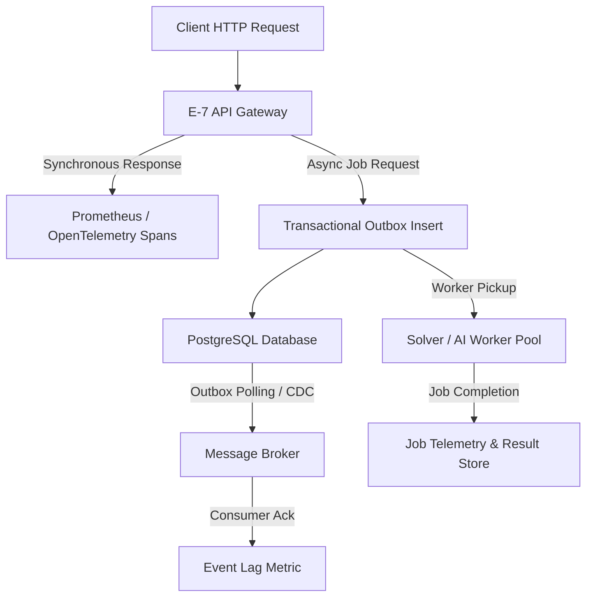

# E-7 Phase-0 Candidate SLO, Retention & First-Tenant Scale Baseline

## 1. Purpose

This document establishes the Phase-0 engineering candidate baseline for:
1. **Service Level Objectives (SLOs) and Performance Targets**: Measurable engineering operational targets for core API availability, synchronous latency, server-side error rates, asynchronous job acceptance, Task Intelligence orchestration, workflow response, scheduling solver completion, and event propagation.
2. **Data Retention Defaults**: Initial engineering operational lifecycles and retention defaults for canonical operational records, entity version histories, workflow execution history, scheduling job results, audit trails, outbox/inbox records, integration metadata, telemetry (logs/traces/metrics), AI prompts/evaluation artifacts, and solver-internal temporary search data.
3. **First-Tenant Benchmark Scale Envelope**: Sizing and testing envelopes defining two engineering levels (**BASELINE** and **STRESS_VALIDATION**) across user concurrency, organizational resource references, plan complexity, daily job volumes, workflow instances, constraint optimization problem sizes, event throughput, and API traffic.

> [!IMPORTANT]
> **Candidate Engineering Proposals Only**: The values in this document are initial engineering baselines established for implementation sizing, Proof-of-Concept (PoC) benchmarking, performance test planning, configuration defaults, and Phase-8/Phase-9 validation.
>
> They are:
> - **NOT** contractual customer Service Level Agreements (SLAs).
> - **NOT** original source requirements from legacy or preliminary documentation.
> - **NOT** production capability guarantees.
> - **NOT** hardcoded application constants.
> - **NOT** final legal, compliance, or regulatory retention policies.

---

## 2. Governance Status

Every candidate numeric target, duration, and capacity limit introduced in this document carries the following mandatory governance classification:

| Governance Field | Classification / Value | Specification / Meaning |
| :--- | :--- | :--- |
| **Candidate Classification** | `PHASE_0_ENGINEERING_PROPOSAL` | Established by Phase-0 engineering consensus for technical sizing and testing. |
| **Approval Status** | `PROPOSED_FOR_REVIEW` | Proposed baseline pending review by architecture, business, and platform owners. |
| **Source Status** | `NOT_ORIGINAL_SOURCE_REQUIREMENT` | Does not represent an original source requirement from product foundation docs. |
| **Contractual Status** | `NON_CONTRACTUAL_SLA` (`contractual_sla: false`) | Must never be cited as an approved customer SLA without formal commercial agreement. |
| **Validation Status** | `NOT_YET_BENCHMARKED` (`validation_status: "NOT_YET_BENCHMARKED"`) | Theoretical candidate baseline; no production or load-test benchmark has yet been run. |
| **Configuration Principle** | `CONFIGURABLE` | Candidate values belong to distinct governance surfaces (runtime budgets, retention policies, observability thresholds, benchmark profiles, and tenant policies). Hardcoding in production logic is prohibited. |

---


### Configuration Governance & Conceptual Ownership
Candidate numeric values must not be treated as a single undifferentiated configuration bucket:
1. **Runtime Technical Budgets** (e.g., planner timeout/budget 120s/180s, solver budget 120s/180s) → Map to **runtime technical configuration / solver profile**.
2. **Retention Durations** (e.g., 365 days history, 30 days logs) → Map to **retention policy / tenant policy configuration**.
3. **SLO Alert / Measurement Thresholds** (e.g., p95 < 500 ms, error rate <= 1.0%) → Map to **observability / SLO monitoring configuration**.
4. **First-Tenant Benchmark Envelope Values** (e.g., 500 users, 100 jobs/day, 100,000 events/day, 25 RPS) → Map to **benchmark / load-test profiles**. These benchmark values **MUST NOT** automatically become production runtime configuration or tenant business policy.
5. **Business / Customer Policy Values** → Map to **versioned tenant / business policy** where applicable.

No final environment-variable names are invented at Phase 0, and hardcoding any candidate value in production business logic is strictly prohibited.

---

## 3. Relationship to Task 0H.1

Task 0H.1 ([`docs/phase-0/SLO_RETENTION_SCALE_EVIDENCE_AUDIT.md`](file:///f:/operations-engine/docs/phase-0/SLO_RETENTION_SCALE_EVIDENCE_AUDIT.md)) performed a strict read-only audit of physically present source documents and frozen Phase-0 governance:
- **Source Numeric Target Count**: Task 0H.1 audited all authoritative source PDFs and established that `SOURCE_NUMERIC_TARGET = 0` (zero formal contractual SLOs exist in original source materials).
- **PoC Implementation Target Preservation**: Task 0H.1 confirmed that `99.9% monthly availability` and `p95 < 500 ms CRUD latency` appeared in the Complete Specification, Section 10 (p. 8) strictly as initial PoC implementation targets rather than contractual customer SLAs.
- **Unresolved Invariants Preserved**: Task 0H.1 established that Recovery Time Objective (`RTO`), Recovery Point Objective (`RPO`), outbox retention, inbox deduplication duration, solver-internal temporary search data lifecycle, and first-tenant scale profile were `UNRESOLVED` or `NOT_DEFINED_IN_AVAILABLE_SOURCES`.

Task 0H.2 builds directly upon Task 0H.1 by proposing concrete engineering baseline numbers for these unassigned operational areas while strictly preserving their non-contractual, non-original governance classification.

---

## 4. Candidate SLO Summary

The table below summarizes the core Phase-0 candidate SLOs established by Task 0H.2. Every entry is classified `PHASE_0_ENGINEERING_PROPOSAL`, carries `approval_status: PROPOSED_FOR_REVIEW`, and has `validation_status: NOT_YET_BENCHMARKED`.

| Candidate ID | Metric / Area | Candidate Target | Origin / Baseline Status | Scope & Exclusions |
| :--- | :--- | :--- | :--- | :--- |
| **`SLO-API-AVAIL-01`** | Core API Availability | **99.9%** monthly availability | Complete Spec PoC target preserved | Core E-7 API gateway; excludes external third-party downtime. |
| **`SLO-API-LAT-01`** | Core CRUD / API Latency | **p95 < 500 ms**<br>**p99 <= 1000 ms** | p95 preserved from Spec PoC; p99 proposed in Task 0H.2 | Synchronous entity CRUD; excludes LLM, solver, and workflow wait. |
| **`SLO-API-ERR-01`** | Core API Server Error Rate | **<= 1.0%** server failure | Proposed in Task 0H.2 | HTTP 5xx outcomes; excludes client 4xx validation and auth rejections. |
| **`SLO-ASYNC-ACK-01`** | Async Job Enqueue Ack | **p95 <= 1000 ms** | Proposed in Task 0H.2 | Durable enqueue ack; does NOT imply 1-second job completion. |
| **`SLO-TI-PLAN-01`** | Plan Generation Completion | **p95 <= 120 s**<br>(max budget: 180 s) | Proposed in Task 0H.2 | End-to-end plan generation under baseline envelope; configurable. |
| **`SLO-WF-RESP-01`** | Workflow Service API | **p95 < 500 ms**<br>**p99 <= 1000 ms** | Aligned with Core API baseline | Synchronous E-7 workflow facade; Flowable health tracked separately. |
| **`SLO-SCHED-SOLVE-01`** | Scheduling Solve Completion | **95% <= 120 s**<br>(max budget: 180 s) | Proposed in Task 0H.2 | Standard baseline solve; returns FEASIBLE/INFEASIBLE; configurable. |
| **`SLO-EVENT-LAG-01`** | Event / Outbox Propagation | **p95 <= 5 s**<br>**p99 <= 30 s** | Proposed in Task 0H.2 | Outbox commit to consumer receipt under healthy broker conditions. |

---

## 5. Core API Availability

- **Candidate ID**: `SLO-API-AVAIL-01`
- **Candidate Target**: **99.9% monthly availability**
- **Governance Classification**: `PHASE_0_ENGINEERING_PROPOSAL` (`approval_status: PROPOSED_FOR_REVIEW`)
- **Origin**: Complete Specification, Section 10 ("Non-Functional Requirements", p. 8) introduced 99.9% monthly uptime explicitly as an implementation target to validate during PoC rather than an original contractual SLO. Task 0H.1 audited and classified it as an engineering proposal; Task 0H.2 formally incorporates it into the candidate baseline.
- **Metric Scope**: Applies strictly to the core E-7 HTTP API gateway and internal platform services hosted within the E-7 infrastructure perimeter.
- **Exclusions**:
  - Scheduled, announced maintenance windows.
  - Upstream and downstream third-party provider failures (e.g., external IdP outages, external Calendar API downtime, E-8 notification gateway failures, legacy MySQL SIS network failures).
  - Client-side connectivity failures, public Internet transit disruptions, and DNS resolution failures beyond E-7 edge gateways.
- **Contractual Status**: `contractual_sla: false`. This target is an engineering sizing guideline and must not be promised in customer contracts without multi-region architectural hardening.

---

## 6. Core API Latency and Error Rate

### Core CRUD / API Latency
- **Candidate ID**: `SLO-API-LAT-01`
- **Candidate Targets**:
  - **p95 < 500 ms** (preserves exact Complete Specification, Section 10, p. 8 PoC target inequality)
  - **p99 <= 1000 ms** (new engineering proposal introduced in Task 0H.2)
- **Scope**: Direct, synchronous REST CRUD endpoints (e.g., retrieving entity metadata, creating a task definition, querying goal status, updating configuration).
- **Explicit Exclusions**:
  - LLM inference and context assembly (governed separately under `SLO-TI-PLAN-01`).
  - Constraint optimization solving (governed separately under `SLO-SCHED-SOLVE-01`).
  - Long-running multi-step workflow execution transitions.
  - Synchronous network latency incurred by calling external provider APIs (IdP, Calendar, SIS).

### Core API Server-Side Error Rate
- **Candidate ID**: `SLO-API-ERR-01`
- **Candidate Target**: **<= 1.0% server-side error rate**
- **Definition & Measurement**: Calculated as `(count(HTTP 5xx responses) / count(total incoming requests)) * 100` over rolling 1-hour and 24-hour evaluation windows.
- **Explicit Exclusions**:
  - Client-side validation failures (HTTP 400 Bad Request).
  - Authentication and authorization rejections (HTTP 401 Unauthorized, HTTP 403 Forbidden).
  - Resource not found responses (HTTP 404 Not Found).
  - Domain business-rule and idempotency conflict rejections (HTTP 409 Conflict, HTTP 422 Unprocessable Entity).

---

## 7. Async Job Acceptance

- **Candidate ID**: `SLO-ASYNC-ACK-01`
- **Candidate Target**: **p95 <= 1000 ms**
- **Scope & Definition**: Measures the duration from receipt of an asynchronous command HTTP request (e.g., `POST /jobs/plan`, `POST /jobs/solve`, `POST /workflows/instances`) to the issuance of an HTTP 202 Accepted response containing the durable `job_id`.
- **Invariants**:
  - Encompasses input schema validation, security token authentication, correlation ID assignment, and atomic transactional persistence of the job record and its associated outbox entry into PostgreSQL.
  - **Crucial Distinction**: This metric measures *durable acceptance and handoff*, **NOT** job completion. A 1000 ms acceptance latency does not imply that complex planning or constraint optimization completes in one second.

---

## 8. Task Intelligence Performance

- **Candidate ID**: `SLO-TI-PLAN-01`
- **Candidate Benchmark Target**: **p95 end-to-end plan generation completion <= 120 seconds**
- **Configurable Maximum Execution Budget**: **180 seconds**
- **Operational Scope**: Covers the complete Task Intelligence orchestration pipeline ([`ADR-002`](file:///f:/operations-engine/docs/adr/ADR-002-task-intelligence-orchestration.md)):
  1. Goal normalization and input decomposition.
  2. Approved context assembly (incorporating data minimization and aggregate-only student restrictions per [`docs/integrations/AI_CONTEXT_ACCESS_POLICY.md`](file:///f:/operations-engine/docs/integrations/AI_CONTEXT_ACCESS_POLICY.md)).
  3. LLM planning prompt dispatch and model inference.
  4. Structured JSON schema validation.
  5. Bounded repair attempts (maximum 2 retries per [`ADR-002`](file:///f:/operations-engine/docs/adr/ADR-002-task-intelligence-orchestration.md)).
  6. Deterministic graph validation (DAG cycle check, dependency consistency).
  7. Initial effort and risk heuristic calculation.
- **Underlying Envelope**: Evaluated under the Task 0H.2 First-Tenant Benchmark Envelope (plans up to 500 tasks and 1,500 dependencies).
- **Governance Constraint**: Configurable engineering proposal. Must be benchmarked against actual configured LLM provider latency during Phase 1 PoC. Never hardcoded into application files.

---

## 9. Workflow Performance

- **Candidate ID**: `SLO-WF-RESP-01`
- **Candidate Targets**:
  - **p95 < 500 ms**
  - **p99 <= 1000 ms**
- **Scope**: Synchronous E-7 workflow facade APIs (e.g., task querying, task claiming, task completion submission, process instance variable retrieval). Aligned directly with the Core API baseline.
- **Flowable Runtime Health**:
  - No separate, speculative availability or latency SLA is established for Flowable.
  - Per [`ADR-001`](file:///f:/operations-engine/docs/adr/ADR-001-workflow-runtime.md), Flowable runs as an embedded library inside the Java workflow service sharing a dedicated schema.
  - External runtime health and database query performance must be instrumented and observed independently via OpenTelemetry metrics.

---

## 10. Scheduling Performance

- **Candidate ID**: `SLO-SCHED-SOLVE-01`
- **Candidate Benchmark Target**: **95% of standard baseline scheduling jobs complete within 120 seconds**
- **Configurable Maximum Solver Budget**: **180 seconds**
- **Scope & Problem Envelope**: Evaluated under the Task 0H.2 First-Tenant Benchmark Envelope:
  - Up to 2,000 candidate assignments/activities.
  - Up to 1,000 participating resources.
  - Up to 20,000 hard and soft constraint instances.
- **Architectural Invariants ([`ADR-003`](file:///f:/operations-engine/docs/adr/ADR-003-scheduling-solver-strategy.md))**:
  - The solver worker executes asynchronously in an isolated execution sandbox.
  - The solver may terminate with status `FEASIBLE` or `INFEASIBLE`. Returning `INFEASIBLE` when a problem cannot satisfy all hard constraints is a valid domain outcome and **NOT** an SLO or performance failure.
  - Optimality within the execution budget is **NOT** required or guaranteed; the solver returns the best feasible solution found within the allotted time limit.
  - The solver execution budget is fully configurable per solver profile and must never be hardcoded.

---

## 11. Event / Outbox Performance

- **Candidate ID**: `SLO-EVENT-LAG-01`
- **Candidate Targets**:
  - **p95 <= 5 seconds**
  - **p99 <= 30 seconds**
- **Definition**: Measures the elapsed duration from the atomic commit of a domain event into the PostgreSQL transactional outbox table (`outbox_events`) to the successful publication and acknowledgment by the message broker consumer.
- **Prerequisites**: Evaluated under normal, healthy operating conditions for PostgreSQL, the message broker (RabbitMQ/Kafka), and the outbox dispatcher worker process.
- **Boundary Clarification**: This is an internal E-7 platform reliability target. It does **NOT** define or guarantee end-to-end transport delivery to external systems such as E-8 Notification Engine ([`docs/integrations/E8_NOTIFICATION_ENGAGEMENT_CONTRACT.md`](file:///f:/operations-engine/docs/integrations/E8_NOTIFICATION_ENGAGEMENT_CONTRACT.md)).

---

## 12. External Integration SLO Deferrals

To preserve strict architectural fidelity with frozen Phase-0 integration governance ([`docs/integrations/PHASE_0_EXTERNAL_PROVIDER_DECISIONS.md`](file:///f:/operations-engine/docs/integrations/PHASE_0_EXTERNAL_PROVIDER_DECISIONS.md)), no end-to-end production latency or availability SLOs are established for unresolved external providers. The following items are explicitly deferred:

```
ERP_EXTERNAL_SLO = DEFERRED_PENDING_LIVE_MEASUREMENT_AND_BLK_01
CALENDAR_EXTERNAL_SLO = DEFERRED_PENDING_PROVIDER_SELECTION
E8_EXTERNAL_DELIVERY_SLO = DEFERRED_PENDING_TRANSPORT_AND_DELIVERY_CONTRACT
IDP_EXTERNAL_SLO = DEFERRED_PENDING_PROVIDER_SELECTION
```

1. **`ERP_EXTERNAL_SLO`**: Deferred pending live database connectivity, network topology assessment, and formal closure of architectural blocker `BLK-01` (MySQL query latency & connection pooling).
2. **`CALENDAR_EXTERNAL_SLO`**: Deferred pending institutional selection of the primary calendar provider under decision `D-EXT-02` (Google Workspace vs. Microsoft 365 vs. Exchange/CalDAV).
3. **`E8_EXTERNAL_DELIVERY_SLO`**: Deferred pending finalization of the production wire transport binding and downstream multi-channel (SMS, Email, Push) delivery agreements owned by E-8.
4. **`IDP_EXTERNAL_SLO`**: Deferred pending institutional selection of the production Identity Provider under decision `D-EXT-01` (Keycloak vs. Azure AD vs. Okta).

---

## 13. Candidate Retention Summary

Every retention duration established in this document is classified as `PHASE_0_ENGINEERING_PROPOSAL` and carries the governance rule:
```
RETENTION_POLICY_PRECEDENCE = GOVERNING_POLICY_RESOLUTION_REQUIRED
ENGINEERING_DEFAULT_ROLE = FALLBACK_ONLY
```
Effective retention MUST satisfy all applicable legal/regulatory obligations, binding contractual requirements, and approved customer/tenant policies. The Phase-0 engineering default applies only where those governing requirements do not establish another value. Where multiple applicable requirements exist, no legal precedence or conflict resolution is decided in this technical document; approved compliance/policy resolution is required. An engineering default must never weaken an applicable governing requirement.

| Candidate ID | Data Category / Artifact Type | Candidate Retention Duration | Governance Trigger / Basis | Configuration & Override Rule |
| :--- | :--- | :--- | :--- | :--- |
| **`RET-CANONICAL-01`** | Canonical Operational Records | **No universal automatic deletion** | Governed by tenant / customer / legal policy | Configurable per tenant; no arbitrary universal number. |
| **`RET-PLAN-01`** | Plan & Task Version History | **365 days** | After supersession or closure | Configurable per tenant; compliance policy overrides. |
| **`RET-WF-01`** | Workflow Execution History | **365 days** | After process instance completion | Configurable per tenant; does not define Flowable internals. |
| **`RET-SCHED-01`** | Scheduling Job & Result History | **180 days** | After solve completion or supersession | Operational run history; published schedules retained per policy. |
| **`RET-AUDIT-01`** | Audit Trail Records | **365 days** (engineering default) | From record creation timestamp | Fallback only; effective retention must satisfy all governing legal/regulatory and contractual policies. |
| **`RET-OUTBOX-01`** | Published Outbox Records | **30 days** | After confirmed broker dispatch | New engineering proposal for diagnostics/replay; configurable. |
| **`RET-INBOX-01`** | Inbox / Deduplication Records | **30 days** | From receipt timestamp | New engineering proposal for replay deduplication; configurable. |
| **`RET-INTEGRATION-01`**| Integration Sync Evidence | **90 days** | From execution timestamp | Diagnostic metadata; no excessive payload retention. |
| **`RET-LOG-01`** | Searchable Application Logs | **30 days** | From emission timestamp | Searchable operational index; must not contain PII/secrets. |
| **`RET-TRACE-01`** | Distributed Tracing Telemetry | **14 days** | From emission timestamp | Short-term distributed span analysis and debugging. |
| **`RET-METRIC-01`** | Time-Series Metrics & Rollups | **90 days** | From emission timestamp | Operational capacity and throughput trend analysis. |
| **`RET-AI-RAW-01`** | Raw AI Prompts & Raw Outputs | **`DO_NOT_PERSIST`** (default)<br>(debug max: 30 days) | Disabled by default; explicit tenant opt-in | Access-controlled, minimized, redacted; never mandatory. |
| **`RET-AI-EVAL-01`** | Sanitized AI Evaluation Sets | **180 days** | From benchmark completion | PII-free sanitized evaluation and regression test sets. |
| **`RET-SOLVER-TEMP-01`**| Solver Temporary Search Data | **`NOT_PERSISTED_BY_DEFAULT`**<br>(debug max: 7 days) | Discarded on solve completion | Search tree/branch diagnostics; never persisted by default. |
| **`RET-PII-01`** | Personal / Sensitive Data | **No universal duration** | Governed by tenant / customer / legal policy | Aggregate-only student boundary intact; no raw row visibility. |

---

## 14. Canonical Operational Records

- **Candidate ID**: `RET-CANONICAL-01`
- **Scope**: Core business entities representing the canonical system of record ([`ADR-006`](file:///f:/operations-engine/docs/adr/ADR-006-system-of-record.md), [`docs/data-model/CANONICAL_OWNERSHIP_AND_SERVICE_BOUNDARIES.md`](file:///f:/operations-engine/docs/data-model/CANONICAL_OWNERSHIP_AND_SERVICE_BOUNDARIES.md)):
  - Strategic goals and organizational objectives.
  - Active plans, task definitions, task assignments, and dependency links.
  - Workflow-linked canonical references.
  - Published master scheduling baselines.
  - Cross-system integration identifier mappings.
- **Candidate Policy**: **NO UNIVERSAL AUTOMATIC DELETION IN PHASE 0**.
- **Governance Invariant**: Retention is strictly **`TENANT_OR_CUSTOMER_OR_LEGAL_POLICY_DRIVEN`**. Because canonical operational entities form the legal and operational baseline of the institution, assigning an arbitrary, platform-wide automatic purging duration is prohibited. Entities remain persisted until explicitly archived or deleted under an authorized tenant policy.

---

## 15. Plan / Task History

- **Candidate ID**: `RET-PLAN-01`
- **Candidate Default Duration**: **365 days after supersession or closure**
- **Scope**: Immutable revision snapshots of planning artifacts:
  - Superseded versions of generated plans following replanning or manual modification.
  - Task state change history (audit changelogs of status transitions, assignment adjustments, and duration modifications).
  - Closed task records that have reached a terminal state (`COMPLETED`, `CANCELLED`).
- **Configuration & Compliance**: Configurable per tenant. Institutions subject to multi-year accreditation or auditing requirements may configure extended archival retention.

---

## 16. Workflow History

- **Candidate ID**: `RET-WF-01`
- **Candidate Default Duration**: **365 days after workflow instance completion**
- **Scope**: Historic execution data for completed or terminated workflow instances (process variables, historic activity instances, historic task instances, and execution transitions).
- **Runtime Boundary**: This proposal defines the operational retention expectation for E-7 workflow reporting. It does **NOT** define Flowable's internal database table cleanup scripts or database partitioning strategy, which will be implemented during Phase 2 engine development.

---

## 17. Scheduling History

- **Candidate ID**: `RET-SCHED-01`
- **Candidate Default Duration**: **180 days after completion or supersession**
- **Scope**: Operational solver run metadata, solver input snapshots, constraint violation scores, and intermediate solved assignment candidates.
- **Boundary Invariant**: This duration applies strictly to *operational solve run history*. The **currently active, published master schedule** represents canonical operational state (`RET-CANONICAL-01`) and is retained according to institutional scheduling policy, not deleted on a 180-day timer.

---

## 18. Audit Evidence

- **Candidate ID**: `RET-AUDIT-01`
- **Candidate Default Duration**: **365 days from creation timestamp**
- **Scope**: Immutable audit log entries recording security-relevant actions, user identity, timestamps, IP addresses, entity mutations, and administrative overrides.
- **Retention Policy Precedence & Resolution Rule**:
  ```
  RETENTION_POLICY_PRECEDENCE = GOVERNING_POLICY_RESOLUTION_REQUIRED
  ENGINEERING_DEFAULT_ROLE = FALLBACK_ONLY
  ```
  Effective retention MUST satisfy all applicable legal/regulatory obligations, binding contractual requirements, and approved customer/tenant policies. The Phase-0 engineering default applies only where those governing requirements do not establish another value.
  Where multiple applicable requirements exist:
  - Do not invent legal precedence (an engineering document must never imply customer contracts override statutory or regulatory obligations).
  - Do not decide legal conflicts in this technical document.
  - Require approved compliance/policy resolution.
  - An engineering default must never weaken an applicable governing requirement.
- **Legal Disclaimer**: 365 days is an initial engineering default proposal (fallback only). It must **NOT** be represented as legally sufficient or compliant without formal institutional compliance review.

---

## 19. Outbox / Inbox Retention

### Published Outbox Records
- **Candidate ID**: `RET-OUTBOX-01`
- **Candidate Proposed Duration**: **30 days after confirmed publication**
- **Purpose**: Diagnostic tracing, broker delivery verification, and replay investigation.
- **Governance Invariant**: Preserves Task 0H.1 audit finding that original source documents contained no defined outbox retention duration (`OUTBOX_RETENTION_DURATION = UNRESOLVED`). This 30-day proposal is a newly introduced Phase-0 operational baseline.

### Inbox / Deduplication Records
- **Candidate ID**: `RET-INBOX-01`
- **Candidate Proposed Duration**: **30 days from event receipt**
- **Purpose**: Idempotent message deduplication across broker redelivery and replay windows.
- **Governance Invariant**: Configurable. Must align with the maximum supported retry/replay window of the chosen message broker. Preserves Task 0H.1 finding that source documents defined no specific replay window.

---

## 20. Integration Evidence

- **Candidate ID**: `RET-INTEGRATION-01`
- **Candidate Proposed Duration**: **90 days from event execution timestamp**
- **Scope**: Diagnostic integration metadata, including:
  - Synchronization timestamps and batch identifiers.
  - Third-party command acceptance and rejection status codes.
  - External entity identifier mapping verification records.
  - Retry attempt logs, backoff telemetry, and dead-letter queue routing metadata.
- **Data Minimization Rule**: Storage of raw external request/response payloads is restricted. Payloads must not be stored merely for logging unless explicitly enabled for active troubleshooting.

---

## 21. Logs / Traces / Metrics

### Searchable Application Logs
- **Candidate ID**: `RET-LOG-01`
- **Candidate Target**: **30 days searchable**
- **Constraint**: Structured JSON application logs indexed in the platform logging store (e.g., OpenSearch/Elasticsearch). Logs must never intentionally contain secrets, cryptographic keys, authentication tokens, or unrestricted student PII.

### Distributed Traces
- **Candidate ID**: `RET-TRACE-01`
- **Candidate Target**: **14 days**
- **Constraint**: OpenTelemetry distributed spans, traces, and execution path graphs retained for short-term root-cause performance analysis.

### Aggregated Telemetry & Metrics
- **Candidate ID**: `RET-METRIC-01`
- **Candidate Target**: **90 days**
- **Constraint**: Time-series metrics (Prometheus/OpenTelemetry) tracking API latency, error rates, queue depths, solver duration, and resource utilization. Aggregated rollups may be retained longer per platform operational policy.

---

## 22. AI Data Retention

### Raw AI Prompts and Raw Model Outputs
- **Candidate ID**: `RET-AI-RAW-01`
- **Production Default**: **`DO_NOT_PERSIST`**
- **Conditional Diagnostic Persistence & Semantics**:
  - Default = **`DO_NOT_PERSIST`**. Raw prompts and raw LLM completions are discarded immediately after response parsing and schema validation.
  - Diagnostic persistence requires an **explicit approved tenant/debug/evaluation policy**. Persistence remains prohibited where the approved policy disallows it.
  - Candidate engineering retention under that policy is **up to 30 days**. Governing legal, contractual, or customer policy may require a different outcome.
  - The proposed 30-day duration is an engineering candidate proposal, **NOT** an unconditional universal "maximum" that overrides approved governing policy.
  - **Mandatory Privacy Controls**: Diagnostic capture requires strict role-based access control, cryptographic encryption at rest, automated payload redaction, and strict compliance with the aggregate-only student boundary (no individual student records).
  - Raw prompt retention is **never mandatory**.

### Sanitized AI Evaluation Artifacts
- **Candidate ID**: `RET-AI-EVAL-01`
- **Candidate Proposed Duration**: **180 days**
- **Scope**: Anonymized, sanitized prompt-response pairs used for regression testing, schema drift evaluation, and prompt engineering benchmarking.

---

## 23. Solver Temporary Data

- **Candidate ID**: `RET-SOLVER-TEMP-01`
- **Production Default**: **`NOT_PERSISTED_BY_DEFAULT`**
- **Conditional Diagnostic Persistence**:
  - Solver-internal temporary artifacts (intermediate search trees, constraint conflict graphs, branch-and-bound logs) are retained in transient worker memory during execution and discarded upon job termination.
  - If explicitly persisted for deep debugging of infeasible models, the maximum candidate retention period is **7 days**.
- **Governance Invariant**: Preserves Task 0H.1 audit finding that solver temporary lifecycle was `NOT_DEFINED_IN_AVAILABLE_SOURCES`. This proposal provides an explicit engineering safeguard against unbounded storage consumption.

---

## 24. Personal / Sensitive Data

- **Candidate ID**: `RET-PII-01`
- **Candidate Policy**: **NO UNIVERSAL DURATION IN PHASE 0**.
- **Retention Driver**: Strictly **`TENANT_OR_CUSTOMER_OR_LEGAL_POLICY_DRIVEN`**.
- **Source Governance Invariant**:
  - Preserves the frozen Task 0G.3 boundary ([`docs/integrations/MYSQL_TASK_INTELLIGENCE_DATA_MAPPING.md`](file:///f:/operations-engine/docs/integrations/MYSQL_TASK_INTELLIGENCE_DATA_MAPPING.md), [`docs/integrations/AI_CONTEXT_ACCESS_POLICY.md`](file:///f:/operations-engine/docs/integrations/AI_CONTEXT_ACCESS_POLICY.md)): Legacy MySQL SIS tables `students` and `student_session` are strictly `AGGREGATE_ONLY` for Task Intelligence context assembly.
  - Individual student rows must never become model-visible or be persisted in E-7 planning context stores.
  - Deletion, archival, and retention of personal data are governed by institutional data protection agreements and applicable law (FERPA/GDPR).

---

## 25. First-Tenant Scale Governance

The scale envelope defined below establishes the initial sizing parameters for the first institutional tenant deployment:
- **Purpose**: Implementation sizing, hardware resource allocation, synthetic benchmark data generation, load-test scenario design, and capacity planning.
- **Explicit Non-Prediction**: This envelope is **NOT** an actual production workload, **NOT** a customer commitment, and **NOT** a solver/API capability guarantee.
- **Workload Status**:
  ```
  FIRST_TENANT_ACTUAL_BUSINESS_WORKLOAD = UNRESOLVED / REQUIRES_BUSINESS_CONFIRMATION
  ```
- **Configuration Assignment**: Benchmark scale values belong to **benchmark / load-test profiles**; they **MUST NOT** automatically become production runtime configuration or tenant business policy.
- **Two Engineering Levels**:
  1. **`BASELINE`**: Nominal operational envelope expected for standard pilot sizing.
  2. **`STRESS_VALIDATION`**: Headroom envelope (approximately 2x to 2.5x multiplier) designed to test platform limits, verify queue stability, and identify architectural bottlenecks before production deployment.

---

## 26. User / Concurrency Envelope

- **Candidate ID**: `SCALE-USERS-01`

| Scale Metric | BASELINE Candidate Target | STRESS_VALIDATION Candidate Target | Governance Notes & Boundary Invariants |
| :--- | :--- | :--- | :--- |
| **Named E-7 Users** | **500** named users | **1,000** named users | Benchmark proposal only. Actual production user classes and counts remain subject to business confirmation. |
| **Simultaneously Active Users** | **75** active users | **150** active users | Benchmark proposal only. Peak active concurrent sessions during benchmark evaluation. |

> [!IMPORTANT]
> **Student User Assumption**: The Task 0H.2 benchmark envelope does not assume students as direct E-7 users. Actual production user classes and counts remain subject to business confirmation.

---

## 27. Resource Envelope

- **Candidate ID**: `SCALE-RESOURCE-01`

| Scale Metric | BASELINE Candidate Target | STRESS_VALIDATION Candidate Target | Governance Notes & Boundary Invariants |
| :--- | :--- | :--- | :--- |
| **Staff & Equipment References** | **1,000** resources | **2,000** resources | Faculty, instructors, laboratory technicians, rooms, specialized equipment. |
| **Cohort & Section References** | **500** aggregate sections | **1,000** aggregate sections | Class sections, academic cohorts, and student grouping references. |

> [!IMPORTANT]
> **Student Data Boundary**: Legacy MySQL SIS tables `students` and `student_session` remain strictly `AGGREGATE_ONLY` for Task Intelligence source/context handling. Individual upstream student rows must not become planner/model-visible. This data-access boundary is separate from and does not establish whether students may or may not be application users through some future identity/user model.

---

## 28. Task Intelligence Envelope

- **Plan Complexity Candidate ID**: `SCALE-TI-PLAN-01`
- **Job Volume Candidate ID**: `SCALE-TI-VOLUME-01`

| Scale Dimension | BASELINE Candidate Target | STRESS_VALIDATION Candidate Target | Architectural Sizing Notes |
| :--- | :--- | :--- | :--- |
| **Tasks per Generated Plan** | **500** tasks | **1,000** tasks | Complex institutional curriculum, semester, or accreditation project plan. |
| **Dependencies per Plan** | **1,500** dependency edges | **3,000** dependency edges | Directed Acyclic Graph (DAG) edges validated for cycle-free properties. |
| **Milestones per Plan** | **50** milestones | **100** milestones | Major tracking checkpoints across the project timeline. |
| **Plan Generation Jobs / Day** | **100** jobs / day | **250** jobs / day | Daily volume of new plan creation and major replanning requests. |
| **Concurrent Planner Jobs** | **5** concurrent jobs | **10** concurrent jobs | Sizing for the asynchronous AI orchestrator worker execution pool. |

---

## 29. Workflow Envelope

- **Candidate ID**: `SCALE-WF-01`

| Scale Dimension | BASELINE Candidate Target | STRESS_VALIDATION Candidate Target | Architectural Sizing Notes |
| :--- | :--- | :--- | :--- |
| **Active Workflow Instances** | **5,000** active instances | **10,000** active instances | Open, running operational workflows managed concurrently in Flowable DB. |
| **Daily Task Transitions** | **25,000** transitions / day | **50,000** transitions / day | Human task completions, automated service task executions, timer fires. |

> [!NOTE]
> Active instances represent persisted workflow state. Workflows spend the vast majority of their lifecycle waiting for human input or scheduled events; they do **not** all execute simultaneously.

---

## 30. Scheduling Envelope

- **Candidate ID**: `SCALE-SCHED-01`

| Constraint Sizing Dimension | BASELINE Candidate Target | STRESS_VALIDATION Candidate Target | Optimization Sizing Notes |
| :--- | :--- | :--- | :--- |
| **Candidate Assignments / Activities** | **2,000** activities | **5,000** activities | Course offerings, examination sessions, room bookings to be placed. |
| **Participating Resources** | **1,000** resources | **2,000** resources | Classrooms, laboratories, professors, proctors. |
| **Constraint Instances (Hard + Soft)** | **20,000** constraints | **50,000** constraints | Availability windows, room capacity, equipment requirements, consecutive limits. |
| **Concurrent Solver Jobs** | **4** concurrent jobs | **8** concurrent jobs | Isolated CP-SAT / Timefold solver worker process pool sizing. |

> [!WARNING]
> These figures define the benchmark testing envelope. They are **NOT** mathematical guarantees of solver capability under pathological constraint combinations.

---

## 31. Event / API Envelope

- **Event Volume Candidate ID**: `SCALE-EVENT-01`
- **API Traffic Candidate ID**: `SCALE-API-01`

| Traffic Dimension | BASELINE Candidate Target | STRESS_VALIDATION Candidate Target | Infrastructure Sizing Notes |
| :--- | :--- | :--- | :--- |
| **Domain Events per Day** | **100,000** events / day | **250,000** events / day | Outbox transactions, state transitions, audit logging entries. |
| **Short-Duration Event Burst** | **100** events / second | **250** events / second | Batch approval or timetable publishing event bursts. |
| **Sustained API Request Rate** | **25** requests / second | **50** requests / second | Continuous HTTP REST traffic across E-7 core endpoints. |
| **Short-Duration API Burst** | **100** requests / second | **200** requests / second | Morning login or shift handover peak request rate. |

---

## 32. Integration Test Envelope

- **Candidate ID**: `SCALE-INTEGRATION-01`

| Integration Flow | BASELINE Candidate Target | STRESS_VALIDATION Candidate Target | Governance Status & Notes |
| :--- | :--- | :--- | :--- |
| **Calendar Sync Operations / Day** | **10,000** operations / day | **25,000** operations / day | Internal load-test volume; provider selection (`D-EXT-02`) unresolved. |
| **E-8 Notification Commands / Day** | **20,000** commands / day | **50,000** commands / day | Internal contract testing volume; wire transport remains unresolved. |

> [!IMPORTANT]
> These figures represent synthetic load-test volumes designed for internal contract validation. They must **NOT** be cited as production external provider rate limits or quotas.

---

## 33. Storage Sizing Rule

- **Candidate ID**: `SCALE-STORAGE-01`
- **Candidate Storage Capacity**: **`PHYSICAL_STORAGE_CAPACITY = MEASURE_DURING_BENCHMARKING`**
- **Sizing Principle**:
  ```
  Physical Storage Required = (Active Row Volume * Average Row Size)
                            + (Historical / Audit Volume * Retention Duration)
                            + Index Overhead (~30-50%)
                            + Transaction Log / WAL Headroom
                            + Database Engine Overhead
  ```
- **Prohibited Derivations**:
  - Assigning an ungrounded arbitrary physical GB or TB number in Phase 0 is prohibited.
  - Deriving physical database storage capacity from legacy MySQL schema table counts (e.g., multiplying 53 tables by an arbitrary factor) is strictly prohibited. Sizing must be determined empirically during Phase 1 PoC benchmarking.

---

## 34. Stress Validation Headroom

- **Headroom Rule**: Stress-validation success is one engineering readiness input. Production readiness additionally depends on architecture, security/privacy, integration readiness, operational observability, and approved pilot scope.
- **Classification**: `PHASE_0_ENGINEERING_PROPOSAL` (`contractual_requirement: false`). This is an engineering safety guideline for pilot readiness, not a customer SLA or a new production certification gate.

---

## 35. Measurement Method

Every candidate SLO defined in this document includes an exact, objective measurement specification:



### Measurement Specification Matrix

| Metric ID | Metric Name | Measurement Window | Calculation Method | Expected Instrumentation Source | Benchmark Scenario |
| :--- | :--- | :--- | :--- | :--- | :--- |
| **`SLO-API-AVAIL-01`** | Core API Availability | Rolling 30 days | `((Uptime - Unexcused Downtime) / Uptime) * 100` | Synthetic edge health probes | 30-second interval continuous ping |
| **`SLO-API-LAT-01`** | Core API Latency | Rolling 1h & 24h | Server-side request duration (p95 < 500 ms, p99 <= 1000 ms) | OpenTelemetry HTTP spans | Baseline sustained CRUD load |
| **`SLO-API-ERR-01`** | Server Error Rate | Rolling 1h & 24h | `(count(HTTP 5xx) / count(Total Requests)) * 100` | Edge Gateway / HTTP metrics | Baseline & stress API load profile |
| **`SLO-ASYNC-ACK-01`** | Async Enqueue Ack | Rolling 1h & 24h | Duration to HTTP 202 + DB job record commit | HTTP server span + DB txn timer | Job submission burst at 100 req/s |
| **`SLO-TI-PLAN-01`** | Plan Gen Duration | Per job & batch | p95 wall-clock time from enqueue to validated DAG | Task Intelligence orchestrator span | 500-task plan synthesis suite |
| **`SLO-WF-RESP-01`** | Workflow API Latency | Rolling 1h & 24h | Server-side task query/complete (p95 < 500 ms, p99 <= 1000 ms) | Workflow service adapter metrics | Concurrent task claims & completes |
| **`SLO-SCHED-SOLVE-01`**| Solve Completion | Per job & batch | % of standard runs completing search <= 120s | Solver worker execution metrics | 2,000-activity benchmark problem |
| **`SLO-EVENT-LAG-01`** | Event Outbox Lag | Rolling 1h & 24h | Duration from outbox commit to consumer ack | Outbox publisher & consumer metrics| Steady event publishing at 100/s |

---

## 36. Promotion Gates

No candidate proposal in this document is automatically promoted to an approved engineering baseline or customer SLA. Promotion requires passing through six formal gates:

```mermaid
flowchart LR
    P[PROPOSED_FOR_REVIEW] --> G1[Gate 1: Governance]
    G1 --> G2[Gate 2: Business & Platform]
    G2 --> G3[Gate 3: PoC Benchmarks]
    G3 --> G4[Gate 4: Security & Privacy]
    G4 --> G5[Gate 5: Blocker Resolution]
    G5 --> A[APPROVED_ENGINEERING_BASELINE]
    A --> G6[Gate 6: Commercial Agreement]
    G6 --> C[CUSTOMER_CONTRACTUAL_SLA]
```



1. **Gate 1: Governance Consistency Review**: Confirmation by architecture owners that candidate values align with frozen Phase-0 governance ([`docs/REQUIREMENTS_TRACEABILITY_MATRIX.md`](file:///f:/operations-engine/docs/REQUIREMENTS_TRACEABILITY_MATRIX.md), [`docs/IMPLEMENTATION_GUARDRAILS.md`](file:///f:/operations-engine/docs/IMPLEMENTATION_GUARDRAILS.md), and [`docs/adr/`](file:///f:/operations-engine/docs/adr/)).
2. **Gate 2: Business & Platform Review**: Review by product, commercial, and operational leadership to confirm that targets align with institutional market requirements.
3. **Gate 3: PoC Benchmark Evidence**: Empirical execution of test suites under Phase 1 PoC and Phase 8 benchmarking demonstrating that the proposed targets are realistically achievable on target hardware.
4. **Gate 4: Security & Privacy Review**: Verification by compliance and security teams that retention defaults uphold data minimization, privacy policies, and statutory constraints (FERPA/GDPR).
5. **Gate 5: Blocker Resolution**: Closure of critical architecture blockers that directly impact operational performance:
   - Closure of `BLK-01` (Legacy MySQL SIS connectivity & query performance).
   - Resolution of `D-EXT-01` (Exact production IdP selection).
   - Resolution of `D-EXT-02` (First production calendar provider selection).
6. **Gate 6: Contractual Promotion**: Formal legal and commercial agreement between IR Infotech and institutional customers incorporating approved baselines into customer contracts.

---

## 37. Unresolved Decisions

The candidate baseline defined in this document intentionally does **NOT** resolve outstanding external architectural decisions. The following items remain strictly unresolved:

| Identifier / Area | Unresolved Item | Current Status | Governance Reference |
| :--- | :--- | :--- | :--- |
| **`RTO`** | Recovery Time Objective | `NOT_FOUND_IN_AVAILABLE_SOURCES` | [`docs/phase-0/SLO_RETENTION_SCALE_EVIDENCE_AUDIT.md`](file:///f:/operations-engine/docs/phase-0/SLO_RETENTION_SCALE_EVIDENCE_AUDIT.md) |
| **`RPO`** | Recovery Point Objective | `NOT_FOUND_IN_AVAILABLE_SOURCES` | [`docs/phase-0/SLO_RETENTION_SCALE_EVIDENCE_AUDIT.md`](file:///f:/operations-engine/docs/phase-0/SLO_RETENTION_SCALE_EVIDENCE_AUDIT.md) |
| **`D-EXT-01`** | Exact Production Identity Provider | `UNRESOLVED` | [`docs/integrations/PHASE_0_EXTERNAL_PROVIDER_DECISIONS.md`](file:///f:/operations-engine/docs/integrations/PHASE_0_EXTERNAL_PROVIDER_DECISIONS.md) |
| **`D-EXT-02`** | First Production Calendar Provider | `UNRESOLVED` | [`docs/integrations/PHASE_0_EXTERNAL_PROVIDER_DECISIONS.md`](file:///f:/operations-engine/docs/integrations/PHASE_0_EXTERNAL_PROVIDER_DECISIONS.md) |
| **`BLK-01`** | Live MySQL SIS Latency & Connection | `UNMEASURED` | [`docs/phase-0/SLO_RETENTION_SCALE_EVIDENCE_AUDIT.md`](file:///f:/operations-engine/docs/phase-0/SLO_RETENTION_SCALE_EVIDENCE_AUDIT.md) |
| **External SLOs** | Live Third-Party Latency/Availability | `DEFERRED` | Section 12 of this document |
| **Customer Retention**| Final Legal Retention Policies | `TENANT_OR_LEGAL_POLICY_DRIVEN` | Section 13 of this document |
| **Workload Scale** | Actual First-Tenant Workload Profile | `REQUIRES_BUSINESS_CONFIRMATION` | Section 25 of this document |
| **Storage Capacity** | Final Production Storage (GB/TB) | `MEASURE_DURING_BENCHMARKING` | Section 33 of this document |

---

## 38. Phase-0 0H Status

With the completion of Task 0H.2:
- **Task 0H.1** established the authoritative evidence baseline, auditing all source documents and confirming zero original source numeric requirements.
- **Task 0H.2** established the comprehensive candidate engineering baseline covering performance SLOs, retention defaults, and first-tenant scale envelopes.
- All candidate numbers are rigorously classified as `PHASE_0_ENGINEERING_PROPOSAL`, externalized as configurable parameters, and bounded by explicit promotion gates.
- Workstream 0H is now **COMPLETE** and ready for Phase-0 consolidation.

---

## 39. Next Task

The next task in the Phase-0 sequence is:
**Task 0I — Final Phase-0 Governance Consolidation & Exit Gate Audit**

> [!CAUTION]
> **Task 0I remains unstarted.** No Phase 0I consolidation work, gate audit, or implementation may proceed until Task 0H.2 review is complete.
