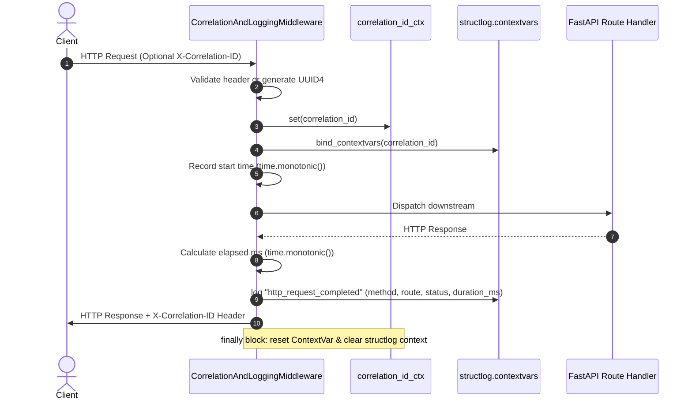

# Phase 1 Configuration, Structured Logging, Correlation & Health Foundation

**Document Version**: 1.0.0  
**Phase**: Phase 1 — Foundation  
**Task**: Task 1B — Configuration, Structured Logging, Correlation & Health Foundation  
**Status**: `COMPLETE`  
**Application Root**: `app/`  

---

## 1. Overview & Objectives

Task 1B implements the foundational runtime configuration, structured logging, request correlation tracking, and health/liveness/readiness verification for the **IR Infotech E-7 Operations Engine**.

This deliverable establishes:
1. **Type-Safe Runtime Configuration**: A unified `Settings` model using `pydantic-settings` with an `E7_` environment variable prefix, safe local defaults, strict validation for environments, log levels, and log formats, and a memoized accessor `get_settings()`.
2. **Idempotent Structured Logging**: Hybrid standard library `logging` and `structlog` pipeline outputting machine-readable JSON (production default) or human-readable console formats, enriched with ISO timestamps, log levels, call site details, and active correlation IDs.
3. **Data Privacy & Censor Pipeline**: Automatic suppression/censoring of sensitive fields (passwords, tokens, authorization headers, cookies, API keys) from event dictionaries, and exclusion of request/response payloads, query parameters, and raw headers from default request logs.
4. **Request Correlation Tracking**: An asynchronous context-safe correlation tracking mechanism powered by Python's `contextvars`, supporting untrusted client header ingestion (`X-Correlation-ID`) with strict character and length validation, safe server-side UUID generation fallback, response header reflection, and leak-free post-request cleanup.
5. **Monotonic Request Duration Tracking**: Non-decreasing monotonic clock (`time.monotonic()`) elapsed time calculation in milliseconds for structured HTTP request completion events (`http_request_completed`).
6. **Decoupled Health & Readiness Endpoints**:
   - `/api/v1/health`: Lightweight process liveness returning `{"status": "ok", "service": "operations-engine", "environment": "..."}`.
   - `/api/v1/ready`: Operational traffic readiness returning `{"status": "ready", "service": "operations-engine", "environment": "..."}` without prematurely probing unimplemented dependencies (PostgreSQL, RabbitMQ, Flowable).

---

## 2. Configuration Model (`app.core.config`)

The configuration subsystem is implemented in `app/core/config.py` using `pydantic_settings.BaseSettings`.

### 2.1 Settings Schema & Environment Variables

All settings use the environment variable prefix `E7_` with case-insensitive matching:

| Field Name | Type | Environment Variable | Default | Valid Values / Constraints |
| :--- | :--- | :--- | :--- | :--- |
| `app_name` | `str` | `E7_APP_NAME` | `"IR Infotech E-7 Operations Engine"` | Non-empty string |
| `environment` | `str` | `E7_ENVIRONMENT` | `"local"` | Normalized lowercase: `local`, `development`, `test`, `staging`, `production` |
| `debug` | `bool` | `E7_DEBUG` | `False` | Boolean (`true`, `false`, `1`, `0`) |
| `log_level` | `str` | `E7_LOG_LEVEL` | `"INFO"` | Normalized uppercase: `DEBUG`, `INFO`, `WARNING`, `ERROR`, `CRITICAL` |
| `log_format` | `str` | `E7_LOG_FORMAT` | `"json"` | Normalized lowercase: `json` (machine-readable default), `console` (developer format) |
| `correlation_header_name` | `str` | `E7_CORRELATION_HEADER_NAME` | `"X-Correlation-ID"` | HTTP header name string |
| `cors_allowed_origins` | `list[str]` | `E7_CORS_ALLOWED_ORIGINS` | `[]` | Parsed from comma-separated list or JSON array; defaults to empty |

### 2.2 Validation & Safety Guarantees
- **Environment Normalization**: Inputs like `"LOCAL"`, `"Production"`, `" development "` are stripped and lowercased. Any invalid value (e.g., `"qa"`, `"tenant-1"`, `"sandbox"`) raises a validation error immediately during configuration load.
- **Log Level Validation**: Inputs like `"info"`, `"debug"` are normalized to uppercase. Invalid log levels (e.g., `"TRACE"`, `"VERBOSE"`) fail configuration validation cleanly without silent downgrades.
- **CORS Allowed Origins Parsing**: Accepts JSON arrays (e.g. `["http://localhost:3000"]`) or comma-delimited strings (`http://localhost:3000,http://localhost:5173`).
- **No Secret/Credential Fields**: No database connection strings, passwords, Google client secrets, message broker credentials, or tenant IDs exist in the Task-1B settings schema.
- **Import Safety**: Importing `app.core.config` performs zero network requests, accesses zero external storage, and requires zero credentials.
- **Cached Settings Accessor**: `get_settings()` is wrapped with `@lru_cache(maxsize=1)` to ensure single instantiation across the application lifecycle.

---

## 3. Structured Logging Architecture (`app.core.logging`)

The logging pipeline combines Python's standard `logging` library with `structlog`.

### 3.1 Pipeline Flow
```
Application / Middleware / Route Event
                  │
                  ▼
   structlog.contextvars (bind correlation_id)
                  │
                  ▼
   censor_sensitive_data_processor (redacts password, token, authorization, etc.)
                  │
                  ▼
   structlog.stdlib.add_log_level & add_logger_name
                  │
                  ▼
   structlog.processors.TimeStamper(fmt="iso")
                  │
                  ▼
   structlog.processors.StackInfoRenderer & format_exc_info
                  │
                  ▼
   Renderer Decision (based on settings.log_format):
       ├── "json"    ──► structlog.processors.JSONRenderer()
       └── "console" ──► structlog.dev.ConsoleRenderer(colors=True)
```

### 3.2 Idempotency & Handler Safety
- `setup_logging(settings)` tracks invocation using an atomic module-level flag `_logging_configured`.
- The root logger's handlers are explicitly cleared (`root_logger.handlers.clear()`) before attaching a clean `logging.StreamHandler(sys.stdout)` with a `structlog.stdlib.ProcessorFormatter`.
- Multiple invocations during application startup, lifespan hooks, or test fixtures produce zero duplicate log entries and zero handler accumulation.

### 3.3 Privacy & Data Exclusion Invariants
The logging subsystem strictly enforces zero leakage of sensitive operational or customer data:
1. **Processor-Level Censors**: Keys containing or matching `password`, `token`, `secret`, `authorization`, `cookie`, `api_key`, `access_token`, `client_secret`, `private_key` are replaced with `"[REDACTED]"`.
2. **Safe Route Template Logging & Unmatched Route Redaction**:
   - For matched routes, the middleware extracts and logs Starlette's route template (e.g., `/api/v1/health`, `/api/v1/items/{item_id}`) rather than concrete resolved identifiers.
   - When no route template matches (unmatched/404 requests), the route field is set to a fixed privacy-safe marker: `"<unmatched>"`.
   - The raw request path (`request.url.path`), raw ASGI scope path, and query strings are never logged, preventing accidental leakage of student IDs, user IDs, filenames, tokens, or other PII present in arbitrary client URLs.
3. **Request Payloads**: Request bodies and response payloads are never logged by the HTTP middleware.
4. **Query Parameters**: Query parameter keys and values are completely excluded from request-completion logs.
5. **Headers**: The authorization header, cookies, and miscellaneous client headers are excluded; only the correlation ID is extracted and propagated.

---

## 4. Correlation ID Tracking & Middleware (`app.core.correlation`, `app.core.middleware`)

### 4.1 Context Isolation
A dedicated context variable `correlation_id_ctx: ContextVar[str | None]` manages the active request's correlation identifier.
- Asynchronous coroutines running concurrent requests have completely isolated correlation context.
- Separate requests cannot cross-contaminate correlation IDs.

### 4.2 Untrusted Header Validation & Sanitization
Client-supplied headers matching `settings.correlation_header_name` (default: `X-Correlation-ID`) are treated as untrusted user input:
- **Validation Rule**: Bounded regex `^[A-Za-z0-9_.:-]+\Z` enforced against candidate IDs.
- **Length Constraint**: Maximum length is 128 characters.
- **Rejection & Replacement**: If the header contains spaces, newlines, control characters, special punctuation, or exceeds 128 characters, the invalid input is discarded without throwing a 400 error, and a cryptographically secure random UUID4 is generated server-side. This eliminates header/log injection vulnerabilities while preserving traceability.
- **Missing Header**: Generates a new UUID4.

### 4.3 Middleware Lifecycle (`CorrelationAndLoggingMiddleware`)


---

## 5. Health & Readiness Semantics (`app.api.v1.router`, `app.api.v1.schemas`)

The application distinguishes between process liveness and external dependency readiness:

### 5.1 Liveness (`GET /api/v1/health`)
- **Semantic Purpose**: Verifies that the FastAPI process is running, responsive, and able to process ASGI events.
- **Failure Conditions**: Only fails if the web process itself is hung or crashed.
- **External Dependencies**: Never checks external databases, brokers, or APIs.
- **Contract Schema**:
  ```json
  {
    "status": "ok",
    "service": "operations-engine",
    "environment": "local"
  }
  ```

### 5.2 Readiness (`GET /api/v1/ready`)
- **Semantic Purpose**: Verifies that the service is ready to accept and process traffic based on required, currently implemented dependencies.
- **Current Phase-1 State**: In Task 1B, zero external dependencies (PostgreSQL, RabbitMQ, Flowable) are implemented or active. Thus, the endpoint returns `200 OK` with `status: "ready"` based on internal subsystem initialization.
- **Future Extensibility**: Later tasks (1D for PostgreSQL, 1G for RabbitMQ, Phase 3 for Flowable) will register dependency health checks against the readiness evaluator without changing the public endpoint contract or degrading the liveness endpoint.
- **Contract Schema**:
  ```json
  {
    "status": "ready",
    "service": "operations-engine",
    "environment": "local"
  }
  ```

---

## 6. CORS Policy Implementation

In `app/main.py`:
- `CORSMiddleware` configuration is driven entirely by `settings.cors_allowed_origins`.
- **Default State**: An empty list (`[]`), preventing unconfigured cross-origin browser access.
- **Security Guardrail**: The middleware dynamically sets `allow_credentials = ("*" not in settings.cors_allowed_origins)`. Pairing wildcard origins (`"*"`) with credentialed cross-origin requests is explicitly blocked.

---

## 7. Change Scope & Summary of Modified/Created Files

| File Path | Action | Description |
| :--- | :---: | :--- |
| `pyproject.toml` | **Modified** | Added `pydantic-settings>=2.4.0` and `structlog>=24.1.0` to runtime dependencies. |
| `.env.example` | **Modified** | Added safe Task-1B environment variables with `E7_` prefix; preserved later placeholders untouched. |
| `app/core/config.py` | **Created** | Strongly typed `Settings` model with validation for environment, log level, log format, and cached `get_settings()`. |
| `app/core/logging.py` | **Created** | Idempotent standard logging + structlog setup with JSON/console renderers and sensitive key redaction processor. |
| `app/core/correlation.py` | **Created** | `ContextVar` management, header validation (`^[A-Za-z0-9_.:-]+\Z`), UUID fallback, and context accessors. |
| `app/core/middleware.py` | **Created** | `CorrelationAndLoggingMiddleware` handling correlation injection, monotonic request timing, structured logging with `resolve_route_template` (logging route templates or `<unmatched>`), and context cleanup. |
| `app/api/v1/schemas.py` | **Created** | Pydantic response models `HealthResponse` and `ReadinessResponse`. |
| `app/api/v1/router.py` | **Modified** | Attached typed `/api/v1/health` and `/api/v1/ready` endpoints. |
| `app/main.py` | **Modified** | Added FastAPI lifespan invoking `setup_logging()`, registered correlation middleware, applied settings-driven CORS. |
| `tests/unit/test_smoke.py` | **Modified** | Updated smoke tests to validate `{"status": "ok"}` on `/api/v1/health`. |
| `tests/unit/test_config.py` | **Created** | Unit test suite covering default settings, environment overrides, invalid environment rejection, invalid log level rejection, invalid log format rejection, and CORS parsing (7 tests). |
| `tests/unit/test_correlation.py` | **Created** | Unit test suite covering missing/valid/malformed/oversized correlation IDs, response headers, and ContextVar isolation across concurrent calls (8 tests). |
| `tests/unit/test_health.py` | **Created** | Unit test suite verifying `/api/v1/health` and `/api/v1/ready` contracts and root endpoint `/` (3 tests). |
| `tests/unit/test_logging.py` | **Created** | Unit test suite verifying idempotent logging setup, context variable binding, sensitive data redaction, unmatched route path/query privacy, and route template resolution (5 tests). |
| `docs/phase-1/PHASE_1_FOUNDATION_BASELINE.md` | **Modified** | Recorded activation of `pydantic-settings` and `structlog` as implemented Task-1B dependencies. |
| `docs/phase-1/PHASE_1_CONFIG_LOGGING_HEALTH.md` | **Created** | This architecture and implementation deliverable document. |

---

## 8. Quality Gate Verification & Test Inventory Reconciliation

All quality commands passed locally with zero warnings and zero errors:

| Command | Target / Scope | Result | Status |
| :--- | :--- | :--- | :---: |
| `python -m compileall app` | Bytecode syntax verification across all files in `app/` | Clean | **PASS** |
| `ruff check .` | Ruff linting and import formatting | 0 errors | **PASS** |
| `mypy app` | Moderate static type checking on `app/` (56 source files) | 0 errors | **PASS** |
| `pytest --collect-only -q` | Pytest test collection verification | 28 tests collected | **PASS** |
| `pytest -q` | Pytest suite execution | 28 passed in 0.35s | **PASS** |

### 8.1 Reconciled Test Inventory Breakdown

| Test Suite File | Collected Tests | Passed Tests | Key Tested Capabilities |
| :--- | :---: | :---: | :--- |
| [`tests/unit/test_config.py`](file:///f:/operations-engine/tests/unit/test_config.py) | **7** | **7** | Default loading, cached accessor, env override, invalid env, invalid log level, invalid log format, CORS parsing |
| [`tests/unit/test_correlation.py`](file:///f:/operations-engine/tests/unit/test_correlation.py) | **8** | **8** | Missing header, valid header, malformed header, oversized header, response header injection, contextvar isolation |
| [`tests/unit/test_health.py`](file:///f:/operations-engine/tests/unit/test_health.py) | **3** | **3** | `/api/v1/health` liveness contract, `/api/v1/ready` readiness contract, root `/` metadata contract |
| [`tests/unit/test_logging.py`](file:///f:/operations-engine/tests/unit/test_logging.py) | **5** | **5** | Idempotent setup, context binding, sensitive data redaction, unmatched route privacy regression, route template resolution |
| [`tests/unit/test_smoke.py`](file:///f:/operations-engine/tests/unit/test_smoke.py) | **5** | **5** | Package import, FastAPI instance metadata, root status, health check status, zero external dependency import safety |
| **Total** | **28** | **28** | **100% Pass Rate across all unit test suites** |

> [!NOTE]
> **Test Reconciliation Audit**: The Task-1B initial report listed 26 passing tests with an errant narrative subtotal of 25 (arising from narrative text inadvertently omitting `test_invalid_log_format_rejected` in `test_config.py`, which actually had 7 tests: 7 + 8 + 3 + 3 + 5 = 26). In Task 1B.1, 2 new tests were added to `test_logging.py` (`test_unmatched_route_request_logging_privacy` and `test_resolve_route_template_parameterized_and_matched`), bringing the verifiable total to **28 collected and 28 passed tests**.

---

## 9. Deferred Work & Non-Goals

The following components were strictly excluded from Task 1B and remain scheduled for future tasks:
- **Task 1C**: Authentication, JWT token verification, Google OIDC validation, tenant authorization, RBAC foundation.
- **Task 1D**: SQLAlchemy 2.0 async engine, session factory, PostgreSQL connection pooling, Alembic migrations.
- **Task 1E**: Repository pattern and Unit of Work (UoW).
- **Task 1F**: Append-only audit trail logging.
- **Task 1G**: RabbitMQ event broker driver (`aio-pika`), Outbox publisher, Inbox deduplication.
- **Task 1H**: Idempotency framework (`Idempotency-Key` header and lock management).
- **Task 1K**: OpenTelemetry distributed tracing and Prometheus metrics.
- **External Dependency Probing**: Health and readiness checks for PostgreSQL, RabbitMQ, and Flowable will be added only as each respective component is implemented.
