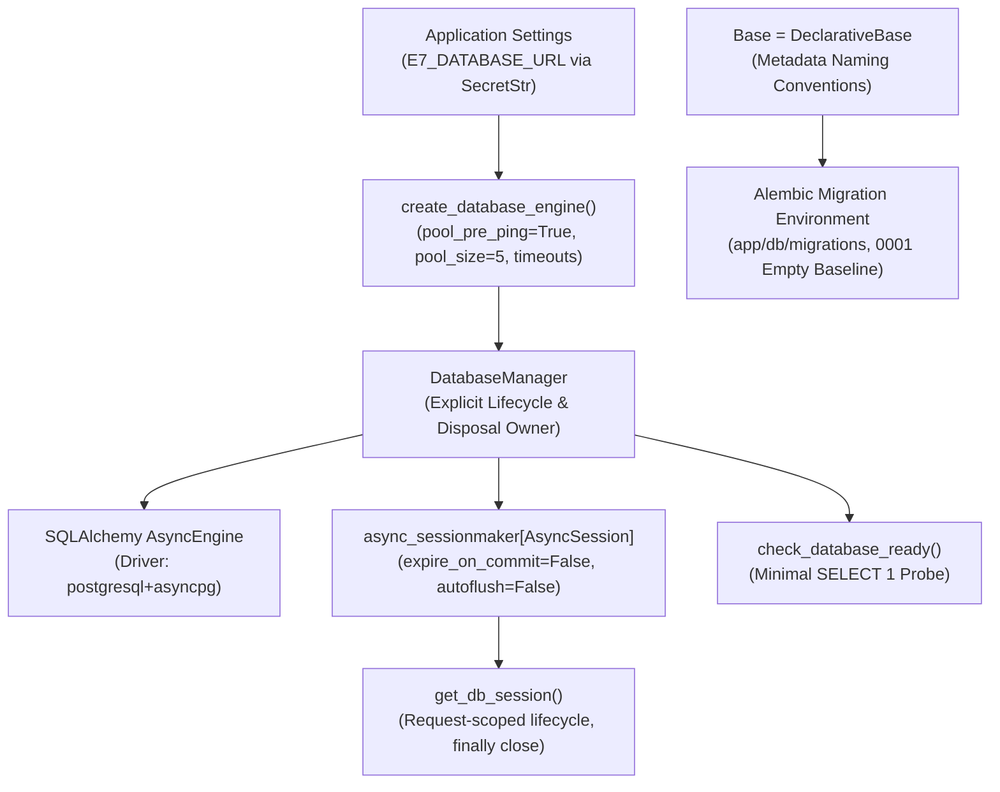

# Phase 1 PostgreSQL / SQLAlchemy / Alembic Persistence Foundation

**Document Version**: 1.0.0  
**Phase**: Phase 1 — Foundation  
**Task**: Task 1D — PostgreSQL / SQLAlchemy / Alembic Persistence Foundation  
**Status**: `COMPLETE`  
**Application Packages**: `app.db`, `app.core.config`  

> [!NOTE]
> This document records technical architecture and implementation details for Task 1D. This document is **not** an Architecture Decision Record (ADR).

---

## 1. Executive Summary & Purpose

Task 1D establishes the **asynchronous persistence foundation, runtime engine lifecycle, session management, DeclarativeBase metadata, and Alembic database migration environment** for the **IR Infotech E-7 Operations Engine**.

This implementation establishes the technical plumbing for PostgreSQL as the canonical System of Record (SoR) for all E-7-owned operational state, without prematurely introducing domain tables, repositories, or transaction policies.



---

## 2. Database Authority Boundary & Negative Invariants

In strict adherence to [`docs/IMPLEMENTATION_GUARDRAILS.md`](file:///f:/operations-engine/docs/IMPLEMENTATION_GUARDRAILS.md) and [`docs/data-model/CANONICAL_OWNERSHIP_AND_SERVICE_BOUNDARIES.md`](file:///f:/operations-engine/docs/data-model/CANONICAL_OWNERSHIP_AND_SERVICE_BOUNDARIES.md):

1. **PostgreSQL System of Record Boundary**:
   - PostgreSQL is the canonical transactional store for E-7 operational state (tasks, workflows, schedules, outbox events, and audit logs).
   - PostgreSQL does **not** replace ERP/SIS master academic records (owned by external ERP systems).
   - PostgreSQL does **not** replace Google Calendar native events (synced via adapter boundary).
   - PostgreSQL does **not** replace Flowable engine native runtime tables.
2. **Zero Company MySQL Connection**:
   - MySQL remains isolated behind BLK-01. No connection or credentials to the legacy company MySQL database exist in Task 1D.
3. **No Business or Domain Tables**:
   - Zero tables exist in [`Base.metadata`](file:///f:/operations-engine/app/db/base.py#L20-L29).
   - No models for users, tenants, roles, permissions, API keys, tasks, workflows, outbox, or audit are introduced in Task 1D.
4. **No SQLite Substitution**:
   - Unit tests use mock interfaces and synthetic URLs. SQLite is rejected by design to prevent false assumptions about PostgreSQL behavior.
5. **Deferred Application Startup Connection**:
   - [`app/main.py`](file:///f:/operations-engine/app/main.py) lifespan does not connect to the database. Importing `app.main` requires zero database infrastructure.
   - `/api/v1/ready` probe integration is deferred until the runtime container stack is wired in Task 1J.

---

## 3. Runtime Dependencies Activated

The following production and migration dependencies are activated in [`pyproject.toml`](file:///f:/operations-engine/pyproject.toml):

| Dependency | Specification | Architectural Justification |
| :--- | :--- | :--- |
| `sqlalchemy[asyncio]` | `>=2.0.0` | Modern SQLAlchemy 2.x asynchronous persistence engine, connection pooling, and DeclarativeBase metadata. |
| `asyncpg` | `>=0.29.0` | High-performance native asynchronous PostgreSQL driver for asyncio runtimes. |
| `alembic` | `>=1.13.0` | Production schema migration framework supporting asynchronous engine drivers and migration revisions. |

> [!IMPORTANT]
> The following dependencies remain explicitly **inactive**:
> - `psycopg`: Not required; `asyncpg` is the designated async PostgreSQL driver.
> - `pgvector`: Vector storage is an architectural capability for later tasks; no vector columns or extensions are defined in Task 1D.
> - RabbitMQ, Redis/Valkey, ORM repository wrappers: Deferred to their dedicated roadmap milestones.

---

## 4. Technical Database Configuration (`app.core.config`)

Configuration is extended in [`app/core/config.py`](file:///f:/operations-engine/app/core/config.py) via `pydantic-settings` using the `E7_` environment prefix:

| Setting Field | Type | Environment Variable | Default | Valid Bounds / Constraints |
| :--- | :--- | :--- | :--- | :--- |
| `database_url` | `SecretStr \| None` | `E7_DATABASE_URL` | `None` | Must start with `postgresql+asyncpg://`. Secret-safe; never exposed in repr or logs. |
| `database_pool_size` | `int` | `E7_DATABASE_POOL_SIZE` | `5` | `1` to `100` |
| `database_max_overflow` | `int` | `E7_DATABASE_MAX_OVERFLOW` | `10` | `0` to `100` |
| `database_pool_timeout_seconds` | `float` | `E7_DATABASE_POOL_TIMEOUT_SECONDS` | `30.0` | `0.1` to `300.0` |
| `database_pool_recycle_seconds` | `int` | `E7_DATABASE_POOL_RECYCLE_SECONDS` | `1800` | `-1` (disabled) or `1` to `86400` |
| `database_connect_timeout_seconds` | `float` | `E7_DATABASE_CONNECT_TIMEOUT_SECONDS` | `10.0` | `0.1` to `300.0` (propagated to `asyncpg` via `connect_args`) |
| `database_echo` | `bool` | `E7_DATABASE_ECHO` | `False` | Boolean. Strictly False by default to prevent SQL statement / parameter leakage. |

### 4.1 Secret Safety & Redaction
- `database_url` is typed as `pydantic.SecretStr`.
- Standard `repr(settings)` renders `database_url=SecretStr('**********')`.
- `str(settings.database_url)` outputs `**********`.
- Exception messages on unsupported schemes only report the scheme name (e.g. `sqlite`), never echoing passwords, usernames, or hosts.
- [`.env.example`](file:///f:/operations-engine/.env.example) contains only a placeholder syntax example: `E7_DATABASE_URL=<postgresql+asyncpg-database-url>`.

---

## 5. Persistence Architecture & Lifecycle

### 5.1 DeclarativeBase & Naming Conventions (`app.db.base`)
Implemented in [`app/db/base.py`](file:///f:/operations-engine/app/db/base.py):
```python
POSTGRESQL_NAMING_CONVENTION = {
    "ix": "ix_%(column_0_label)s",
    "uq": "uq_%(table_name)s_%(column_0_name)s",
    "ck": "ck_%(table_name)s_%(constraint_name)s",
    "fk": "fk_%(table_name)s_%(column_0_name)s_%(referred_table_name)s",
    "pk": "pk_%(table_name)s",
}

class Base(DeclarativeBase):
    metadata = MetaData(naming_convention=POSTGRESQL_NAMING_CONVENTION)
```
- Guarantees deterministic constraint naming across all future Alembic migrations.
- `len(Base.metadata.tables) == 0` is strictly verified.

### 5.2 Engine Factory & Lifecycle Management (`app.db.engine`)
Implemented in [`app/db/engine.py`](file:///f:/operations-engine/app/db/engine.py):
- `create_database_engine(settings, database_url)`:
  - Enforces `postgresql+asyncpg` scheme validation via `validate_postgresql_async_url`.
  - Configures `pool_pre_ping=True` for resilient connection recovery.
  - Passes `connect_args={"timeout": database_connect_timeout_seconds}` directly to asyncpg.
  - Does **not** connect to the network at creation time.
- `DatabaseManager`:
  - Owns the `AsyncEngine` and `async_sessionmaker`.
  - Provides `dispose()` method awaiting `self._engine.dispose()`.
  - Provides `check_readiness(timeout_seconds)` delegating to `check_database_ready`.

### 5.3 Session Factory & Request Lifecycle Primitive (`app.db.session`)
Implemented in [`app/db/session.py`](file:///f:/operations-engine/app/db/session.py):
- `create_session_factory(engine)`:
  - Configures `expire_on_commit=False` (prevents lazy-load IO errors outside session scope).
  - Configures `autoflush=False` (prevents premature flushes before explicit transaction boundaries).
- `get_db_session(database_manager)`:
  - Asynchronous generator acquiring an `AsyncSession`.
  - Guarantees `await session.close()` in a `finally` block.
  - **Does NOT auto-commit** transactions. Transaction policies and Unit of Work are deferred to Task 1E.

### 5.4 Low-Level Readiness Probe (`app.db.health`)
Implemented in [`app/db/health.py`](file:///f:/operations-engine/app/db/health.py):
- `check_database_ready(engine, timeout_seconds=3.0)`:
  - Executes minimal `SELECT 1` query using `asyncio.timeout(timeout_seconds)`.
  - Returns `True` if scalar result is `1`, `False` otherwise.
  - Never raises unhandled exceptions to callers.
  - Emits structured warnings logging only error types (e.g. `OperationalError`), never leaking connection strings.

---

## 6. Alembic Migration Environment

### 6.1 Configuration Structure
- [`alembic.ini`](file:///f:/operations-engine/alembic.ini): Located at repository root. Sets `script_location = app/db/migrations` and leaves `sqlalchemy.url = ` blank.
- [`app/db/migrations/env.py`](file:///f:/operations-engine/app/db/migrations/env.py):
  - Imports `Base.metadata` as `target_metadata`.
  - Implements canonical `get_url()` resolving from application Settings or `E7_DATABASE_URL` with strict PostgreSQL async scheme validation (`postgresql+asyncpg` only, rejecting `sqlite`, `mysql`, `mariadb`).
  - Supports offline mode (`context.configure(literal_binds=True)`).
  - Supports online mode (`create_async_engine(url, poolclass=pool.NullPool)`).
  - Protected with `is_context_active()` check so importing `env.py` outside of Alembic CLI runner never triggers proxy `NameError`.
- [`app/db/migrations/script.py.mako`](file:///f:/operations-engine/app/db/migrations/script.py.mako): Standard async migration template.
- [`app/db/migrations/versions/0001_phase_1_persistence_baseline.py`](file:///f:/operations-engine/app/db/migrations/versions/0001_phase_1_persistence_baseline.py):
  - Initial baseline migration revision `0001`.
  - Empty `upgrade()` (`pass`) and empty `downgrade()` (`pass`).
  - Zero table creations, zero table drops, zero column additions.

---

## 7. Verification & Test Coverage

All requirements are verified across two dedicated unit test suites:

### 7.1 `tests/unit/test_database.py` (21 Tests)
1. `test_app_main_import_without_database_url`: Safe import without environment variables.
2. `test_missing_database_url_fails_only_when_requested`: Explicit engine creation requires URL.
3. `test_database_manager_accepts_valid_postgresql_asyncpg_url`: Valid PostgreSQL URL accepted.
4. `test_unsupported_schemes_rejected`: Rejection of sqlite, mysql, mariadb, sync postgresql across 7 parameterized fixtures without secret leakage.
5. `test_database_settings_bounds_and_defaults`: Numeric bounds validation.
6. `test_database_echo_is_independent_of_debug_flag`: Echo safety.
7. `test_secret_handling_redaction`: Password masking in repr, str, and logs.
8. `test_engine_configuration_arguments_propagation`: Pool and connect_args timeout propagation.
9. `test_database_manager_lifecycle_and_disposal`: Async engine disposal.
10. `test_session_factory_and_get_db_session_primitive`: Clean close without auto-commit.
11. `test_declarative_base_and_naming_convention`: DeclarativeBase, naming conventions, and 0 tables assertion.
12. `test_check_database_ready_probe_*`: Probe success, unexpected value, timeout, and exception handling.

### 7.2 `tests/unit/test_alembic.py` (14 Tests)
1. `test_alembic_ini_exists_and_uncredentialed`: File presence and credential absence.
2. `test_alembic_env_targets_base_metadata`: Target metadata linkage.
3. `test_alembic_url_resolution_from_settings`: Dynamic URL resolution from Settings.
4. `test_alembic_url_resolution_from_environment`: Environment fallback resolution.
5. `test_alembic_url_resolution_missing_fails_clearly`: Clean failure with DatabaseConfigurationError when unconfigured.
6. `test_alembic_rejects_unsupported_schemes`: Parameterized rejection across 6 unsupported schemes (sqlite, sqlite+aiosqlite, mysql, mysql+asyncmy, mariadb+asyncmy, sync postgresql) without credential leakage.
7. `test_alembic_raw_env_cannot_bypass_validation`: Verifies raw environment variables cannot bypass canonical scheme validation.
8. `test_alembic_script_directory_loads_baseline_revision`: Alembic ScriptDirectory discovery of revision `0001`.
9. `test_initial_migration_contains_zero_table_mutations`: AST verification of zero table mutations.

---

## 8. File Inventory & Modifications

### 8.1 Files Created
- [`app/db/base.py`](file:///f:/operations-engine/app/db/base.py)
- [`app/db/engine.py`](file:///f:/operations-engine/app/db/engine.py)
- [`app/db/session.py`](file:///f:/operations-engine/app/db/session.py)
- [`app/db/health.py`](file:///f:/operations-engine/app/db/health.py)
- [`alembic.ini`](file:///f:/operations-engine/alembic.ini)
- [`app/db/migrations/env.py`](file:///f:/operations-engine/app/db/migrations/env.py)
- [`app/db/migrations/script.py.mako`](file:///f:/operations-engine/app/db/migrations/script.py.mako)
- [`app/db/migrations/versions/0001_phase_1_persistence_baseline.py`](file:///f:/operations-engine/app/db/migrations/versions/0001_phase_1_persistence_baseline.py)
- [`tests/unit/test_database.py`](file:///f:/operations-engine/tests/unit/test_database.py)
- [`tests/unit/test_alembic.py`](file:///f:/operations-engine/tests/unit/test_alembic.py)
- [`docs/phase-1/PHASE_1_DATABASE_FOUNDATION.md`](file:///f:/operations-engine/docs/phase-1/PHASE_1_DATABASE_FOUNDATION.md) (This document)

### 8.2 Files Modified
- [`pyproject.toml`](file:///f:/operations-engine/pyproject.toml): Activated `sqlalchemy[asyncio]>=2.0.0`, `asyncpg>=0.29.0`, `alembic>=1.13.0`.
- [`app/core/config.py`](file:///f:/operations-engine/app/core/config.py): Added technical PostgreSQL settings and bounds validation.
- [`.env.example`](file:///f:/operations-engine/.env.example): Replaced legacy database entries with safe syntax placeholder block.
- [`app/db/__init__.py`](file:///f:/operations-engine/app/db/__init__.py): Exported public database interfaces.

---

## 9. Deferred Phase-1 Work & Roadmap Alignment

In strict accordance with the frozen Phase-1 sequence, subsequent tasks are:
- **Task 1E**: Repository pattern + Unit of Work + explicit transaction boundaries (infrastructure/abstractions only; zero business/domain tables).
- **Task 1F**: Append-only audit.
- **Task 1G**: Transactional Outbox + RabbitMQ + versioned event envelope + Inbox/deduplication.
- **Task 1H**: Idempotency.
- **Task 1I**: /api/v1 conventions + OpenAPI + error model + jobs.
- **Task 1J**: Docker Compose runtime topology: API / worker / PostgreSQL / RabbitMQ / Flowable placeholder.
- **Task 1K**: OpenTelemetry / observability foundation.

> [!IMPORTANT]
> **Identity / Tenant Persistence Classification**:
> Persistence models for tenants, principals, external identity mappings, service credentials, and roles/permissions are classified as:
> `DEFERRED — REQUIRES EXPLICIT DATA-MODEL TASK`
> They are NOT assigned to Task 1E, Task 1F, or Task 1G, and will be introduced through a separately reviewed implementation task when their canonical data model is ready.
