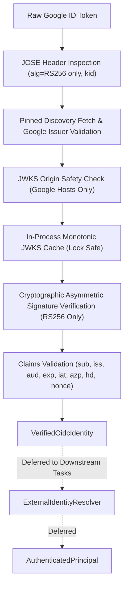

# Phase 1 Google OIDC Cryptographic Verification Foundation

**Document Version**: 1.1.0  
**Phase**: Phase 1 — Foundation  
**Task**: Task 1C.2 & Task 1C.2A — Google OIDC Provider Pinning & Algorithm Hardening  
**Status**: `COMPLETE`  
**Application Modules**: `app.core.auth.google_oidc`, `app.core.config`  

---

## 1. Executive Summary & Purpose

Task 1C.2 and Task 1C.2A implement the **hardened cryptographic verification foundation** for Google OpenID Connect (OIDC) ID tokens, realizing Decision `D-EXT-01` (Google Cloud Identity / Google Workspace) within an explicit, pinned provider boundary.

The verifier executes local cryptographic signature verification, pinned dynamic discovery and JWKS caching, strict `RS256`-only algorithm allowlisting, and claim validation. Crucially, the verifier stops cleanly at producing a validated, frozen [`VerifiedOidcIdentity`](file:///f:/operations-engine/app/core/auth/models.py#L42-L69) object. It performs zero tenant derivation, role assignment, database queries, or canonical principal creation.



---

## 2. Google-Specific Adapter Boundary & Negative Assertions

In accordance with [IMPLEMENTATION_GUARDRAILS.md](file:///f:/operations-engine/docs/IMPLEMENTATION_GUARDRAILS.md) and [PHASE_0_EXTERNAL_PROVIDER_DECISIONS.md](file:///f:/operations-engine/docs/integrations/PHASE_0_EXTERNAL_PROVIDER_DECISIONS.md):

1. **Provider Boundary**: All Google-specific interaction logic, discovery handling, JWKS retrieval, and claim mapping are isolated in [`app/core/auth/google_oidc.py`](file:///f:/operations-engine/app/core/auth/google_oidc.py).
2. **Provider Pinning**: The verifier cannot be pointed to an arbitrary OIDC provider. Discovery is pinned to `https://accounts.google.com/.well-known/openid-configuration`, and issuer values must belong to `GOOGLE_ALLOWED_ISSUERS`.
3. **Provider-Neutral Models Untouched**: No Google-specific fields are introduced into [`AuthenticatedPrincipal`](file:///f:/operations-engine/app/core/auth/models.py#L95-L162), [`TenantContext`](file:///f:/operations-engine/app/core/auth/models.py#L88-L93), or generic RBAC hooks.
4. **Zero Intrinsic Authorization**:
   - `sub != principal_id`: Google's subject claim is an external provider identifier, not the canonical internal user ID.
   - `hd != tenant_id`: The Google Workspace hosted domain claim is **not** an E-7 organization or tenant boundary.
   - `email != canonical identity`: Email addresses are optional, descriptive attributes only.
5. **No Premature HTTP Perimeter**:
   - No `Authorization: Bearer` parsing middleware is registered in [`app/main.py`](file:///f:/operations-engine/app/main.py).
   - `/`, `/api/v1/health`, and `/api/v1/ready` remain public and untouched.
   - Composing authentication mechanisms into an HTTP perimeter is deferred to Task 1C.3.
6. **No Per-Token Network Round Trips**:
   - Google's legacy `tokeninfo` endpoint is strictly forbidden. Verification is 100% local cryptographic evaluation backed by cached JWKS.

---

## 3. Runtime Dependencies & Algorithm Hardening

Task 1C.2 and 1C.2A utilize the following runtime dependencies:

| Dependency | Specification | Architectural Justification |
| :--- | :--- | :--- |
| `pyjwt[crypto]` | `>=2.9.0` | Asymmetric RSA (`RS256`) signature verification using `cryptography` primitives and `PyJWKSet`. |
| `httpx` | `>=0.27.0` | Asynchronous non-blocking OIDC discovery and JWKS retrieval with redirects disabled (`follow_redirects=False`). |

### Algorithm Hardening Policy
- **RS256 ONLY**: In accordance with Google's published OIDC discovery document (`id_token_signing_alg_values_supported = ["RS256"]`), the local algorithm allowlist is strictly restricted to `RS256`.
- **Prohibited Algorithms**: `ES256`, `none`, `HS256`, `HS384`, `HS512`, `PS256`, `RS384`, `RS512` are rejected immediately with `UnsupportedAlgorithmError`.
- **Discovery Algorithm Consistency**: If provider discovery metadata publishes `id_token_signing_alg_values_supported`, `RS256` must be present. If absent, the verifier fails closed with `ProviderMetadataUnavailableError`.

---

## 4. Technical Configuration (`app.core.config.Settings`)

Verifier configuration is declared in [`app/core/config.py`](file:///f:/operations-engine/app/core/config.py) using `E7_` prefixed environment variables with safe defaults:

| Setting Field | Env Variable | Default | Constraints & Validation |
| :--- | :--- | :--- | :--- |
| `google_oidc_discovery_url` | `E7_GOOGLE_OIDC_DISCOVERY_URL` | `https://accounts.google.com/.well-known/openid-configuration` | Pinned: Must equal Google's canonical HTTPS discovery endpoint. |
| `google_oidc_client_ids` | `E7_GOOGLE_OIDC_CLIENT_IDS` | `[]` | Parsed from list, JSON, or comma-separated string; no blank entries. Required non-empty when verifier is constructed. |
| `google_oidc_allowed_hosted_domains` | `E7_GOOGLE_OIDC_ALLOWED_HOSTED_DOMAINS` | `[]` | Parsed from list, JSON, or comma-separated string; normalized to lowercase; no blank entries. |
| `google_oidc_http_timeout_seconds` | `E7_GOOGLE_OIDC_HTTP_TIMEOUT_SECONDS` | `10.0` | Positive float between 0.1s and 60.0s. |
| `google_oidc_clock_skew_seconds` | `E7_GOOGLE_OIDC_CLOCK_SKEW_SECONDS` | `60` | Non-negative integer between 0s and 300s. |
| `google_oidc_cache_fallback_seconds` | `E7_GOOGLE_OIDC_CACHE_FALLBACK_SECONDS` | `3600` | Positive integer between 1s and 604800s (7 days). |
| `google_oidc_cache_max_seconds` | `E7_GOOGLE_OIDC_CACHE_MAX_SECONDS` | `86400` | Positive integer between 1s and 2592000s (30 days); must be `>= cache_fallback_seconds`. |

---

## 5. Provider Pinning, Discovery & JWKS Origin Safety

To prevent rogue IdP injection or arbitrary HTTPS origin SSRF:

1. **Discovery URL Pinning**: Verified against canonical Google endpoint: `https://accounts.google.com/.well-known/openid-configuration`.
2. **Provider Issuer Validation**:
   - `GOOGLE_ALLOWED_ISSUERS = frozenset({"https://accounts.google.com", "accounts.google.com"})`
   - Discovery document `issuer` must be non-empty and present in `GOOGLE_ALLOWED_ISSUERS`.
   - Token `iss` must match `GOOGLE_ALLOWED_ISSUERS`.
3. **JWKS Origin Safety**:
   - JWKS URI is resolved dynamically from discovery but strictly checked before retrieval.
   - `GOOGLE_ALLOWED_JWKS_HOSTS = frozenset({"www.googleapis.com", "googleapis.com", "accounts.google.com"})`
   - Scheme must be `https`, port must be default `443` (or `None`), and hostname must belong to `GOOGLE_ALLOWED_JWKS_HOSTS`.
   - Localhost, private IPs (`127.0.0.1`, `internal-host`), and arbitrary domains (`evil.example`) are rejected before any network call.
4. **Redirect Safety**:
   - HTTP client configured with `follow_redirects=False`.
   - Explicit check: any HTTP 3xx redirect response on discovery or JWKS endpoints triggers immediate fail-closed `ProviderMetadataUnavailableError`.

---

## 6. Monotonic Caching & Reconciled Network-Request Counts

### 6.1 Accurate Network Retrieval Counts
Based on automated test assertions (`test_cache_hits_and_expiry`, `test_unknown_kid_triggers_controlled_jwks_refresh`):
- **Cold Verification** (caches unpopulated):
  - Discovery document fetch: **1 request**
  - JWKS keyset fetch: **1 request**
  - Total network requests on initial cold verify: **2 requests**
- **Subsequent Cached Verification** (within TTL):
  - Discovery document fetch: **0 requests**
  - JWKS keyset fetch: **0 requests**
  - Total network requests on warm verify: **0 requests**
- **Cache Expiry Refresh**:
  - Discovery document fetch: **1 request**
  - JWKS keyset fetch: **1 request**
  - Total network requests on TTL expiry: **2 requests**
- **Unknown-kid Key Rotation**:
  - Discovery document fetch: **0 requests** (serviced from cache)
  - Controlled JWKS forced refresh: **1 request**
  - Total network requests on unknown-kid rotation: **1 request**

### 6.2 Stampede Protection & Controlled Key Rotation
When a token contains a `kid` absent from the cached JWKS:
1. **Single Lock**: Coroutines acquire `asyncio.Lock`.
2. **Double Check**: Checks whether a concurrent task already refreshed the cache.
3. **Single Controlled Refresh**: Fetches fresh JWKS once (`follow_redirects=False`).
4. **Retry Once**: Retries lookup in the refreshed keyset.
5. **Fail Closed**: If still absent after refresh, raises [`SigningKeyNotFoundError`](file:///f:/operations-engine/app/core/auth/google_oidc.py#L51-L53).

---

## 7. Cryptographic Claim Validation Rules

Verification executes via `jwt.decode` backed by the resolved public key:

| Dimension | Rule | Failure Classification |
| :--- | :--- | :--- |
| **JOSE Header** | Requires `alg` and `kid`. Rejects missing/blank values. | `UnsupportedAlgorithmError`, `SigningKeyNotFoundError` |
| **Algorithm Allowlist** | Only approved asymmetric algorithm: `RS256`. Explicitly prohibits `ES256`, `none`, `HS256`, `HS384`, `HS512`, `PS256`. | `UnsupportedAlgorithmError` |
| **Signature** | Cryptographically verified against public key. Cannot be disabled. | `InvalidSignatureError` |
| **Issuer (`iss`)** | Must match `GOOGLE_ALLOWED_ISSUERS` (`https://accounts.google.com` or `accounts.google.com`). Cannot be disabled. | `InvalidIssuerError` |
| **Audience (`aud`)** | Must match at least one approved client ID in `google_oidc_client_ids`. Normalized to `frozenset[str]`. Cannot be disabled. | `InvalidAudienceError` |
| **Multi-Audience / `azp`** | If `aud` contains multiple client IDs, `azp` is mandatory, must be an approved client ID, and must exist in the token's audience set. | `InvalidAudienceError` |
| **Expiration (`exp`)** | Current time must be `< exp + leeway`. Cannot be disabled. | `TokenExpiredError` |
| **Issued-At (`iat`)** | Mandatory claim. | `InvalidRequiredClaimsError` |
| **Not-Before (`nbf`)** | Validated when present; current time must be `>= nbf - leeway`. | `TokenNotYetValidError` |
| **Subject (`sub`)** | Mandatory non-empty, non-whitespace string. | `InvalidRequiredClaimsError` |
| **Nonce (`nonce`)** | When `expected_nonce` is supplied by caller, token must contain exact matching nonce. | `NonceMismatchError` |
| **Hosted Domain (`hd`)** | If `allowed_hosted_domains` is configured, token must contain `hd` belonging to the allowlist (case-insensitive). | `HostedDomainRejectedError` |
| **Email (`email`)** | Optional descriptive string attribute. Never used as canonical identity. | `InvalidRequiredClaimsError` (if non-string) |

---

## 8. Error Model & Privacy Invariants

All verification failures map to a structured exception taxonomy with bounded `reason_code` values:

```python
GoogleOidcVerificationError (OIDC_VERIFICATION_FAILED)
├── MalformedTokenError (MALFORMED_TOKEN)
├── UnsupportedAlgorithmError (UNSUPPORTED_ALGORITHM)
├── SigningKeyNotFoundError (SIGNING_KEY_NOT_FOUND)
├── InvalidSignatureError (INVALID_SIGNATURE)
├── InvalidIssuerError (INVALID_ISSUER)
├── InvalidAudienceError (INVALID_AUDIENCE)
├── TokenExpiredError (TOKEN_EXPIRED)
├── TokenNotYetValidError (TOKEN_NOT_YET_VALID)
├── InvalidRequiredClaimsError (INVALID_REQUIRED_CLAIMS)
├── NonceMismatchError (NONCE_MISMATCH)
├── HostedDomainRejectedError (HOSTED_DOMAIN_REJECTED)
└── ProviderMetadataUnavailableError (PROVIDER_METADATA_UNAVAILABLE)
```

### Privacy Guarantee
When failures are logged:
- **Zero Token Leakage**: The raw token is **never** logged.
- **Zero Claim Leakage**: Raw claims, email, subject, authorization headers, and JWKS bodies are excluded.
- **Sanitized Metadata**: Log events emit only `event="google_oidc_verification_failed"`, `reason_code`, and `provider="google_oidc"`.

---

## 9. Test Verification Strategy & Matrix

All tests run locally with zero network calls using `httpx.MockTransport` and ephemeral synthetic RSA/EC keys:

| Test Category | Suite File | Test Cases | Scope Tested |
| :--- | :--- | :---: | :--- |
| **Success Matrix** | [`test_google_oidc.py`](file:///f:/operations-engine/tests/unit/test_google_oidc.py) | 4 | Single audience, multi-audience with `azp`, matching nonce, allowed `hd`. |
| **Key & Signature Matrix** | [`test_google_oidc.py`](file:///f:/operations-engine/tests/unit/test_google_oidc.py) | 6 | Invalid signature, rotation with controlled refresh, unknown key rejection, missing/blank `kid`, prohibited `alg` / `none` / HMAC, explicit `ES256` rejection with valid EC key. |
| **Claims Matrix** | [`test_google_oidc.py`](file:///f:/operations-engine/tests/unit/test_google_oidc.py) | 2 | Expired token, future `nbf`, missing `exp`/`iat`/`sub`, blank `sub`, wrong issuer, wrong audience, multi-audience missing `azp`, mismatched `azp`, nonce mismatch, disallowed `hd`, malformed tokens. |
| **Caching Matrix** | [`test_google_oidc.py`](file:///f:/operations-engine/tests/unit/test_google_oidc.py) | 2 | Cache hits within TTL (0 fetches), cache refresh on expiry (2 fetches), concurrent stampede protection. |
| **Network, Pinning & Provider Failures** | [`test_google_oidc.py`](file:///f:/operations-engine/tests/unit/test_google_oidc.py) | 14 | Connect timeout, HTTP 500, missing `jwks_uri`, insecure HTTP `jwks_uri`, malicious discovery issuer (`evil.example`), missing `RS256` in discovery `id_token_signing_alg_values_supported`, malicious JWKS hosts (`evil.example`, `localhost`, `127.0.0.1`, `internal-host`, non-https), discovery redirects (`301`, `302`, `307`, `308`), JWKS redirects (`301`, `302`). |
| **Config & Lifecycle** | [`test_google_oidc.py`](file:///f:/operations-engine/tests/unit/test_google_oidc.py) | 4 | Settings validation (canonical URL pinning, bounds), constructor validation (canonical discovery pinning, client IDs), context manager `aclose`, zero network calls on `import app.main`. |

**Total Unit Tests Passing**: **80 tests across 7 test suites** (100% pass rate).

---

## 10. Summary of Files Created & Modified

| File Path | Action | Description |
| :--- | :---: | :--- |
| `app/core/auth/google_oidc.py` | **Modified** | Hardened algorithm allowlist (`RS256` only), Google provider pinning (`GOOGLE_ALLOWED_ISSUERS`), canonical discovery check, JWKS origin safety (`GOOGLE_ALLOWED_JWKS_HOSTS`), discovery algorithm consistency check, redirect rejection (`follow_redirects=False`). |
| `app/core/config.py` | **Modified** | Pinned `google_oidc_discovery_url` strictly to Google's canonical endpoint `https://accounts.google.com/.well-known/openid-configuration`. |
| `tests/unit/test_google_oidc.py` | **Modified** | Added explicit tests for `ES256` rejection, malicious discovery issuer, missing `RS256`, malicious JWKS origins, and HTTP 3xx redirect fail-closed behavior. Total suite tests increased to 32. |
| `docs/phase-1/PHASE_1_GOOGLE_OIDC_VERIFICATION.md` | **Modified** | Documented provider pinning, `RS256`-only policy, origin checks, redirect policy, and reconciled network counts. |
