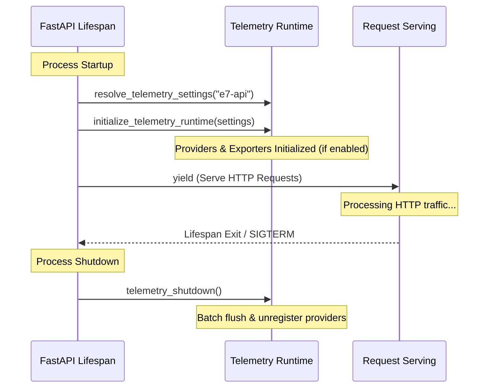
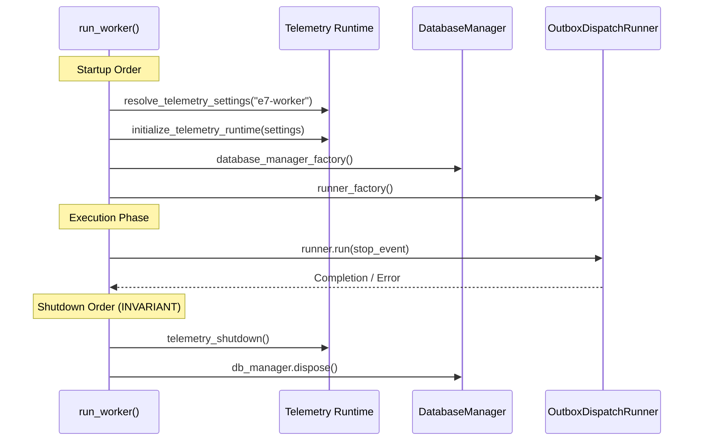

# Phase 1 OpenTelemetry API & Worker Telemetry Lifecycle Integration

**Document Version**: 1.0.0  
**Phase**: Phase 1 — Foundation  
**Task**: Task 1K.3 — API & Worker Telemetry Lifecycle Integration  
**Status**: `COMPLETE`  

---

## 1. Executive Summary

Task 1K.3 integrates the core OpenTelemetry runtime foundation established in Task 1K.2 into the two Phase-1 runtime process boundaries:
1. The **FastAPI API process** via Starlette/FastAPI `lifespan` in `app/main.py`.
2. The **Outbox-only worker process** via `run_worker()` entrypoint in `app/worker.py`.

This integration establishes deterministic startup initialization, fail-fast configuration enforcement, deterministic shutdown flush and teardown ordering, dual-cleanup error preservation, and service identity resolution (`e7-api` vs `e7-worker`).

Import safety is strictly preserved: importing `app.main` or `app.worker` triggers zero network operations, zero background telemetry threads, and zero provider mutations. Disabled mode (`E7_OTEL_ENABLED=false`) operates with zero overhead.

---

## 2. Frozen Scope Boundaries

Per the Task 1K.3 contract, the following boundaries were strictly observed:

- **Zero New Dependencies**: No new packages added to `pyproject.toml`. Specifically, `opentelemetry-instrumentation-fastapi` is **not installed** and deferred to Task 1K.4.
- **Zero FastAPI Auto-Instrumentation**: No `FastAPIInstrumentor`, no ASGI trace middleware, and no request span wrappers added in this task.
- **Zero Database / Broker Instrumentation**: No SQLAlchemy query tracing and no RabbitMQ custom span instrumentation added.
- **Zero Docker Compose / Live Collector Requirements**: Compose remains unmodified. All tests execute deterministically without a live Collector or Prometheus container.
- **Zero Database Migrations**: `Base.metadata` remains strictly at 5 tables (`audit_events`, `outbox_events`, `inbox_messages`, `idempotency_records`, `jobs`), Alembic head remains at `0007`.

---

## 3. Service Identity Resolution Contract

Telemetry configuration is resolved at each process entrypoint boundary using `resolve_telemetry_settings()` in `app/core/telemetry/config.py`:

```
Resolution Precedence:
1. Explicit override_settings passed directly to entrypoint (highest priority, used in tests/custom callers).
2. Operator configuration (E7_OTEL_SERVICE_NAME via environment or .env file).
3. Canonical entrypoint default:
   - API Process    -> "e7-api"
   - Worker Process -> "e7-worker"
```

### Validation Invariants
When `E7_OTEL_ENABLED=true`:
- `otel_service_name` must be non-empty and not whitespace-only.
- `otel_exporter_otlp_endpoint` must be non-empty and not whitespace-only.
- If invalid, startup raises a clear `ValueError` before any services, databases, or listeners start.

---

## 4. API Process Telemetry Lifecycle (`app/main.py`)

The FastAPI application lifespan context manager owns the API process telemetry lifecycle:



### Lifecycle Invariants & Error Preservation
1. **Startup Fail-Fast**: If `initialize_telemetry_runtime()` raises during startup, the exception immediately bubbles out of `lifespan()`, preventing the server from accepting traffic.
2. **Deterministic Shutdown**: `telemetry_shutdown()` is guaranteed to execute in the lifespan's `finally:` block.
3. **Clean Shutdown Failure**: If request serving finished cleanly but `telemetry_shutdown()` raises, the shutdown error propagates.
4. **Dual Cleanup Note Preservation**: If a primary error occurred during lifespan execution and `telemetry_shutdown()` also raises, the primary error is preserved and the secondary telemetry shutdown error is attached via Python's standard `exc.add_note(...)`.

---

## 5. Worker Process Telemetry Lifecycle (`app/worker.py`)

The Outbox-only worker entrypoint `run_worker()` strictly controls startup and shutdown ordering:



### Invariant Ordering Contract
- **Startup Invariant**: Telemetry initialization precedes database connection pool construction and runner instantiation. If telemetry fails, no database connections are acquired and no outbox rows are claimed.
- **Shutdown Invariant**: Telemetry shutdown executes strictly **BEFORE** database disposal (`telemetry_shutdown()` then `db_manager.dispose()`).
- **Error Preservation**: If the worker runner raises an unhandled error, both `telemetry_shutdown()` and `db_manager.dispose()` execute in sequential cleanup blocks. Any cleanup failures are attached as notes to the primary runner exception, preserving the root business cause.

---

## 6. Verification & Test Evidence

### 6.1 Test Suites Executed

| Test Suite | Purpose | Tests | Result |
| :--- | :--- | :---: | :---: |
| `tests/unit/test_api_telemetry_lifecycle.py` | API lifespan startup/shutdown, disabled mode, fail-fast, error notes, route inventory stability | 11 | **PASS** |
| `tests/unit/test_worker_entrypoint.py` | Worker startup order, shutdown order, fail-fast, secondary error preservation, service identity | 21 | **PASS** |
| `tests/unit/test_telemetry_*.py` | Core SDK, configuration, logging, resource, and tracer provider tests | 54 | **PASS** |
| Full Test Suite (`tests/`) | Unit, integration, smoke, routing, idempotency, outbox, and audit tests | 1173 | **PASS** (34 skipped) |

### 6.2 Code Quality Gates

| Command | Target | Result |
| :--- | :--- | :---: |
| `python -m compileall app` | Bytecode syntax across all source trees | **0 errors** |
| `python -m ruff check .` | Linter, imports, syntax, line lengths | **0 errors** |
| `python -m mypy app` | Static type checking across 117 source files | **0 errors** |
| `python -m pytest tests -q` | Full test execution (unit + integration) | **1139 passed, 34 skipped** |

---

## 7. Status & Progression Marker

```
TASK_1K_3_STATUS = COMPLETE
TASK_1K_4_STATUS = UNSTARTED
CANONICAL_TASK_1K = IN_PROGRESS
PHASE_1_STATUS = IN_PROGRESS
```
