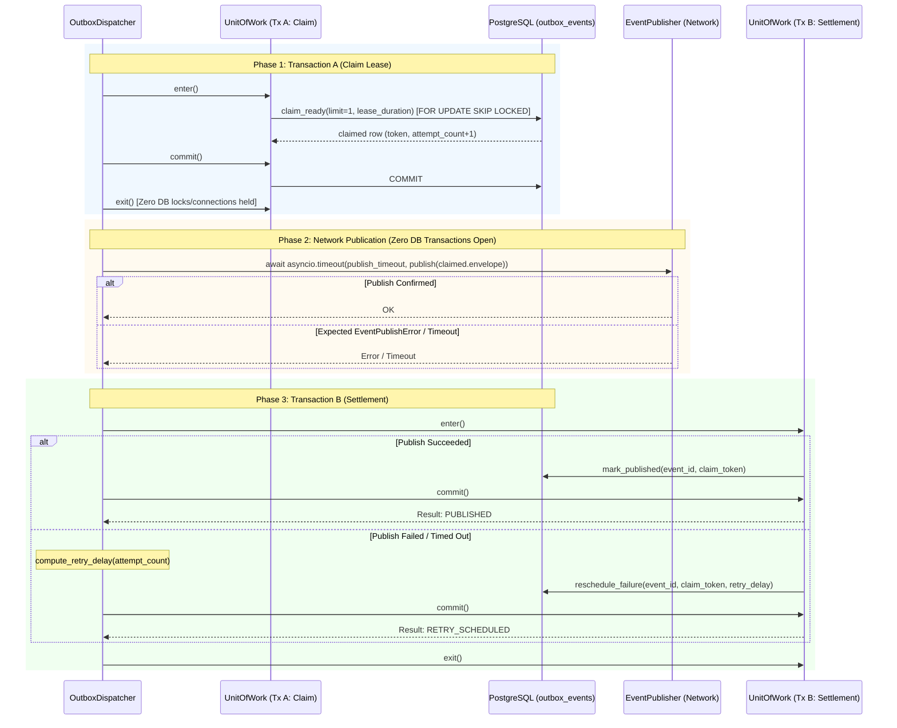

# Phase 1 Task 1G.3B2 — Single-Event Outbox Dispatch Orchestration

**Document Version**: 1.0.0  
**Phase**: Phase 1 — Foundation  
**Task**: Task 1G.3B2 — Single-Event Outbox Dispatch Orchestration  
**Status**: `COMPLETE`  
**Application Scope**: `app/events/outbox/`  

---

## 1. Executive Summary & Context

Task 1G.3B2 implements the provider-neutral, single-event outbox dispatch orchestration primitive for the **IR Infotech E-7 Operations Engine**.

Tasks 1A through 1F, Task 1G.1/1G.1A (Canonical Event Envelope Contract), Task 1G.2/1G.2A (Transactional Outbox Persistence), Task 1G.3A/1G.3A.1 (RabbitMQ Publisher Transport), and Task 1G.3B1 (Outbox Claim, Lease, and Retry-State Persistence) are complete and frozen. Canonical Task 1G remains **IN PROGRESS**.

Task 1G.3B2 establishes the execution bridge between transactional persistence and network message publication. It orchestrates a single bounded event lifecycle:
$$\text{Claim in Transaction A} \longrightarrow \text{Publish via Network (No DB Tx)} \longrightarrow \text{Mark/Reschedule in Transaction B}$$

> [!IMPORTANT]
> This document is technical architectural documentation and foundation record, **not** an Architectural Decision Record (ADR).

---

## 2. The Single-Event Dispatch Primitive (`dispatch_once`)

The public interface for dispatch orchestration is strictly bounded to a single outbox event per invocation:
- `dispatch_once() -> DispatchResult` (with alias `dispatch_one()`).

### Why Only One Event per Call
`OutboxDispatchRepository.claim_ready` supports batch claiming (`limit=...`). However, `OutboxDispatcher` deliberately claims with `limit=1`.

This is **not** a throughput constraint; it is a foundational correctness primitive:
1. **Lease Aging Prevention**: Claiming a batch of $N$ events and publishing them sequentially across network I/O causes subsequent events in the batch to experience lease decay while waiting for earlier network calls to complete.
2. **Precise Failure Isolation**: If event $k$ fails or hangs, it can be rescheduled or timed out immediately without compromising or stalling uncommitted peers.
3. **Controlled Concurrency**: Future multi-worker throughput (Task 1G.3B3) is achieved by concurrent invocation of this atomic, one-event primitive rather than unbounded sequential batch dispatching.

If `claim_ready` unexpectedly returns more than one row despite `limit=1`, the dispatcher raises a strict `RuntimeError` invariant violation rather than silently ignoring or mishandling surplus rows.

---

## 3. Why Network I/O Never Occurs Inside a Database Transaction

Holding database transactions or row-level locks open across network boundaries is strictly forbidden:

```
[ANTIPATTERN - FORBIDDEN]
BEGIN DB TRANSACTION
  SELECT ... FOR UPDATE (locks row)
  NETWORK I/O: await publisher.publish(envelope) (unbounded latency, timeouts, broker disconnects)
  UPDATE outbox_events SET published_at = now()
COMMIT DB TRANSACTION
```

Holding database locks across message broker I/O causes:
1. **Connection Pool Exhaustion**: Pinned database connections starve HTTP endpoints and background operations during broker latency or transport stalls.
2. **Cascading Contention**: Other workers or application transactions block on held PostgreSQL row locks.
3. **Distributed Deadlocks & Rollback Disasters**: If the network times out or drops after the broker receives the message, rolling back the database transaction leads to duplicate publication when another worker re-locks the row.

---

## 4. The Three-Phase Execution Ordering

To enforce complete transaction isolation, `OutboxDispatcher` executes a strict three-phase sequence across independent transaction boundaries:



### Verification of Zero Active Transactions During Publish
In unit testing, `RecordingUnitOfWork.active_count` is asserted to be strictly `0` inside the publisher network call, ensuring no connection or transaction spans broker I/O.

---

## 5. OutboxDispatchPolicy Specification

The dispatcher is configured via the immutable `OutboxDispatchPolicy` value object (`frozen=True`, `extra="forbid"`):

| Field | Type | Invariant / Validation Rule |
| :--- | :--- | :--- |
| `lease_duration` | `timedelta` | Strictly positive ($> 0$). |
| `publish_timeout` | `timedelta` | Strictly positive ($> 0$), strictly less than `lease_duration`. |
| `retry_base_delay` | `timedelta` | Strictly positive ($> 0$). |
| `retry_max_delay` | `timedelta` | Greater than or equal to `retry_base_delay`. |
| `retry_multiplier` | `float` | Finite number $\ge 1.0$ (rejects `NaN`, `+inf`, `-inf`). |

### No Hidden Production Defaults
All policy fields are mandatory and explicit. The codebase defines no hidden environment assumptions (e.g., no default 30-second lease or 5-second retry). Configuration integrity is enforced at construction.

---

## 6. Deterministic Capped Exponential Backoff

When publication encounters an expected transport failure or timeout, the retry delay is calculated deterministically by `OutboxDispatchPolicy.compute_retry_delay(dispatch_attempt_count)`:

$$\text{delay} = \min\left(\text{retry\_base\_delay} \times \text{retry\_multiplier}^{\max(0, \text{attempt} - 1)}, \; \text{retry\_max\_delay}\right)$$

### Backoff Properties:
1. **Attempt 1**: Always yields `retry_base_delay`.
2. **Attempt 2**: Yields $\text{retry\_base\_delay} \times \text{retry\_multiplier}^1$.
3. **Attempt $k$**: Scales exponentially until saturating at `retry_max_delay`.
4. **Saturation & Overflow Safety**: Exponents are capped ($\le 100$) and calculation catches `OverflowError` to safely saturate at `retry_max_delay` without numeric overflow even at millions of attempts.
5. **No Random Jitter**: Kept strictly deterministic and testable. If future fleet-scale traffic demonstrates thundering-herd resonance, jitter will be introduced as a reviewed operational improvement.
6. **Database Authority**: The dispatcher computes only the relative `retry_delay`. PostgreSQL (`func.now() + retry_delay`) remains the sole authority for evaluating `next_attempt_at`.

---

## 7. Indefinite Retries & Zero Arbitrary Max-Attempt Drops

To protect against data loss in producer outbox pipelines:
- **No Max Attempts**: There is no arbitrary threshold (e.g., 5 attempts) after which an outbox event is marked `DEAD`, `FAILED`, or `ABANDONED`.
- **No Producer DLQ**: Outbox events remain durable in PostgreSQL until delivered or manually resolved by operations.
- **Bounded Impact**: Exponential backoff prevents tight retry loops; events quickly saturate at `retry_max_delay` (e.g., 10 minutes) where they poll at a calm, predictable frequency until downstream broker recovery.

---

## 8. Ambiguous Network Timeout Semantics & At-Least-Once Delivery

Network publication is strictly bounded by `asyncio.timeout(policy.publish_timeout.total_seconds())`.

### Ambiguous Outcomes:
If `publish()` times out, the outcome is inherently **ambiguous**: the broker may have received and acknowledged the message over TCP right as the client timeout expired, or the connection dropped before transmission.

### Failure Classification: Retryable vs. Non-Retryable Failures

To prevent masking lifecycle, configuration, or programming bugs as false transient failures, the dispatcher strictly classifies publication outcomes:

1. **Retryable Failures (Trigger `reschedule_failure`)**:
   - `EventPublishError`: Raised when the underlying broker/transport rejects the message or encounters a confirmed network transmission failure.
   - `TimeoutError`: Raised when network publication exceeds `policy.publish_timeout` (ambiguous delivery).
   Both cases invoke `policy.compute_retry_delay(dispatch_attempt_count)` and persist a new `next_attempt_at` via `reschedule_failure`.

2. **Non-Retryable Errors (Immediate Propagation)**:
   - `PublisherStateError`: Represents lifecycle/state misuse (e.g., publisher not started, already closed, or invalid transition). These indicate operational wiring defects that must fail fast to trigger worker alerts, rather than quietly cycling every outbox row.
   - `PublisherNotStartedError`: Raised if `publish()` is called on an unstarted publisher. Propagates immediately.
   - `PublisherConnectionError`: Raised during connection establishment. Propagates immediately.
   - Programming Errors (`TypeError`, `ValueError`): Application defects propagate without rescheduling.
   - `asyncio.CancelledError`: Cancellation is never swallowed or converted to a retry; it propagates cleanly without executing uncoordinated settlement transitions.

**Design Rule**:
- Timeouts and `EventPublishError` are classified as retryable publication failures.
- The event is rescheduled via `reschedule_failure`.
- If the broker did receive the message prior to timeout, a duplicate message will later be published when retried.
- **At-least-once delivery** is explicitly embraced: downstream consumers (Task 1G.4 Inbox) are responsible for deduplicating events by canonical `event_id`.
- The system **never** claims "exactly once" delivery across network boundaries.

---

## 9. Stale Claim Recovery & Lost Claim Handling

PostgreSQL row-level leases provide crash-recoverable ownership. If a dispatcher process crashes or experiences severe network stalls, its lease eventually expires (`claimed_at <= now() - lease_duration`), allowing another worker to reclaim the event.

`DispatchOutcome` explicitly enumerates all settlement paths:

| Outcome | Trigger Condition | Consequence |
| :--- | :--- | :--- |
| `IDLE` | `claim_ready` returned 0 rows. | No publish call, no settlement UoW opened. |
| `PUBLISHED` | Publish succeeded AND `mark_published` committed. | Event lifecycle complete. |
| `RETRY_SCHEDULED` | Publish failed (`EventPublishError` / `TimeoutError`) AND `reschedule_failure` committed. | Rescheduled for `now() + retry_delay`. |
| `CLAIM_LOST_AFTER_PUBLISH` | Publish succeeded, but `mark_published` raised `OutboxClaimLostError`. | Another worker reclaimed the row after lease expiry. The dispatcher yields cleanly without overwriting or republishing. |
| `CLAIM_LOST_AFTER_FAILURE` | Publish failed, but `reschedule_failure` raised `OutboxClaimLostError`. | Another worker reclaimed the row. Current claim yields cleanly. |

### Infrastructure Failure Handling:
- If `mark_published` or `reschedule_failure` encounters a generic database connection or transaction failure (other than `OutboxClaimLostError`), the exception propagates. The dispatcher does not swallow it, and does not attempt secondary mutations. The committed claim remains until lease expiry, permitting natural recovery.
- If an unexpected programming exception (e.g., `TypeError`, `ValueError`, `PublisherStateError`) or `asyncio.CancelledError` occurs, it propagates immediately without being converted into a retry.

---

## 10. Event Identity Preservation & Transport Isolation

1. **Exact Envelope Publication**: The dispatcher publishes `claimed.envelope` directly without modification. It never re-generates UUIDs, never alters `occurred_at`, and never mutates `event_version`.
2. **Claim Token Isolation**: The `claim_token` is an internal PostgreSQL concurrency lease identifier. It is **never** added to `EventEnvelope`, never serialized into message payloads, and never used as `message_id`, `correlation_id`, or routing key.
3. **Provider-Neutral Transport**: `OutboxDispatcher` depends strictly on the abstract `EventPublisher` protocol and `EventPublishError` from `app.events.publishers.base`. It has **zero** imports from `aio_pika` or `app.events.publishers.rabbitmq`.

---

## 11. No Worker Loop & No Inbox / Consumer Deduplication

Task 1G.3B2 implements **only** the single-event bounded dispatch operation:
- **No Worker Loop**: Contains no `while True`, no polling sleep intervals, no worker TaskGroups, and no OS signal handlers. (Deferred to Task 1G.3B3).
- **No Publisher Lifecycle**: The dispatcher does not call `start()` or `close()` on the publisher; it assumes an externally managed publisher. (Deferred to Task 1G.3B3).
- **No Inbox / Consumer Deduplication**: Incoming message deduplication belongs to Task 1G.4.

---

## 12. Live Integration Status

```
OUTBOX_DISPATCH_ORCHESTRATION_RUNTIME_TEST = DEFERRED_TO_TASK_1J_RUNTIME_INTEGRATION
```

Task 1J will verify the outbox dispatch orchestration with live PostgreSQL and RabbitMQ instances:
- Claim transaction commits and releases locks before network publication.
- No database transaction or connection remains active during RabbitMQ publication.
- Successful publish followed by database mark transition.
- Broker failure or timeout followed by database reschedule transition with PostgreSQL `next_attempt_at`.
- Duplicate delivery resulting from publish confirmation + database mark failure.
- In-flight lease expiry and reclaim rejection by old worker.
- Downstream consumer deduplication by canonical `event_id`.

---

## 13. File Artifacts & Scope Audit

### Created Files
- `app/events/outbox/dispatcher.py`: Implementation of `OutboxDispatchPolicy`, `DispatchOutcome`, `DispatchResult`, and `OutboxDispatcher`.
- `tests/unit/test_outbox_dispatcher.py`: Comprehensive test suite (26 tests) covering ordering, isolation, policy validation, backoff, timeouts, and claim-lost scenarios.
- `docs/phase-1/PHASE_1_OUTBOX_DISPATCH_ORCHESTRATION.md`: This architectural specification.

### Modified Files
- `app/events/outbox/__init__.py`: Exporting `OutboxDispatcher`, `OutboxDispatchPolicy`, `DispatchOutcome`, and `DispatchResult`.
- `docs/phase-1/PHASE_1_FOUNDATION_BASELINE.md`: Updated baseline recording completion of Task 1G.3B2.

### Frozen & Unmodified Files
- `app/events/schemas.py`, `app/events/validation.py`, `app/events/serialization.py`
- `app/events/publishers/base.py`, `app/events/publishers/rabbitmq.py`
- `app/events/outbox/models.py`, `app/events/outbox/repository.py`, `app/events/outbox/dispatch.py`, `app/events/outbox/dispatch_repository.py`
- `app/db/uow.py`, `app/db/session.py`, `app/db/engine.py`
- Database migrations: Head remains `0004` (zero new migrations created).
- `Base.metadata`: Remains strictly `audit_events` and `outbox_events`.

---

## 14. Deferred Increments

- **Task 1G.3B3**: Long-running dispatcher runner, polling lifecycle, worker shutdown, and concurrency management.
- **Task 1G.4**: Transactional Inbox persistence, consumer transport, and message deduplication.
