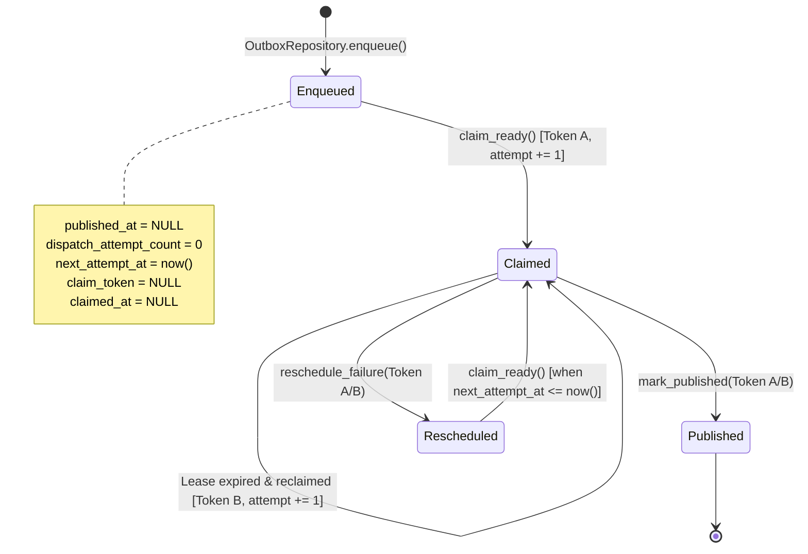

# Phase 1 Task 1G.3B1 — Outbox Dispatch Claim & Retry-State Persistence

**Document Version**: 1.0.0  
**Phase**: Phase 1 — Foundation  
**Task**: Task 1G.3B1 — Outbox Dispatch Claim & Retry-State Persistence  
**Status**: `COMPLETE`  
**Application Scope**: `app/events/outbox/`  

---

## 1. Executive Summary & Context

Task 1G.3B1 implements the concurrency control, row-claiming mechanics, crash-recoverable lease lifecycle, and retry-state persistence for the Transactional Outbox pattern in the **IR Infotech E-7 Operations Engine**.

Tasks 1A through 1F, Task 1G.1/1G.1A (Canonical Event Envelope), Task 1G.2/1G.2A (Transactional Outbox Persistence), and Task 1G.3A/1G.3A.1 (RabbitMQ Publisher Transport) are complete and frozen. Canonical Task 1G remains **IN PROGRESS**.

Task 1G.3B1 establishes the database-level persistence foundation for safe, concurrent outbox dispatching by multiple future worker processes **without performing any network publication or message broker operations**.

> [!IMPORTANT]
> This document is technical architectural documentation and foundation record, **not** an Architectural Decision Record (ADR).

---

## 2. Why Database Locks Cannot Span Message Broker I/O

A classic antipattern in outbox dispatcher implementations is holding an open database transaction and row-level lock across network publication:

```
[ANTIPATTERN - FORBIDDEN]
BEGIN DB TRANSACTION
  SELECT ... FOR UPDATE (locks rows)
  NETWORK I/O: publish message to RabbitMQ (unbounded latency / network failure)
  UPDATE outbox_events SET published_at = now()
COMMIT DB TRANSACTION
```

Holding database locks across network boundaries leads to:
1. **Connection Pool Starvation**: Database connections remain pinned during broker network latency, backpressure, or connection drops.
2. **Cascading Contention**: Other concurrent dispatchers or transactional producers block on held row locks.
3. **Distributed Deadlocks & Timeouts**: If the message broker hangs or disconnects, transaction timeouts abort and can cause cascading connection exhaustion.

### The Required Short-Transaction Architecture

To eliminate this vulnerability, outbox dispatching is decoupled into two independent, brief database transactions separated by network publication:

```
SHORT DB TRANSACTION #1 (Claim Phase)
  SELECT ... FOR UPDATE SKIP LOCKED
  Update claim metadata: claim_token, claimed_at = now(), dispatch_attempt_count += 1
COMMIT DB TRANSACTION #1 (Locks immediately released)

NETWORK I/O (Publication Phase — Outside any DB Transaction)
  Publish EventEnvelope to RabbitMQ transport via EventPublisher

SHORT DB TRANSACTION #2 (Settlement Phase)
  If publication succeeded:
    UPDATE outbox_events SET published_at = now(), claim_token = NULL, claimed_at = NULL
    WHERE event_id = :event_id AND claim_token = :claim_token AND published_at IS NULL
  If publication failed:
    UPDATE outbox_events SET next_attempt_at = now() + :retry_delay, claim_token = NULL, claimed_at = NULL
    WHERE event_id = :event_id AND claim_token = :claim_token AND published_at IS NULL
COMMIT DB TRANSACTION #2
```

Task 1G.3B1 implements the database schema, constraints, partial index, and repository primitives for Transaction #1 and Transaction #2. It performs **zero** network I/O.

---

## 3. Dispatch Operational Schema

Task 1G.3B1 preserves the canonical immutable staging columns established in Task 1G.2 (`event_id`, `envelope`, `created_at`, `published_at`) and adds strictly four operational columns to `outbox_events`:

| Column Name | Type | Nullable | Default | Operational Purpose |
| :--- | :--- | :--- | :--- | :--- |
| `dispatch_attempt_count` | `INTEGER` | `NOT NULL` | `server_default 0` | Counts successful claim acquisitions / initiated dispatch attempts. Must be `>= 0`. |
| `next_attempt_at` | `TIMESTAMPTZ` | `NOT NULL` | `server_default now()` | Earliest database timestamp at which record is eligible for claim. |
| `claim_token` | `UUID` | `NULLABLE` | `None` | Opaque lease ownership token identifying the active claiming worker. |
| `claimed_at` | `TIMESTAMPTZ` | `NULLABLE` | `None` | Database-authored timestamp when the active lease was acquired. |

### Forbidden Fields Kept Out of Outbox Schema
To preserve clean architectural boundaries, the following fields are strictly omitted from `outbox_events`:
- Zero error messages or raw exception strings (`last_error_message`, `raw_exception`, `broker_response`).
- Zero worker hostnames or process identifiers (`worker_hostname`, `process_id`, `locked_by`).
- Zero transport metadata (`exchange`, `queue`, `routing_key`, `delivery_tag`).
- Zero status enums or synthetic surrogate keys (`status`, `outbox_id`).

---

## 4. PostgreSQL Clock Ownership & Lease Semantics

All timestamps governing dispatch eligibility, claim acquisition, publication confirmation, and failure rescheduling are authored strictly by PostgreSQL server clock expressions (`func.now()` / `CURRENT_TIMESTAMP`).

### Why Application Clocks Are Forbidden
Multiple dispatcher workers running in distributed containers or hosts naturally suffer from clock skew (NTP drift, container scheduling latency). Storing application-computed timestamps (such as `datetime.now() + lease_duration`) introduces race conditions where one worker believes a lease is active while another considers it expired.

### Database-Authored Lease Expiration
The database provides the sole authoritative time reference. An active claim is considered stale and eligible for reclaim when:
$$\text{claimed\_at} \le \text{database\_now}() - \text{lease\_duration}$$

The caller supplies the technical policy input `lease_duration` (e.g., `timedelta(seconds=30)`), but PostgreSQL evaluates the predicate against its own current timestamp.

---

## 5. Database Invariants & Check Constraints

Migration `0004_add_outbox_dispatch_state.py` adds three named check constraints ensuring invalid dispatch states cannot exist:

1. **`ck_outbox_events_dispatch_attempt_count_non_negative`**:
   $$\text{dispatch\_attempt\_count} \ge 0$$
   Guarantees attempt counts never become negative.

2. **`ck_outbox_events_claim_token_and_claimed_at_pair`**:
   $$(\text{claim\_token IS NULL} \land \text{claimed\_at IS NULL}) \lor (\text{claim\_token IS NOT NULL} \land \text{claimed\_at IS NOT NULL})$$
   Enforces that lease identity and lease acquisition time are strictly paired. A claim token cannot exist without a timestamp, and a timestamp cannot exist without a token.

3. **`ck_outbox_events_published_has_no_active_claim`**:
   $$\text{published\_at IS NULL} \lor (\text{claim\_token IS NULL} \land \text{claimed\_at IS NULL})$$
   Guarantees that a completed/published event never retains an active claim lease.

---

## 6. Concurrency Control: SKIP LOCKED & Deterministic Ordering

Concurrent dispatcher workers claim ready rows using PostgreSQL row-level locking:
```sql
SELECT event_id, envelope, dispatch_attempt_count, ...
FROM outbox_events
WHERE published_at IS NULL
  AND next_attempt_at <= now()
  AND (claimed_at IS NULL OR claimed_at <= now() - :lease_duration)
ORDER BY next_attempt_at ASC, created_at ASC, event_id ASC
LIMIT :limit
FOR UPDATE SKIP LOCKED;
```

### Why `SKIP LOCKED`
- Standard `FOR UPDATE` causes competing workers to block and wait on the first worker's selected rows.
- `SKIP LOCKED` causes concurrent workers to silently skip rows currently locked by other workers, immediately acquiring distinct batches of available rows with zero lock contention.

### Deterministic Ordering
Rows are sorted by `(next_attempt_at ASC, created_at ASC, event_id ASC)` before applying `LIMIT`. This guarantees fair FIFO processing (oldest eligible events claimed first) and ensures repeatable candidate selection.

---

## 7. Claim Lifecycle & Crash-Recoverable Stale Leases



### Crash Recovery Mechanism
If a dispatcher worker process crashes, dies, or suffers network partition after acquiring a claim:
1. `claim_token` and `claimed_at` remain stored in the database row.
2. Once PostgreSQL current time advances past $\text{claimed\_at} + \text{lease\_duration}$, another worker automatically considers the row eligible.
3. The new worker issues a new UUID `claim_token`, sets `claimed_at = func.now()`, and increments `dispatch_attempt_count`.
4. No manual database intervention or operator cleanup is required.

---

## 8. Stale Worker Protection via Conditional UPDATE

If Worker A experiences a prolonged network stall, its lease may expire and be reclaimed by Worker B (which receives Token B).

If Worker A eventually recovers and attempts to finalize publication or reschedule the event using its stale Token A, it must not overwrite Worker B's active claim or corrupt state.

Both `mark_published` and `reschedule_failure` execute conditional updates requiring active token matching:
```sql
UPDATE outbox_events
SET published_at = now(), claim_token = NULL, claimed_at = NULL
WHERE event_id = :event_id
  AND claim_token = :claim_token
  AND published_at IS NULL;
```

### Deterministic Rowcount Verification
- If `rowcount == 1`: The transition succeeded.
- If `rowcount == 0`: The claim was lost (the lease expired and was reclaimed, or another worker already published the event). The repository raises `OutboxClaimLostError`.

---

## 9. Index Evolution

Task 1G.2 created a partial index `ix_outbox_events_pending_created_at` on `created_at` WHERE `published_at IS NULL`.

Because dispatch eligibility in Task 1G.3B1 depends primarily on `next_attempt_at`, migration `0004_add_outbox_dispatch_state.py` supersedes and replaces this index:

- **Dropped**: `ix_outbox_events_pending_created_at`
- **Created**: `ix_outbox_events_dispatch_ready` on `(next_attempt_at, created_at, event_id)` WHERE `published_at IS NULL`

Downgrade reverses this cleanly, dropping `ix_outbox_events_dispatch_ready` and recreating `ix_outbox_events_pending_created_at`.

---

## 10. Repository Demarcation & Value Object Contract

### Separation of Responsibilities
1. **`OutboxRepository`** (`app/events/outbox/repository.py`):
   - Producer-side durable staging.
   - Exposes strictly `enqueue(envelope: EventEnvelope) -> UUID`.
2. **`OutboxDispatchRepository`** (`app/events/outbox/dispatch_repository.py`):
   - Operational dispatcher state transitions.
   - Exposes `claim_ready`, `mark_published`, `reschedule_failure`.

### `ClaimedOutboxEvent` Value Object
`OutboxDispatchRepository.claim_ready()` returns a tuple of immutable `ClaimedOutboxEvent` instances (`app/events/outbox/dispatch.py`):
- `event_id`: Canonical UUID.
- `envelope`: Canonical, immutable `EventEnvelope`.
- `claim_token`: Opaque UUID lease ownership token.
- `dispatch_attempt_count`: Monotonically increasing attempt integer.
- Pydantic model with `frozen=True, extra="forbid"`.
- Contains **zero** mutable ORM records or database sessions.

### Unit of Work Ownership
`OutboxDispatchRepository` inherits from `SqlAlchemyRepository` and receives an externally managed `AsyncSession`. It **never** commits, rolls back, or closes the session. The enclosing `UnitOfWork` remains the sole transaction owner.

---

## 11. Testing & Runtime Verification Boundary

### Static & Unit Test Coverage
Unit tests verify:
1. `tests/unit/test_outbox_dispatch_model.py`: Model columns, types, defaults, check constraints, partial index, forbidden fields.
2. `tests/unit/test_outbox_dispatch_repository.py`: Claim input validation, PostgreSQL statement compilation (`FOR UPDATE SKIP LOCKED`, ordering, predicates), claim transitions, attempt counting, stale lease reclaim, `mark_published` conditional update and rowcount checks, `reschedule_failure` retry delay bounds, `OutboxClaimLostError`, stale worker protection, and architectural boundaries.
3. `tests/unit/test_outbox_dispatch_migration.py`: Alembic revision chain (0004 revises 0003, head is 0004), upgrade AST declarations, downgrade restoration.

### Authoritative Runtime Deferral
```python
POSTGRES_OUTBOX_DISPATCH_RUNTIME_TEST = "DEFERRED_TO_TASK_1J_RUNTIME_INTEGRATION"
```
Live multi-worker concurrent claiming (`SKIP LOCKED`), actual clock evaluation, and connection isolation are deferred to Task 1J Docker Compose runtime integration where a live PostgreSQL instance is available.

---

## 12. Changeset Audit

### Files Created
- `app/events/outbox/dispatch.py`
- `app/events/outbox/dispatch_repository.py`
- `app/db/migrations/versions/0004_add_outbox_dispatch_state.py`
- `tests/unit/test_outbox_dispatch_model.py`
- `tests/unit/test_outbox_dispatch_repository.py`
- `tests/unit/test_outbox_dispatch_migration.py`
- `docs/phase-1/PHASE_1_OUTBOX_DISPATCH_STATE.md`

### Files Modified
- `app/events/outbox/models.py`
- `app/events/outbox/__init__.py`
- `tests/unit/test_alembic.py`
- `tests/unit/test_audit_migration.py`
- `tests/unit/test_event_envelope.py`
- `tests/unit/test_outbox_model.py`
- `tests/unit/test_outbox_migration.py`
- `docs/phase-1/PHASE_1_FOUNDATION_BASELINE.md`

---

## 13. Deferred Work

The following components belong to subsequent tasks and were **not** implemented:
- **Task 1G.3B2**: Dispatcher orchestration loop, polling intervals, retry backoff calculation (exponential multiplier, max delay, jitter), max attempts policy, dead-lettering / permanent failure handling, worker lifecycle.
- **Task 1G.4**: Inbox persistence, consumer deduplication, consumer idempotency.
