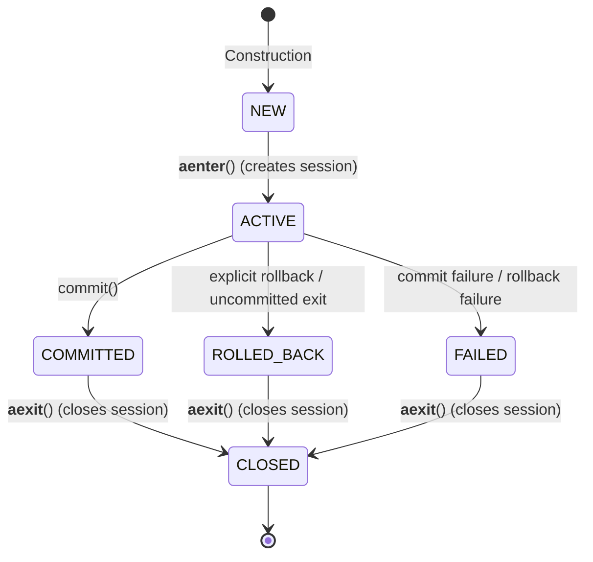

# Phase 1 Repository, Unit of Work & Transaction Foundation

**Document Version**: 1.0.0  
**Phase**: Phase 1 — Foundation  
**Task**: Task 1E — Repository + Unit of Work + Explicit Transaction Foundation  
**Status**: `COMPLETE`  
**Application Packages**: `app.db`, `app.db.repositories`  

> [!NOTE]
> This document records technical architecture and implementation details for Task 1E. This document is **not** an Architecture Decision Record (ADR).

---

## 1. Executive Summary & Purpose

Task 1E establishes the **Unit of Work pattern, transaction demarcation, session lifetime ownership, and minimal repository/session contracts** for the **IR Infotech E-7 Operations Engine**.

Building upon the SQLAlchemy 2.x asynchronous persistence engine and Alembic migration foundation established in Task 1D, Task 1E defines explicit transactional boundaries without prematurely introducing business tables, generic CRUD assumptions, or global framework coupling.

```mermaid
flowchart TD
    SessionFactory["async_sessionmaker[AsyncSession]"] --> UowFactory["SqlAlchemyUnitOfWorkFactory\n(Dependency Injection)"]
    UowFactory -->|create()| UoW["SqlAlchemyUnitOfWork\n(One-Shot Instance)"]
    UoW -->|__aenter__| Session["AsyncSession\n(Single Session per UoW)"]
    Session --> RepoA["SqlAlchemyRepository A\n(e.g., Domain Repo 1)"]
    Session --> RepoB["SqlAlchemyRepository B\n(e.g., Domain Repo 2)"]
    UoW -->|Explicit commit()| Commit["session.commit()\n(State: COMMITTED)"]
    UoW -->|Uncommitted Exit / Exception| Rollback["session.rollback()\n(State: ROLLED_BACK)"]
    UoW -->|__aexit__ finally| Close["session.close()\n(State: CLOSED)"]
```

---

## 2. Core Transaction & Session Ownership Invariants

### 2.1 Unit of Work Responsibilities
The Unit of Work (`UnitOfWork`) owns:
1. **Transaction Demarcation**: Defines the exact boundary of business transactions.
2. **Explicit Commit**: Calls `session.commit()` exclusively upon explicit caller request.
3. **Automatic Rollback on Uncommitted Exit**: Exiting context without an explicit `commit()` always triggers `session.rollback()`.
4. **Automatic Rollback on Exception**: Any exception raised inside context triggers rollback and cleanly propagates the original exception without swallowing.
5. **Session Lifetime**: Creates exactly one fresh `AsyncSession` on entry and closes it in a guaranteed `finally` block on exit.

### 2.2 Repository Negative Invariants
Repositories (`SqlAlchemyRepository`) strictly do **NOT** own:
1. `commit()`: Repositories must never call `session.commit()`.
2. `rollback()`: Repositories must never call `session.rollback()`.
3. `close()`: Repositories must never close or dispose of the session.
4. Engine or Session Creation: Repositories receive an already active session supplied by the Unit of Work.
5. Independent Connections: Repositories never bypass the Unit of Work transaction boundary.

---

## 3. Explicit Commit & Rollback Policy

The engine adheres to a strict **Explicit-Commit Policy**:
- **Successful Write Path**:
  ```python
  async with uow:
      # Perform domain operations via repositories bound to uow.session
      await uow.commit()  # Explicit commit required
  ```
- **Uncommitted Exit Path**:
  ```python
  async with uow:
      # Perform read or staging operations
      # Exit without calling uow.commit()
  # Automatically triggers session.rollback(); no implicit commit occurs!
  ```
- **Exception Path**:
  ```python
  async with uow:
      raise DomainValidationError("Invalid operational payload")
  # Automatically triggers session.rollback(), closes session, and propagates DomainValidationError
  ```

> [!CAUTION]
> Implicit auto-commit ("commit automatically if no exception occurred") is **strictly forbidden**. Clean exit without calling `commit()` is treated as an abandoned or read-only transaction and is rolled back.

---

## 4. Unit of Work Lifecycle State Model

`SqlAlchemyUnitOfWork` tracks deterministic lifecycle state via `UnitOfWorkState`:



### 4.1 State Invariants & Enforcement
| Illegal Operation | Trigger Condition | Exception Raised |
| :--- | :--- | :--- |
| **Commit before Enter** | Calling `uow.commit()` in `NEW` state | `UnitOfWorkNotActiveError` |
| **Rollback before Enter** | Calling `uow.rollback()` in `NEW` state | `UnitOfWorkNotActiveError` |
| **Session access before Enter** | Accessing `uow.session` in `NEW` state | `UnitOfWorkNotActiveError` |
| **Session access after Commit** | Accessing `uow.session` in `COMMITTED` state | `UnitOfWorkStateError` |
| **Session access after Rollback** | Accessing `uow.session` in `ROLLED_BACK` state | `UnitOfWorkStateError` |
| **Session access after Failure** | Accessing `uow.session` in `FAILED` state | `UnitOfWorkStateError` |
| **Commit / Rollback in Failure** | Calling `commit()` or `rollback()` in `FAILED` state | `UnitOfWorkStateError` |
| **Re-entry / Nested Transaction** | Calling `__aenter__()` on `ACTIVE` UoW | `UnitOfWorkStateError` |
| **Double Commit** | Calling `uow.commit()` twice | `UnitOfWorkStateError` |
| **Commit after Rollback** | Calling `uow.commit()` after `uow.rollback()` | `UnitOfWorkStateError` |
| **Rollback after Commit** | Calling `uow.rollback()` after `uow.commit()` | `UnitOfWorkStateError` |
| **Reuse Closed Instance** | Calling `__aenter__()` on `CLOSED` UoW | `UnitOfWorkClosedError` |
| **Session access after Close** | Accessing `uow.session` in `CLOSED` state | `UnitOfWorkClosedError` |

### 4.2 Terminal Transaction States & Exception Preservation (Task 1E.1 / Task 1E.2)
Tasks 1E.1 and 1E.2 harden transaction lifecycle boundaries and exception safety:
1. **Terminal Session Availability**: `uow.session` is accessible **strictly while `state == ACTIVE`**. `COMMITTED`, `ROLLED_BACK`, and `FAILED` are terminal transaction states. Attempting to access `uow.session` after commit, rollback, or failure is rejected with `UnitOfWorkStateError`. All subsequent persistence work requires a fresh `UnitOfWork` instance from the factory.
2. **Failure State vs. Closed State**: When `commit()` or `rollback()` raises an exception, the UoW transitions to `FAILED` (rather than claiming `CLOSED` prematurely). `CLOSED` strictly represents a completed cleanup lifecycle where `session.close()` has been called and finalized.
3. **Session Close Exactly Once**: Across every exit path (successful commit, explicit rollback, uncommitted clean exit, application exception, commit failure, or rollback failure), `session.close()` is awaited exactly once in `__aexit__()`. No session leak is possible.
4. **Primary Application Exception Preservation**: If an application/domain exception is propagating out of context, any secondary failure in `session.rollback()` or `session.close()` during `__aexit__()` does NOT replace or mask the primary application error.
5. **No Manual Exception-Chain Mutation**: The Unit of Work never manually assigns `__context__` or `__cause__` on propagating exceptions, avoiding artificial or cyclic exception chains. Python's native exception semantics govern propagation.
6. **Sanitized Secondary-Failure Annotations**: Suppressed cleanup failures are safely attached to the propagating primary exception via `BaseException.add_note(...)` containing strictly sanitized operation and exception-type metadata (e.g. `"Secondary UnitOfWork session close cleanup failed: CloseCleanupError"`). Raw database exception text, SQL queries, connection strings, credentials, or parameters are never exposed.
7. **Commit Failure Preservation**: If `await uow.commit()` fails, the commit exception remains primary even if secondary rollback or session closure fails.
8. **Cleanup Failure Propagation**: If no primary exception was active and `session.close()` fails on clean exit, the cleanup failure propagates to the caller.
9. **Explicit Rollback Failure**: If explicit `await uow.rollback()` raises, the UoW is marked as `FAILED`, propagates the error, and `__aexit__()` ensures `session.close()` is awaited exactly once before transitioning to `CLOSED`.

---

## 5. One-Shot Lifecycle & Unit of Work Factory

Each `SqlAlchemyUnitOfWork` instance is strictly **one-shot**. Once closed, it cannot be re-entered. Callers obtain fresh instances via `SqlAlchemyUnitOfWorkFactory`:

```python
factory = create_unit_of_work_factory(session_factory)

# Transaction 1
async with factory() as uow1:
    ...
    await uow1.commit()

# Transaction 2 (independent session)
async with factory() as uow2:
    ...
    await uow2.commit()
```

- **One UoW = One Session**: All repositories participating in a transaction receive the same `uow.session`.
- **Distinct Sessions**: Separate `UnitOfWork` instances receive distinct `AsyncSession` objects.
- **No Global Mutable Session**: Singletons of `UnitOfWork` or `AsyncSession` are prohibited.

---

## 6. Minimal Repository Abstraction & Generic CRUD Decision

Implemented in [`app/db/repositories/base.py`](file:///f:/operations-engine/app/db/repositories/base.py):

```python
@runtime_checkable
class Repository(Protocol):
    @property
    def session(self) -> AsyncSession: ...

class SqlAlchemyRepository:
    def __init__(self, session: AsyncSession) -> None:
        self._session = session

    @property
    def session(self) -> AsyncSession:
        return self._session
```

### 6.1 Why Generic CRUD is Intentionally Not Defined
1. **Aggregate Independence**: Different domain aggregates exhibit fundamentally different lifecycle contracts (e.g. append-only audit events vs. stateful schedules vs. immutable outbox messages). Forcing `add()`, `get()`, `update()`, `delete()` across all repositories prematurely constrains domain design.
2. **Zero Domain Models**: No tables or domain models exist in Phase 1 Foundation. Abstracting CRUD over nonexistent models produces speculative code.
3. **Bound Session Invariant**: The repository contract focuses strictly on **transaction/session ownership** (`repo.session is uow.session`). Domain-specific queries belong to dedicated future repository implementations.

---

## 7. Negative Architectural Invariants Maintained

1. **Zero Business / Domain Tables**:
   - `len(Base.metadata.tables) == 0` is strictly maintained.
   - Zero mapped ORM classes created.
   - Initial baseline migration [`0001_phase_1_persistence_baseline.py`](file:///f:/operations-engine/app/db/migrations/versions/0001_phase_1_persistence_baseline.py) remains unchanged (0 table creations, 0 table drops).
   - Zero new Alembic revisions generated.
2. **No Speculative Repository Registry**:
   - `SqlAlchemyUnitOfWork` does **not** declare speculative properties like `uow.users`, `uow.tenants`, `uow.tasks`, `uow.audit`, or `uow.outbox`.
3. **Existing `get_db_session` Preserved**:
   - [`get_db_session`](file:///f:/operations-engine/app/db/session.py#L35-L49) in `app.db.session` is preserved without auto-commit for low-level or simple read-only operations.
4. **No Global FastAPI Middleware**:
   - Unit of Work is not wired globally into `app.main` or route middleware.
   - Endpoints (`/`, `/api/v1/health`, `/api/v1/ready`) remain untouched.
5. **No Nested Transactions or Custom Isolation**:
   - Savepoints, `begin_nested()`, and custom transaction isolation levels are prohibited in Task 1E.
6. **No SQLite Substitution**:
   - Unit tests use mock session doubles (`AsyncMock`) and test-local subclasses without substituting SQLite.

---

## 8. Test Coverage & Verification

Implemented across two dedicated unit test suites:

### 8.1 `tests/unit/test_uow.py` (35 Tests)
- `test_unit_of_work_protocol_conformance`: Protocol runtime checkability.
- `test_uow_requires_session_factory`: Rejection of None session factory.
- `test_factory_creates_fresh_uow_instances`: Distinct UoW instance creation.
- `test_uow_successful_explicit_commit`: Happy-path explicit commit and closure.
- `test_uow_clean_exit_without_commit_triggers_rollback`: Explicit-commit policy enforcement.
- `test_uow_exception_triggers_rollback_and_propagates`: Error rollback and exception propagation.
- `test_uow_explicit_rollback`: Manual rollback execution.
- `test_uow_commit_failure_attempts_rollback_and_closes`: Rollback attempt on commit failure and cleanup.
- `test_uow_separate_instances_have_distinct_sessions`: Session isolation across UoWs.
- `test_uow_access_session_before_enter_rejected`: State error before enter.
- `test_uow_commit_before_enter_rejected`: State error on early commit.
- `test_uow_rollback_before_enter_rejected`: State error on early rollback.
- `test_uow_nested_or_reenter_active_rejected`: Re-entry prevention.
- `test_uow_double_commit_rejected`: Prevention of redundant commits.
- `test_uow_commit_after_rollback_rejected`: Invalid transition rejection.
- `test_uow_rollback_after_commit_rejected`: Invalid transition rejection.
- `test_uow_reuse_closed_instance_rejected`: One-shot enforcement.
- `test_uow_access_session_after_close_rejected`: Post-close session protection.
- `test_uow_session_access_after_commit_rejected`: Terminal state session rejection after commit.
- `test_uow_session_access_after_rollback_rejected`: Terminal state session rejection after rollback.
- `test_uow_cannot_obtain_another_transaction_after_finalization`: Complete finalization protection.
- `test_fresh_uow_from_factory_works_after_previous_finalized`: Independent factory instances.
- `test_exit_finalization_call_counts`: Verification of commit/rollback/close exact call counts.
- `test_application_exception_remains_primary_when_close_fails`: Close failure does not mask app error.
- `test_application_exception_remains_primary_when_rollback_fails`: Rollback failure does not mask app error.
- `test_commit_failure_remains_primary_when_rollback_fails`: Commit error preserved over rollback error.
- `test_commit_failure_remains_primary_when_close_fails`: Commit error preserved over close error.
- `test_commit_failure_with_both_rollback_and_close_failure_preserves_commit_error`: Multi-failure preservation.
- `test_no_primary_exception_close_failure_propagates`: Close error propagation on clean exit.
- `test_clean_uncommitted_exit_rollback_failure_propagates_and_closes_session`: Uncommitted rollback failure handling.
- `test_explicit_rollback_failure_propagates_closes_session_and_leaves_uow_unusable`: Rollback failure handling and single close.
- `test_explicit_rollback_failure_with_close_failure_preserves_rollback_error`: Rollback error preserved over close error.
- `test_sanitized_cleanup_notes_contain_no_raw_db_error_strings`: Zero sensitive leakage into exception notes.
- `test_no_manual_cyclic_exception_chaining`: Prevention of artificial exception cycles.
- `test_uow_exception_hierarchy`: Exception inheritance assertions.

### 8.2 `tests/unit/test_repository.py` (7 Tests)
- `test_repository_protocol_conformance`: Repository protocol checkability.
- `test_repository_requires_active_session`: Rejection of None session.
- `test_repository_shares_session_with_uow`: Identity check between repo session and UoW session.
- `test_multiple_repositories_share_same_uow_session`: Multi-repo single-session sharing.
- `test_repository_base_does_not_own_transaction_lifecycle`: Confirmation that repo lacks commit/rollback/close.
- `test_repository_base_does_not_enforce_generic_crud`: Absence of generic CRUD methods.
- `test_domainless_subclass_operates_without_committing`: Safe query dispatch on bound session.

---

## 9. File Inventory

### 9.1 Files Created
- [`app/db/uow.py`](file:///f:/operations-engine/app/db/uow.py): UnitOfWork protocol, SqlAlchemyUnitOfWork, states, exceptions, and factory.
- [`app/db/repositories/base.py`](file:///f:/operations-engine/app/db/repositories/base.py): Repository protocol and SqlAlchemyRepository base.
- [`tests/unit/test_uow.py`](file:///f:/operations-engine/tests/unit/test_uow.py): Unit of Work test suite.
- [`tests/unit/test_repository.py`](file:///f:/operations-engine/tests/unit/test_repository.py): Repository test suite.
- [`docs/phase-1/PHASE_1_REPOSITORY_UOW_TRANSACTIONS.md`](file:///f:/operations-engine/docs/phase-1/PHASE_1_REPOSITORY_UOW_TRANSACTIONS.md): This document.

### 9.2 Files Modified
- [`app/db/__init__.py`](file:///f:/operations-engine/app/db/__init__.py): Exported UoW and Repository interfaces.
- [`app/db/repositories/__init__.py`](file:///f:/operations-engine/app/db/repositories/__init__.py): Exported Repository and SqlAlchemyRepository.
- [`docs/phase-1/PHASE_1_FOUNDATION_BASELINE.md`](file:///f:/operations-engine/docs/phase-1/PHASE_1_FOUNDATION_BASELINE.md): Updated Task 1E status.

---

## 10. Deferred Task 1F+ Work

In accordance with the frozen Phase-1 sequence:
- **Task 1F**: Append-only audit trail logging.
- **Task 1G**: Transactional Outbox + RabbitMQ + versioned event envelope + Inbox/deduplication.
- **Task 1H**: Idempotency framework.
- **Task 1I**: Public API schemas, error handling middleware, background jobs.
- **Task 1J**: Docker Compose runtime stack (PostgreSQL, RabbitMQ, Flowable).
- **Task 1K**: OpenTelemetry / observability foundation.
- **Identity / Tenant Persistence Models**: Classified as `DEFERRED — REQUIRES EXPLICIT DATA-MODEL TASK`.
