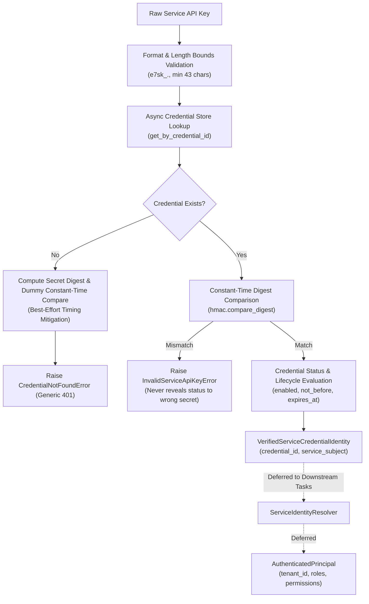

# Phase 1 Service API-Key Verification Foundation

**Document Version**: 1.1.0  
**Phase**: Phase 1 — Foundation  
**Task**: Task 1C.3 & Task 1C.3A — Service API-Key Verification Foundation & Verification-Path Hardening  
**Status**: `COMPLETE`  
**Application Modules**: `app.core.auth.service_api_key`, `app.core.config`  

> [!NOTE]
> This document records technical architecture and implementation details for Task 1C.3 and security hardening Task 1C.3A. This document is **not** an Architecture Decision Record (ADR).

---

## 1. Executive Summary & Purpose

Task 1C.3 and Task 1C.3A establish the **provider-neutral, production-grade service API-key verification foundation** for machine-to-machine (M2M) and automated service authentication.

Mirroring the established Google OIDC verification boundary, this task implements:

```
raw service API key
        ↓
ServiceApiKeyVerifier
        ↓
VerifiedServiceCredentialIdentity
```

It stops cleanly at producing a validated, frozen [`VerifiedServiceCredentialIdentity`](file:///f:/operations-engine/app/core/auth/models.py#L71-L86) record.



### Negative Scope Assertions
- **Does NOT create [`AuthenticatedPrincipal`](file:///f:/operations-engine/app/core/auth/models.py#L95-L162)**.
- **Does NOT derive `tenant_id`**.
- **Does NOT assign roles or permissions**.
- **Does NOT register global HTTP authentication middleware**.
- **Does NOT parse headers in production requests** (HTTP perimeter deferred).
- **Does NOT implement persistence** (SQLAlchemy, PostgreSQL, MySQL, Redis, Valkey, or filesystem stores are deferred to Task 1D).
- **Does NOT modify frozen models** ([`models.py`](file:///f:/operations-engine/app/core/auth/models.py), [`rbac.py`](file:///f:/operations-engine/app/core/auth/rbac.py), [`context.py`](file:///f:/operations-engine/app/core/auth/context.py), [`resolvers.py`](file:///f:/operations-engine/app/core/auth/resolvers.py), [`google_oidc.py`](file:///f:/operations-engine/app/core/auth/google_oidc.py)).

---

## 2. Structured Service Key Wire Format

The verifier establishes a single canonical wire format:

```
e7sk_<credential_id>.<secret>
```

### Format Semantics
| Segment | Syntax / Constraints | Security Semantics |
| :--- | :--- | :--- |
| **Prefix** | Exactly `e7sk_` | Format / version discriminator. Distinguishes E-7 service keys from human tokens or third-party credentials. |
| **`credential_id`** | Bounded ASCII identifier: `^[a-zA-Z0-9_-]{1,64}$` | Non-secret lookup identifier. Used for store lookups. **The `credential_id` alone is not authentication proof**. |
| **Separator** | Exactly one dot `.` | Separates lookup identifier from secret material. Multiple separators are strictly rejected. |
| **`secret`** | Unpadded base64url token: `^[a-zA-Z0-9_-]{43,256}$` | High-entropy secret credential material (minimum 43 characters). Possession of matching secret constitutes authentication proof. |

### Strict Parsing & Bounded Invariants
- Total API key length is strictly capped at 512 characters.
- Minimum secret length is set to **43 characters**, corresponding to the unpadded base64url encoding of 32 bytes (256 bits) of random secret material.
- Syntactically valid but too-short secrets (such as 16, 24, 32, or 42 characters) are strictly rejected with `MalformedServiceApiKeyError`.
- Whitespace, newlines (`\n`, `\r`), tabs (`\t`), null bytes (`\0`), and non-ASCII/control characters are strictly rejected with `MalformedServiceApiKeyError`.
- No business-specific or tenant-identifying prefixes are permitted in the wire format (e.g. `tenant123_e7sk_...` is rejected).

---

## 3. High-Entropy Assumption & SHA-256 Secret Digest

### High-Entropy Assumption & Precise Wording
Production service-key issuance MUST generate at least 32 bytes of cryptographically secure random secret material. The wire-format minimum length (43 characters) is selected to support that requirement when using unpadded base64url encoding.

The accepted format is sized to accommodate at least 32 bytes (256 bits) of cryptographically random secret material. Actual entropy depends on secure generation. String length alone does not mathematically guarantee entropy; production issuance workflows must ensure cryptographically secure random generation (e.g., Python `secrets.token_urlsafe(32)` or hardware CSPRNGs).

### Password-Hashing Explanation & Design Choice
Slow password KDFs are primarily intended to compensate for low-entropy human-chosen passwords. E-7 service keys are required to be machine-generated high-entropy secrets, so a cryptographic digest plus constant-time comparison is the selected design. This design MUST NOT be reused for human passwords.

- For credentials generated with $\ge 256$ bits of cryptographic entropy, brute-force attacks against SHA-256 pre-images are computationally infeasible ($2^{256}$ operations).
- A fast, deterministic hash function (**SHA-256**) provides pre-image resistance and one-way protection without introducing severe CPU denial-of-service bottlenecks on high-throughput machine API endpoints.
- Digest comparison uses constant-time string comparison (`hmac.compare_digest`) to prevent timing side-channel leaks.

> [!CAUTION]
> Deterministic SHA-256 hashing is safe **only** for high-entropy machine credentials. It must **never** be applied to user/human passwords.

### No New Crypto Dependencies
Task 1C.3 and Task 1C.3A require **no new external cryptography libraries**. All operations use Python standard library modules:
- `hashlib.sha256` for deterministic secret digests.
- `hmac.compare_digest` for constant-time comparisons.
- `secrets` in test fixtures / generation utilities.

`passlib`, `bcrypt`, `argon2`, and `PyNaCl` remain strictly prohibited from Phase-1 foundation runtime dependencies.

---

## 4. Stored Credential Record & Store Protocol

### Credential Record Model
[`ServiceApiKeyCredentialRecord`](file:///f:/operations-engine/app/core/auth/service_api_key.py) is an immutable Pydantic model (`frozen=True`, `extra="forbid"`) containing verification state:

| Field | Type | Description |
| :--- | :--- | :--- |
| `credential_id` | `str` | Public lookup identifier (`1..64` chars). |
| `service_subject` | `str` | Canonical service subject identifier (e.g. `svc:scheduler`, `svc:billing`). |
| `secret_digest` | `str` | Deterministic SHA-256 hex digest of the raw secret (64 lowercase hex characters). |
| `enabled` | `bool` | Active status indicator (`True` = active, `False` = disabled/revoked). |
| `not_before` | `datetime \| None` | Optional UTC datetime before which the credential is not yet valid. |
| `expires_at` | `datetime \| None` | Optional UTC datetime at/after which the credential is expired. |
| `issuer` | `str \| None` | Optional administrative issuer or metadata tag. |

**Critical Invariants**:
- `raw_api_key` and `raw_secret` fields are **prohibited** from `ServiceApiKeyCredentialRecord`.
- `tenant_id`, `roles`, and `permissions` are **prohibited** from the credential record; authorization mapping belongs exclusively to downstream resolvers.

### Credential Store Protocol
[`ServiceApiKeyCredentialStore`](file:///f:/operations-engine/app/core/auth/service_api_key.py) defines an asynchronous, provider-neutral protocol:

```python
class ServiceApiKeyCredentialStore(Protocol):
    """Asynchronous, provider-neutral store protocol for service API-key credential records."""

    async def get_by_credential_id(
        self, credential_id: str
    ) -> ServiceApiKeyCredentialRecord | None:
        """Retrieve credential verification record by public credential_id."""
        ...
```

- **Persistence Independence**: The protocol is completely decoupled from PostgreSQL, MySQL, Redis, or any concrete database.
- **No Production In-Memory Key Registry**: No module-level `SERVICE_API_KEYS = {...}` dictionaries or static registries exist in production code. Real persistence arrives in Task 1D.

---

## 5. Verification Flow, Uniform Secret Path & Timing Mitigation

[`ServiceApiKeyVerifier`](file:///f:/operations-engine/app/core/auth/service_api_key.py) executes the verification flow:

1. **Parse & Validate Wire Format**: Parses `credential_id` and `secret`. Enforces 43-character minimum secret length and unpadded base64url characters. Rejects malformed syntax (`MalformedServiceApiKeyError`).
2. **Store Lookup**: Invokes `store.get_by_credential_id(credential_id)`.
3. **Unknown Credential Path (Best-Effort Timing Mitigation)**:
   - If the credential is not found, the verifier computes a SHA-256 digest of the supplied secret and performs a dummy constant-time `hmac.compare_digest` against a precomputed dummy digest (`_DUMMY_SECRET_DIGEST`).
   - This provides a best-effort reduction of obvious timing differences without claiming full network-level timing indistinguishability.
   - Raises `CredentialNotFoundError` internally (which collapses to a generic failure).
4. **Uniform Constant-Time Secret Comparison**:
   - For an existing record, the verifier computes `computed_digest = hashlib.sha256(secret.encode("utf-8")).hexdigest()`.
   - Executes `hmac.compare_digest(record.secret_digest, computed_digest)` **before** evaluating credential status.
   - If the secret does not match, raises `InvalidServiceApiKeyError` immediately.
   - **Status Privacy Guarantee**: An attacker with a wrong secret **never** learns whether a credential is disabled, expired, or active.
5. **Lifecycle & Status Evaluation (Only After Secret Possession Proven)**:
   - Checks `enabled == True`. If disabled, raises `CredentialDisabledError`.
   - If `not_before` is set, ensures `current_time >= not_before`. If not yet valid, raises `CredentialNotYetValidError`.
   - If `expires_at` is set, ensures `current_time < expires_at`. If expired, raises `CredentialExpiredError`.
6. **Return Verified Identity**:
   - Instantiates and returns frozen [`VerifiedServiceCredentialIdentity`](file:///f:/operations-engine/app/core/auth/models.py#L71-L86):
     ```python
     VerifiedServiceCredentialIdentity(
         credential_id=record.credential_id,
         service_subject=record.service_subject,
     )
     ```

---

## 6. Error Taxonomy & Privacy Guarantees

### Error Hierarchy
All service API key exceptions inherit from [`ServiceApiKeyVerificationError`](file:///f:/operations-engine/app/core/auth/service_api_key.py):

```
ServiceApiKeyVerificationError (reason_code)
├── MalformedServiceApiKeyError     (MALFORMED_SERVICE_API_KEY)
├── InvalidServiceApiKeyError       (INVALID_SERVICE_API_KEY)
├── CredentialNotFoundError         (CREDENTIAL_NOT_FOUND)
├── CredentialDisabledError         (CREDENTIAL_DISABLED)
├── CredentialExpiredError          (CREDENTIAL_EXPIRED)
└── CredentialNotYetValidError      (CREDENTIAL_NOT_YET_VALID)
```

### Privacy & Logging Guarantees
- **No Secret Leakage**: Exception messages contain static, sanitized strings. Raw API keys, secret portions, digests, and authorization headers **never** appear in exceptions.
- **Observability vs Public Failures**: Specific reason codes are logged internally via `logger.warning("service_api_key_verification_failed", reason_code=..., provider="service_api_key")`. When exposed to HTTP clients in downstream perimeter tasks, all errors collapse into a generic `401 Unauthorized` challenge.
- **Request Header Privacy**: The existing request completion logging middleware ([`app/core/middleware.py`](file:///f:/operations-engine/app/core/middleware.py)) logs only method, matched route, status code, duration, and correlation ID. It **never** logs request headers.

---

## 7. Technical Configuration & HTTP Carrier Header

Configuration is declared in [`app/core/config.py`](file:///f:/operations-engine/app/core/config.py):

| Setting Field | Env Variable | Default | Constraints & Validation |
| :--- | :--- | :--- | :--- |
| `service_api_key_header_name` | `E7_SERVICE_API_KEY_HEADER_NAME` | `X-E7-Service-Key` | Valid RFC 7230 token syntax (`^[a-zA-Z0-9!#$%&'*+\-.^_|~]+$`), non-empty, 1-64 characters. Rejects control chars and whitespace. |

### Header Contract
- **Non-Secret Configuration**: The setting defines the technical HTTP header name only. No actual service key is stored in `Settings` or `.env.example`.
- **Deferred Middleware Composition**: Task 1C.3/1C.3A defines the header carrier contract. Reading and verifying headers in production middleware, as well as resolving precedence between `Authorization: Bearer` and `X-E7-Service-Key`, is explicitly deferred to downstream HTTP perimeter tasks.

---

## 8. Tenant & RBAC Separation Invariant

Service API-key verification establishes **identity proof only**:

```
VerifiedServiceCredentialIdentity
├── credential_id: "svc_billing_01"
└── service_subject: "svc:billing"
```

The verifier does **not**:
- Derive `tenant_id` from `credential_id`, key prefixes, or `service_subject`.
- Assign `roles` or `permissions`.
- Set or inspect `TenantContext`.

Resolution of `VerifiedServiceCredentialIdentity` into an [`AuthenticatedPrincipal`](file:///f:/operations-engine/app/core/auth/models.py#L95-L162) with organization boundaries, active tenant, and RBAC grants is performed exclusively by downstream resolver workflows ([`ServiceIdentityResolver`](file:///f:/operations-engine/app/core/auth/resolvers.py#L31-L40)).

---

## 9. Test Strategy & Inventory

The unit test suite at [`tests/unit/test_service_api_key.py`](file:///f:/operations-engine/tests/unit/test_service_api_key.py) provides 45 tests verifying all functional requirements and security invariants:

1. **Wire Format & Secret Length Bounds (Task 1C.3A Hardened)**:
   - Canonical format verification (`e7sk_<credential_id>.<secret>`).
   - Rejection of secrets of 16, 24, 32, and 42 characters.
   - Acceptance of secrets of 43 characters (exact 256-bit unpadded base64url minimum), 64 characters, and 256 characters (maximum bound).
   - Rejection of secrets exceeding 256 characters.
   - Strict rejection of missing prefix, missing ID, missing secret, extra separators, whitespace, newlines, tabs, control characters, null bytes, base64 padding (`=`), non-base64url characters (`~`), and oversized keys (>512).
2. **Secret Digest Determinism**:
   - SHA-256 digest computation determinism and uniqueness across different secrets.
3. **Verification Flow**:
   - Successful verification returning [`VerifiedServiceCredentialIdentity`](file:///f:/operations-engine/app/core/auth/models.py#L71-L86).
   - Wrong secret rejection.
   - Unknown `credential_id` rejection with dummy timing mitigation.
   - Constant-time comparison invocation (`hmac.compare_digest`).
4. **Verification Path & Status Privacy (Task 1C.3A Hardened)**:
   - Known credential + wrong secret + disabled record $\rightarrow$ `InvalidServiceApiKeyError` (does not leak disabled state).
   - Known credential + correct secret + disabled record $\rightarrow$ `CredentialDisabledError`.
   - Known credential + wrong secret + expired record $\rightarrow$ `InvalidServiceApiKeyError` (does not leak expired state).
   - Known credential + correct secret + expired record $\rightarrow$ `CredentialExpiredError`.
   - Known credential + wrong secret + not yet valid record $\rightarrow$ `InvalidServiceApiKeyError` (does not leak future state).
   - Known credential + correct secret + not yet valid record $\rightarrow$ `CredentialNotYetValidError`.
   - Active unexpired time-window acceptance.
5. **Privacy & Immutability**:
   - Rejection of raw secret field injection in `ServiceApiKeyCredentialRecord`.
   - Exception messages verified to contain zero secrets, keys, or digests.
6. **Technical Configuration**:
   - Default header name verification (`X-E7-Service-Key`).
   - Custom valid header name support.
   - Rejection of invalid header names (spaces, semicolons, empty strings).
7. **External Isolation**:
   - Verifier instantiation and module imports perform zero external network, database, or I/O calls.

---

## 10. Summary of Changes

| File Path | Action | Description |
| :--- | :---: | :--- |
| [`app/core/auth/service_api_key.py`](file:///f:/operations-engine/app/core/auth/service_api_key.py) | **Created / Hardened** | Wire format parser with 43-character minimum unpadded base64url secret bounds, SHA-256 digest helper, `ServiceApiKeyCredentialRecord`, `ServiceApiKeyCredentialStore` protocol, `ServiceApiKeyVerifier` with uniform secret-comparison path prior to status checks, dummy timing mitigation, and safe error taxonomy. |
| [`tests/unit/test_service_api_key.py`](file:///f:/operations-engine/tests/unit/test_service_api_key.py) | **Created / Hardened** | Comprehensive unit test suite (45 tests) covering length bounds (42 rejected, 43 accepted, 64 accepted), status privacy with wrong secrets, timing mitigation, lifecycle, and privacy. |
| [`docs/phase-1/PHASE_1_SERVICE_API_KEY_VERIFICATION.md`](file:///f:/operations-engine/docs/phase-1/PHASE_1_SERVICE_API_KEY_VERIFICATION.md) | **Created / Hardened** | Technical architecture, cryptographic invariants, entropy requirements, uniform secret comparison, and security documentation for Task 1C.3 and Task 1C.3A. |
| [`app/core/config.py`](file:///f:/operations-engine/app/core/config.py) | **Modified (1C.3)** | Added `service_api_key_header_name` configuration field and RFC token syntax validator. |
| [`app/core/auth/__init__.py`](file:///f:/operations-engine/app/core/auth/__init__.py) | **Modified (1C.3)** | Exported new service API-key records, protocols, verifier, helpers, and exceptions in `__all__`. |
| [`.env.example`](file:///f:/operations-engine/.env.example) | **Modified (1C.3)** | Added `E7_SERVICE_API_KEY_HEADER_NAME=X-E7-Service-Key` template comment; zero secret values. |
| [`docs/phase-1/PHASE_1_FOUNDATION_BASELINE.md`](file:///f:/operations-engine/docs/phase-1/PHASE_1_FOUNDATION_BASELINE.md) | **Modified (1C.3)** | Updated foundation baseline notes for Task 1C.3 dependency neutrality. |

---

## 11. Deferred Work

The following items are intentionally deferred:
- **HTTP Authentication Perimeter**: Global authentication middleware and header parsing (`Authorization: Bearer` and `X-E7-Service-Key`) are deferred to the HTTP authentication perimeter task.
- **Identity Resolution**: Resolving `VerifiedServiceCredentialIdentity` to `AuthenticatedPrincipal` via `ServiceIdentityResolver`.
- **Database Persistence**: Concrete database storage of credential records (PostgreSQL / Alembic) is deferred to Task 1D.
- **Credential Issuance / Rotation**: Administrative key generation, rotation, and lifecycle APIs.
