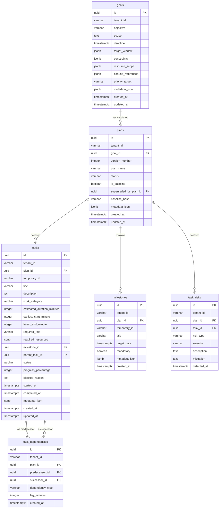

# Phase 2 Planning Persistence Architecture

**Status**: FROZEN (Phase 2A Baseline)  
**Migration Head**: `0008_create_planning_domain`  
**ORM Models**: `app.db.models.planning`  
**Repositories**: `app.db.repositories.planning`

---

## 1. Relational Schema & Table Definitions

The Task Intelligence domain adds 6 PostgreSQL tables under migration `0008`:

---

## 2. Integrity Constraints & Foreign Keys

### 2.1 Native Plan Versioning
- `uq_plans_tenant_goal_version`: `UNIQUE (tenant_id, goal_id, version_number)`
- Plan versions are 1-based, monotonic integers (`version_number >= 1`).
- Every plan belongs to a parent `goals.id` via `ON DELETE CASCADE`.

### 2.2 Intra-Plan Uniqueness
- `uq_milestones_tenant_plan_temp_id`: `UNIQUE (tenant_id, plan_id, temporary_id)`.
- `uq_tasks_tenant_plan_temp_id`: `UNIQUE (tenant_id, plan_id, temporary_id)`.
- `uq_task_dependencies_pred_succ`: `UNIQUE (tenant_id, plan_id, predecessor_id, successor_id)`.

### 2.3 Foreign Key Cascades
- Deleting a `plan` cascades to its `tasks`, `dependencies`, `milestones`, and `risks`.
- `task_dependencies.predecessor_id` and `successor_id` reference `tasks.id` with `ON DELETE CASCADE`.
- Repository aggregate persistence flushes `tasks` before inserting `task_dependencies` to satisfy foreign keys.

---

## 3. Transactional Atomicity with Audit & Outbox

All planning mutations execute inside an atomic `SqlAlchemyUnitOfWork` scope. A mutation guarantees that:
1. **Domain Row State** (`goals`, `plans`, `tasks`, etc.)
2. **Append-Only Audit Trail** (`audit_events`)
3. **Transactional Outbox Event** (`outbox_events`)

are committed in the same database transaction.

### 3.1 Event Contracts & Data Minimization
Outbox events conform to strict data minimization principles:

| Event Type | Subject Type | Payload Contents |
| :--- | :--- | :--- |
| `plan.generated` | `plan` | `goal_id`, `plan_id`, `version_number`, `task_count`, `dependency_count` |
| `plan.approved` | `plan` | `plan_id`, `goal_id`, `version_number`, `baseline_hash`, `approver_id` |

Full task descriptions, PII, and context are never emitted in outbox event payloads.

### 3.2 Rollback Invariant
If any step in the pipeline fails (e.g. invalid state transition, constraint violation, or outbox serialization error), `SqlAlchemyUnitOfWork` rolls back the transaction. Zero partial plans, audit logs, or outbox records persist.
