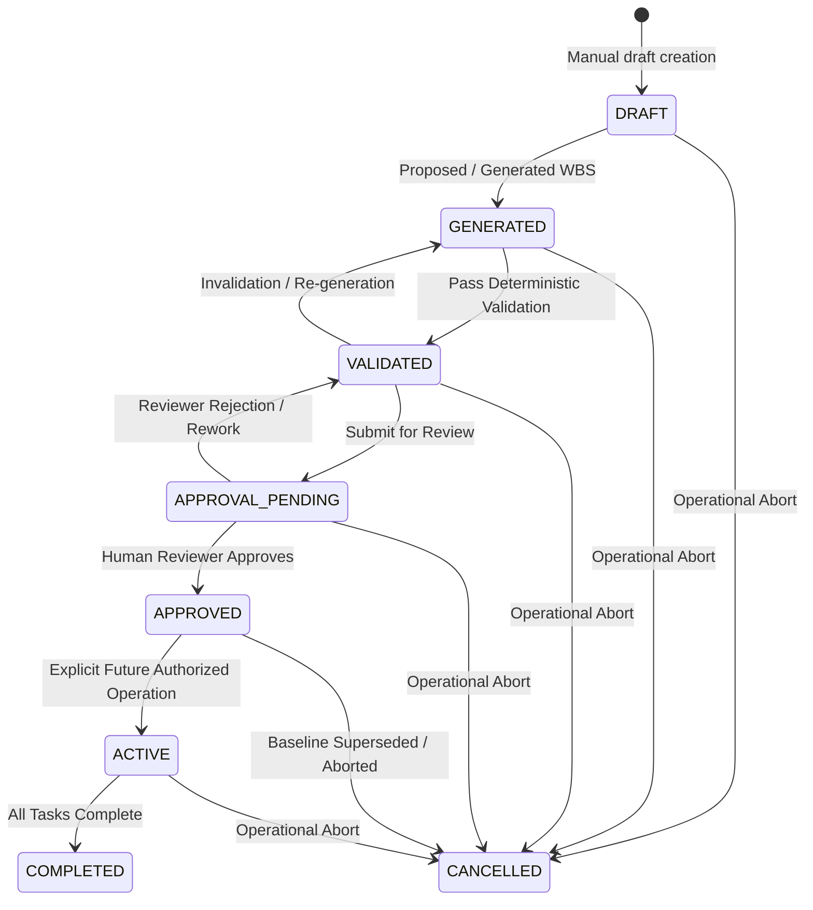

# Phase 2 Task Intelligence Domain Specification

**Status**: FROZEN (Phase 2A Baseline)  
**Scope**: Deterministic Task Intelligence Core & Domain Contracts  
**Phase Demarcation**: Non-authoritative model output -> deterministic validation pipeline -> human approval gate

---

## 1. Executive Overview

Phase 2 introduces the **Task Intelligence Core** to the operations engine. The core operational loop transitions:
```
Goal Formulation (Tenant-Scoped)
    -> Typed Proposal / Generation (PlannerProtocol)
    -> Deterministic Validation Pipeline (PlanValidator)
    -> Directed Acyclic Graph Analysis (TaskDependencyGraph & CriticalPathCalculator)
    -> Human Review & Approval (PlanService)
    -> Frozen Authoritative Baseline
```

All model outputs are strictly **non-authoritative suggestions**. No plan can transition to executable execution without passing deterministic graph validation, policy constraint checks, and explicit authorized human approval.

---

## 2. Core Domain Entities & Schemas

### 2.1 Goal (`GoalCreate`, `GoalResponse`)
- **Location**: `app.task_intelligence.schemas.goal`
- Represents the high-level objective and operational boundary.
- **Attributes**:
  - `objective`: Mandatory, non-empty, max 1000 characters.
  - `scope`: Optional text boundary describing inclusions and exclusions.
  - `deadline`: Optional timezone-aware UTC datetime.
  - `target_window`: Optional temporal window (`start_date`, `end_date`).
  - `constraints`: List of tenant-defined operational constraints.
  - `resource_scope`: Allowlist of accessible teams, facilities, or venues.
  - `context_references`: External system IDs (e.g. ERP curriculum ID, exam cycle ID).
  - `priority_target`: Priority label (e.g. `HIGH`, `CRITICAL`).
  - `metadata`: JSON-serializable dictionary.

### 2.2 Work Breakdown Structure (WBS) & Tasks (`TaskDraft`, `PlanSchema`)
- **Location**: `app.task_intelligence.schemas.plan`
- **Work Categories** (`WorkCategory` enum):
  - `PLANNING`
  - `QUESTION_PAPER_READINESS`
  - `ROOM_PREPARATION`
  - `INVIGILATION_ROSTER`
  - `PRINT_LOGISTICS`
  - `EXAM_CONDUCT`
  - `PACKING_HANDOVER`
  - `SECURITY_ESCORT`
  - `COMMUNICATION`
  - `APPROVALS`
  - `CLOSURE`
- **TaskDraft**:
  - `temporary_id`: Deterministic planning ID (e.g. `T1_PLANNING`, `T2_QP_DRAFT`), alphanumeric + underscores/hyphens.
  - `title`: Short task name (max 255 chars).
  - `description`: Detailed operational instructions.
  - `work_category`: Optional `WorkCategory` enum.
  - `estimated_duration_minutes`: Integer duration $\ge 1$.
  - `earliest_start_minute` / `latest_end_minute`: Optional temporal bounding windows.
  - `required_role`: Role required for execution (e.g. `EXAM_OFFICER`, `INVIGILATOR`).
  - `required_resources`: List of resource constraints (e.g. `PRINTING_ROOM_A`).
  - `milestone_id`: Optional reference to a milestone temporary ID.
  - `parent_task_id`: Optional parent task temporary ID for hierarchical WBS.

### 2.3 Dependencies (`DependencyDraft`, `DependencyType`)
- **DependencyType**:
  - `FINISH_TO_START` (default and primary CPM relationship).
  - `START_TO_START`
  - `FINISH_TO_FINISH`
  - `START_TO_FINISH`
- **DependencyDraft**:
  - `predecessor_id`: Temporary ID of the predecessor task.
  - `successor_id`: Temporary ID of the successor task.
  - `dependency_type`: Relationship type.
  - `lag_minutes`: Non-negative lead/lag buffer time ($\ge 0$).

### 2.4 Milestones (`MilestoneDraft`)
- **MilestoneDraft**:
  - `temporary_id`: Milestone identifier (e.g. `M1_QP_SEALED`).
  - `title`: Milestone milestone description.
  - `target_date`: Optional target milestone timestamp.
  - `mandatory`: Boolean indicator whether milestone is a strict gating condition.

---

## 3. Plan Lifecycle State Machine

Plans strictly adhere to a deterministic state machine managed by `PlanService` and validated via `assert_valid_plan_transition`:



### 3.1 Allowed Transitions
| From State | Allowed Target States | Lifecycle Enforcement Notes |
| :--- | :--- | :--- |
| `DRAFT` | `GENERATED`, `CANCELLED` | `DRAFT -> VALIDATED` is strictly prohibited. Plans must become `GENERATED` first. |
| `GENERATED` | `VALIDATED`, `GENERATED`, `CANCELLED` | Deterministic validation advances `GENERATED` to `VALIDATED`. |
| `VALIDATED` | `APPROVAL_PENDING`, `GENERATED`, `CANCELLED` | Submission for human review advances plan to `APPROVAL_PENDING`. |
| `APPROVAL_PENDING` | `APPROVED`, `VALIDATED`, `CANCELLED` | Human approval freezes baseline as `APPROVED`. Rejection returns to `VALIDATED`. |
| `APPROVED` | `ACTIVE`, `CANCELLED` | Approval ends at `APPROVED`. Auto-activation is prohibited in Phase 2A. |
| `ACTIVE` | `COMPLETED`, `CANCELLED` | Execution runtime management (deferred to later phases). |
| `COMPLETED` | *(Terminal)* | |
| `CANCELLED` | *(Terminal)* | |

Any invalid transition attempt raises `InvalidPlanStateTransitionError`.

---

## 4. Deterministic Validation Pipeline (`PlanValidator`)

The validator pipeline executes all rules deterministically and collects all failures before returning:

1. **WBS Completeness**:
   - At least 1 task must be present (`WBS_EMPTY`).
   - Unique temporary IDs across all tasks (`DUPLICATE_TASK_ID`).
   - Non-empty, non-whitespace titles (`EMPTY_TITLE`).
   - Strictly positive estimated duration ($\ge 1$) (`NEGATIVE_DURATION`).
2. **Hierarchy Integrity**:
   - Parent references must exist within the plan (`UNKNOWN_PARENT_TASK`).
   - Parent task cannot reference itself (`PARENT_CYCLE_DETECTED`).
   - Hierarchy tree cannot contain loops (`PARENT_CYCLE_DETECTED`).
3. **Dependency Integrity**:
   - Predecessor and successor must exist (`UNKNOWN_PREDECESSOR`, `UNKNOWN_SUCCESSOR`).
   - Self-dependencies are forbidden (`SELF_DEPENDENCY`).
   - Duplicate edges are rejected (`DUPLICATE_DEPENDENCY`).
   - Negative lag is rejected (`NEGATIVE_LAG`).
4. **Graph Topology & Acyclicity**:
   - NetworkX `SimpleCycle` detection enforces zero cycles.
   - On cycle, returns `CYCLE_DETECTED` with explicit cycle path list (`["T1", "T2", "T3", "T1"]`).
5. **Milestone Integrity**:
   - Unique milestone IDs (`DUPLICATE_MILESTONE_ID`).
   - Tasks referencing milestones must reference declared milestones (`UNKNOWN_MILESTONE`).
6. **Extensible Policy Hooks**:
   - Injected policy rules (e.g. maximum shift duration, required lead buffers) run synchronously without network I/O.

### Validation Codes (`ValidationIssueCode`)
- `WBS_EMPTY`
- `DUPLICATE_TASK_ID`
- `EMPTY_TITLE`
- `NEGATIVE_DURATION`
- `UNKNOWN_PREDECESSOR`
- `UNKNOWN_SUCCESSOR`
- `SELF_DEPENDENCY`
- `DUPLICATE_DEPENDENCY`
- `CYCLE_DETECTED`
- `UNKNOWN_PARENT_TASK`
- `PARENT_CYCLE_DETECTED`
- `UNKNOWN_MILESTONE`
- `DUPLICATE_MILESTONE_ID`
- `NEGATIVE_LAG`
- `POLICY_VIOLATION`
- `INVALID_WINDOW`

---

## 5. Priority & Risk Intelligence

### 5.1 Deterministic Priority Engine (`PriorityEngine`)
- Multi-criteria policy-driven scoring using explicit caller-supplied weights (`PriorityWeights` / `PriorityPolicy`):
  - Zero hardcoded production default weights exist. Weights are a required input.
  - Required weights cover source factor concepts: `urgency`, `impact`, `dependency_criticality`, and `policy_contribution`.
  - Normalization contract: all weights must be finite, non-negative, non-zero sum, and sum to 1.0 ($1.0 \pm 10^{-4}$).
- **Human Priority Override**:
  - Implemented as an explicit control/bypass path, NOT an arbitrary weighted feature.
  - When provided, directly maps to `TaskPriority` while preserving computed score for auditing.
- Produces normalized composite score $[0.0, 1.0]$ and canonical priority rank: `LOW`, `MEDIUM`, `HIGH`, `CRITICAL`.

### 5.2 Deterministic Risk Detector (`DeterministicRiskDetector`)
- Analyzes plan topology and task attributes to identify operational failure modes:
  - `CRITICAL_PATH_SLIPPAGE`: High-duration tasks on the critical path with near-zero slack.
  - `DEPENDENCY_DELAY`: Bottleneck tasks with high in-degree or out-degree.
  - `UNSUPPORTED_CAPACITY`: Consecutive tasks exceeding single-operator work shift limits.

### 5.3 Progress Tracking State Machine (`TaskProgressStatus`)
- Tasks transition through: `TODO` -> `IN_PROGRESS` -> `COMPLETED`.
- Any task may enter `BLOCKED` with an explicit non-empty `blocked_reason`.
- Transitioning to `COMPLETED` requires `progress_percentage = 100`.
