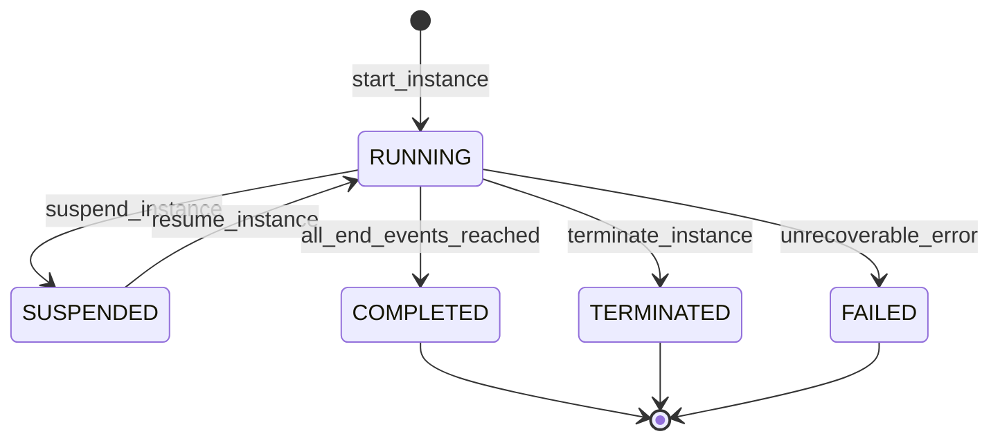
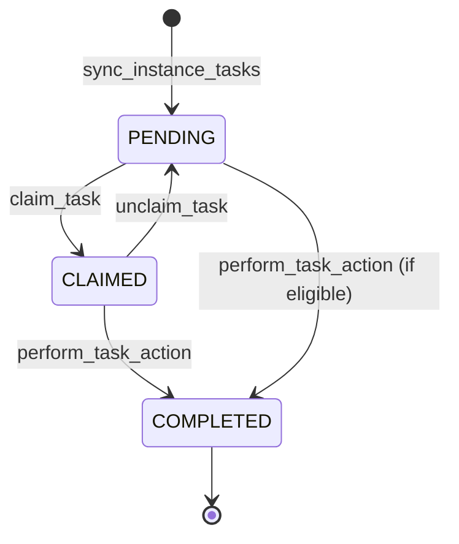

# Phase 3 Workflow Runtime Architecture & Core Engine

## 1. Architectural Authority Boundary

The workflow subsystem in E-7 maintains a strict architectural authority boundary:

- **Flowable Engine Domain (`flowable_db` / `ACT_*` tables)**:
  - Owns execution mechanics: BPMN token movement, activity instances, execution graphs, timers, sequence flow evaluations, and raw engine state.
  - State is managed internally by Flowable's native Liquibase migrations inside PostgreSQL database `flowable_db`.
  - Flowable engine IDs (`processDefinitionId`, `processInstanceId`, `taskId`, `deploymentId`) are strictly secondary external references.

- **Operations Engine Domain (`operations_engine` / Canonical Tables)**:
  - Owns business truth, tenant isolation, access boundaries, human actor eligibility, transactional audit logs, and transactional outbox events.
  - State is persisted in canonical tables managed strictly by Alembic revision `0009` (revising `0008`):
    - `workflow_definitions`: Versioned BPMN 2.0 definitions, SHA-256 artifact integrity fingerprints, and tenant associations.
    - `workflow_instances`: Business references, lifecycle state machine (`RUNNING`, `SUSPENDED`, `COMPLETED`, `TERMINATED`, `FAILED`), and correlation IDs.
    - `workflow_task_mappings`: Human task allocations, assignees, candidate role groups, completion audit references, and sanitized input variables.
  - Zero `ACT_*` tables or Liquibase runtime schemas are managed by Alembic.

## 2. Canonical State Machine

### Task Mapping State Lifecycle

## 3. Actor Eligibility Boundary

Task authorization is evaluated strictly BEFORE invoking Flowable:

1. **Assignee Match**: If `task.assignee` is set, `principal.principal_id == task.assignee`.
2. **Candidate Role Match**: If `task.candidate_roles` is non-empty, `principal.roles & set(task.candidate_roles)` must not be empty.
3. **Tenant Scoping**: `principal.tenant_id == task.tenant_id` is non-negotiable. Cross-tenant access is rejected unconditionally.
4. **Action Specificity**: `COMPLETE` or `APPROVE` requires assignee or candidate role. Privileged overrides require injected policies.
5. **Fail-Closed Boundary**: An unassigned task with no candidate roles fails closed (denies all access).
6. **Pre-Engine Evaluation**: If the principal is unauthorized, `WorkflowTaskUnauthorizedError` is raised immediately, an audit log with outcome `DENIED` is written, and Flowable REST is NEVER called.

## 4. Idempotency Execution Model

Human task actions utilize the canonical Phase-1 idempotency contracts (`IdempotencyRepository`, `IdempotencyIdentity`, `RequestFingerprint`):

- **Key Scoping**: `(tenant_id, "workflow.task.action", sha256(raw_key))`.
- **Request Fingerprint**: Deterministic SHA-256 digest of `{action, variables, workflow_task_id}`.
- **Replay Behavior**: If an `EXISTING_MATCH` is observed, the previously committed `WorkflowTaskResponse` is returned without calling Flowable, writing audit records, or publishing outbox events.
- **Conflict Behavior**: If an `EXISTING_CONFLICT` is observed (same key, modified action or variables), an `IdempotencyConflictError` is raised immediately.
- **Replay Authorization Safety**: Unauthorized principals attempting to replay an action with a valid key are rejected at the actor eligibility boundary BEFORE idempotency inspection or replay disclosure.
- **Privacy Minimization**: Raw idempotency keys are never written to disk, databases, or logs; only `key_digest` is retained.

## 5. Audit & Outbox Integration

All workflow lifecycle mutations write transactional audit events:
- `workflow.definition.registered`
- `workflow.definition.deployed`
- `workflow.instance.started`
- `workflow.instance.completed`
- `workflow.task.completed`
- `workflow.task.unauthorized` (outcome: `DENIED`)

Task creation events (`workflow.task.created`) are written atomically to `outbox_events` within the canonical unit of work.
