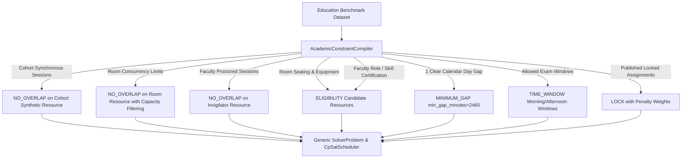

# Phase 5 OR-Tools Academic Profile Specification

## 1. Overview & Architectural Philosophy
The OR-Tools Academic Profile implements domain-specific educational scheduling logic on top of the frozen, generic Phase-4 CP-SAT scheduling engine (`CpSatScheduler`) via a clean compiler abstraction (`AcademicConstraintCompiler`).

Rather than altering the generic solver or database schema, educational concepts (cohorts, examination halls, invigilator skills, major exam recovery intervals) are faithfully compiled into generic constraint primitives:
1. `ConstraintType.NO_OVERLAP`
2. `ConstraintType.MINIMUM_GAP`
3. `ConstraintType.TIME_WINDOW`
4. `ConstraintType.ELIGIBILITY`
5. `ConstraintType.LOCK`

This preserves total architectural cohesion: the generic scheduling engine remains untouched, while educational scheduling operates as a first-class profile.

---

## 2. Compilation Mappings

### 2.1 Cohort No-Overlap
Each student cohort (e.g. `cohort-g10-a`) is represented as an exclusive discrete resource. All examination sessions attended by the cohort declare a demand of 1 for this cohort resource, compiling into a `NO_OVERLAP` constraint that strictly prevents a cohort from being scheduled for two exams concurrently.

### 2.2 Room Capacity & Concurrency
- **Concurrency Invariant**: An examination hall or laboratory cannot host multiple classes simultaneously. Hence, each room resource has `capacity = 1` in the CP-SAT interval model.
- **Seating Capacity Invariant**: Student count vs. room seating capacity (e.g. 24 students vs. 32 seats) is enforced prior to solver instantiation via **Candidate Room Eligibility Filtering**:
  $$\text{Eligible Rooms}(s) = \{ r \in \text{Rooms} \mid \text{capacity}(r) \ge \text{students}(s) \land \text{features}(r) \supseteq \text{required\_features}(s) \}$$
  This is compiled into a generic `ConstraintType.ELIGIBILITY` definition, ensuring only physically adequate rooms are considered.

### 2.3 Invigilator Qualification & Assignment
Each session requires proctoring by qualified faculty. The compiler generates an invigilator `ELIGIBILITY` constraint:
$$\text{Eligible Invigilators}(s) = \{ i \in \text{Invigilators} \mid \text{skills}(i) \cap \text{required\_skills}(s) \neq \emptyset \}$$
Concurrent assignments for the same faculty member are prevented by a `NO_OVERLAP` constraint on each invigilator resource.

### 2.4 Major Subject Clear Calendar Day Gap
Educational best practice mandates that students have at least one full calendar day of rest/revision between major subject examinations (e.g., Mathematics, Science, Social Studies).

In a daily operating window of 09:00 to 16:00:
- If Exam 1 finishes at Day 1, 11:00 (or 16:00), Day 2 must remain completely exam-free.
- Exam 2 can only start on Day 3, 09:00 at earliest.
- Duration from Day 1 16:00 to Day 3 09:00 = 17 hours (Day 1 evening to Day 2 morning) + 24 hours (Day 2) = 41 hours = **2460 minutes**.

The compiler injects a pair-wise `MINIMUM_GAP` constraint with `min_gap_minutes = 2460` between all major subject sessions of the same cohort:
$$\text{start}(s_2) - \text{end}(s_1) \ge 2460 \quad \forall s_1, s_2 \in \text{MajorSessions}(\text{cohort})$$
This strictly forbids scheduling major exams on adjacent calendar days while allowing Day 1 -> Day 3 -> Day 5 schedules.

### 2.5 Lock Preservation & Repair Semantics
In repair scenarios (`SC-EXAM-REPAIR-001`), published assignments are injected as `ConstraintType.LOCK` with fixed start times and resource bindings. The solver objective applies heavy displacement penalties ($\text{weight} = 1000$) to disincentivize unnecessary churn, guaranteeing that only directly disrupted sessions are reallocated.

---

## 3. Explainability & Infeasibility Diagnostics
When an academic schedule is mathematically impossible (e.g. `SC-EXAM-INFEASIBLE-001` attempting to fit 3 major exams into a 3-day window under 1-clear-day gap rules), the OR-Tools CP-SAT solver utilizes **Assumption Literals**:
1. Every constraint is associated with an active Boolean assumption variable.
2. If the solver detects `INFEASIBLE`, it extracts the sufficient assumption conflict subset via `solver.SufficientAssumptionsForInfeasibility()`.
3. The compiler decodes the assumption literals directly into human-readable E-7 diagnostic codes (`RESOURCE_OVERLAP_CONFLICT`, `TIME_WINDOW_VIOLATION`, `INSUFFICIENT_CALENDAR_SPAN`).
4. Result: Deterministic, automated operator feedback explaining the exact conflicting exams and resources in sub-100ms.
