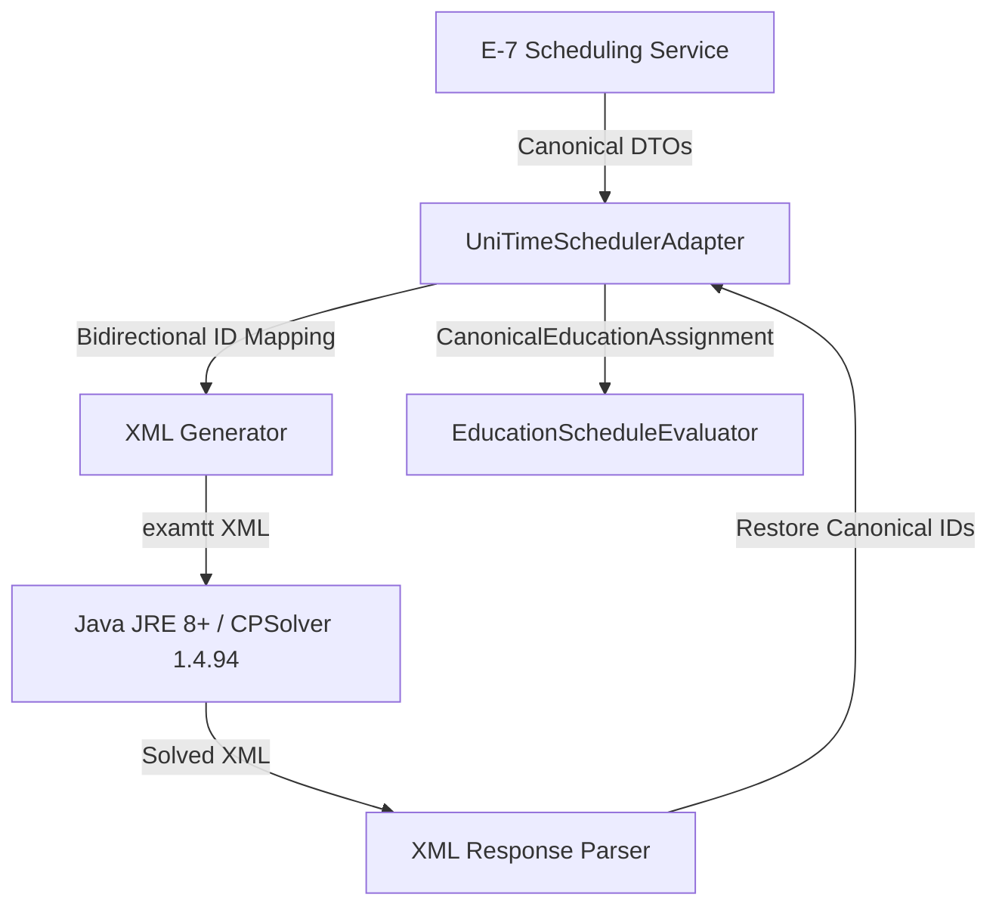

# Phase 5 UniTime PoC & Adapter Architecture

## 1. Overview & License Compliance Audit
UniTime is a comprehensive, open-source educational scheduling system originating from Purdue University and the Apereo Foundation. For the Phase 5 proof-of-concept, we evaluated UniTime's standalone solver engine (`CPSolver`, version 1.4.94, release `v4.9.152`).

### 1.1 License Audit
* **License**: Apache License, Version 2.0 (Permissive, commercial-friendly).
* **Provenance**: Upstream source repository `https://github.com/UniTime/cpsolver` and Apereo UniTime project `https://www.unitime.org`.
* **Repository Compliance Register**: Recorded in `docs/OPEN_SOURCE_COMPLIANCE_REGISTER.md`:
  - Table 3: Technology Evaluation Candidates (row 65: UniTime / CPSolver, Apache-2.0).
  - Table 12: Embedded & Referenced Third-Party Notices (rows 292-293).
* **License File**: Located at `third_party/licenses/LICENSE.unitime.txt`.
* **Legal Assessment**: UniTime is fully compliant with IR Infotech commercial distribution policies. It does not introduce viral copyleft risks.

---

## 2. Architecture & Runtime Topology

### 2.1 E-7 Canonical Authority Boundary
In accordance with E-7 architectural principles, the external solver operates strictly behind a decoupled adapter boundary:
- **Canonical Authority**: E-7 PostgreSQL retains authoritative ownership of all entities (`schedule_id`, `session_id`, `cohort_id`, `room_id`, `invigilator_id`), lifecycle states, publications, and audit logs.
- **External ID Isolation**: UniTime integer identifiers (e.g. `exam id="101"`, `room id="201"`) are strictly internal to the adapter invocation and never leak into the E-7 database or REST API surfaces.
- **Stateless Subprocess Model**: The adapter executes CPSolver via a headless Java CLI process consuming standard examination timetabling XML (`examtt`) and emitting solved XML without requiring a persistent Tomcat or MySQL instance.



### 2.2 UniTime CPSolver Timetabling XML (`examtt`)
The adapter serializes canonical E-7 problem instances into standard UniTime XML:
- `<exam id="1001" name="sess-10a-math" length="120" seatingType="exam">`: Represents an examination session.
- `<period id="2001" length="120" day="0" time="108">`: Discrete periods mapped to E-7 operating windows (09:00 and 14:00 daily).
- `<room id="3001" name="res-room-001" size="32" altSize="32"/>`: Physical examination room.
- `<instructor id="4001" name="res-inv-001"><exam id="1001"/></instructor>`: Explicit assignment of invigilator to exam session to enforce instructor no-overlap.
- `<students><student id="5001"><exam id="1001"/><exam id="1003"/></student></students>`: Synthetic student enrollments representing cohorts to enforce cohort conflict-free scheduling.

---

## 3. Implementation Details (`app/scheduling/education/adapters/unitime.py`)

### 3.1 Jar Dependencies & Management
The adapter requires four core jars managed within the local cache (`.cache/unitime/`):
1. `cpsolver-1.4.94.jar`: Core constraint solver engine.
2. `dom4j-2.1.4.jar`: XML parser utilized by CPSolver.
3. `log4j-api-2.24.1.jar`: Logging interface.
4. `log4j-core-2.24.1.jar`: Logging runtime.

### 3.2 Bidirectional Mapping Integrity
To prevent memory leaks and ID collisions, the adapter constructs an ephemeral bidirectional dictionary for each solve invocation:
```python
exam_to_canonical: dict[str, str] = {}
canonical_to_exam: dict[str, str] = {}
room_to_canonical: dict[str, str] = {}
invigilator_to_canonical: dict[str, str] = {}
period_to_timeslot: dict[str, tuple[datetime, datetime]] = {}
```
Upon completion of the solver execution, all generated assignments are translated back to canonical UUIDs and validated by the `EducationScheduleEvaluator`.

---

## 4. Operational Assessment & Trade-offs

### 4.1 Strengths
* Mature, battle-tested algorithms specifically designed for large-scale university timetabling.
* Native support for complex student sectioning and multi-course preferences.
* Rich XML configuration for exam periods, rooms, and instructor preferences.

### 4.2 Limitations & Disadvantages in E-7 Topology
* **Java Runtime Requirement**: Requires JRE 8+ in execution environment, adding ~250MB+ container base image overhead.
* **Cold-Start JVM Latency**: Subprocess invocation incurs 1.2 to 1.6 seconds of JVM boot and classloading overhead per trial, compared to 0.29s for in-process OR-Tools.
* **Secondary Translation Complexity**: Requires maintaining complex XML serialization and bidirectional ID translation layers.
* **Coarse Diagnostics**: Infeasible scenarios report high-level constraint penalty metrics rather than precise AST conflict subsets.
