# Phase 6: Cross-Service Audit Evidence & Correlation Trail

## 1. Single Root Correlation Architecture
A core requirement of the E-7 architecture is that an entire operational scenario—spanning planning, workflow automation, solver execution, integrations, and disruption repairs—must share a single root `correlation_id`.

```mermaid
flowchart TD
    Root["Root correlation_id: corr-semester-exam-XXXXXXXX"]
    Root --> E1["1. goal.created (GoalService)"]
    Root --> E2["2. plan.generated (SemesterExamPlanner)"]
    Root --> E3["3. plan.validated (PlanValidator & CPM)"]
    Root --> E4["4. plan.approved (PlanApprovalService)"]
    Root --> E5["5. workflow.instance_started (FlowableAdapter)"]
    Root --> E6["6. workflow.task.created (Science Dept Review)"]
    Root --> E7["7. workflow.task.created (Humanities Dept Review)"]
    Root --> E8["8. workflow.dmn_evaluated (DMN Readiness Rule)"]
    Root --> E9["9. workflow.sla_tracked (SlaService 24h Timer)"]
    Root --> E10["10. task.completed (T4_RESOURCE_READINESS)"]
    Root --> E11["11. schedule.demand_created (AcademicConstraintCompiler)"]
    Root --> E12["12. schedule.generated (OR-Tools Candidate v1)"]
    Root --> E13["13. schedule.published (Published v1)"]
    Root --> E14["14. calendar.synced (FakeCalendarAdapter 10 events)"]
    Root --> E15["15. notification.dispatched (E-8 NotificationCommand)"]
    Root --> E16["16. resource.unavailable (INV-001 proctor disruption)"]
    Root --> E17["17. schedule.generated (Repaired Candidate v2)"]
    Root --> E18["18. schedule.superseded (Schedule v1 marked superseded)"]
    Root --> E19["19. schedule.published (Repaired Schedule v2)"]
    Root --> E20["20. schedule.changed (Delta notification & calendar resync)"]
```



---

## 2. Child Entity Identity Discovery
All subsystem-specific entities are discoverable through the root correlation trail:
- `goal_id`: `goal-XXXXXXXX`
- `plan_id`: `plan-grade10-001`
- `workflow_instance_id`: `flowable-proc-grade10-99`
- `workflow_task_id`: `task-science-dept`, `task-humanities-dept`
- `schedule_job_id`: `sched-job-XXXXXXXX`
- `schedule_id` (v1): UUID v1
- `schedule_id` (v2): UUID v2
- `notification_command_id`: UUID
- `calendar_sync_id`: `cal-session-XXXXXXXX`

---

## 3. Privacy & Governance Guarantees
Details stored in `audit_events` strictly adhere to the enterprise security rules:
- **Zero Full Prompts**: Prompt templates and LLM completions are never written to audit details.
- **Zero Authentication Secrets**: Passwords, API keys, JWT bearer tokens, and session credentials are scrubbed.
- **Zero Student PII**: Student names, addresses, and grades are excluded. Cohort IDs and session IDs are used exclusively.
- **Zero Raw Payloads**: Full external provider webhook bodies are truncated or omitted.

---

## 4. Query Verification Contract (`GET /api/v1/audit`)
The canonical audit query endpoint resolves the complete trail in chronological order:
```http
GET /api/v1/audit?correlation_id=corr-semester-exam-XXXXXXXX HTTP/1.1
Host: localhost:8000
Authorization: Bearer <tenant-token>
```

### Expected Response Snapshot
```json
[
  {
    "audit_event_id": "c8f1e948-3162-4f36-a185-1fa3b3e89001",
    "schema_version": 1,
    "tenant_id": "tenant-alpha-001",
    "event_type": "goal.created",
    "resource_type": "goal",
    "resource_id": "goal-grade10-001",
    "outcome": "SUCCESS",
    "correlation_id": "corr-semester-exam-XXXXXXXX",
    "details": { "objective": "Conduct Grade 10 Semester Examinations" },
    "recorded_at": "2026-10-06T10:00:00Z"
  },
  {
    "audit_event_id": "c8f1e948-3162-4f36-a185-1fa3b3e89002",
    "schema_version": 1,
    "tenant_id": "tenant-alpha-001",
    "event_type": "plan.approved",
    "resource_type": "plan",
    "resource_id": "plan-grade10-001",
    "outcome": "SUCCESS",
    "correlation_id": "corr-semester-exam-XXXXXXXX",
    "details": { "approver": "operator-exam-chair" },
    "recorded_at": "2026-10-06T10:05:00Z"
  },
  {
    "audit_event_id": "c8f1e948-3162-4f36-a185-1fa3b3e89003",
    "schema_version": 1,
    "tenant_id": "tenant-alpha-001",
    "event_type": "schedule.published",
    "resource_type": "schedule",
    "resource_id": "sched-v1-uuid",
    "outcome": "SUCCESS",
    "correlation_id": "corr-semester-exam-XXXXXXXX",
    "details": { "version": 1, "published_by": "operator-exam-chair" },
    "recorded_at": "2026-10-06T10:30:00Z"
  },
  {
    "audit_event_id": "c8f1e948-3162-4f36-a185-1fa3b3e89004",
    "schema_version": 1,
    "tenant_id": "tenant-alpha-001",
    "event_type": "schedule.changed",
    "resource_type": "schedule",
    "resource_id": "sched-v2-uuid",
    "outcome": "SUCCESS",
    "correlation_id": "corr-semester-exam-XXXXXXXX",
    "details": { "old_version": 1, "new_version": 2, "repair_reason": "resource.unavailable" },
    "recorded_at": "2026-10-06T11:00:00Z"
  }
]
```
