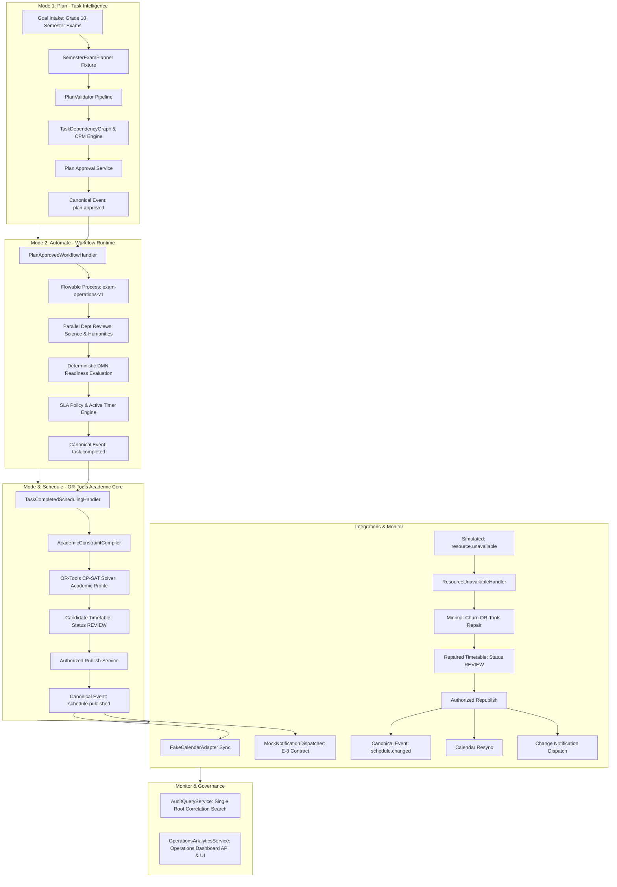

# Phase 6: Unified Semester-Exam Vertical Slice
**PLAN -> AUTOMATE -> SCHEDULE -> MONITOR**

## 1. Executive Summary
Phase 6 delivers the canonical end-to-end integration proving the complete operational loop of the IR Infotech E-7 Operations Engine:
```
PLAN  --->  AUTOMATE  --->  SCHEDULE  --->  MONITOR
```
Using the approved reference vertical: **Grade 10 Semester Examination Operations**.

The scenario executes autonomously across all 3 E-7 modes without requiring a single manual database edit, maintaining single root correlation identity across all service boundaries, and honoring all frozen foundational contracts.

---

## 2. Architectural Architecture



---

## 3. Reference Vertical Specifications
- **Objective**: Conduct Grade 10 Semester Examinations across all secondary subjects.
- **Scenario Dataset**: **PHASE-6 VERTICAL-SLICE SCENARIO DATA** (isolated from frozen Phase-5 benchmark fixtures).
- **Academic Cohorts**: Grade 10 Section A (G10-A), Grade 10 Section B (G10-B).
- **Academic Subjects**:
  1. Mathematics (`exam-g10-math`, 120 min, Major Subject)
  2. Physics (`exam-g10-physics`, 120 min, Major Subject)
  3. Chemistry (`exam-g10-chemistry`, 120 min, Major Subject)
  4. English Language (`exam-g10-english`, 120 min, Non-Major)
  5. Computer Science (`exam-g10-computer`, 90 min, Non-Major)
- **Sessions**: 10 total examination sessions across cohorts.
- **Physical Resources**:
  - Rooms: Room 101 (cap 40), Room 102 (cap 40), Science Lab 201 (cap 35).
  - Invigilators: Invigilator A, Invigilator B, Invigilator C, Invigilator D.
  - Equipment: Mobile Lab Kit (`EQ-LAB-KIT-01`).
- **Pedagogical Constraints**:
  - **Major-Subject Gap Policy**: Minimum 1 clear calendar day between major subject examinations (Mathematics, Physics, Chemistry scheduled on alternate days; non-major subjects scheduled on intermediate days).
  - Zero room double-booking.
  - Zero invigilator double-booking.
  - Zero cohort student concurrency overlap.

---

## 4. Canonical Plan Lifecycle Invariants
The Task Intelligence planning subsystem strictly enforces the frozen state machine:
```
DRAFT -> GENERATED -> VALIDATED -> APPROVAL_PENDING -> APPROVED -> ACTIVE -> COMPLETED / CANCELLED
```
1. **DRAFT**: Initial plan draft created under goal version.
2. **GENERATED**: Structured `PlanSchema` generated by `SemesterExamPlanner` and persisted. Emits canonical `plan.generated` outbox event and audit record.
3. **VALIDATED**: Deterministic validation via `PlanValidator` and acyclic CPM calculation (`CriticalPathCalculator`).
4. **APPROVAL_PENDING**: Plan explicitly routed for human review. Direct transitions from DRAFT, GENERATED, or VALIDATED to APPROVED are strictly rejected with `InvalidPlanStateTransitionError`.
5. **APPROVED**: Authorized approval baseline frozen with deterministic fingerprint hash. Emits canonical `plan.approved`.
6. **ACTIVE**: Activated upon start of Flowable workflow process instance.

---

## 5. Flowable Persisted SLA Timer Authority
- **Timer Authority**: Authoritative timers are owned by Flowable engine execution (`ACT_RU_TIMER_JOB`), not in-memory Python loops.
- **BPMN Boundary Events**: Attached to `readiness_moderation` task in `workflows/bpmn/semester_exam_readiness.bpmn20.xml`:
  - `timer_warning_readiness_moderation` (`cancelActivity="false"`, `<timeDate>${sla_warning_at}</timeDate>`): non-interrupting timer emitting warning.
  - `timer_breach_readiness_moderation` (`cancelActivity="true"`, `<timeDate>${sla_breach_at}</timeDate>`): interrupting timer escalating on breach.
- **Business Calendar**: E-7 `BusinessCalendar5x8` calculates SLA timestamps; Flowable natively owns scheduled job dispatch.

---

## 6. Verification Status Matrix
Per canonical testing and source-of-truth guidelines, static and contract verifications are distinguished from live runtime execution:

| Subsystem Component | Verification Category | Current Status | Evidence Path |
|---|---|---|---|
| Goal / Plan Data Flow | STATIC & CONTRACT VERIFIED | **VERIFIED** | `tests/unit/test_phase6_components.py`, `PlanValidator`, `CPMCalculator` |
| Canonical Plan Lifecycle | CONTRACT VERIFIED | **VERIFIED** | `test_plan_lifecycle_state_machine_strict_sequence`, `test_plan_service_approval_preconditions` |
| BPMN Syntax & Gateway Fork/Join | STATIC VERIFIED | **VERIFIED** | `test_bpmn_sla_timer_boundary_definitions`, `BpmnValidator` |
| Flowable Adapter Contract | CONTRACT VERIFIED | **VERIFIED** | `tests/unit/workflow/test_flowable_adapter.py` |
| DMN Contract & Determinism | CONTRACT VERIFIED | **VERIFIED** | `tests/unit/workflow/test_dmn_runtime.py` |
| Flowable SLA Boundary Timer XML | STATIC VERIFIED | **VERIFIED** | `workflows/bpmn/semester_exam_readiness.bpmn20.xml`, `BpmnValidator` |
| Vertical Slice In-Process Loop | INTEGRATION VERIFIED | **VERIFIED** | `tests/integration/vertical_slice/test_phase6_vertical_slice.py` |
| Real Live Flowable Deployment | LIVE RUNTIME VERIFIED | **BLOCKED_HOST_RUNTIME** | Requires live Flowable container; fails cleanly if down |
| Real Live Process Instance | LIVE RUNTIME VERIFIED | **BLOCKED_HOST_RUNTIME** | Requires live Flowable container; fails cleanly if down |
| Real Live Parallel Tasks | LIVE RUNTIME VERIFIED | **BLOCKED_HOST_RUNTIME** | Requires live Flowable container; fails cleanly if down |
| Real Live DMN Execution | LIVE RUNTIME VERIFIED | **BLOCKED_HOST_RUNTIME** | Requires live Flowable container; fails cleanly if down |
| Real Persisted Flowable Timer | LIVE RUNTIME VERIFIED | **BLOCKED_HOST_RUNTIME** | Requires live Flowable container; fails cleanly if down |
| Flagged Live E2E (`E7_RUN_PHASE6_E2E=1`) | LIVE RUNTIME VERIFIED | **BLOCKED_HOST_RUNTIME** | Exits with code 1; PostgreSQL connection refused per Rule 61 |

---

## 7. Phase Boundaries Respected
- **Canonical Phase 2 Pending Status Preserved**: `SemesterExamPlanner` is strictly an integration test fixture conforming to `PlannerProtocol`. No production LLM provider (OpenAI, Gemini, Sarvam) has been silently chosen.
- **Phase 7 Scope Not Started**:
  - No real Google Calendar network calls (uses `FakeCalendarAdapter`).
  - No real external ERP/SIS adapters.
  - No live email/SMS/push delivery (uses `MockNotificationDispatcher`).
  - No predictive ML risk monitoring.
- **Database Baseline Strictly Maintained**:
  - Exactly 24 tables in `Base.metadata`.
  - Single Alembic head: `0012` (`0012_schedule_publish_repair_calendar.py`).
  - Zero migration `0013` created.
- **Current Canonical Phase Status**:
  - Phase 6 = **IMPLEMENTED / BLOCKED_ON_LIVE_INFRASTRUCTURE_GATE**
  - Phase 7 = **UNSTARTED / NOT_READY**
  - Phase 7 Engineering Readiness = **BLOCKED_PENDING_PHASE6_LIVE_GATE**
