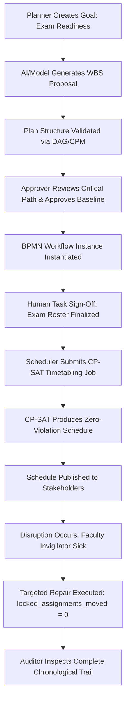

# Phase 8G: User Acceptance Testing (UAT) & Role-Based Operational Validation Plan

## 1. Executive Summary & Objective

Phase 8G establishes the formal operational acceptance and role-based validation framework for the **IR Infotech E-7 Operations Engine**. While preceding phases verified security boundaries (8A), AI prompt protections (8B), load performance (8C), disaster recovery (8D), capacity controls (8E), and operational runbooks (8F), Phase 8G validates end-to-end operational behaviors from the perspective of real business actors executing realistic organizational workflows.

The primary objective is to prove that:
1. All canonical operational personas can execute their duties without permission friction.
2. Cross-role boundary constraints (Separation of Duties, least privilege) fail closed deterministically.
3. Multi-tenant isolation (BOLA protection, anti-enumeration, strict tenant context) is preserved across all API endpoints and operational domains.
4. Dedicated idempotency and concurrent-conflict scenarios settle into deterministic, non-corrupted states without duplicate side effects.
5. Degraded broker (RabbitMQ) and workflow engine (Flowable) outages provide safe client error envelopes, zero persistent event loss, and reliable retry safety.
6. The CP-SAT solver and disruption repair engine fulfill domain invariants (zero disturbance to locked assignments).
7. Tenant-admin capabilities are truthfully classified between mounted HTTP product features and controlled operational administrative procedures.
8. Known external boundary states degrade predictably with clear operator ergonomics.

---

## 2. Canonical Operational Personas & Test Tenants

### 2.1 Synthetic Test Tenants
To guarantee total multi-tenant verification without relying on production data, two synthetic tenants are provisioned:
- **`uat-tenant-alpha`**: Primary tenant executing the Semester Exam Readiness & Scheduling lifecycle.
- **`uat-tenant-beta`**: Isolation verification tenant used to prove cross-tenant denial, BOLA prevention, and quota independence.

### 2.2 Persona Definition & Entitlements
| Persona Key | Canonical Role | Test Subject / Principal | Granted Permissions | Operational Responsibilities |
|---|---|---|---|---|
| `UAT_PLANNER` | `planner` | `user:uat_planner_alpha` | `goal:create`, `plan:create`, `plan:validate`, `task:read` | Creates operational goals, generates WBS proposals, validates task structures. Strictly barred from baseline approval and scheduling execution. |
| `UAT_APPROVER` | `approver` | `user:uat_approver_alpha` | `plan:approve`, `schedule:publish`, `workflow:approve`, `task:read` | Reviews plans, inspects critical paths, approves baselines, signs off human workflow steps. Enforces Separation of Duties against planner self-approval. |
| `UAT_SCHEDULER` | `scheduler`, `operator` | `user:uat_scheduler_alpha` | `schedule:solve`, `schedule:publish`, `schedule:repair`, `task:execute`, `task:read` | Compiles timetabling requests, submits solver jobs, monitors status, publishes schedules, and executes disruption repairs. |
| `UAT_AUDITOR` | `auditor` | `user:uat_auditor_alpha` | `audit:read`, `analytics:read`, `task:read` | Read-only inspection of immutable chronological audit trails and operational telemetry. Zero mutation permissions across all domains. |
| `UAT_TENANT_ADMIN`| `tenant_admin` | `user:uat_admin_alpha` | `workflow:deploy`, `quota:read`, `admin:*` | Deploys versioned BPMN workflows and monitors capacity limits. (Credential management is operational-admin procedure). |
| `UAT_VIEWER` | `viewer` | `user:uat_viewer_alpha` | `*:read` | Read-only access to operational dashboards; barred from state mutations. |
| `UAT_FOREIGN_USER`| `planner` (Beta) | `user:uat_planner_beta` | Scoped to `uat-tenant-beta` | Used to verify anti-enumeration (HTTP 404) across all domain resources. |

---

## 3. Operational Domain Dataset: "Semester Exam Readiness and Scheduling"

The UAT lifecycle models a high-stakes, time-sensitive academic operations cycle:

### 3.1 Work Breakdown Structure (WBS)
1. **Activity 1**: `task-exam-syllabus-01` — Finalize Exam Syllabus & Paper Blueprints (Duration: 120m)
2. **Activity 2**: `task-exam-roster-01` — Student Eligibility & Candidate Roster Review (Duration: 60m)
3. **Activity 3**: `task-exam-room-01` — Examination Hall & Seating Capacity Audit (Duration: 60m)
4. **Activity 4**: `task-exam-timetable-01` — CP-SAT Timetable Generation & Conflict Resolution (Duration: 180m)
5. **Activity 5**: `task-exam-invigilator-01` — Invigilation Staff Allocation & Workload Balancing (Duration: 60m)
6. **Activity 6**: `task-exam-publish-01` — Final Timetable Publication & Candidate Notification (Duration: 30m)

### 3.2 Constraints & Domain Invariants
- **Room Capacity**: Maximum student capacity strictly enforced per examination hall.
- **Invigilator No-Overlap**: Invigilators cannot be assigned to overlapping exam sessions.
- **Consecutive Exam Limit**: Students cannot sit more than two examinations in a single calendar day.
- **Disruption Repair Stability**: In the event of room closure or invigilator absence, existing confirmed slots MUST remain locked (`locked_assignments_moved == 0`).

---

## 4. Top-Level UAT Environment & Execution Provenance

### 4.1 Infrastructure Environment
Testing exercises the actual system composition as far as practical:
- **PostgreSQL 16**: Genuinely active in Docker (`e7-postgres` on port 55432), backing database connections, migrations, outbox tables, and service credential hashing.
- **RabbitMQ 3.13**: Genuinely active in Docker (`e7-rabbitmq` on port 5672), backing message broker failure injection and outbox resilience.
- **Flowable 7.0.0**: Genuinely active in Docker (`e7-flowable` on port 8080), backing workflow engine outage resilience testing.
- **Uvicorn / ASGI Application**: Fast, deterministic test harness mounting canonical middlewares (`CorrelationAndLoggingMiddleware`, `SecurityHeadersMiddleware`, `RequestBodySizeLimitMiddleware`) and domain routers via `TestClient`.
- **OpenTelemetry (OTel)**: Active W3C trace context and baggage propagation across request lifecycles.
- **Offline / Deterministic Adapters**:
  - LLM Provider: Deterministic offline stub (`MockLLMProvider` / `UatStubPlanService`).
  - Google Calendar: Frozen integration contract.
  - E-8 Notification Endpoint: Blocked externally; verified via local contract dispatch.
  - MySQL Read Boundary: Blocked on read-only credentials; verified via static governance check.

### 4.2 Execution Provenance Classification Taxonomy
Every UAT scenario is classified under exactly one execution level:
1. `REAL_HTTP_LOCAL_UVICORN`: Real network loopback HTTP request against a running Uvicorn server socket.
2. `IN_PROCESS_ASGI_HTTP`: Full HTTP stack executed in-process through Starlette/FastAPI ASGI test harness (`client.post`, `client.get`, etc.), including authentication, middleware, routing, serialization, and error handling.
3. `DIRECT_APPLICATION_SERVICE`: Direct invocation of domain services, repositories, or constraint compilers with genuine dependencies.
4. `MOCK_BACKED_ACCEPTANCE`: Acceptance executed against full mock stubs.
5. `STATIC_GOVERNANCE_ASSERTION`: Static verification of architectural boundary constants, frozen integrations, or blocked dependencies.

---

## 5. Scope of User Acceptance Testing (49 Scenarios)

The reconciled UAT catalog comprises 49 deterministic scenarios across 17 test suites:

| Suite | Scenarios | Target Verification | Provenance Level |
|---|---|---|---|
| **Planner Acceptance** | `UAT-PLANNER-001` .. `003` | Goal authoring, typed plan generation, deterministic cycle rejection. | `IN_PROCESS_ASGI_HTTP`, `DIRECT_APPLICATION_SERVICE` |
| **Approver Acceptance** | `UAT-APPROVER-001` .. `003` | Critical path inspection, SoD enforcement (anti-self-approval), validation feedback. | `IN_PROCESS_ASGI_HTTP` |
| **Workflow Runtime** | `UAT-WORKFLOW-001` .. `003` | BPMN instance startup, human task action idempotency, SLA breach escalation. | `IN_PROCESS_ASGI_HTTP`, `DIRECT_APPLICATION_SERVICE` |
| **Scheduler Acceptance**| `UAT-SCHEDULER-001` .. `007` | Job submission, feasible benchmark, infeasible diagnostics, budget exhaustion distinction, publishing, disruption repair stability, quota rejection UX (HTTP 429). | `IN_PROCESS_ASGI_HTTP`, `DIRECT_APPLICATION_SERVICE` |
| **Auditor Acceptance** | `UAT-AUDITOR-001` .. `003` | Reconstructing audit trails, strict mutation prohibition (403), cross-tenant audit isolation. | `IN_PROCESS_ASGI_HTTP` |
| **Tenant Admin** | `UAT-TENANT-ADMIN-001` .. `003` | BPMN deployment, service credential lifecycle & revocation (operational admin), capacity observability. | `IN_PROCESS_ASGI_HTTP`, `DIRECT_APPLICATION_SERVICE` |
| **Negative Auth** | `UAT-AUTH-NEG-001` .. `003` | Missing credentials, malformed bearer tokens, conflicting credentials fail-closed. | `IN_PROCESS_ASGI_HTTP` |
| **Tenant Isolation** | `UAT-ISOLATION-001` | Cross-tenant BOLA anti-enumeration (uniform HTTP 404). | `IN_PROCESS_ASGI_HTTP` |
| **External Boundaries**| `UAT-BOUNDARIES-001` .. `004` | Verification of degraded/blocked boundary behavior without regressions. | `STATIC_GOVERNANCE_ASSERTION` |
| **End-to-End Story** | `UAT-E2E-001` | Continuous narrative trace through all roles in a single test transaction. | `IN_PROCESS_ASGI_HTTP` |
| **Dedicated Idempotency**| `UAT-IDEMPOTENCY-001` .. `003`| Plan approval, task action, and schedule publication repeated without duplicate effects. | `IN_PROCESS_ASGI_HTTP` |
| **Dedicated Concurrency** | `UAT-CONCURRENCY-001` .. `004` | Concurrent approvers, concurrent task actions, concurrent publication, and concurrent quota boundary. | `IN_PROCESS_ASGI_HTTP`, `DIRECT_APPLICATION_SERVICE` |
| **Degraded RabbitMQ** | `UAT-DEGRADED-RABBITMQ-001` | Outbox persistence and durable backlog during broker outage; zero event loss. | `DIRECT_APPLICATION_SERVICE` |
| **Degraded Flowable** | `UAT-DEGRADED-FLOWABLE-001` | Clean connection failure handling and state retry safety during engine outage. | `DIRECT_APPLICATION_SERVICE` |
| **Expanded Cross-Tenant**| `UAT-ISOLATION-GOAL-001` .. `AUDIT-001` | Cross-tenant anti-enumeration across goals, plans, tasks, workflows, schedules, audits with DB non-mutation. | `IN_PROCESS_ASGI_HTTP` |
| **Negative Service Keys** | `UAT-AUTH-SERVICE-KEY-INVALID` .. `EXPIRED` | Non-existent, revoked, and expired service API keys fail closed with HTTP 401. | `IN_PROCESS_ASGI_HTTP` |

---

## 6. Canonical External & Deployment Boundary Conditions

All UAT executions recognize and honor the canonical external operational boundaries:
1. `MYSQL_LIVE_READ_VERIFICATION = BLOCKED_ON_MYSQL_READ_ONLY_ACCOUNT_PRIVILEGES`
2. `E8_NOTIFICATION_INTEGRATION = BLOCKED_ON_E8_ENDPOINT`
3. `E8_LOCAL_CONTRACT_DISPATCH = PASS`
4. `GOOGLE_CALENDAR_INTEGRATION = PASS / FROZEN`
5. `APPLICATION_CAPACITY_QUOTAS = PASS`
6. `RATE_LIMITING = BLOCKED_ON_PRODUCTION_GATEWAY_CONFIGURATION`

---

## 7. Acceptance Criteria & Final Exit Rule

Phase 8G may be frozen only when:
- 100% of all 49 role-based, idempotency, concurrency, degraded-mode, and isolation UAT scenarios pass synchronously.
- Separation of Duties (SoD) between Planner and Approver is mathematically and policy-enforced.
- The solver proves distinction between `INFEASIBLE` and `BUDGET_EXHAUSTED`.
- Disruption repair maintains `locked_assignments_moved == 0` for confirmed allocations.
- Service API key authentication strictly implements SHA-256 one-way hashing with instant revocation response.
- All negative auth and cross-tenant probes return canonical failure codes (401, 403, 404).
- Broker and workflow engine failure injection prove fail-safe client behavior without persistent state corruption.
- Full repository regression suite passes with zero regressions.
