# Phase 0 Fixture Corpus Audit

---

## 1. Scope
This document establishes the authoritative, independent audit report and frozen cryptographic manifest for the complete **Phase-0 Test Fixture Corpus** of the **IR Infotech E-7 Operations Engine**. It verifies all 18 canonical datasets across 6 families, asserts cross-fixture referential integrity, audits state and event vocabularies, confirms strict provider neutrality, and validates isolation against production code.

---

## 2. Corpus Inventory
| Dataset ID | Version | Family | Fixture Type | Relative Path | SHA-256 (Truncated) |
| :--- | :---: | :--- | :--- | :--- | :--- |
| **`INT-CALENDAR-001`** | `1.0.0` | `integration` | `calendar_sync_contract_case` | [`tests/fixtures/integrations/INT-CALENDAR-001.json`](file:///tests/fixtures/integrations/INT-CALENDAR-001.json) | `c4eda2204d716a65...` |
| **`INT-CALENDAR-DUP-001`** | `1.0.0` | `integration` | `calendar_callback_deduplication_case` | [`tests/fixtures/integrations/INT-CALENDAR-DUP-001.json`](file:///tests/fixtures/integrations/INT-CALENDAR-DUP-001.json) | `3a8f0fc915adb008...` |
| **`INT-NOTIFY-001`** | `1.0.0` | `integration` | `notification_command_contract_case` | [`tests/fixtures/integrations/INT-NOTIFY-001.json`](file:///tests/fixtures/integrations/INT-NOTIFY-001.json) | `b8e8ccdc12d1eabc...` |
| **`RS-SYNTH-001`** | `1.0.0` | `resources` | `resource_catalog` | [`tests/fixtures/resources/RS-SYNTH-001.json`](file:///tests/fixtures/resources/RS-SYNTH-001.json) | `a85fed2b6069000b...` |
| **`SC-EXAM-FEASIBLE-001`** | `1.0.0` | `exam_scheduling` | `education_exam_scheduling_case` | [`tests/fixtures/scheduling/exam/SC-EXAM-FEASIBLE-001.json`](file:///tests/fixtures/scheduling/exam/SC-EXAM-FEASIBLE-001.json) | `afa37a4c329cd842...` |
| **`SC-EXAM-INFEASIBLE-001`** | `1.0.0` | `exam_scheduling` | `education_exam_scheduling_case` | [`tests/fixtures/scheduling/exam/SC-EXAM-INFEASIBLE-001.json`](file:///tests/fixtures/scheduling/exam/SC-EXAM-INFEASIBLE-001.json) | `f9f7d824a43ff67c...` |
| **`SC-EXAM-REPAIR-001`** | `1.0.0` | `exam_scheduling` | `education_exam_scheduling_case` | [`tests/fixtures/scheduling/exam/SC-EXAM-REPAIR-001.json`](file:///tests/fixtures/scheduling/exam/SC-EXAM-REPAIR-001.json) | `0b7f1cd1446ed0fe...` |
| **`SC-MAINT-FEASIBLE-001`** | `1.0.0` | `maintenance_scheduling` | `generic_scheduling_case` | [`tests/fixtures/scheduling/maintenance/SC-MAINT-FEASIBLE-001.json`](file:///tests/fixtures/scheduling/maintenance/SC-MAINT-FEASIBLE-001.json) | `99d9f72fac2f3bfd...` |
| **`SC-MAINT-INFEASIBLE-001`** | `1.0.0` | `maintenance_scheduling` | `generic_scheduling_case` | [`tests/fixtures/scheduling/maintenance/SC-MAINT-INFEASIBLE-001.json`](file:///tests/fixtures/scheduling/maintenance/SC-MAINT-INFEASIBLE-001.json) | `289f7127786c9a85...` |
| **`SC-MAINT-REPAIR-001`** | `1.0.0` | `maintenance_scheduling` | `generic_scheduling_case` | [`tests/fixtures/scheduling/maintenance/SC-MAINT-REPAIR-001.json`](file:///tests/fixtures/scheduling/maintenance/SC-MAINT-REPAIR-001.json) | `0d6a22429a99e1c5...` |
| **`TI-GOLD-001`** | `1.0.0` | `task_intelligence` | `task_intelligence_gold_case` | [`tests/fixtures/ai_gold_set/TI-GOLD-001.json`](file:///tests/fixtures/ai_gold_set/TI-GOLD-001.json) | `092a4e84b1d71b53...` |
| **`TI-GOLD-002`** | `1.0.0` | `task_intelligence` | `task_intelligence_gold_case` | [`tests/fixtures/ai_gold_set/TI-GOLD-002.json`](file:///tests/fixtures/ai_gold_set/TI-GOLD-002.json) | `8084fe2c725d3869...` |
| **`TI-GOLD-003`** | `1.0.0` | `task_intelligence` | `task_intelligence_gold_case` | [`tests/fixtures/ai_gold_set/TI-GOLD-003.json`](file:///tests/fixtures/ai_gold_set/TI-GOLD-003.json) | `801ec1b93037d0ae...` |
| **`TI-GOLD-004`** | `1.0.0` | `task_intelligence` | `task_intelligence_gold_case` | [`tests/fixtures/ai_gold_set/TI-GOLD-004.json`](file:///tests/fixtures/ai_gold_set/TI-GOLD-004.json) | `91efd3e6e69c8d1d...` |
| **`TI-GOLD-005`** | `1.0.0` | `task_intelligence` | `task_intelligence_gold_case` | [`tests/fixtures/ai_gold_set/TI-GOLD-005.json`](file:///tests/fixtures/ai_gold_set/TI-GOLD-005.json) | `81fee9c138786c6a...` |
| **`WF-EXAM-HAPPY-001`** | `1.0.0` | `workflow` | `workflow_scenario_case` | [`tests/fixtures/workflows/WF-EXAM-HAPPY-001.json`](file:///tests/fixtures/workflows/WF-EXAM-HAPPY-001.json) | `6a1a0541c5937430...` |
| **`WF-EXAM-REJECT-001`** | `1.0.0` | `workflow` | `workflow_scenario_case` | [`tests/fixtures/workflows/WF-EXAM-REJECT-001.json`](file:///tests/fixtures/workflows/WF-EXAM-REJECT-001.json) | `4d20c6ea5b35044c...` |
| **`WF-EXAM-SLA-001`** | `1.0.0` | `workflow` | `workflow_scenario_case` | [`tests/fixtures/workflows/WF-EXAM-SLA-001.json`](file:///tests/fixtures/workflows/WF-EXAM-SLA-001.json) | `19bad551e3ef7fb9...` |

---

## 3. Dataset Family Counts
| Family | Expected Count | Discovered Count | Status |
| :--- | :---: | :---: | :---: |
| `resources` | 1 | 1 | **MATCH** |
| `task_intelligence` | 5 | 5 | **MATCH** |
| `workflow` | 3 | 3 | **MATCH** |
| `exam_scheduling` | 3 | 3 | **MATCH** |
| `maintenance_scheduling` | 3 | 3 | **MATCH** |
| `integration` | 3 | 3 | **MATCH** |
| **Total** | **18** | **18** | **MATCH** |

---

## 4. SHA-256 Manifest Summary
All 18 fixture files were hashed directly from disk bytes without serialization or formatting mutations. The complete cryptographic inventory is canonically committed in [`tests/fixtures/MANIFEST.json`](file:///f:/operations-engine/tests/fixtures/MANIFEST.json).

---

## 5. Dataset Reference Graph
Cross-fixture dependencies link specialized operational scenarios back to base resources and feasible schedule baselines:

```mermaid
graph TD
    RS["RS-SYNTH-001@1.0.0 (Base Resource Catalog)"]
    SC_EXAM_FEAS["SC-EXAM-FEASIBLE-001@1.0.0"] -->|resource_dataset_ref| RS
    SC_EXAM_INFEAS["SC-EXAM-INFEASIBLE-001@1.0.0"] -->|resource_dataset_ref| RS
    SC_EXAM_REP["SC-EXAM-REPAIR-001@1.0.0"] -->|resource_dataset_ref| RS
    SC_EXAM_REP -->|base_schedule_dataset_ref| SC_EXAM_FEAS
    SC_MAINT_FEAS["SC-MAINT-FEASIBLE-001@1.0.0"] -->|resource_dataset_ref| RS
    SC_MAINT_INFEAS["SC-MAINT-INFEASIBLE-001@1.0.0"] -->|resource_dataset_ref| RS
    SC_MAINT_REP["SC-MAINT-REPAIR-001@1.0.0"] -->|resource_dataset_ref| RS
    SC_MAINT_REP -->|base_schedule_dataset_ref| SC_MAINT_FEAS
    TI_001["TI-GOLD-001@1.0.0"] -->|resource_dataset_ref| RS
    TI_002["TI-GOLD-002@1.0.0"] -->|resource_dataset_ref| RS
    TI_003["TI-GOLD-003@1.0.0"] -->|resource_dataset_ref| RS
    TI_004["TI-GOLD-004@1.0.0"] -->|resource_dataset_ref| RS
    TI_005["TI-GOLD-005@1.0.0"] -->|resource_dataset_ref| RS
    INT_001["INT-CALENDAR-001@1.0.0"] -->|schedule_dataset_ref| SC_EXAM_FEAS
    INT_002["INT-CALENDAR-DUP-001@1.0.0"] -->|schedule_dataset_ref| SC_EXAM_FEAS
    INT_003["INT-NOTIFY-001@1.0.0"] -->|schedule_dataset_ref| SC_EXAM_FEAS
    INT_003 -->|resource_dataset_ref| RS
```

---

## 6. Scenario Ownership
* **`E7-REF-EXAM-001` (Semester Examination Operations)**: Authoritative source-defined vertical slice covering 14 datasets across TI Gold Sets, Workflow Scenarios, Exam Scheduling, and Integrations.
* **`E7-REF-MAINT-001` (Facility Maintenance Work-Order Scheduling)**: Proposed Phase-0 generic benchmark fixture covering 3 maintenance scheduling datasets.
* **`RS-SYNTH-001`**: Shared synthetic resource catalog declaring `source_scenarios: ["E7-REF-EXAM-001", "E7-REF-MAINT-001"]`.
* **Governance Status**: `E7-REF-MAINT-001` remains strictly a proposed generic benchmark fixture, NOT a production commercial maintenance requirement.

---

## 7. Resource Referential Integrity
All canonical resource identifiers referenced in scheduling, workflow, AI, and integration fixtures were verified against the normalized catalog [`tests/fixtures/resources/RS-SYNTH-001.json`](file:///f:/operations-engine/tests/fixtures/resources/RS-SYNTH-001.json). Every non-exception resource reference resolves unambiguously to an active person, room, or equipment entity.

---

## 8. Intentional Negative-Test Exceptions
1. **Unresolved Resource Reference (`res-inv-999`)**:
   - Present exclusively within [`tests/fixtures/ai_gold_set/TI-GOLD-005.json`](file:///f:/operations-engine/tests/fixtures/ai_gold_set/TI-GOLD-005.json).
   - Purpose: Deliberate synthetic invalid candidate testing deterministic schema/context validation and bounded repair diagnostics.
   - Zero presence in `RS-SYNTH-001.json` or any other fixture.
2. **Directed Dependency Cycle**:
   - Present exclusively in `TI-GOLD-005.json`: `tmp-task-001` -> `tmp-task-002` -> `tmp-task-003` -> `tmp-task-001`.
   - Purpose: Deliberate synthetic invalid candidate testing cycle detection and diagnostic extraction.
   - Zero dependency cycles exist in any other gold or workflow fixture.

---

## 9. Scheduling Family Audit
* **Maintenance Family (`SC-MAINT-*`)**:
  - `SC-MAINT-FEASIBLE-001`: 6 work orders, 6 witness assignments, outcome `FEASIBLE`, candidate requires review, no auto-publish.
  - `SC-MAINT-INFEASIBLE-001`: Outcome `INFEASIBLE`, root is zero eligible resources with combined PLUMBING+NETWORK skills, conflict diagnostics and relaxation suggestions produced, zero candidate published.
  - `SC-MAINT-REPAIR-001`: 1 technician unavailability disruption, 1 affected assignment, 5 unaffected assignments preserved without time movement, candidate requires review.
* **Exam Family (`SC-EXAM-*`)**:
  - `SC-EXAM-FEASIBLE-001`: 2 cohorts, 5 exams, 10 sessions, 10 witness assignments, room capacity and invigilator skills satisfied, 1 clear calendar day major-subject gap verified for both cohorts.
  - `SC-EXAM-INFEASIBLE-001`: Outcome `INFEASIBLE`, root is `MAJOR_SUBJECT_GAP_WINDOW_UNSATISFIABLE` (3 major exams in a 3-day window requiring 1 clear calendar day between successive major exams), zero candidate published.
  - `SC-EXAM-REPAIR-001`: 1 invigilator unavailability disruption, exactly `assign-exam-005` affected and reassigned, 9 assignments untouched without time/room movement, gap rule preserved.

---

## 10. Workflow Family Audit
* **`WF-EXAM-HAPPY-001`**: Parallel all-of approvals (`APPROVED` + `APPROVED`) evaluate gate `exam-readiness-gate` to `READY_FOR_SCHEDULING`; workflow state `COMPLETED`.
* **`WF-EXAM-REJECT-001`**: Rejection by Approver Beta evaluates gate to `REWORK_REQUIRED`; workflow state remains `RUNNING`; canonical `readiness-rework` task spawned; zero scheduling-ready state permitted.
* **`WF-EXAM-SLA-001`**: Unresolved task `department-approval-alpha` starts at 09:00; warning triggered at 11:00 (120 business minutes); breach triggered at 13:00 (240 business minutes); simulated restart checkpoint at 10:30 asserts timer state persistence; escalation to `EXAM_OPERATIONS_MANAGER`.

---

## 11. AI Gold-Set Audit
* All 5 fixtures (`TI-GOLD-001` through `005`) assert `exact_wording_scored: false`.
* Zero fixtures contain `expected_model_response`, `expected_exact_plan`, `expected_exact_text`, or `gold_response_text`.
* Non-authoritative proposal status: Generated plans require explicit human/policy review prior to canonical activation.
* Full category coverage (`TI-GOLD-001`), benchmark extensions (`TI-GOLD-002` science lab & accessibility), critical-path and estimation benchmarks (`TI-GOLD-003`), missing-information non-hallucination (`TI-GOLD-004`), and bounded repair (`TI-GOLD-005`) verified.

---

## 12. Integration Contract Audit
* **`INT-CALENDAR-001`**: Calendar sync operation matches feasible exam witness assignment `assign-exam-001` (09:00–11:00, `res-room-003`, `res-inv-002`); idempotency key asserted; canonical and external IDs cleanly decoupled.
* **`INT-CALENDAR-DUP-001`**: Redelivered identical callback processed with 1 committed effect for first delivery and 0 additional committed effects for duplicate delivery; zero claim of network-level single delivery.
* **`INT-NOTIFY-001`**: Outbound notification command emitted on `schedule.published`; destination adapter `synthetic-e8-mock`; canonical audience resolves to authorized invigilators; zero concrete E-8 wire protocols, URLs, or credentials invented.

---

## 13. Canonical Event Vocabulary Audit
* **Authorized Source Events Used in Fixtures**:
  - `plan.approved`
  - `schedule.published`
  - `workflow.sla.breached`
  - `workflow.sla.warning`
  - `workflow.task.created`
* **Authorized Source Events Currently Unexercised** (Valid Phase-0 state; reserved for downstream phases):
  - `goal.created`
  - `plan.generated`
  - `resource.unavailable`
  - `schedule.changed`
  - `schedule.generated`
  - `task.blocked`
  - `task.completed`
* **Invented Domain Events**: **Zero**. No non-canonical events (`notification.sent`, `calendar.synced`, `workflow.completed`, etc.) exist.

---

## 14. State Vocabulary Audit
* **Schedule States**: Strictly limited to canonical lifecycle `REQUESTED`, `SOLVING`, `FEASIBLE`, `INFEASIBLE`, `REVIEW`, `PUBLISHED`, `SUPERSEDED`. Infeasibility is represented exclusively as `INFEASIBLE`, never `FAILED` or `ERROR`.
* **Workflow States**: Execution states limited to `RUNNING` and `COMPLETED`. Business outcomes `READY_FOR_SCHEDULING` and `REWORK_REQUIRED` are cleanly segregated in domain payloads.
* **Plan States**: Limited to canonical `APPROVED`.

---

## 15. Provider/Engine Neutrality
Case-insensitive word-boundary regex scans across all 18 JSON fixture payloads confirmed zero coupling to engine runtimes or third-party SDKs:
* Zero OR-Tools variable structs or solver types.
* Zero UniTime XML tags or Java classes.
* Zero Flowable, Camunda, or Operaton execution tokens or BPMN/DMN XML.
* Zero RabbitMQ AMQP delivery tags or headers.
* Zero LLM provider names (Sarvam, OpenAI, Anthropic, Gemini, Claude, Ollama, Bedrock).

---

## 16. Secret / PII Audit
* **Credential Keys**: Zero occurrences of `password`, `secret`, `private_key`, `access_token`, `refresh_token`, or `bearer`.
* **Personal Information**: Zero real student, teacher, or employee names, email addresses, phone numbers, or physical addresses. All identities are 100% synthetic.

---

## 17. Production-Hardcoding Isolation
Scans of the production codebase under `app/` against all 18 dataset identifiers, synthetic tenant IDs, resource IDs, work order keys, and fixture SLA thresholds yielded **zero matches**. Fixture values remain strictly isolated within `tests/fixtures/`.

---

## 18. REFERENCE_USE_CASES Alignment
All 18 discovered dataset identifiers match the reserved dataset inventory codified in Section 12 of [`docs/poc/REFERENCE_USE_CASES.md`](file:///f:/operations-engine/docs/poc/REFERENCE_USE_CASES.md). A textual count mismatch in Section 14 stating '16 dataset identifiers' was detected and recorded as Finding `WARN-001`.

---

## 19. Solver-Governance Consistency
Cross-check between [`docs/IMPLEMENTATION_GUARDRAILS.md`](file:///f:/operations-engine/docs/IMPLEMENTATION_GUARDRAILS.md) and [`docs/adr/ADR-003-scheduling-solver-strategy.md`](file:///f:/operations-engine/docs/adr/ADR-003-scheduling-solver-strategy.md) confirms full reconciliation:
* LLMs are strictly non-authoritative for scheduling.
* Deterministic solvers own feasibility and optimization.
* Google OR-Tools CP-SAT is the primary generic solver.
* Phase 5 evaluates UniTime vs an OR-Tools-native model for education timetabling.
* FET is a benchmark/fallback subject to licensing review.
* Timefold remains conditional behind an ADR/evidence gate.

---

## 20. Fixture Coverage vs Implementation Coverage
> [!IMPORTANT]
> **TEST ASSETS ONLY — NOT IMPLEMENTATION COMPLETION**
> The existence of versioned canonical test fixtures provides regression baselines; it does NOT constitute implementation of the underlying subsystems:
> * **Task Intelligence Fixtures (`TI-GOLD-*`)**: Support future Phase-2 benchmarking of prompt decomposition, PydanticAI structured output conformance, and DAG cycle detection.
> * **Workflow Fixtures (`WF-EXAM-*`)**: Support future Phase-3 contract testing of Flowable REST adapters, DMN rule evaluation, and persistent SLA timer durability.
> * **Scheduling Fixtures (`SC-MAINT-*`, `SC-EXAM-*`)**: Support future Phase-4 (OR-Tools CP-SAT) and Phase-5 (UniTime/FET comparison) solver modeling, diagnostics, and disruption repair.
> * **Integration Fixtures (`INT-*`)**: Support future Phase-6 and Phase-7 testing of calendar synchronization adapters and outbound notification event dispatch.

---

## 21. Findings
### Finding 1: DOCUMENTATION COUNT MISMATCH (16 vs 18) [WARNING]
* **Severity**: `WARNING`
* **Location**: `docs/poc/REFERENCE_USE_CASES.md:398`
* **Description**: docs/poc/REFERENCE_USE_CASES.md line 398 states 'All 16 dataset identifiers are formally reserved', but Section 12 explicitly lists 18 reserved dataset IDs (1 Resource + 5 TI + 3 WF + 3 Exam + 3 Maint + 3 Int). This is an arithmetic documentation inconsistency from prior task definition.
* **Action Required**: Non-breaking documentation inconsistency to be reconciled in future documentation review.

---

## 22. Blocking Findings
**Total Blockers**: **0**. No blocking issues detected. The fixture corpus is internally consistent and frozen.

---

## 23. Phase-0 Boundary / Remaining Work
Passing Task 0F.2G establishes solely that the Phase-0 fixture corpus is internally consistent and frozen. It does **NOT** indicate Phase 0 is complete. Remaining Phase-0 prerequisites include:
1. Integration/provider inventory and technology decision gates.
2. Corporate Identity Provider (IdP) integration contract and decision gate.
3. Primary ERP/SIS adapter target and synchronization boundary.
4. Primary calendar provider adapter selection.
5. E-8 notification engine wire contract / mock boundary.
6. Service Level Objective (SLO) candidate definitions.
7. Operational data retention policy candidates.
8. First-tenant scale and performance envelope.
9. Implementation epics and task backlog verification.
10. Comprehensive Phase-0 exit-gate review and RTM/ADR sign-off.

---

## 24. Final Fixture-Corpus Status
**STATUS: PASS**

* **PASS Assertions**: 642
* **WARNING Findings**: 1
* **ERROR Findings**: 0
* **BLOCKER Findings**: 0
