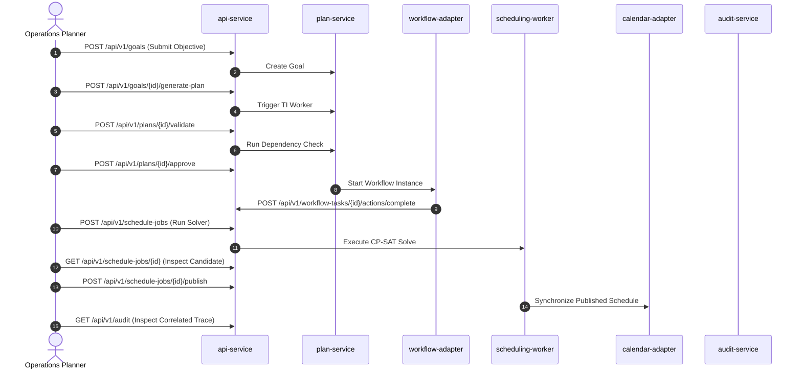

# Reference Use Cases and Benchmark Scenario Freeze

---

## 1. Document Purpose and Governance Scope

This specification establishes and freezes the **Reference Use Cases, Benchmark Scenarios, and Test Variants** for the **IR Infotech E-7 Operations Engine**.

### 1.1 Governance Purpose
The purpose of this document is to codify fixed, reproducible scenarios that will govern:
* **Task Intelligence Gold-Set Construction & Evaluation**: Establishing baseline objectives for semantic, structural, and dependency graph validation.
* **Workflow End-to-End Verification**: Validating approval routing, parallel branches, DMN decision tables, SLA timer durability, and rejection loops.
* **Constraint Solver Feasibility & Infeasibility Benchmarks**: Verifying hard/soft constraint satisfaction, relaxation diagnostics, and solver scoring under Google OR-Tools CP-SAT and UniTime.
* **Operational Disruption & Schedule Repair**: Testing localized neighborhood rescheduling, locked assignment immutability, and change metrics.
* **Integration Adapter Contract Tests**: Verifying idempotent calendar synchronization, deduplicated webhook ingestion, and transactional outbox event delivery over RabbitMQ.
* **Phase 6 Unified Vertical Demonstration**: Serving as the definitive operational acceptance scenario for the complete *Plan $\rightarrow$ Automate $\rightarrow$ Schedule $\rightarrow$ Monitor* lifecycle.

### 1.2 Non-Production & Fixture Governance Invariant
* **Test Data Only**: All identities, institutional entities, courses, work orders, personnel, and time windows defined or implied by these reference scenarios are **synthetic test fixtures**.
* **Zero Production Hardcoding**: Fixed fixture values are regression benchmarks and **must never become production defaults, schema enums, or hardcoded application logic**.
* **Test Fixture Separation**: As codified in Section 10, this document defines scenario semantics and acceptance properties; concrete synthetic values (counts, dates, time windows, durations, solver budgets, IDs) belong in versioned Task 0F.2 fixture files.

---

## 2. Reference Scenario Catalog

| Scenario ID | Scenario Name | Type | Source Status | Primary Domains Exercised | Future Dataset Family | First Phase | Primary Acceptance Purpose |
| :--- | :--- | :--- | :--- | :--- | :--- | :---: | :--- |
| **`E7-REF-EXAM-001`** | **Semester Examination Operations** | End-to-End Vertical Slice | **SOURCE-DEFINED REFERENCE VERTICAL** | Task Intelligence, Flowable BPMN/DMN, Academic Scheduling, Calendars, Notifications | AI Gold Set, Workflow Fixtures, Exam Scheduling, Resource Mappings | Phase 2 (TI) / Phase 6 (E2E) | Validate complete unified Plan-Automate-Schedule-Monitor loop in an institutional academic context. |
| **`E7-REF-MAINT-001`** | **Facility Maintenance Work-Order Scheduling** | Generic Resource Scheduling | **PROPOSED PHASE-0 GENERIC BENCHMARK FIXTURE** | OR-Tools CP-SAT, Multi-Skill Assignment, Equipment Binding, Disruption Repair | Generic Maintenance Scheduling Fixtures, Resource Skills | Phase 4 (Scheduling MVP) | Validate generic multi-resource time-slot optimization, hard/soft constraints, and schedule repair independent of education logic. |

---

## 3. Source-Defined Reference Vertical: E7-REF-EXAM-001

### Title: Semester Examination Operations
* **Source Authority**: Explicitly defined in Section 32 (*Reference End-to-End Scenario — Semester Examinations*) and Section 24 (*Phase 6 — Unified Vertical Slice*) of the authoritative *Complete Implementation Plan*.
* **Scope & Synthetic Identity Rule**: The scenario models Grade 10 semester examination operations. All participant names, courses, subject codes, and room identifiers are strictly synthetic; no real school or student data is utilized.

### 3.1 Business Objective
Plan, approve, schedule, conduct, and close semester examination operations while respecting human workflow approvals, room and invigilator availability, pedagogical gap constraints, and compliance audit requirements.

### 3.2 Actors and Roles (Logical Synthetic Roles)
* **Tenant Administrator**: Configures institutional parameters, academic calendar blackout periods, and user roles.
* **Operations Planner**: Submits the high-level examination goal, reviews AI-generated WBS proposals, and approves the baseline.
* **Department / Academic Approver**: Subject matter authority responsible for reviewing question-paper readiness and approving schedule drafts.
* **Workflow Administrator**: Oversees Flowable BPMN/DMN process deployments and handles SLA escalation alerts.
* **Scheduler Administrator**: Triggers OR-Tools constraint solver runs, inspects candidate timetables, and formally publishes schedules.
* **Resource Administrator**: Maintains invigilator qualifications, room seating capacities, and equipment availability.
* **Auditor**: Inspects immutable append-only audit trails across plan generation, workflow approvals, and solver executions.
* **ERP / SIS System (Mock)**: Upstream authoritative source for student cohort counts, faculty registries, and room master data.
* **Calendar Provider (Mock)**: Downstream external CalDAV / Google / Exchange calendar service receiving synchronized published exam sessions.
* **E-8 Notification Engine (Mock)**: Communication platform receiving approved notification commands for invigilators and students.

### 3.3 Systems and Components Involved
* **E-7 Core Subsystems**: `operations-ui`, `api-service`, `plan-service`, `task-intelligence-worker`, `dependency-service`, `workflow-adapter`, `Flowable runtime`, `resource-service`, `scheduling-worker`, `calendar-adapter`, `event-gateway`, `audit-service`, `analytics-api`.
* **External Integration Mocks**: ERP/SIS Mock (Resource ingestion), Calendar Mock (CalDAV sync), E-8 Mock (Notification commands).

### 3.4 Source-Defined End-to-End Lifecycle Flow
The execution flow faithfully follows the 11 authoritative stages specified in the master implementation plan:

```
[EX-01: Goal Intake] ---> [EX-02: TI Proposal] ---> [EX-03: Plan Validation] ---> [EX-04: Human Review & Approval]
                                                                                             |
[EX-08: Publication] <--- [EX-07: Candidate Solve] <--- [EX-06: Scheduling Request] <--- [EX-05: Workflow Execution]
         |
         v
[EX-09: Calendar & Notify] ---> [EX-10: Operational Disruption & Repair] ---> [EX-11: Closure & Audit Correlation]
```

* **STAGE EX-01 — Goal Intake**: Authorized administrator submits the semester examination operational goal specifying target date window, Grade 10 cohort, approved major subjects, and resource scope. Emits `goal.created`.
* **STAGE EX-02 — Task Intelligence Proposal**: `task-intelligence-worker` uses PydanticAI to generate a structured `PlanSchema` proposal encompassing 8 mandatory phases: planning, question-paper readiness, departmental/authorized approvals, room and invigilator preparation, timetable scheduling, exam execution, incident handling, and closure.
* **STAGE EX-03 — Deterministic Plan Validation**: `dependency-service` parses the proposal via NetworkX; asserts graph acyclicity; computes topological order, slack, and critical path. Validates schema types, parent-child hierarchies, and date consistency.
* **STAGE EX-04 — Human Plan Review & Approval**: Operations Planner reviews draft in `operations-ui`, makes necessary adjustments, and signs off. Baseline hash is minted and stored canonically. Emits `plan.approved`.
* **STAGE EX-05 — Workflow Execution**: `plan.approved` event triggers `workflow-adapter` to launch Flowable question-paper/readiness workflows. Parallel department/authorized approval tasks are spawned; DMN decision tables evaluate routing and readiness rules where configured; SLA timers monitor configured deadlines.
* **STAGE EX-06 — Scheduling Request**: Upon satisfaction of workflow readiness gates, a scheduling job is queued. Input snapshot resolves subjects, cohorts, invigilators, rooms, capacity, and pedagogical gap rules.
* **STAGE EX-07 — Candidate Timetable Generation**: `scheduling-worker` invokes Google OR-Tools CP-SAT. Returns a `FEASIBLE` candidate assignment (staged as `REVIEW`) or an `INFEASIBLE` diagnostic report. Infeasibility is a valid solver/domain outcome, not an infrastructure or execution failure; unresolvable constraint conflicts produce an explicit canonical `INFEASIBLE` state with relaxation candidates rather than an execution failure.
* **STAGE EX-08 — Publication**: Scheduler Administrator inspects timetable in UI and executes authorized publish action. Emits `schedule.published`.
* **STAGE EX-09 — Calendar and Notification Integration**: `calendar-adapter` synchronizes sessions idempotently to external calendars; E-8 mock receives notification dispatch commands.
* **STAGE EX-10 — Operational Disruption & Targeted Repair**: An invigilator becomes unavailable (`resource.unavailable`). `scheduling-worker` executes targeted repair, freezing unaffected exam slots, penalizing movement, and re-rostering eligible replacements.
* **STAGE EX-11 — Closure and Audit Correlation**: Milestones complete as operational exams conclude; `audit-service` links goal creation, LLM proposal metadata, workflow sign-offs, solver scores, repair history, and calendar sync tokens into a single correlation view.

---

## 4. Semester Examination Scenario Variants

| Variant ID | Name | Trigger / Condition | Expected System Behavior | Expected Result State | Requirements Exercised | Test Layer |
| :--- | :--- | :--- | :--- | :--- | :--- | :--- |
| **`EX-HAPPY-001`** | Full Happy Path | Valid goal, prompt, available resources, and approved baseline. | Executes stages EX-01 through EX-11 without rejection or resource deficits. | Plan `APPROVED`, Workflow `COMPLETED`, Schedule `PUBLISHED`, Calendars `SYNCHRONIZED`. | FR-TI-01..09, FR-WF-01..07, FR-SC-01..06, FR-INT-01..03 | System E2E / Integration |
| **`EX-PLAN-CYCLE-001`** | Dependency Cycle Rejection | LLM or user introduces circular dependency edge (A -> B -> C -> A). | `dependency-service` detects cycle during validation; activation is strictly blocked. | Plan remains `DRAFT`; HTTP 422 Problem Details returned with exact cycle path nodes. | FR-TI-04, FR-TI-05 | Unit / Contract |
| **`EX-WF-REJECT-001`** | Workflow Task Rejection | Academic approver rejects question-paper/readiness task. | Flowable BPMN engine routes execution token to rework activity; scheduling trigger blocked. | Workflow instance remains active in rework branch; `task.blocked` emitted; audit log records reason. | FR-WF-02, FR-WF-06 | Integration (Flowable) |
| **`EX-SLA-BREACH-001`** | SLA Warning & Breach Handling | An unresolved workflow task passes configured warning and breach business-time thresholds. | Flowable job executor triggers timer; configured warning behavior occurs; configured breach_action occurs; configured escalation_chain is applied where defined; warning/breach events and audit evidence are produced; persisted workflow/timer state survives restart. | Task `sla_status` transitions `OK` -> `WARNING` -> `BREACHED`; configured breach_action executed; timer and state survive service restart. | FR-WF-04, FR-WF-07 | Integration / Durability |
| **`EX-SCHED-FEASIBLE-001`**| Feasible Exam Timetabling | Valid exam sessions, rooms, invigilators, and major-subject gap constraints. | OR-Tools CP-SAT solves within time budget satisfying all hard rules and optimizing gaps. | Schedule outcome/state `FEASIBLE`; candidate assignments created in `REVIEW` status. | FR-SC-01, FR-SC-02, FR-SC-03 | Benchmark (OR-Tools) |
| **`EX-SCHED-INFEASIBLE-001`**| Over-Constrained Exam Timetable | A deliberately constructed exam dataset contains mutually incompatible hard scheduling requirements involving the available examination window, required major-subject gaps, and/or eligible resources. | Solver proves model infeasible; identifies violated/conflicting hard constraints, conflicting resources, or time windows where relevant, and generates relaxation candidates without silent partial-success schedule. | Schedule outcome/state `INFEASIBLE`; violated/conflicting hard constraints and relaxation suggestions produced; zero silent partial-success schedules published. | FR-SC-01, FR-SC-04 | Benchmark (Diagnostics) |
| **`EX-REPAIR-RESOURCE-001`**| Invigilator Absence Repair | Ingestion of `resource.unavailable` event for an assigned invigilator post-publication. | Re-solves schedule with locked session times; applies heavy movement penalty on unaffected assignments. | New superseding candidate created; unaffected assignments preserved; delta metrics recorded. | FR-SC-05, FR-SC-06 | Integration / Regression |
| **`EX-CALENDAR-DUPLICATE-001`**| Duplicate Calendar Callback | External calendar webhook redelivers identical sync confirmation callback. | `calendar-adapter` checks sync token and idempotency key; ignores duplicate request. | Exactly-once state transition; zero duplicate database writes or secondary events. | FR-INT-01, FR-INT-02 | Contract / Idempotency |
| **`EX-BROKER-OUTAGE-001`** | Broker Outage Outbox Resilience | RabbitMQ broker offline when state transition commits in PostgreSQL. | Local DB transaction commits state + outbox; outbox poller pauses; resumes upon broker restart. | Zero message loss; domain state remains consistent; messages dispatched after broker recovery. | FR-INT-01, FR-INT-02 | Reliability / Fault-Injection |

---

## 5. Generic Non-Education Benchmark: E7-REF-MAINT-001

### Title: Facility Maintenance Work-Order Scheduling
> [!IMPORTANT]
> **GOVERNANCE NOTICE**:
> **PROPOSED PHASE-0 BENCHMARK FIXTURE — NOT AN AUTHORITATIVE BUSINESS-DOMAIN REQUIREMENT.**
> This scenario is a synthetic engineering test fixture designed to validate generic multi-resource time-slot optimization, skill matching, equipment binding, and disruption repair without reliance on educational domain concepts.

### 5.1 Generic Business Description
A facilities engineering team manages incoming maintenance work orders across commercial facilities. Each work order requires:
* Specific technician skills/certifications (e.g., `HVAC_CERTIFIED`, `HIGH_VOLTAGE_ELECTRICIAN`).
* Specialized tools/equipment (e.g., `THERMAL_IMAGER`, `HYDRAULIC_LIFT`).
* Location/room occupancy constraints (e.g., `SERVER_ROOM_A` allowing only one maintenance team at a time).
* Temporal parameters: duration, earliest start, latest finish, and precedence order (e.g., *Power Isolation* must precede *Transformer Replacement*).
* Resource parameters: technician work shifts, equipment maintenance blackouts, and locked emergency assignments.

### 5.2 Hard Constraints (Mathematical Rules)
1. **No Person Double-Booking**: A technician cannot be assigned to overlapping work orders ($\sum 	ext{overlap} \le 1$).
2. **No Equipment Double-Booking**: Shared specialized machinery cannot be assigned simultaneously.
3. **Location Exclusivity**: Rooms marked exclusive cannot host multiple concurrent work orders.
4. **Technician Skill Eligibility**: A technician must possess all required skill capabilities for the assigned work order.
5. **Equipment Requirements**: Assigned equipment must match the requested equipment category and capacity.
6. **Temporal Windows**: Work orders must start and complete strictly within $[ 	ext{earliest\_start}, 	ext{latest\_finish} ]$.
7. **Precedence & Minimum Gaps**: Dependent tasks must satisfy $t_{	ext{start}}(B) \ge t_{	ext{end}}(A) + 	ext{min\_gap}$.
8. **Resource Availability**: Work must fall entirely within resource shift windows and outside blackout periods.
9. **Locked Assignment Immutability**: Assignments marked `locked = true` cannot be moved or unassigned.
10. **Tenant Isolation**: Resources and work orders cannot cross tenant boundaries.

### 5.3 Soft Constraints (Optimization Objectives)
1. **Minimize Idle Gaps**: Minimize technician unproductive waiting time between consecutive work orders (Weight: 10).
2. **Preferred Time-of-Day**: Align work order execution with requester preferred time windows (Weight: 5).
3. **Fairness / Workload Balancing**: Minimize variance of total active hours across eligible technicians (Weight: 8).
4. **Minimize Disruption / Movement**: During repair, penalize moving previously published work orders (Weight: 50).
5. **Buffer Preservation**: Maximize safety slack buffers before strict SLA deadlines (Weight: 12).
*Note: Teacher-student specific spread rules are marked: **Not exercised by this scenario**.*

### 5.4 Generic Benchmark Variants

| Variant ID | Name | Trigger / Condition | Expected Behavior | Expected Output | Requirements Exercised |
| :--- | :--- | :--- | :--- | :--- | :--- |
| **`MAINT-FEASIBLE-001`** | Feasible Facility Rostering | The dataset contains sufficient eligible technicians, equipment and available time windows to produce at least one feasible assignment. | OR-Tools CP-SAT produces a feasible assignment with zero hard-constraint violations; calculates score components and records reproducibility metadata. | Status `FEASIBLE`; zero hard-constraint violations; candidate assignments persisted for review (`REVIEW` status); score components available; reproducibility metadata recorded. | FR-SC-01, FR-SC-02, FR-SC-03 |
| **`MAINT-INFEASIBLE-001`**| Impossible Capability/Time Requirement | A deliberately constructed maintenance dataset where a required capability, equipment, or time combination cannot be satisfied by eligible available resources. | Solver detects model infeasibility; identifies violated/conflicting constraints and extracts conflicting resource, capability, or time requirements without silent partial-success schedule. | Canonical outcome/state `INFEASIBLE`; diagnostic payload identifies conflicting constraints and relaxation suggestions; no candidate published; zero silent partial success. | FR-SC-01, FR-SC-04 |
| **`MAINT-REPAIR-001`** | Assigned Technician Unavailability | An assigned technician becomes unavailable (`resource.unavailable`) after initial schedule generation. | Executes targeted repair; preserves locked and unaffected work where possible; minimizes movement according to solver profile; measures change amount. | Produces superseding candidate/version for review; locked/unaffected assignments preserved; change metrics and movement penalties recorded. | FR-SC-05, FR-SC-06 |

---

## 6. Requirement Traceability Matrix Mapping

This matrix maps every reference scenario and variant against the functional requirements codified in [`docs/REQUIREMENTS_TRACEABILITY_MATRIX.md`](file:///F:/operations-engine/docs/REQUIREMENTS_TRACEABILITY_MATRIX.md):

| Scenario / Variant ID | Functional Requirements Exercised | Primary Acceptance Areas | E-7 Components Involved | Associated Domain Events | Target Phase | Future Test Category |
| :--- | :--- | :--- | :--- | :--- | :---: | :--- |
| **`E7-REF-EXAM-001`** | FR-TI-01..09, FR-WF-01..07, FR-SC-01..06, FR-INT-01..03 | End-to-End Operational Lifecycle | All 14 Components | All 12 Canonical Events | Phase 6 | System E2E |
| `EX-HAPPY-001` | FR-TI-01..08, FR-WF-01..05, FR-SC-01..03, FR-INT-01..03 | Full Plan-Automate-Schedule Loop | All 14 Components | `goal.created`, `plan.approved`, `schedule.published` | Phase 6 | End-to-End Regression |
| `EX-PLAN-CYCLE-001` | FR-TI-04, FR-TI-05 | Graph Validation & Cycle Rejection | `plan-service`, `dependency-service` | None (Rejected before emission) | Phase 2 | Unit / Contract |
| `EX-WF-REJECT-001` | FR-WF-02, FR-WF-06 | Workflow Rejection & Audit Logging | `workflow-adapter`, `Flowable runtime`, `audit-service` | `task.blocked` | Phase 3 | Integration (BPMN) |
| `EX-SLA-BREACH-001` | FR-WF-04, FR-WF-07 | SLA Timer Durability & Escalation | `workflow-adapter`, `Flowable runtime`, `api-service` | `workflow.sla.warning`, `workflow.sla.breached` | Phase 3 | Integration (Durability) |
| `EX-SCHED-FEASIBLE-001`| FR-SC-01, FR-SC-02, FR-SC-03 | Academic Exam Timetabling & Gaps | `scheduling-worker`, `resource-service` | `schedule.generated` | Phase 4 / 5 | Solver Benchmark |
| `EX-SCHED-INFEASIBLE-001`| FR-SC-01, FR-SC-04 | Infeasibility Diagnostics & Relaxation | `scheduling-worker`, `operations-ui` | None (Outcome `INFEASIBLE`; diagnostics produced) | Phase 4 / 5 | Solver Diagnostics |
| `EX-REPAIR-RESOURCE-001`| FR-SC-05, FR-SC-06 | Disruption Ingestion & Partial Repair | `scheduling-worker`, `calendar-adapter` | `resource.unavailable`, `schedule.changed` | Phase 4 / 5 | Solver Repair |
| `EX-CALENDAR-DUPLICATE-001`| FR-INT-01, FR-INT-02 | Ingestion Deduplication & Idempotency | `calendar-adapter`, `api-service` | None (Duplicate suppressed) | Phase 6 | Contract / Idempotency |
| `EX-BROKER-OUTAGE-001`| FR-INT-01, FR-INT-02 | Outbox Durability Under Broker Failure | `event-gateway`, PostgreSQL Outbox, RabbitMQ | Outbox delivery post-recovery | Phase 1 / 8 | Fault Injection |
| **`E7-REF-MAINT-001`**| FR-SC-01, FR-SC-02, FR-SC-03, FR-SC-04, FR-SC-05 | Generic Multi-Resource Optimization | `scheduling-worker`, `resource-service` | `schedule.generated`, `schedule.published` | Phase 4 | Solver Benchmark |
| `MAINT-FEASIBLE-001` | FR-SC-01, FR-SC-02, FR-SC-03 | Skill/Equipment Matching & Optimization | `scheduling-worker`, `resource-service` | `schedule.generated` | Phase 4 | Solver Benchmark |
| `MAINT-INFEASIBLE-001`| FR-SC-01, FR-SC-04 | Generic Infeasibility Diagnostics | `scheduling-worker`, `resource-service` | None (Outcome `INFEASIBLE`; diagnostics produced) | Phase 4 | Solver Diagnostics |
| `MAINT-REPAIR-001` | FR-SC-05, FR-SC-06 | Unavailability Repair & Stability | `scheduling-worker`, `resource-service` | `resource.unavailable`, `schedule.changed` | Phase 4 | Solver Repair |

---

## 7. Canonical Domain Event Coverage

The reference scenarios exercise the authoritative domain events established in the project specification:

| Canonical Domain Event | Emitting Subsystem | Triggering Scenario Variant | Payload Contents / Aggregate Reference |
| :--- | :--- | :--- | :--- |
| **`goal.created`** | `plan-service` | `EX-HAPPY-001` (Stage EX-01) | `goal_id`, `tenant_id`, `target_date`, `context_json` |
| **`plan.generated`** | `task-intelligence-worker` | `EX-HAPPY-001` (Stage EX-02) | `plan_id`, `goal_id`, `version`, `model_id`, `confidence` |
| **`plan.approved`** | `plan-service` | `EX-HAPPY-001` (Stage EX-04) | `plan_id`, `approved_by`, `baseline_hash`, `approved_at` |
| **`task.blocked`** | `plan-service` / Workflow | `EX-WF-REJECT-001` | `task_id`, `reason`, `blocked_by_task_id`, `timestamp` |
| **`task.completed`** | `plan-service` / Workflow | `EX-HAPPY-001` (Stage EX-11) | `task_id`, `completed_by`, `completed_at`, `output_refs` |
| **`workflow.task.created`**| `workflow-adapter` | `EX-HAPPY-001` (Stage EX-05) | `workflow_task_id`, `instance_id`, `assignee_role`, `due_at` |
| **`workflow.sla.warning`** | `workflow-adapter` | `EX-SLA-BREACH-001` | `workflow_task_id`, `sla_policy_id`, `warning_offset_minutes` |
| **`workflow.sla.breached`**| `workflow-adapter` | `EX-SLA-BREACH-001` | `workflow_task_id`, `sla_policy_id`, `breached_at`, `escalation_role` |
| **`resource.unavailable`** | `resource-service` | `EX-REPAIR-RESOURCE-001`, `MAINT-REPAIR-001` | `resource_id`, `start_at`, `end_at`, `reason` |
| **`schedule.generated`** | `scheduling-worker` | `EX-SCHED-FEASIBLE-001`, `MAINT-FEASIBLE-001` | `job_id`, `status=CANDIDATE`, `score_components`, `solver_name` |
| **`schedule.published`** | `scheduling-worker` | `EX-HAPPY-001` (Stage EX-08) | `job_id`, `tenant_id`, `published_by`, `published_at` |
| **`schedule.changed`** | `scheduling-worker` | `EX-REPAIR-RESOURCE-001`, `MAINT-REPAIR-001` | `job_id`, `superseded_job_id`, `movement_score`, `changed_count` |

*(Note: Internal operations lacking a distinct event specification emit no additional event; audit records are written directly to PostgreSQL `audit_events`).*

---

## 8. API Journey Coverage

The reference scenarios validate end-to-end traversal across the canonical API endpoints:



### Specific Endpoint Mappings
* **Goals & Planning**: `POST /api/v1/goals`, `POST /api/v1/goals/{id}/generate-plan`, `POST /api/v1/plans/{id}/validate`, `POST /api/v1/plans/{id}/approve`, `GET /api/v1/plans/{id}/critical-path`.
* **Workflow Orchestration**: `POST /api/v1/workflow-definitions/deploy`, `POST /api/v1/workflow-instances`, `POST /api/v1/workflow-tasks/{id}/actions/{action}`.
* **Scheduling Operations**: `POST /api/v1/schedule-jobs`, `GET /api/v1/schedule-jobs/{id}`, `POST /api/v1/schedule-jobs/{id}/publish`, `POST /api/v1/schedules/{id}/repair`.
* **Resources & Operations**: `GET /api/v1/resources/availability`, `GET /api/v1/analytics/operations`, `GET /api/v1/audit`.

---

## 9. Future Dataset Family Plan

The following machine-readable dataset directory structure and logical families are planned for formal realization in Task 0F.2:

```
tests/fixtures/
├── ai_gold_set/                 # Family A: Goal prompts, expected schemas, DAG assertions
├── workflows/                   # Family B: BPMN/DMN scenario inputs, user task assignments
├── scheduling/
│   ├── exam/                   # Family C: Canonical semester exam timetabling fixtures
│   └── maintenance/            # Family D: Generic facility maintenance work-order fixtures
├── resources/                   # Family E: Synthetic personnel, rooms, tools, shifts
└── integrations/                # Family F: Synthetic calendar callbacks, webhook payloads
```

### Dataset Family Definitions
* **Family A: AI / Task Intelligence Gold Set (`tests/fixtures/ai_gold_set/`)**: Synthetic goal descriptions, expected semantic task groupings, required parent-child relationships, and forbidden hallucinated strings.
* **Family B: Workflow Scenario Fixtures (`tests/fixtures/workflows/`)**: User task assignment payloads, question-paper/readiness review inputs, DMN evaluation cases, and SLA threshold triggers.
* **Family C: Education Scheduling Fixtures (`tests/fixtures/scheduling/exam/`)**: Canonical exam session demands, student cohorts, room capacities, invigilator certifications, and gap constraints. **Crucial Rule**: The *same* canonical exam dataset must feed the OR-Tools model, the UniTime adapter, and the FET benchmark without divergence.
* **Family D: Generic Scheduling Fixtures (`tests/fixtures/scheduling/maintenance/`)**: Work order demands, technician skill matrices, equipment reservations, and shift calendars.
* **Family E: Resource / ERP Fixtures (`tests/fixtures/resources/`)**: Normalized personnel rosters, skills, facility room types, equipment registries, and availability time masks. Zero real PII.
* **Family F: Calendar & Notification Fixtures (`tests/fixtures/integrations/`)**: Synthetic CalDAV responses, duplicate webhook payloads, and E-8 notification command fixtures. Zero external credentials.

---

## 10. Fixture Governance Rules

### 10.1 Fixture vs. Scenario Specification Separation Rule
`REFERENCE_USE_CASES.md` defines scenario semantics and acceptance properties.

Concrete synthetic values such as:
* Resource counts
* Subject counts
* Work-order counts
* Dates
* Time windows
* Durations
* Capacities
* Exact gap values
* Exact solver budgets
* Synthetic IDs

belong in versioned Task 0F.2 fixture files unless the value is itself directly required by the authoritative source.

**Exception**:
Source-defined semantic facts may remain, such as:
* Grade 10 semester examinations
* Major subjects require a gap
* Rooms and invigilators come from resource/ERP context

### 10.2 Test Fixtures vs. Production Hardcoding
Fixed values inside versioned test fixtures are **NOT** production hardcoding.

However:
* Fixture constants must never be imported by production code.
* Fixture solver budgets must never become production defaults.
* Fixture SLA values must never become production SLA defaults.
* Fixture resource IDs must never become production resource IDs.
* Fixture policies must never silently become tenant defaults.

### 10.3 Fixture Construction and Maintenance Invariants
All future test fixture creation in Task 0F.2 must strictly comply with the following 15 governance rules:

1. **Synthetic Identities Only**: All human names, employee IDs, student cohorts, course codes, and facility names must be 100% synthetic (e.g., `Tech-Alpha`, `Room-101`, `StudentGroup-10A`).
2. **Zero Personally Identifiable Information (PII)**: No real-world student, teacher, employee, or customer data may ever be committed.
3. **Test Data != Production Defaults**: Fixture values are regression benchmarks only; they must never be imported into application defaults.
4. **Zero Production Credentials**: Never include real API tokens, client secrets, passwords, or private URLs in fixture files.
5. **Deterministic Randomness**: Any procedurally generated test datasets must use fixed seeds and be stored as static, versioned files.
6. **Provider-Neutral Canonical Inputs**: Scheduling fixtures must be defined in canonical E-7 format, allowing adapters to translate them to OR-Tools, UniTime, or FET formats.
7. **Cross-Engine Benchmark Parity**: UniTime and FET benchmarks must run against translated instances of the exact same canonical input dataset used for OR-Tools.
8. **Infeasible Fixtures Must Have Known Roots**: Infeasible test datasets must contain intentional, documented conflicting constraint pairs (e.g., conflicting room capacity, overlapping sessions requiring exclusive resources, or window-gap incompatibilities).
9. **Repair Fixtures Require Published Baselines**: Repair test cases must start from an explicit, valid, published schedule solution.
10. **Semantic Property Assertions**: Automated tests must assert mathematical and structural invariants rather than brittle exact solver orderings.
11. **Explicit Semantic Versioning**: Every fixture dataset file must include a `dataset_version` attribute (e.g., `1.0.0`).
12. **Version Control of Fixtures**: Any change to a fixture that alters an expected objective score or critical path must be accompanied by an audit note.
13. **Strict Isolation from Production Code**: Production application packages (`app/*`) are strictly forbidden from importing from `tests/*` or `tests/fixtures/*`.
14. **No Runtime Dynamic Modification**: Tests must treat fixture files as read-only; mutations must occur only in in-memory test copies.
15. **Bounded Benchmark Budgets**: Benchmark fixtures must be sized so that CP-SAT can find an optimal or proven-infeasible result within designated regression benchmark budgets.

---

## 11. Property-Based Assertions vs. Brittle Output Testing

To maintain durable automated tests across solver and LLM updates, assertions must target invariant properties:

### 11.1 Task Intelligence Assertions
* **Do NOT Assert**: Exact wording, specific sentence lengths, or identical task titles from LLMs.
* **DO Assert**:
  * Generated JSON successfully parses into `PlanSchema`.
  * All 8 mandatory examination lifecycle phases are represented.
  * Dependency graph contains zero cycles ($|V| > 0, |E| > 0, 	ext{is\_dag} = 	ext{True}$).
  * No external resource IDs are hallucinated (all references match the provided resource context).

### 11.2 Workflow Execution Assertions
* **Do NOT Assert**: Internal Flowable database primary keys or exact millisecond execution times.
* **DO Assert**:
  * Correct BPMN sequence flows and task states are transitioned.
  * DMN decision table returns expected deterministic outputs for given inputs.
  * Rejection path terminates with `task.blocked` and returns to rework.
  * SLA warning fires at configured warning threshold; SLA breach fires at configured breach threshold; configured breach_action and escalation_chain are triggered; timer state survives restarts.

### 11.3 Scheduling Assertions
* **Do NOT Assert**: Exact slot-by-slot identical timetables when multiple alternative assignments share the identical optimal objective score.
* **DO Assert**:
  * **Hard Constraint Violations** $\equiv 0$ for feasible scenarios.
  * **Infeasibility vs. Failure Distinction**: Infeasibility is a valid solver/domain outcome, not an infrastructure or execution failure.
  * Over-constrained scenarios transition to canonical outcome/state `INFEASIBLE` with the minimal conflicting constraint subset and relaxation candidates identified.
  * No candidate schedule is published, and no partial-success schedule is silently emitted.
  * In repair scenarios, all assignments marked `locked = true` retain identical `start_at`, `end_at`, and `resource_id`.
  * Objective scores and total movement penalties match the specified mathematical weights.

---

## 12. Reserved Dataset Identifiers

The following identifiers are formally reserved for instantiation in Task 0F.2:

* **Task Intelligence Gold Sets**:
  * `TI-GOLD-001` (Standard Grade 10 Semester Examination goal prompt & expected DAG structure)
  * `TI-GOLD-002` (Complex multi-track examination goal with parallel science lab readiness)
  * `TI-GOLD-003` (Edge case: Goal with compressed deadline forcing CPM path optimization)
  * `TI-GOLD-004` (Edge case: Vague/underspecified objective testing context enrichment)
  * `TI-GOLD-005` (Negative test: Malformed input testing bounded repair loop)
* **Workflow Scenario Fixtures**:
  * `WF-EXAM-HAPPY-001` (Standard question-paper/readiness workflow with parallel department approvals and readiness completion)
  * `WF-EXAM-REJECT-001` (Rejection of question-paper/readiness draft requiring revision)
  * `WF-EXAM-SLA-001` (Unresolved question-paper/readiness workflow task passing configured warning and breach thresholds)
* **Education Scheduling Fixtures**:
  * `SC-EXAM-FEASIBLE-001` (Feasible Grade 10 examination dataset with subjects, cohorts, rooms, invigilators, and major-subject gap requirements)
  * `SC-EXAM-INFEASIBLE-001` (Infeasible examination dataset with mutually incompatible examination window, major-subject gap, and/or resource constraints)
  * `SC-EXAM-REPAIR-001` (Published feasible examination schedule with single invigilator absence disruption)
* **Generic Scheduling Fixtures**:
  * `SC-MAINT-FEASIBLE-001` (Feasible maintenance rostering dataset with work orders, multi-skilled technicians, equipment, and shift windows)
  * `SC-MAINT-INFEASIBLE-001` (Infeasible maintenance dataset requiring unsatisfied capability, equipment, or temporal combinations)
  * `SC-MAINT-REPAIR-001` (Published feasible maintenance schedule where an assigned technician becomes unavailable)
* **Resource & Facility Fixtures**:
  * `RS-SYNTH-001` (Normalized synthetic resource roster of faculty invigilators, maintenance technicians, examination rooms, and specialized equipment)
* **Integration & Webhook Fixtures**:
  * `INT-CALENDAR-001` (CalDAV sync payload for published exam session)
  * `INT-CALENDAR-DUP-001` (Duplicate CalDAV callback payload asserting idempotency)
  * `INT-NOTIFY-001` (E-8 notification command payload for published invigilator assignment)

---

## 13. Implementation Phase Mapping

The reference scenarios become active and executable across the staged development lifecycle:

* **Phase 2 (Task Intelligence)**: Activates `TI-GOLD-001..005` to benchmark prompt templates, PydanticAI structured output accuracy ($\ge 95\%$), and DAG cycle detection.
* **Phase 3 (Workflow Engine)**: Activates `WF-EXAM-HAPPY-001`, `WF-EXAM-REJECT-001`, and `WF-EXAM-SLA-001` to test Flowable REST integration, DMN tables, and SLA timer recovery.
* **Phase 4 (Generic Scheduling MVP)**: Activates `SC-MAINT-FEASIBLE-001`, `SC-MAINT-INFEASIBLE-001`, and `SC-MAINT-REPAIR-001` to validate OR-Tools CP-SAT constraint modeling and repair.
* **Phase 5 (Education Scheduler PoC)**: Activates `SC-EXAM-FEASIBLE-001`, `SC-EXAM-INFEASIBLE-001`, and `SC-EXAM-REPAIR-001` across OR-Tools, UniTime adapter, and FET benchmark for comparative evaluation.
* **Phase 6 (Unified Vertical Slice)**: Executes full end-to-end `E7-REF-EXAM-001` scenario (Stages EX-01 through EX-11) as the unified system demonstration.
* **Phase 7 (Integrations & Enterprise)**: Activates `INT-CALENDAR-001`, `INT-CALENDAR-DUP-001`, and `INT-NOTIFY-001` for calendar sync and event bus testing.
* **Phase 8 (Hardening & Performance)**: Applies concurrency, stress-scaling, and chaos/broker-outage tests (`EX-BROKER-OUTAGE-001`) to all scenario variants.

---

## 14. Success Conditions for Task 0F.1

This task is complete and successfully frozen when:
* Exactly 2 top-level reference scenarios are defined (`E7-REF-EXAM-001` and `E7-REF-MAINT-001`).
* `E7-REF-EXAM-001` is faithfully mapped to the authoritative *Complete Implementation Plan*.
* `E7-REF-MAINT-001` is prominently marked as a proposed Phase 0 benchmark fixture.
* All 9 exam variants and 3 maintenance variants are specified with clear preconditions and expected behaviors.
* All 16 dataset identifiers are formally reserved without creating concrete JSON/YAML files.
* Zero production PII or real credentials exist.
* Zero application, runtime, or infrastructure files are modified.
