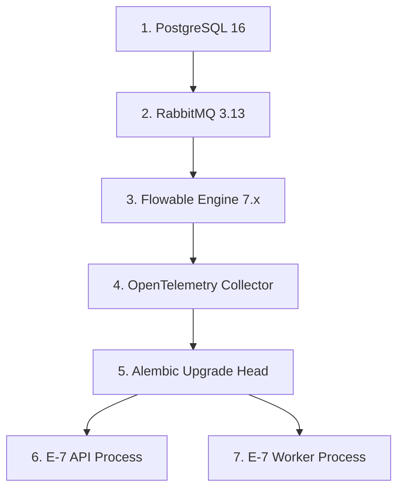

# E-7 Operations Engine — Production Deployment Runbook

**Document Version:** 1.0.0  
**Phase:** Phase 8F Canonical Production Documentation  
**Current Expected Database Migration:** `0014 (head)`  
**Overall Production Readiness:** `NOT_READY` (Blocked on external boundaries)  

---

## 1. Production Deployment Prerequisites

**Governance Classification:** `ORIGINAL_REQUIREMENT`

The E-7 Operations Engine requires the following baseline infrastructure:

| Component | Minimum Version | Production Role | Verification Command |
|---|---|---|---|
| **PostgreSQL** | 16.x | Primary System of Record & Credentials | `pg_isready -h <host> -p <port>` |
| **RabbitMQ** | 3.13.x | Event broker (AMQP 0-9-1) | `rabbitmq-diagnostics check_running` |
| **Flowable Engine**| 7.x | BPMN 2.0 / DMN 1.3 process execution | `curl -f http://<flowable>:8080/flowable-rest/service/management/engine` |
| **OTel Collector** | 0.90+ | Distributed tracing & metric aggregation| `curl -f http://<otel>:13133/` (health check) |
| **E-7 API** | Python 3.12 | FastAPI HTTP REST API server | `GET /api/v1/health` and `GET /api/v1/ready` |
| **E-7 Worker** | Python 3.12 | Background asynchronous event/solver processor | Process supervisor / systemd / k8s liveness |

---

## 2. Explicit External Boundary Blockers

The following external dependencies are currently **gated/blocked**. Deployment teams must retain these explicit blockers in production deployment planning:

### 2.1 Institutional MySQL Live Read Verification (`MYSQL_LIVE_READ_VERIFICATION`)
- **Status:** `MYSQL_LIVE_READ_VERIFICATION = BLOCKED_ON_COMPANY_READ_ONLY_ACCESS`
- **Owner:** Institutional Database Administration (DBA) Team
- **Current State:** Application-side read-only guards (`ReadOnlyDatabaseConnection`) with `SET SESSION TRANSACTION READ ONLY` and mathematical query models are fully tested and pass (`PASS`).
- **Requirement:** Database administrators must provision a strictly `SELECT`-only service account on verified institutional ERP tables (strictly the 11 approved active tables; the four conditional support tables are not part of the initial grant scope) before enabling live ERP synchronization. Do not execute migrations or alter grants directly.

### 2.2 Corporate Identity & SSO (`PRODUCTION_COMPANY_OIDC`)
- **Status:** `PRODUCTION_COMPANY_OIDC = BLOCKED_EXTERNAL`
- **Owner:** Corporate IT / Identity Team
- **Current State:** Production-grade Google Workspace OIDC authentication (`GoogleOidcVerifier`), subject-first identity resolution, and recycled-email account protection are implemented and pass unit tests.
- **Requirement:** Institutional IT provisioning of Google Cloud Console OAuth Web Client ID, authorized redirect URIs, Google hosted domain (`hd`) claim enforcement, and enterprise security review sign-off.

### 2.3 E-8 Notification Integration (`E8_NOTIFICATION_INTEGRATION`)
- **Status:** `E8_NOTIFICATION_INTEGRATION = BLOCKED_EXTERNAL`
- **Owner:** E-8 Platform Team
- **Current State:** Dual-transport dispatcher per ADR-012 (AMQP default broker `e8.notifications` with HTTP fallback) and dedicated `NotificationWorker` are implemented, registered, and verified with transactional inbox/outbox atomicity.
- **Requirement:** Provisioning of enterprise AMQP broker DSN, virtual host, dedicated E-8 broker credentials, and notification queue topology or authenticated HTTP endpoint.

### 2.4 Production Gateway & Edge Security (`PRODUCTION_GATEWAY`)
- **Status:** `PRODUCTION_GATEWAY = BLOCKED_ON_PRODUCTION_INFRASTRUCTURE`
- **Owner:** Cloud Infrastructure Team
- **Current State:** Application-layer capacity quotas (`TenantQuotaManager` with HTTP 429) and pilot reverse proxy (`e7-pilot-gateway` with NGINX rate limiting) are active.
- **Requirement:** Enterprise Edge Gateway / Ingress provisioning with TLS 1.3 termination, DNS routing, OWASP WAF rules, edge volumetric rate limiting, and public/private VPC network isolation. RabbitMQ broker readiness and network access policies are tracked as subordinate dependencies.

### 2.5 Google Calendar Integration (Frozen Baseline)
- **Status:** `GOOGLE_CALENDAR_INTEGRATION = PASS / FROZEN`
- **Current State:** Uses keyless Application Default Credentials (ADC) / OAuth2 service account. All integration tests pass. Configuration is frozen and production-ready.

---

## 3. Deployment Pre-Flight Checklist

Execute these checks sequentially prior to promoting code or starting application containers:

```bash
# 1. Environment Variable Presence Check (Zero Credential Value Echoing)
python -c "
import os, sys
required = [
    'E7_DATABASE_URL',
    'E7_RABBITMQ_URL',
    'E7_FLOWABLE_REST_URL',
    'E7_ENVIRONMENT',
]
missing = [var for var in required if not os.environ.get(var)]
if missing:
    print(f'PRE_FLIGHT_FAIL: Missing required environment variables: {missing}')
    sys.exit(1)
print('PRE_FLIGHT_PASS: Mandatory environment variables present.')
"

# 2. Database Connectivity & Alembic Version Check
alembic current
# EXPECTED OUTPUT: 0014 (head)

# 3. RabbitMQ Connectivity Check
python -c "
import asyncio
from app.events.rabbitmq.connection import create_rabbitmq_connection
async def test():
    conn = await create_rabbitmq_connection()
    await conn.close()
    print('PRE_FLIGHT_PASS: RabbitMQ broker reachable.')
asyncio.run(test())
"

# 4. Flowable Engine Connectivity Check
curl -s -u admin:test http://localhost:8080/flowable-rest/service/management/engine | grep "version"

# 5. Application Table Count Verification
python -c "
import asyncio, sqlalchemy as sa
from app.db.engine import DatabaseManager
async def check():
    db = DatabaseManager()
    async with db.engine.connect() as c:
        r = await c.execute(sa.text(\"SELECT tablename FROM pg_tables WHERE schemaname='public'\"))
        tables = [row[0] for row in r.fetchall() if row[0] != 'alembic_version']
        assert len(tables) == 26, f'Expected 26 tables, got {len(tables)}'
        print('PRE_FLIGHT_PASS: Exact 26 application tables confirmed.')
    await db.engine.dispose()
asyncio.run(check())
"
```

---

## 4. Database Migrations Execution Runbook

**Governance Classification:** `APPROVED_ADR_DECISION` (ADR-006)

1. **Pre-Migration Snapshot:** Always create a PostgreSQL snapshot / `pg_dump` backup prior to running migrations:
   ```bash
   pg_dump -Fc -h <host> -U <user> -d <db> -f pre_migration_backup_$(date +%Y%m%d_%H%M%S).dump
   ```
2. **Execute Head Migration:**
   ```bash
   alembic upgrade head
   ```
3. **Verify Active Migration Level:**
   ```bash
   alembic current
   # MUST report: 0014 (head)
   ```
4. **Rollback Policy:**
   - **Do NOT execute automatic `alembic downgrade` in production.** Downward migrations risk irreversible data loss for tables containing active production transactions.
   - If a migration fails mid-stream, halt startup and follow the Point-in-Time Recovery procedure: [`docs/phase-8/recovery/POSTGRES_PITR.md`](file:///f:/operations-engine/docs/phase-8/recovery/POSTGRES_PITR.md).

---

## 5. Component Startup Sequence

Components must be started in strict dependency order:



### 5.1 Temporary Availability Tolerances & Startup Semantics

- **PostgreSQL:** **Strictly blocking.** Hard dependency for canonical persistence and schema verification. If PostgreSQL is unreachable, API and Worker processes fail closed during pre-flight.
- **RabbitMQ Broker:** **Worker & Dispatch Blocking / API Non-Blocking (Degraded Asynchronous Mode).**
  * `API_PROCESS_BOOT_REQUIRES_RABBITMQ?` -> **NO.** API process boots and initializes telemetry without requiring RabbitMQ broker connectivity.
  * `API_READINESS_REQUIRES_RABBITMQ?` -> **NO.** `/api/v1/ready` probe verifies PostgreSQL availability and does not fail when RabbitMQ is unavailable.
  * `WORKER_PROCESS_BOOT_REQUIRES_RABBITMQ?` -> **YES.** `OutboxDispatcherRunner` starts the event publisher during startup (`await publisher.start()`); if the broker is unreachable, worker process fails fast.
  * `EVENT_DISPATCH_REQUIRES_RABBITMQ?` -> **YES.** Publishing events from the outbox to AMQP exchanges requires an active broker connection.
  * `DOMAIN_WRITES_CAN_PERSIST_TO_OUTBOX_WHILE_RABBITMQ_DOWN?` -> **YES.** Business domain mutations and outbox records persist atomically within the same ACID PostgreSQL transaction. In a broker outage, the API operates in degraded asynchronous mode: mutations persist to `outbox_events` and accumulate durably until RabbitMQ recovers and the worker drains the backlog.
- **OpenTelemetry Collector:** Non-blocking. If OTel is unreachable, API and Worker fall back to console logging and local counters without failing startup.
- **Google Calendar / E8 / MySQL ERP:** Non-blocking at startup. The engine boots successfully and logs connection retry warnings until external endpoints become reachable.


---

## 6. Service Launch Commands

### 6.1 E-7 API Process
```bash
# Production launch using Uvicorn with standard production settings
export E7_ENVIRONMENT=production
export E7_MOUNT_DOMAIN_ROUTERS=true
export E7_DOCS_ENABLED=false # Disables /docs and /redoc interactive endpoints in production

uvicorn app.main:app \
    --host 0.0.0.0 \
    --port 8000 \
    --workers 4 \
    --log-level info \
    --no-access-log
```

### 6.2 E-7 Background Worker Process
```bash
# Production launch for asynchronous outbox, scheduling, and workflow worker
export E7_ENVIRONMENT=production

python -m app.worker
```

---

## 7. Disaster Recovery & Recovery Drill References

For detailed recovery procedures validated during Phase 8D drills, consult:

- **PostgreSQL Full Backup & Restore:** [`docs/phase-8/recovery/POSTGRES_BACKUP_RESTORE.md`](file:///f:/operations-engine/docs/phase-8/recovery/POSTGRES_BACKUP_RESTORE.md)
- **PostgreSQL Point-in-Time Recovery (PITR):** [`docs/phase-8/recovery/POSTGRES_PITR.md`](file:///f:/operations-engine/docs/phase-8/recovery/POSTGRES_PITR.md)
- **RabbitMQ Broker Recovery & Mirroring:** [`docs/phase-8/recovery/RABBITMQ_RECOVERY.md`](file:///f:/operations-engine/docs/phase-8/recovery/RABBITMQ_RECOVERY.md)
- **Flowable Engine Recovery & Task Sync:** [`docs/phase-8/recovery/FLOWABLE_RECOVERY.md`](file:///f:/operations-engine/docs/phase-8/recovery/FLOWABLE_RECOVERY.md)
- **Worker Crash & Lease Reclamation:** [`docs/phase-8/recovery/WORKER_RECOVERY.md`](file:///f:/operations-engine/docs/phase-8/recovery/WORKER_RECOVERY.md)
- **External Integration Outage Recovery:** [`docs/phase-8/recovery/INTEGRATION_OUTAGE_RECOVERY.md`](file:///f:/operations-engine/docs/phase-8/recovery/INTEGRATION_OUTAGE_RECOVERY.md)
- **Auth Restart & Credential Cache Recovery:** [`docs/phase-8/recovery/AUTH_RESTART_RECOVERY.md`](file:///f:/operations-engine/docs/phase-8/recovery/AUTH_RESTART_RECOVERY.md)
